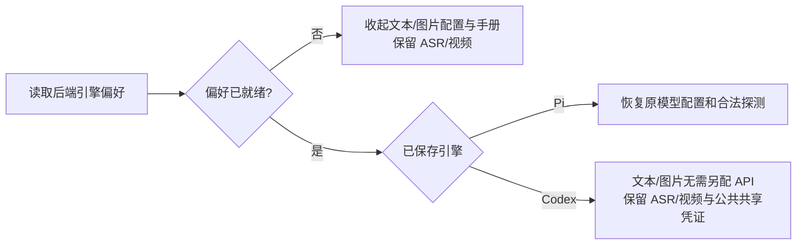

# T-1238 设置加载护栏与隔离 UI 探针独立复核

复核日期：2026-10-11。复核者：`engine_coverage_audit`。本轮仅读取源码与已发生证据，并新增本审查记录；未修改产品源码，未重复运行长测试、模型或浏览器。

## 结论

设置加载护栏、公开服务关联和 canonical 三方整合的源码复核通过。隔离 UI 探针新增发现的 `PR-001` 已修复；修后两份真实浏览器旅程和实际清理块的临时文件验证均已归档，本次只读查证后关闭该明确缺陷。真实文件验证覆盖 ready 前后编辑进入快照的情况，不代表两个进程在文件写回瞬间竞争的 E2E。

## 已复核的产品边界

以主工作区 `/Users/zyongzhu/Workbase/Thirdspace-creator` 的实际最终代码为 canonical，独立工作树中的新增 leaf 改动与测试用于交叉核对。

- `frontend/src/features/settings/settings-model-region.tsx:25` 的 `showIndependentModels=preference.ready&&!usesCodex` 统一约束来源提示、手册、文本卡和图片卡（`:76`、`:139`、`:141`、`:177`）。加载期间不先展示 Pi 配置；读回 Pi 后原表单恢复；Codex 保持免单独文本/生图配置。
- canonical `settings-model-region.tsx:34` 保留原稳定 `defaultProbe`，`:35` 明确加入 `preference.ready`，同时保留原渠道模型和受管额度禁用条件；`:155` 保留 `testSession={defaultProbe}`。未新增会话或供应商端口。既有 `model-connection-test.tsx:67` 的 enabled 失效处理、`:90` 的发送门和 `:98` 的晚回写归属检查继续生效。
- ASR 与视频的原 `capabilityCard` 调用不受独立模型门控制（region `:158`、`:187`），配置备份仍保留（`:200`）。Pi 已就绪时保留全部原公开用户凭证卡；加载期间或 Codex 下，仅按真实能力关联的服务 ID 保留媒体凭证，共享视频/文本服务不会因文本独立配置隐藏而被误删（`:26`、`:118`）。代码不按服务名称猜测归属。
- `settings-page.tsx:340` 的集合仅来自原本就下发的非 `activation_managed` 服务；`:350` 只恢复集合成员的能力关联 ID。未知或内部受管 ID 仍为 null；服务名称、provider、baseUrl 与 ASR 实现模型脱敏继续保留（`:351`—`:359`）。没有新增公开密钥、API 字段、服务权限或存储。
- 原公开 DTO 已有服务 ID（`contract/src/resources/settings.ts:60`）；原 PUT 仍使用服务端当前验签 authority 的 scope（`frontend/src/server/settings-channel-model-credentials-wrap.ts:87`、`:125`），拒绝不在当前完整能力服务集合的 ID（`:116`）及受管凭证手写 Key（`:119`）。该安全边界本轮未修改。

## 已发生的验证及其限制

读取 `settings-pending-guard-recheck.txt`：最终 leaf 命令实际退出 0，2026-10-11 20:58:36 的三个文件共 43 PASS、无 SKIP；命令为零重试，test/hook 预算 180 秒。原加载护栏红 2、凭证护栏红 4，以及公开映射红 1 / 29 个 selector SKIP 均保留；中间单文件 10 PASS 不与最终批次相加。

媒体用例现经真实 `sanitizeModelAuthorityForClient` 后渲染（`settings-model-region.codex.test.tsx:40`），覆盖同名不同 ID、文本/图片专用服务隐藏、default/video 共享服务保留，以及读回 Pi/Codex。投影用例覆盖公开成员、未知 ID、受管 ID 和供应商信息脱敏（`settings-page.test.tsx:158`）。这是隔离 React/接口夹具证据，不是账户真机或全系统 E2E。本审查没有自行重新运行 canonical 的 43 项、类型检查或浏览器；后续真实 pending UI 与清理证据的只读查证见下文。

## PR-001：探针的整文件回退可覆盖启动期间并发编辑

状态：已关闭。主线程已用提交 `ebd31b714` 修复，独立与 canonical 工作区均已同步；本审查已核实际修后代码，并读取下述修后验证工件。范围：验证脚本，不是产品引擎执行缺陷。

原 `docs/verification/t1238/run-ui-journey.cjs:16` 记录启动前 `before`；`:30` 在服务 ready 后记录 `generated`；原 `:47` 在 `current===generated` 时，把整个 `next-env.d.ts` 写回 `before`。`generated` 不证明这些字节全部由本轮 Next 生成，它也可能包含启动期间其他编辑者加入的内容。

具体反例：启动前文件为 A；启动期间 Next 写入本轮 routes 类型 import，其他编辑者同时加入注释 C；ready 快照和清理时文件均为 A + 本轮 import + C。此时 `current===generated` 为 true，整文件回退为 A，C 丢失。已按现有分支做纯内存反例复核，实际输出 `wholeFileRestoreTaken=true`、`concurrentCommentBeforeCleanup=true`、`concurrentCommentAfterCleanup=false`；没有读写真实元数据或启动服务，不能称为真实并发文件测试。

修复事实：当前 `:47`—`:48` 始终逐行仅替换包含本轮独有 routes 类型路径的 import，不再整文件回退。独立与 canonical 的该段实际一致。用同一反例做修后纯内存复核，结果为 `concurrentCommentRetained=true`、`originalTypeImportRestored=true`、`isolatedTypeImportRemoved=true`；这是分支行为验证，不是真实文件并发测试。此前已启动的旧脚本进程未加载此修复，其结果不计入新清理逻辑实证；后续新旅程见下列关闭证据。

### PR-001 关闭证据与层级

1. **真实隔离浏览器旅程**：独立工作树 `ui-cleanup-reviewed-final.txt` 与 canonical `integrated-ui-cleanup-reviewed-final.txt` 均记录完整旅程完成，主线程实际执行回执均为 exit 0。两边各自 `ui-final.json` 都是 10 个检查、`errors=[]`，观测时间分别为 `2026-10-11T13:29:51.282Z` 与 `2026-10-11T13:29:52.412Z`。两份结果均记录持有 1 个偏好加载请求、独立模型探测请求 0、模型控制未出现；这是实际浏览器与隔离服务的 pending 证据，故障状态包含明确故障注入，不扩写为全系统模型真机。
2. **真实元数据文件前后比较**：上述两份旅程日志的 `before`/`after` SHA-256 均一致：`tsconfig.json` 为 `895dc494185b91b5848eea41db3df0302d3406fc3bb98dbb4e8186e96f967b2d`，`next-env.d.ts` 为 `7ad303e40d4fddf44f156129e397511953a71481c5cfd86b1862649aaaf240cc`。这验证本轮完整启动与清理没有留下元数据字节变更；没有主动插入并发编辑。
3. **实际清理块 + 真实临时文件**：已读取 `ui-cleanup-concurrency-proof.cjs` 和 `ui-cleanup-concurrency-proof.txt`。脚本从当前 `run-ui-journey.cjs` 抽取清理循环并执行它，使用真实临时文件分别构造 `before-ready`、`after-ready` 编辑进入快照的情形；两项实际均保留 next-env 注释与 tsconfig 新字段并移除本轮路径，主线程实际执行回执 exit 0。日志清理块 SHA-256 为 `9098a652ad9f4f6c566ad94a9a20b837f4ad3abf1573e04a3ada1a7d81742ce1`，本次只读重新计算两工作区当前清理块均与之相同，确认执行的是实际修后块，而非另写的仿制 helper。

关闭依据覆盖原缺陷的明确快照反例，并有真实 UI 清理回归。第 3 项是串行构造文件状态后执行实际代码，不是两个外部进程同时写同一文件的竞争测试；因此不签“所有并发文件写回绝对安全”。本次只读查证没有重新运行以上长旅程或文件证明脚本。

其余隔离措施的源码范围：`:17` 用独立临时目录；`:22` 把缓存放入独有 `.next/<本轮目录名>`，`:25` 使用独立端口和数据库/媒体/登录路径；`:51` 仅删除本轮临时目录及缓存子目录，不删除其他 Next 缓存。`tsconfig.json` 整文件回退另有去掉本轮 include 后与启动前内容的等价检查（`:44`），比上述 next-env 分支更窄；有新增配置时保留当前解析内容再清除本轮 include（`:45`）。这些静态检查不能代替外部编辑进程与文件写回同时发生时的真实验证。

本报告不签 23 个功能族逐项账户真机、安装包上线或全系统全绿。

## 最后完整对账与日期单项补验只读核对

已读取 `reconcile-stable-final.txt`，并机械逐行核对真实 `[ERROR]`：最后完整 reconcile 的实际回执是 **exit 1、25 ERROR、0 WARN**，原记录保留。分布如下：

| 类别 | 原完整回执数量 | 当前归属与证据 |
|---|---:|---|
| BACKLOG 健康 | 1 | `backlog-health.mjs` RUNAWAY，控制面队列体积欠债；不能签健康门绿。 |
| 旧任务 review receipt | 19 | 缺事件、SPEC 过期、snapshot 不一致或未销账；任务 ID 列于下文，没有 T-1238。 |
| manifest 日期漂移 | 1 | 本次 DEC 为 2026-10-11，原 manifest 仍 2026-09-21；这是本次控制面问题，不能归旧债。已修正当前 manifest `project.updated_at` 为真实 2026-10-11，并单项补验通过。 |
| LED-052 | 1 | `full-led-052-remaining.txt` 实际 exit 1：缺显式 `CREATOROS_TEST_POSTGRES_URL`，原门拒绝运行。属于未满足隔离 PG 前置条件，不能用缺环境或 skip 宣称归档业务通过。 |
| LED-018 | 1 | `full-led-018-remaining.txt` 实际 exit 101：Cargo 缺真实 `binaries/creatoros-server-aarch64-apple-darwin` 构建资源，未进入完整桌面交付证明。 |
| LED-057 | 1 | `full-led-057-remaining.txt` 实际 exit 101：同一打包资源前置失败，安装完整性验收未通过。 |
| LED-053 | 1 | `timeout-current.txt` 完整验证实际 exit 1，22 条范围外静态短超时保留；后续分组测试绿不能取消静态失败。 |

19 个旧 review 任务为：`T-1072-owned-devices`、`T-1021`、`T-915`、`T-859`、`T-858`、`T-824`、`T-819`、`T-816`、`T-768`、`T-726`、`T-707`、`T-703`、`T-691`、`T-694`、`T-656`、`T-652`、`T-645`、`T-642`、`T-635`。已与 `review-audit-final-2.txt` 交叉读取；T-1238 原真实评审链错误没有出现在该最终清单，未把旧评审补造为 PASS。

`manifest-date-recheck.txt` 记录从原 reconcile 抽取执行日期护栏后的实际 exit 0 回执：`updated_at (2026-10-11) is >= newest decision (2026-10-11).` 本次读取当前 `orchestrator/ARTIFACT_MANIFEST.yaml:24` 确为 `2026-10-11`，原 `reconcile.mjs:702`—`:714` 比较的是 `DECISION_LOG` 真实 `Date:` 行；最新 `DEC-T1238-002` 正是该日期。**“剩余 24 项”只是原完整清单去掉这项已修复日期错误后的归属计数，不能写成再次完整执行得到 24 ERROR；没有新的完整回执。**

同一完整稳定对账日志中，`LED-014`、`LED-042`、`LED-047`、`LED-054`、`LED-058`、`LED-059`、`LED-061` 均为当场 `[OK]`，不是靠日期 helper 替代。范围外 24 项沿原 `T-1204` 跟踪；进度生成器的 `T-1026` 非法 write_set 失败另见 `progress-final.txt`，不重复计入上述 24，也没有手改 implementation 为 done。

有限复核结论：当前 T-1238 stage 已用合法 `passed` / `gate_status: pass`，真实合同评审事件可审，原相关 fixture、源码 CR-001—CR-005 与本审查 PR-001 均有修后证据。此次最后错误清单与当前控制面核对中，未见 T-1238 新增、未关闭的源码或控制面阻断。BACKLOG 此时仍保留 `🔨`、任务最终状态交主线程按 `taskctl` 与实际证据办理；本审查没有自行完成任务或绕过全局失败。上述结论不等于全局 reconcile 通过、未验环境已通过、23 个功能族逐项真机或安装发行版已上线。本轮未运行长测试或完整 reconcile，仅新增本节审查事实。
