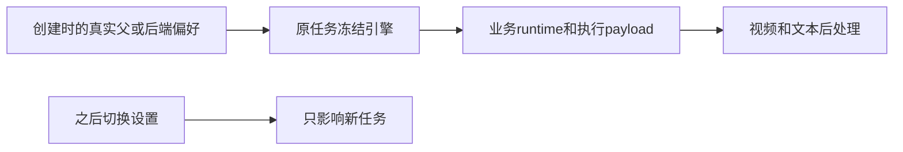

# T1238 原任务路由消费与继承

本文件记录独立工作树当场测试，未使用真实用户数据库/媒体、未调用真实模型、未发布。实现未提交。源码运行与安装版、实际Codex模型生成是不同证据，本文不代签后者。

## 修改

- 朋友圈创建读取后端偏好并冻结路线；Codex不读取独立文本供应商authority。
- benchmark纯ASR不申请文本Skill，仍冻结原任务的后续文本引擎。
- 调度创建按真实job、scheduledFor、用户和工作区查唯一automation_sync父，在Worker领取和后续attach之前冻结父路线；拒绝不唯一/错误父身份，跨用户、跨账号和错时刻不继承。
- 调度首次attach仅更新尚未领取、无调用的子任务，同事务更新execution payload与ai runtime；不改历史和已经领取的路线。
- 视频准备按原ai runtime，执行端口按原execution payload选择Codex；Pi解析携带真实aiTaskId，切换当前偏好不改已冻结任务。
- 转录文本后处理按原execution payload选择Codex，Pi resolver参数明确分开owner和AbortSignal；原保真、预算、未知结果和保存回放门保持。

## 当场红测

- `route-freeze-red.json`：13PASS/2FAIL/3SKIP。两个产品断言为子任务runtime未继承、已领取Pi被覆盖。三项未执行是新增测试夹具误用不存在的repository方法；保留原报告，改正夹具后单独重跑。
- `runtime-route-red.json`：0PASS/3FAIL，朋友圈、benchmark路由未冻结，视频逐Skill读取API resolver。
- `postprocess-route-red.json`：42PASS/2FAIL，新增Codex后处理未进入prepared；原bundle用例WORKER_EXITED。
- `scheduled-create-route-red.json`：3PASS/1FAIL，创建时未继承真实父引擎。

## 修复后实际结果

- `route-freeze-green.json`：62PASS/1FAIL，新增用例均通过；原转录bundle失败保留。
- `route-freeze-related-green.json`：54PASS/0FAIL/2SKIP，五文件覆盖路由冻结、调度原取消/恢复、后处理伪造拒绝、朋友圈模型业务、作品审核。两项是原PostgreSQL真实行锁条件用例未配置环境，并未删除或放宽。
- `video-original-route-green.json`：2PASS/0FAIL，实际数据库与执行lease端口验证Codex/Pi在偏好切换后保留原身份。
- `route-freeze-final-green.json`：6PASS/0FAIL，补跨用户、跨账号、错调度时刻拒绝继承后复验。

以上运行均`--retry=0 --maxWorkers=1 --testTimeout=180000 --hookTimeout=180000`。报告有重复覆盖，不能将这些数字相加冒充独立用例总数。

转录bundle原失败已定位：工作树当时不存在`ai-worker/dist/execution-worker.cjs`，`ls`返回ENOENT且Node导入MODULE_NOT_FOUND。需要真实构建后重跑原完整测试；本文未把缺失产物记录成产品链路PASS。

`route-consumer-typecheck.log`实际exit2，有23行错误；没有本分工文件/新增测试错误，集中同轮其它文件和同步知识旧deps测试。全局类型未通过，不签全绿。曾拟停止重复typecheck以减并发内存，但工具调用时其进程已结束，原exit2保留。

本分工文件`git diff --check`通过。未更改原终态、预算、取消、保真或原公共链断言；未签全部入口及真实Codex可用。
