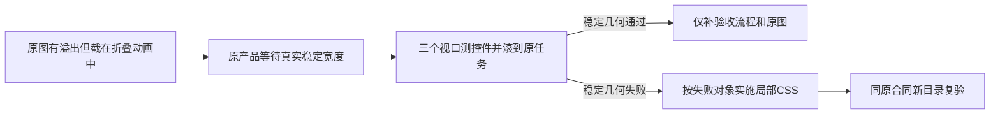

# T1245 自动化窄窗口：只读诊断与准确候选

结论：先给原产品补稳定观察和实际滚动截图，再由真实结果决定是否改 CSS。当前没有证明必须修改全局 shell。原3938的功能 PASS 保留；原390截图确实不适合签窄窗口任务操作可达。本文是候选准备，不是产品实现或新浏览器 GREEN。

本次按 oil-ui-pro 0.10.0 的存量局部修复路径和账号组 UI_RULES 审核，正式品牌、字号、间距、边框、圆角和按钮状态均沿用。product-to-code-orchestrator 与项目过程均3.29.0，无版本漂移。仅写本任务验证目录，未运行 Next、DB、模型、测试或全局 Gate。

## 已核的真实证据与消费者

亲看3938的1536×1024运行详情图和390×844刷新图。后者账号 select 超出面板，快速创建标题逐字挤列，原作业未进入画面；不能据此签窄窗口扫码按钮可达。桌面图可读缺绑定错误，不代表真人账号绑定成功。

原 trace 的 `call@873 setViewportSize` 起止为36479.709/36508.139ms；`call@875 screenshot` 起止为36550.512/36582.074ms，截图开始距视口调整开始70.803ms。Sidebar 的真实 `matchMedia(max-width:1024px)` 会收拢，原类名 `transition-[width] duration-200` 保留。故约150px栏位与过渡阶段相符，不能冒签其为稳定宽度或全局侧栏 bug。完整白名单时序与 trace SHA 在 `original-animation-observation.json`；不推断截图内部曝光的精确时刻。

`sidebar.tsx` 稳定折叠是 `w-16 px-2`，展开使用正式 `--creatoros-sidebar-width:224px`；主题注入只写颜色，没有宽度。`app-shell.tsx` 主框及内容已有 `min-w-0`，`PageScrollArea` 是唯一页面滚动区；`scroll-area.tsx` 已把 Radix 内容 wrapper 改为 block/w-full/min-w-0。不能为该截图去改共享导航、tokens、侧栏偏好或 ScrollArea。

局部源码的确定风险是：`automations-island.tsx:1907` 的 flex 筛选中 label/select 保留内容最小宽度；`max-w-full` 本身没有给账号 label 可收缩宽度。`:1550` 快捷卡固定图标/标题/状态三列，auto 状态列会挤压标题；标题栏的 min-w-0 只允许被挤，不保证可读。`:466` JobRow 已有一列→两列→四列响应式，不需要重做布局；账号 badge 和完整错误字符串仍需检查自然换行。`:1339` 运行标题紧邻绝对定位关闭按钮，长作业名应实测文字范围与关闭区是否重叠；运行状态/日期/结果目前在同一 nowrap 方向排列。后两项是需补覆盖的风险，未用原未出现的窄 Dialog 或任务行捏造实际失败。

## 精确候选文件与实施阶梯

1. `automations-run-now-layout.candidate.ts` 是原 `frontend/tests/e2e/automations-run-now-public.spec.ts` 的完整候选。只增加 type import、私有几何/截图 helper 和一次 helper 调用；逆去新增片段后与原源逐字节相等，见 `original-preservation.json`。原标题、数据、所有 API、UI启用/唯一 runNow、状态/原ID全值比较、错组404、扫码文本、原两图均保留。
2. root先独评/绑定该测试，再在原产品上单次3939实际运行。先等待 sidebar 的真实 collapsed 属性与目标宽度连续两次采样稳定，不用固定200ms sleep；再测390/900/1536、真实滚入原 job。若稳定几何全通过，产品保持原样，收口的是验收截图流程；不得为瞬态原图硬改 CSS。
3. 只有稳定布局出现具体 RED 后，才选择 `automations-local-css.candidate.patch` 对应失败族。该 patch 是待验参考，**当前不应用，也不要求整份同时实施**。未来唯一产品点是 `automations-island.tsx`；自动化 server page、shared shell/sidebar/Dialog primitive、API、状态、效果、计时、事件和轮询接线不改。若稳定栏宽无法满足当前真实声明，先重新诊断，不能偷加 shell 写集。

CSS候选的具体选择：

| 真实失败对象 | 局部 CSS 候选 | 保留边界 |
| --- | --- | --- |
| 筛选 select 超出面板 | 小于sm时 label纵排，select w-full/min-w-0/max-w-full；sm恢复横排，父flex min-w-0；长组名/账号卡可换行 | 平台/账号选项、value/onChange、共享任务规则不改 |
| 快捷标题逐字挤列 | 小于sm时图标+标题两列，状态标签移到标题下方，说明仍在标题列；sm恢复原三列 | 三模板真实筛选、已存在启用/定位及新建动作不改；不藏标签、不缩字 |
| 原任务 badge 越界 | badge max-w-full/flex-wrap，账号长ID overflow-wrap:anywhere | 原行grid、开关/编辑/扫码/运行按钮与禁用条件不改；动作行本就wrap |
| 运行 Dialog 标题/状态越界 | 标题换行、图标shrink-0，header保留关闭区；小于sm运行摘要wrap、结果另行，长错误换行 | 原Dialog和body内部滚动、Escape/close、历史读取及无重叠轮询不改 |

该候选没有新颜色/字号/token、隐藏功能、业务词意判断或额外执行权。桌面筛选和快捷卡通过sm恢复现状，原xl任务四列不动；Dialog给关闭区留位属于防覆盖，仍须新桌面原图验证。新建/编辑表单的既有业务没有变更；本轮只检查原行编辑入口可达，不冒签所有编辑表单和保存族。

## 新增覆盖的准确边界

候选在原刷新窄图之后、原公共终态和错组断言之前调用几何 helper。每个视口都等待稳定侧栏，检查真实 Radix viewport 无横向撑开；select在真实面板和视口四边内，保持可用。当前 `intent.ts` 只有三个模板，实际可见模板逐个检查，异常超上界会失败，不截断洗绿；标题栏至少容纳四个现有字号汉字，避免逐字竖排，这只是几何判据，不替代亲看原图。

原行 switch/编辑/扫码分别真实 scrollIntoViewIfNeeded 后检查可用、完整几何，**不点击扫码、不提交编辑**。运行详情由原行作业名真实点击打开，核唯一原needs_reconnect项、真实点击该历史记录button后核原固定错误；文本 Range 四边在 header内且不覆盖关闭按钮，关闭/错误正文可见。各视口按 Escape 退出再观察下一视口。该过程只重读历史，不再运行/新建任何任务；最后原三层全值和唯一runNow计数继续原样断言。

新增12张 `testInfo.outputPath` 原PNG（每视口筛选/快捷/原job/原run Dialog）和一份白名单几何JSON；不覆盖3938或固定图库图。短窗整段内容不能同时上屏，逐对象滚动和几何与截图分别存证；不能拿一张顶部图代签所有按钮，也不能把截图中的0或待扫码状态叫采集成功。JSON无cookie、token、prompt或签名URL。没有新增主动公共readback请求；原末尾公共回读仍证明同ID及状态。

## 真正的静态预算与待验项

`candidate-budget-analysis.mjs` 只解析候选TypeScript AST，没有运行候选或服务。语法diagnostics=0，原30轮×10槽=300；新增固定3视口、2筛选、最多3模板、3原行控件均展开，各 helper也展开。含重复同promise finally、条件分支、截图/附件等保守计 **643槽×120秒=77,160,000ms（21小时26分）**，24小时case留2小时34分。这里按同一poll整体deadline和其真实回调边界保守计槽，没有把interval当执行限时，也没有称文件写入或DOM同步遍历拥有SDK120秒自动上限。

API request/action/nav/context/expect沿原120,000ms，新增poll明确120,000ms和原保守间隔，新增截图明确120,000ms。共享config保持原样；root命令必须保留 `--timeout=86400000`，case24h、driver120h，才避免SDK calculateMaxTimeout 任一0即返回0的无限AfterHooks声明。原四个24h声明槽加300秒启动为96h5min，driver余23h55min；本次不能重新宣称24h driver覆盖全部cleanup。外层只是有限验证观察，不续生产原task期限、不重发任务。

AST结果在 `candidate-budget-analysis.json`；其中真实caseCount=1、候选SHA固定。未跑eslint/tsc/浏览器/Gate，不能将syntax0写成类型或GREEN。独评通过后root还需绑定正式test、实际静态/type、源冻结及唯一运行；候选作者不能独自签实现准入。

## 当场锚点

- SPEC（含动态诊断更正）：`3d2dfa2118f9c49c96ae2c0e136c7249e48a52b076d9dc4cc8d96b10952d3379`。
- 原product island：`d353ca9926198b0f58c3f2eeffe12ca8f466812162357d36d18f2eb96fd841f1`。
- 原test：`608b6a00686d566f444115c125c8ced563843dd381fc9c592bd99ee7bd789d80`。
- 准确完整测试候选：`748976450dc39d1f59991c79a624775cd993ffc6cd5e57b36c27cb635cf0e1a7`。
- 原trace：`a7bc8752bd46e638d4a0c812df9c3ec580f2c7ec9e1bb45b0656f7f1a749b8f8`。

本次仅候选研究完成；T1245产品CSS是否需要、稳定布局新实际结果均待验。既有全局失败、T1227暂停、安装版/native/真实平台授权与模型不在本轮签证范围。

## 候选当场接线纠正（未运行）

独评者发现首稿4f3a1b…打开旧行详情后直接等error不成立：真实openDetail清detailRunId，RunDetailDialog会selectedRunId=null；只有选中历史记录才渲染error。准确候选已在唯一run项count断言之后追加一次真实记录button点击，再等原错误；只读已有历史，不调用runNow。已重新逐字逆恢复原测试、重算643槽并更新上述最终SHA。此为候选静态纠正，未伪称当场浏览器FAIL/GREEN。
