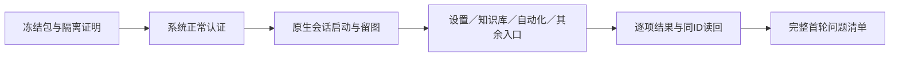

# T-1246 原生开发 App 自动验收用例

2026-10-11。依据 `docs/features/t1246-integrated-dev-package-acceptance.md`、当前公共界面源码及 T-1238 功能矩阵编写。这里是验收用例，当前没有原生会话、App 操作或 App 截图，全部操作用例待执行。历史 T-1207 初始化失败保留，不能直接判定本轮失败；环境当前事实见 `app-environment.json`。

给人看的流程：先确认拿到的是本轮开发包，并确认运行它不会碰真实用户资料；系统正常认证后，AI 在这个 App 内逐项操作、读回、截图。失败保留原任务和日志，完整首轮结束后再集中修复。

## 运行准入与证据规则

- 由主线程提供冻结 commit、App 路径、版本、SHA 与打包回执；先读 Info.plist 和签名，再核实际运行进程可执行路径，不能只按同一个 bundle ID 猜包版本。原安装留存，不操作 `/Applications/CreatorOS.app`。
- **数据隔离尚未证明**：当前 Rust `frontend/src-tauri/src/lib.rs:2381` 从 Tauri `app_data_dir()` 建库；`:2394` 建日志、`:2403` 处理待执行重置、`:2543` 解析 master key，`:614` 使用 machine-id，`:2591` 使用 license，`:2721`/`:2732` 使用登录目录。`:2835`/`:2836` 覆盖 sidecar 的数据环境变量。因此仅给 Appium `appPath` 或传 `PGLITE_DATA_DIR` 不能证明 shell/激活/凭据隔离。不得变更产品 bundle ID、激活、keychain、TCC 或真实用户库来制造准入。
- 当前 `automationmodetool` 无参数实测为 disabled、需要用户认证。正常授权由 XCTest 初始化的系统提示完成；等待主线程确认用户可响应。真实 man 没有普通 enable 子命令；不调用任何免认证开关，不代填系统密码。
- 独立 `/tmp/t1246-appium` 工具运行时，不加项目依赖。按实际锁定驱动检查 capability。`noReset=true` 时 `environment` 与启动参数不生效，不能以此声称新进程隔离。`skipAppKill=true` 保留其他运行实例；测试结束仅清理明确归属本轮的 session/server/进程，无法证明归属则保留并报告。
- 每个正 HTTP/probe/原生命令预算至少120秒；WDA 启动预算600秒；建会话 HTTP 预算900秒；独立 Appium 外层至少1800秒覆盖编译、授权等待、启动和清理。完整旅程的外层依实际串行用例数量留足预算；retry0。观察到期限耗尽后读回原 ID，不新发同一业务任务。
- Appium 原生元素树与截图用于 App 证据；WebView 可访问性不足如实登记，不能改用浏览器 DOM 冒称原生通过。坐标操作只用当前截图/元素几何、每步留图，不使用盲猜坐标。
- 每条用例保存开始/结束、包 SHA、sessionId、操作结果、原生截图与必要 XML。写操作另保存原 resource/task/execution ID、公共后端同 ID 读回及隔离库范围。凭据和激活材料不进入报告。
- 正常、空态、明确拒绝、环境阻塞分别记录；真实模型与受控故障注入分别标注。旧截图/历史 fixture 不覆盖本轮验收。

## 用例矩阵

以下所有行初始状态都是 `pending`。UI 名称依据现有界面；执行时先取真实原生树，找不到合法可操作控件即记录失败或可访问性缺口，不编造操作。

| ID / AC | 前置与原生操作 | 应观察的结果与证据 |
|---|---|---|
| APP-01 / 1、2、5 | 核冻结 App/Info.plist/签名/SHA；隔离证明齐全后创建 mac2 session，读取进程路径和窗口树 | 实际本轮 App；session 真建立；启动页 PNG/XML；启动失败保留 Appium/WDA/xcresult 原日志 |
| APP-02 / 3、5 | 点击当前侧栏各入口：账号组/工作台/知识库/素材/自动化/设置及当前目录内其他入口 | 每入口可见真实标题和内容/真实空态；无启动卡死；逐页截图；不存在的入口单独登记，不捏造菜单 |
| APP-03 / 3、5 | 在隔离环境无独立文本/图片 Key 时打开设置，观察偏好加载过程与完成状态 | 加载期间不出现独立文本/图片卡/手动探测；保持媒体按需入口；完成后状态来自服务，不用固定等待截图代替状态观察 |
| APP-04 / 3、5 | 设置选择 Codex，保存，导航离开后返回并刷新 | 后端 preference 同用户读回 Codex；无独立文本/图片 Key 要求；本地登录/能力状态诚实；原生截图和公共读回 |
| APP-05 / 3、5 | Codex 下检查 ASR/视频服务，含同一个服务同时关联 default 和 video 的合法隔离样本 | 仍可配置公开关联 ASR/video；只用于文本/图片的服务不显示；不按名称猜关联，不恢复 secret/provider/baseUrl 脱敏字段 |
| APP-06 / 3、5 | 切回 Pi 并保存、刷新，随后切回 Codex | Pi 原文本/图片模型卡、连接探测操作仍存在，ASR/video 保留；无 Key 的 Pi 如实未配置；两次偏好读回；不擅加 Key或调用外部供应商 |
| APP-07 / 3、5 | 设置宽窗口与 App 实际支持的最窄窗口重复 APP-04～06 | 无遮挡/横向溢出，保存/选择/媒体操作可点；记录实际窗口尺寸，不把浏览器390px冒称原生窗口390px |
| APP-08 / 3、5 | 在隔离服务允许可恢复故障注入时，保存偏好触发明确拒绝，再移除注入读回 | 失败提示可见且原保存值不被覆写；注入方式/原响应记录；无法合法注入时本例未验，不改冻结源码 |
| APP-09 / 3、5 | 知识库空库打开；用“添加资料”填写资料标题、完整原文、出处，保存 | 真实空态；生成原资料 ID；同 ID 公共读回、原文一致；原生保存前后截图；只写隔离库 |
| APP-10 / 3、5 | 原资料打开阅读完整原文；编辑原文、保存新版本、导航与刷新 | 原资料 ID 保持，revision 按真实合同变化；阅读/编辑内容一致；刷新不丢失；截图与版本读回 |
| APP-11 / 3、5 | 知识库创建文件夹、移动原资料、筛选类别、搜索；空搜索再清除 | 公共归属/文件夹读回一致；空结果真实显示0，清除后原资料可达；不得由显示名冒称 ID |
| APP-12 / 3、5 | Codex 无 Key 从实际知识归类入口发一次任务；保原任务观察并读回候选 | 原 aiTask/execution 引擎 Codex；无需独立文本配置；有真实模型回执才签模型通过；采纳由公共端口落库；超时不重发 |
| APP-13 / 3、5 | 全文蒸馏、关联、评论提炼的当前真实可见入口分别记录；若可操作各发独立明确任务 | 每类记录独立原 ID、引擎与结果；无入口/缺依赖/未获有效结果分别记录；APP-12 不能代签其余三类 |
| APP-14 / 3、5 | 打开素材空态、添加本轮临时 PNG；从实际入口理解/分类，独立生图和参考图各一次 | 原 group/file/version 与原任务保持；候选采纳及下载原 bytes/checksum；每类分别证据；未执行不得拿 T1238历史绿代签 |
| APP-15 / 3、5 | 在隔离组 A/B 各开知识/素材/自动化；切组后刷新、打开详情 | 只出现合法本组数据，原任务按原 owner 读回；拒绝越组不被改成空成功；跨组负例需实际合法端口构造，禁止读真实组 |
| APP-16 / 3、5 | 自动化组含两平台/三账号、一个无计划账号及 disabled jobs；宽窗口用“筛选媒体平台”“筛选平台账号” | 筛选真实生效，组共享任务保持，账号计划状态诚实；原 job ID 读回；不启用真实采集/发布任务 |
| APP-17 / 3、5 | 自动化详情打开后点可见“关闭”；通过同页链接再打开；点击真实筛选导航 | 关闭按钮可达可用；本地弹层操作不等待整页加载；详情归属正确；保截图与原 job/run ID |
| APP-18 / 3、5 | 最窄 App 窗口重复平台/账号筛选、长名称任务、详情关闭和空筛选清除 | 筛选控件及弹层标题不挤出窗口，关闭仍可点击；任务不丢失，清除筛选恢复原行；记录真实尺寸 |
| APP-19 / 3、5 | 自动化的已有/新增表单、disabled 开关、频率读取和刷新，仅在隔离 disabled 样本操作 | 保存同 job ID、频率和 group/account 不偷换；不产生真实平台动作；功能失败截图/响应均保存 |
| APP-20 / 3、5 | 工作台/聊天读取、候选查看；实际可见创作入口目录与23功能矩阵逐项对应 | 聊天本身与工具子任务分别列原 ID；文章/图文/封面/脚本/选题/复盘/转录/渲染等每族签实际状态；入口可达不等于模型整链通过 |
| APP-21 / 3、5 | 用原生成任务在途时切引擎、刷新，再读原任务；恢复只访问已知原任务 | 原冻结 Codex/Pi保持；新设置只影响新任务；未知/partial/failed 诚实；不自动新发；缺原任务或恢复条件则未验 |
| APP-22 / 5、6 | 保存本轮首轮完整清单；删除本轮 session、关闭归属已证明的测试 server；核数据/安装保护 | 每个用例有 PASS/FAIL/pending 与截图/日志索引；未建 session 不编造 App 图片；原安装/真实数据未改；后续修复重包单独回执 |

## 功能族覆盖如何计数

本轮 `COVERAGE.md` 的23行是公共功能族来源，不能用 APP-02 入口巡检、APP-12 单次知识归类或一个原生 probe 代签全部功能。浏览器代理负责完整既有 E2E；原生执行代理在 APP-20 下补逐族实际子记录，区分入口可达、隔离公共整链、受控外部 fixture、官方 Codex 调用。原生不可访问的任务仍保留未验，而不是删掉范围。ASR 与视频供应商仍按现有按需配置合同，不能因 Codex 隐藏独立文本/图片卡把它们误判为免配置。

## 当前环境与资料来源

- `app-environment-preinstall.json/.txt` 为本轮新实际探针，临时旧运行时不存在与当前 disabled 事实均非历史推断。
- 安装后首次显式隔离 APPIUM_HOME 的 doctor 因 driver 未登记实际 exit1，原 `app-environment-installed.json/.txt` 保留；本地锁定4.3.6登记后 `app-tools-register.txt` exit0，`app-environment-installed-registered.json/.txt` 中 doctor exit0、0项必需修复、1项需要用户认证的可选警告。未执行 doctor 建议的免认证开关，不能从 doctor exit0 推定原生会话成功。
- 正常系统提示以用户真实响应为准；缺认证与未证明 shell 数据隔离仍是准入前置，不是产品功能 FAIL。
- [Appium官方 Mac2 环境准备](https://appium.github.io/appium-mac2-driver/latest/getting-started/)、[capabilities](https://appium.github.io/appium-mac2-driver/latest/reference/capabilities/)，以本地实际锁定4.3.6源码再核消费者与默认值。
- 当前源码：`frontend/src/features/settings/settings-model-region.tsx:25` ready/卡片护栏；`:34` defaultProbe保留；`settings-page.tsx:340`公开 serviceId 映射；`frontend/src/features/automations/automations-island.tsx:1910`/`:1916` 两筛选，详情及窄窗布局按整合后实际包核对。

当前结论：**用例已准备，原生 App 待验；不签本轮包、全系统或23功能逐族真机通过。**

## 用户决定与执行状态更新

2026-10-11 主线程传达用户明确决定：**暂不授权原生 App 操作与系统认证**。本轮 native 状态为 `blocked`（验收前置未授权，不是已执行的产品失败）。APP-01～22均未运行，无 session、App启动或App截图；不得触发认证提示或继续原生执行。工具准备与首次环境失败/修后doctor回执全部保留；浏览器及四包单元/集成验证另有独立证据，不能代签 App。详见 `app-results.json` / `app-results.md`。
