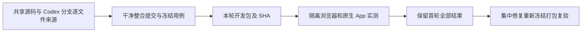

# T-1246 独立规格与来源首评

评审日期：2026-10-11。机制：独立子 Agent 按 `product-to-code-orchestrator/prompts/spec-reviewer.md` 进行只读规格评审，并核查真实 Git、文件 SHA 与已有打包/测试消费者；不使用作者自评替代证据，不输出 Gate verdict。本次只保存此报告，未改源码、BACKLOG 或任务状态，未运行打包、长测或 Appium。

被审规格：`docs/features/t1246-integrated-dev-package-acceptance.md`，SHA256 `8a4e5ed7ace44905c885410f02e9d1475d49383ff854856342bdea62b8416635`。宪法：`docs/产品定位.md`。技能与项目安装版本均为 `3.29.0`；实际 `context-plan` 返回 `4-build`、`compat-full`。本次为该任务实施前独立评审，不代签 BUILD/SHIP 完成。

## 规格结论

未发现需要修改已确认规格才能继续的阻断问题。用户已授权整合、开发包、子 Agent 实测、首轮问题记录及确认缺陷集中修复。规格明确保留来源、原断言和历史失败，要求先完整首轮再退出冻结集中修复、重新打包、原例复测；没有把公开发布、真实平台发布或激活绕过纳入授权。Appium 权限/驱动不足与覆盖缺口必须记录为未验，不构成成功。本结论不表示所有 AC 已经满足。

范围与验收可追溯到 AC-1246-1 至 AC-1246-6：来源与冻结、真实包身份、全部入口用例、公共浏览器业务链、原生 App、首轮失败与修复后再验分别有明确产物和责任人。数据隔离、同 ID 回读、受控外部 fixture 与官方 Codex 真调用的证据范围已明确。新增 UI 修复仍遵循既有 oil-ui-pro 和实际视觉/操作证据要求，本次不冒称已完成视觉审查。

```json
{
  "schema": "spec-review-round/v2",
  "review_kind": "initial",
  "summary": "整合、冻结、真实开发包、公共浏览器与原生 App 分别验收、首轮记录及集中修复的范围和授权明确；未发现规格阻断。来源候选、测试运行配置与原生数据隔离仍需按已确认 AC 在执行前核实，本轮不代签任何执行成功。",
  "findings": []
}
```

## 来源独立核查

本次 Git 实读共享 HEAD 为 `4df3424972831acfdd091056b3045b2472120692`，`codex/local-codex-unified-engine` 为 `5dfd1c706fe8deb661f96c3ebc9fb8b8b30c91fd`；merge-base 等于共享 HEAD。共享目录有大量实际未提交与未跟踪工件，不能仅用 HEAD 或 `git diff` 的跟踪文件清单代表当前产品源码。

逐文件复核 `source-inventory-before.json` 的 253 个源码条目：当前文件 SHA 全部匹配该清单；其中 209 个再与 Codex 分支 `git show` 字节独立比较，全匹配。其余 44 个是当前共享源码与 Codex 分支不同的版本，其中包括 Worker 正文/恢复兼容、情报、媒体目录隔离、主题初始化、设置/模型连接与 Skill、素材/稿面、自动化及公共 E2E。不能把这些差异按旧分支整文件覆盖，也不能仅凭“另一个会话已完成”给所有文件签验收。它们的具体来源与用户范围由主 Agent 在候选来源清单中绑定；已完成会话的代码与未完成/待授权研究仍按规格区分。

T-1245 `browser-3942-config-stable/REPORT.md` 所记自动化产品 SHA `96c88efdb8cd8d2ad4fa2e13e7450f6ac3a472c588eae72c722e113e1085e865`、公共测试 SHA `748976450dc39d1f59991c79a624775cd993ffc6cd5e57b36c27cb635cf0e1a7` 与共享当前清单匹配。只读 diff 确认保留了窄窗筛选纵排/收缩、运行详情标题避开关闭区的改动。该历史报告证明的是隔离组内单次触发、待扫码、刷新同 ID、错组拒绝与三档窗口；它明确没有证明真人平台登录/采集、模型生成或已安装 App 操作，不能把其历史浏览器结果换成 T-1246 包验收。

## 执行前需要核实的已有合同

以下是实际消费者约束与待核项，均属于已确认 AC 的执行落实，不是新增审批或规格扩张：

1. **打包与原安装保护。** 入口实际位于 `frontend/package.json` 的 `desktop:package-local`，调用 `frontend/scripts/desktop/package-local.mjs`。其默认完成后会删除并替换 `/Applications/CreatorOS.app`，随后 `open` 启动；没有保留旧安装备份。脚本已有 `CREATOROS_LOCAL_SKIP_INSTALL=1` 分支，可先仅构建本轮包。执行安装前必须落实 AC-1246-5 的原安装备份及隔离，不可把脚本默认行为当作已经符合这两项要求。构建密钥只经既有入口读取，不复制到整合源码或证据。开发包已有 ad-hoc 签名边界，不能称 Developer ID/公证发布。
2. **原生隔离不能照搬 Web 环境变量。** `frontend/src-tauri/src/lib.rs:2381` 从 Tauri `app_data_dir()` 确定 DB 与根目录；其后向 sidecar 注入固定的 `CREATOROS_APP_DATA_DIR`、`CREATOROS_DB_DIR`、认证和日志目录。只给外层 App 设置这些同名环境变量，不能证明 Rust 根已经隔离。原生代理应先证明本轮实际运行身份及应用数据根不会触及用户库、激活、认证目录；没有合法机制时保留前置未满足与原日志，不启动用户库。macOS 系统认证、辅助功能或驱动不足不能通过修改安全/激活门消除。
3. **Playwright 默认配置不足以直接签本轮 AC。** 当前 `frontend/playwright.config.ts` 已使用 fresh PGlite、媒体和登录态，`reuseExistingServer:false`。但默认截图为 `only-on-failure`，trace 为 `retain-on-failure`，CI retry 为 2，未设置全局最少 120 秒的 expect/request 与 180 秒 test/hook。因此本轮运行前须冻结明确的实际命令/运行配置、成功截图和 trace 采集、retry0 与完整外层预算；既有局部显式预算也要核实际消费者。保留原断言，不能在首轮中改源或改断言抹掉失败。
4. **冻结与结果身份仍未验。** 当前来源快照字节无漂移，不等于已存在干净整合 commit、四处版本回执或本轮包 SHA。测试代码、运行配置、公共入口清单、整合 commit、App/DMG 必须绑定同一轮候选，完整首轮的 FAIL/前置/缺口先归档；修复后重新冻结和打包，原例保留并复测。原 reconcile 欠债不能由局部结果替代，未实测平台与权限不足仍保持未验。



## 待下一次复核

收到隔离整合工作树路径及冻结清单后，仅复核来源选择、字节漂移、commit/测试/包身份与上述执行前置；本轮未开展实际用例执行，没有伪造测试或打包 PASS。现有 209/44 统计只针对来源清单内的 253 个变动条目，不代表全仓所有文件已完成审查。
