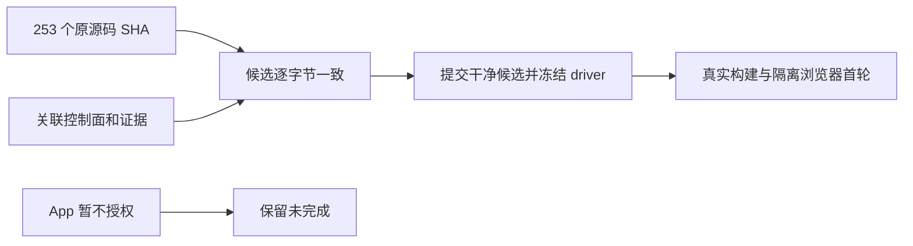

# T-1246 整合来源独立复核

2026-10-11，独立子 Agent，只读 Git/文件/消费者核查；仅保存本报告。模型设置继承父任务，具体型号无法独立核验，记为 `unknown/inherited`。本报告不代签构建、运行、App 或完整验收。

## 实际检查结果

候选工作树：`/Users/zyongzhu/.codex/worktrees/integrated-dev-acceptance/Thirdspace-creator`。当前分支 `codex/integrated-dev-package-acceptance`；复核时 HEAD 仍为 `4df3424972831acfdd091056b3045b2472120692`，候选尚未提交冻结。来源 Codex SHA 为 `5dfd1c706fe8deb661f96c3ebc9fb8b8b30c91fd`。

独立用实际文件字节核查 `integration-snapshot.json` 和 `source-inventory-before.json`：

| 核查 | 实际结果 | 证明边界 |
|---|---|---|
| 来源源码 253 条均进入复制清单 | 0 缺失 | 包括未跟踪源码与测试，不以共享 HEAD 替代真实文件 |
| 候选源码 vs 原来源 SHA、复制 SHA | 0 不匹配 | 253 条均为共享当前版本 |
| 全部复制条目 1,149 条 vs 当前候选 | 0 漂移 | 包括关联 SPEC、控制面和必要 probe，不包含本报告等后续验收产物 |
| 来源分类 | 209 条与 Codex 分支同字节，44 条保留共享最新差异 | 209 条已在首评独立 `git show` 比较；本轮候选再次与这些原 SHA 匹配 |
| 产品目录复制清单外源码 | 0 | `ai-worker`、`backend`、`contract`、`frontend` 的候选 Git 变动均在 253 条内；浏览器生成副本单列 |
| 原构建和 Rust 配置变更 | 无本任务额外变更 | 桌面 Worker 打包消费者改动属于原 253 条 T-1238 写集，不称整个 desktop 目录未改 |
| 敏感数据路径 | 未发现 `.env`、`.auth`、PGlite、凭据、激活文件、master-key、构建 key、PEM、SQLite 文件进入复制清单 | 限于复制清单路径/扩展名核查 |
| 明显密钥内容模式 | 0 命中 | 对复制文本检查私钥 PEM、长 OpenAI/GitHub/AWS key 模式，仅说明这些模式未命中，不声称完成全面安全扫描 |

复制分布为 `ai-worker` 55、`backend` 123、`contract` 10、`frontend` 65，共 253 条源码；其余 `docs` 421、`orchestrator` 471 和四个根控制文档。probe 为 441 个 JSON 与 1 个 Markdown。没有发现清单外研究源码、用户数据库或认证目录被并入；相关历史研究文字只是来源/协议证据，不据此扩大已确认实现范围。

## T-1245 与控制面真实性

`frontend/src/features/automations/automations-island.tsx` 实际 SHA256 为 `96c88efdb8cd8d2ad4fa2e13e7450f6ac3a472c588eae72c722e113e1085e865`；`frontend/tests/e2e/automations-run-now-public.spec.ts` 为 `748976450dc39d1f59991c79a624775cd993ffc6cd5e57b36c27cb635cf0e1a7`。两者与原 3942 报告及来源清单一致，窄窗筛选与运行详情关闭区修复未被 Codex 旧文件覆盖。这里只复核来源，不把原历史浏览器截图当本轮运行成功。

`BACKLOG.md`、`orchestrator/events.ndjson`、`orchestrator/progress.json` 与复制 SHA 及当场共享当前文件均一致。BACKLOG 中 T-1238 仍为共享目录 `🔨 待办 / 待验`，仅说明独立工作树曾经严格完成并链接原 GATES；共享事件中没有 T-1238 完成事件。T-1245 也保留待验；T-1246 记录真实 start 和首评 receipt，未声明构建或 App 完成。因此未发现抄入别处完成状态而冒签候选的情况。

`USER_NATIVE_DECISION.md` 如实记录用户“暂不授权，保留 App 验收未完成”；本轮不建立 Appium session、触发 XCTest 认证或启动当前用户 App。工具安装与 doctor 回执不能代签 App 功能。identifier-only 只能隔离 Tauri AppSupport，CLI、keychain、defaults 的真实共享消费者问题仍按先前反馈保留，未因工具准备而销账。

## 发现与冻结前置

本次来源复核未发现阻断来源正确性的缺陷，`findings: []`。253 条来源并未被替换或漏拷，也没有新增产品源码范围。

候选目前仍未提交且脏，不能因此签 AC-1246-1 的“干净、精确 commit”。主 Agent 完成来源提交后，应记录最终 SHA、源码/原测试/driver 清单及当轮包身份，再进行冻结复核。新增浏览器副本与证据属于本任务产物，须独立核原断言及机械变更；本报告未代签其正确性，也未签 Next 构建输出或运行真值。后续若改动来源文件，原 SHA 检查必须重新进行。

