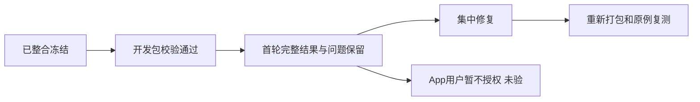

# T-1246 开发包验收进度

更新时间：2026-10-12T06:31:34.516632+00:00。首轮已结束，集中修复和复测继续进行；修复后的开发包与最终浏览器全量验收尚未完成。App 按用户决定保留未验。

已整合并冻结本地Codex与另一已完成会话代码，候选 `533224f334c43cdb81a344424e420cad93784dd1`。开发包1.2.0真实构建通过；原App未安装覆盖、未启动。以下是不同批次的实际结果，不能相互代签。

| 验证 | 实际结果 | 证据 |
|---|---|---|
| 开发包 | 构建exit0；基础45项通过；DMG及内外App签名校验通过；本地ad-hoc签名 | [包回执](/Users/zyongzhu/.codex/worktrees/integrated-dev-acceptance/Thirdspace-creator/docs/verification/t1246/package-first/RESULT.json) · [首轮开发包原件](/tmp/t1246-package-first-preserved/CreatorOS-1.2.0.dmg) |
| 实际包Worker限定启动 | 包内Node及执行Worker真实ready、exit0；无任务、未启动App | [启动回执](/Users/zyongzhu/.codex/worktrees/integrated-dev-acceptance/Thirdspace-creator/docs/verification/t1246/package-worker-tool-v2/result.json) |
| 合同原首轮 | 76文件；456通过/43失败 | [原结果](/Users/zyongzhu/.codex/worktrees/integrated-dev-acceptance/Thirdspace-creator/docs/verification/t1246/unit-first/contract.json) |
| 合同额外原测试 | 原config遗漏2文件；30通过/0失败，独立批次 | [额外结果](/Users/zyongzhu/.codex/worktrees/integrated-dev-acceptance/Thirdspace-creator/docs/verification/t1246/unit-first/contract-extra.json) |
| Worker原首轮 | 159文件；1437通过/25失败 | [原结果](/Users/zyongzhu/.codex/worktrees/integrated-dev-acceptance/Thirdspace-creator/docs/verification/t1246/unit-first/ai-worker.json) |
| Backend原首轮 | 643文件：554通过/88失败/1跳过；6492例通过/400失败/1跳过，exit1 | [单元进度](/Users/zyongzhu/.codex/worktrees/integrated-dev-acceptance/Thirdspace-creator/docs/verification/t1246/unit-first/FIRST_ROUND_RESULTS.md) |
| Frontend原首轮 | 559文件、5078例：4911通过、158失败、8跳过、1TODO，另有1未处理异常；exit1 | [完整摘要](/Users/zyongzhu/.codex/worktrees/integrated-dev-acceptance/Thirdspace-creator/docs/verification/t1246/unit-first/frontend-summary.json) |
| 公共超时补覆盖 | 原用例另轮1通过；真实reader 31138毫秒超过旧30秒，保原断言、550秒预算；不代签平台/App | [补测回执](/Users/zyongzhu/.codex/worktrees/integrated-dev-acceptance/Thirdspace-creator/docs/verification/t1246/unit-first/timeout-smoke-result.json) |
| Rust纯单元 | 实际267通过/0失败/13忽略；另有子harness覆盖缺口待修；保原资源不足exit101 | [真实摘要](/Users/zyongzhu/.codex/worktrees/integrated-dev-acceptance/Thirdspace-creator/docs/verification/t1246/rust-first/SUMMARY.json) |
| 浏览器原170例 | 54spec、170唯一case全部结束：131通过、39失败；170最终截图及trace，retry0，exit1 | [原场景索引](/Users/zyongzhu/.codex/worktrees/integrated-dev-acceptance/Thirdspace-creator/docs/verification/t1246/round-1/533224f/browser-original-dr005/scenario/scenario-index.ndjson) |
| 新Codex免独立API配置旅程 | 首轮59项已结束：框架4通过/55失败；旅程4页面通过/50失败/5缺前置。错误默认DTO断言导致官方49生成未执行，实际生成call=0 | [完整原结果](/Users/zyongzhu/.codex/worktrees/integrated-dev-acceptance/Thirdspace-creator/docs/verification/t1246/round-1/new-native-v2/FINAL_FIRST_ROUND.json) |
| App原生操作 | 用户暂不授权；未建立会话、未启动本轮App，验收未完成 | [用户决定](/Users/zyongzhu/.codex/worktrees/integrated-dev-acceptance/Thirdspace-creator/docs/verification/t1246/USER_NATIVE_DECISION.md) |

首轮发现的 Codex 封面免配置、首载工作区同步、绑定内部字段兼容、账号组分页，以及设置关闭返回问题已实施修复，相关局部回归通过，最终公共浏览器仍待复验。原失败均保留。生成原完整22例最终全部通过；新隔离PG下原27文件509例通过；这些批次有重叠，不能相加成全产品通过数。

当前合同、后端、Worker 标准类型检查通过。前端完整类型检查真实 exit2，仍有原封存测试的4项历史错误，原文件没有删除或排除。T1253 后续完整25例与九文件46例分别全部通过，保留原失败且不合并重叠批次。MCP 标准检查实际8文件116例通过、类型检查通过、scanner8例通过、实际 CLI bundle 构建通过；完整渲染两文件11例通过。T1252 随包CLI两条310秒协议验证和公共三条业务链实际通过，原约301秒失败与后来PNG/PDF等待不足的失败保留。最新完整超时门8组已实际全部通过（158项Vitest、11项Node、5项Windows策略检查），边界无新增违规但保留5条基线，孤儿检查0错误/100警告。Doocs源码与产物已实际精确交付，最终暂存来源审计实际通过348源码/100驱动/53删除，未发现越界修改。新的冻结提交、重新打包及最终浏览器正在推进；App按用户决定未验。

[所有首轮问题与处理边界](/Users/zyongzhu/.codex/worktrees/integrated-dev-acceptance/Thirdspace-creator/docs/verification/t1246/ISSUES.md)。浏览器已留真实截图/trace，Worker已保真实stderr；修复后仍保留原失败及后续独立复测。

下图来自首轮实际失败：对话框已经打开，但原测试要求的组件选择器未出现。独立核对已确认这是旧测试仍要求退役次区；原FAIL保留，集中校准后复测，截图可见不代表原断言通过。

2026-10-12T00:10:34.230899+00:00 当场补充：T1252 实际打包CLI受控两条310秒headers/body均PASS，十份raw SHA已逐一核验，单POST/完整JSON EOF/自有group及listener关闭。T1253 V3完整25=23PASS2FAIL，原9/46=44PASS2FAIL，两组不相加；proper backend/worker types均0，原两红完整保留。T1250仅两新增slow测试隔离获独立与ROOT复核后已应用，V9完整hosts正在跑；不签App或总验收完成。

- T1254 官方 registry 元数据实际查询：pnpm 12.6.0 存在，单次查询退出 0，3205ms，受控进程组已闭合、源未漂移。此结果只证明版本及完整性元数据可取得；未安装、未执行新 pnpm、未重建或复制产物。

- T1254 pnpm12.6固定工具实际安装退出0（10887ms），458实现文件46,657,823字节与registry完整性一致、ROOT逐SHA0漂移。尚未执行该pnpm、安装两源码依赖或重建。T1252公共首轮收集失败PT002已保留，三个正文实际完成数0。

### 2026-10-12T01:21:00.689256+00:00 当场进度

公共三body已完成2例，各1PASS：原Native8HTTP和新出生310秒原ID对账；最后PNG/PDF尚在执行，不签整轮通过，56过滤项不计PASS。原生PNPM12.6.0的version及install --help两条实际命令均exit0，源码依赖安装与构建仍未发生。错误旧entry bin/pnpm.cjs从未执行，原记录与独立更正均保留。App验收继续未完成。

### 2026-10-12T02:16:17.565090+00:00 中断后当场对账

三公共body实际JSON为2PASS/1FAIL；最后PNG/PDF body在661486.826334ms后因110秒单timer早约0.1485ms失败。原raw16文件全SHA核验并保留，case2 child/proof/final回执缺失，不补拍历史close或全绿。当前独立进程与输入检查仅说明现在无存活/无漂移。极窄minimum等待候选正在独审。App未验。

### 2026-10-12T02:29:17.654529+00:00 两套原源码锁安装完成

V6实际exit0，总597011.373375ms；原static补丁/native安装/static安装三child均0且closed/group0。原fetch a46与两份锁字节保持，完整安装清单native70264/static70248项。仅依赖安装通过，下载后的依赖尚未跑测试/构建；等待完整闭包与驱动双审。App未验。

### 2026-10-12T02:47:14.265353+00:00 公共慢链整轮当场完成

新E5iiqj整轮实际EOF0：3选定body=3PASS/0FAIL；原Native8HTTP、新310秒原ID对账、两真实Chromium PNG/PDF各超过300秒（第三body661655.820791ms）。4子进程closed/group0/signals0，原ID/D和权限/版本/4HTTP/2launch均通过；全部绑定source/installed/browser/Node/b88/tool after一致，survivors空。39原始文件ROOT逐SHA核验；每轮56过滤例不计PASS，不加总171例。原旧FAIL/missingfinal全保。协议真实输出bytes有内容校验但未保存为浏览器截图，最终170+111和新开发包仍待完成；App、Windows、官方49不被此结果代签。

### 2026-10-12T03:29:08.032380+00:00 Node初始化实际失败

V9实际exit1，首child274ms/SIGABRT，真实closed/group0，25步骤完成0；网络探针、原shared测试、两RED和构建尚未开始，未应用private候选或复制生产。独核已定位标准输出fd1的fstat错误分支；日志位于被child限制的HOME是待实际验证的机制推断，未观察具体errno。将日志窄移owned private根，并补实际Node动态库闭包后重跑；原失败不覆盖。App未验。

### 2026-10-12T03:50:42.990091+00:00 Doocs资源校验实际失败

V10首网络probe真实PASS/215ms；Node成功启动、owned loopback完成、TESTNET实际EPERM、listener/sockets/child/group关闭，private日志原字节归档成立。第二checker2096ms/exit1，真实mapDeps正例AST结构未被工具接受，1/25步骤；源码before/after同913587/cd995，未old8/两RED/apply/build或生产复制。原9正负断言保留，下一窄候选按实际AST协议纠错再验；本次不是请求预算TDD红测。

### 2026-10-12T04:06:19.842820+00:00 旧请求实际提前abort与清理计量失败

V11 checker9和native原8真实PASS，native旧a46合法31秒正文请求在30003.785833ms实际AbortError/单POST/原成功断言FAIL。child自然exit1/closed/group0，但其报告在server.close回调之后仍有1个socket未记录close；完整RED清理门据此停止，整轮exit1/4of25/245642ms。源before/after同092790/cd995，未第二RED/apply/build或生产copy。旧early-abort已观察，不能补造旧socket0。下一窄候选等待真实close事件并提高RED外层以覆盖完整setup/清理，全部预算断言保留。

### 2026-10-12T04:32:37.863712+00:00 两真实RED完整与private文件模式失败

V12两根原8各8PASS，两根原a46合法31s请求各真实约30s AbortError/1POST/成功断言FAIL，真实socket事件各1=Promise1/Set0，child退出1/closed/group0；六前序阶段完成。四private源码候选实际SHA精确fe239/fed3，static两个原mode0664被copy变0644，严格后验因此失败；wrapper494006.856042ms/exit1/6of25。原应用receipt与成功source-after缺失保留，source-after-error原记录保留；未whole24/green/build或生产copy。下一仅两mode恢复与剩余19阶段续段，保V12原UTC观测上限，不在V2重造旧RED或洗旧exit。

续段V13只读封存26b028/948448，ROOT逐SHA/size/mode/link核1752+141220及17附件为0漂移。仅两static mode回原0664、剩原19步骤；待独审与ROOT精确准入，尚未execute/chmod/生产copy。原V12 exit1及missing永久保留；原UTC上限与新单出生88.02M取更早。

V13 nonce907bb8已经实际恢复两static原0664，inode/UID/4SHA保持；两根whole24分别24PASS/0FAIL/closed/group0。正执行原31/120/130真实请求，尚未签build/交付或browser。原V12失败与missing保持。

V13已真实EOF1/1153972.482ms，10/19完成后第11static原build16981ms失败：Vite资源阶段完成，vue-tsc三TS6133(showAIToolbox/isMobile/showEditor)。两根24、两组三个实际slow、两shared types以及native原build/verify已实际过，原据保持；sourceafter同26b028/cd995。不得把partial dist作完整buildPASS。T1254按taskctl block真实原因；新根因T1256两树登记CONTRACT候选b7bddf，独评前不改源。

T1256规范复审2/3 PASS(ed320d/b3d116)，ROOT/peer三声明候选双审。V14完整1837+141614及395真实native图逐SHA/mode/UID/文件集0漂移；ROOT准入034e1a后nonceba7a4e已一次实际启动原9续步骤，尚待child结果。仅Panel保持V6实际0644/inodeUID，保三段旧失败/原RED。浏览器29b3静态源评c8a49通过，尚未finalseal/实跑。

V14实际ba7a EOF1/179108ms，Panel三声明清理已实际保持0644/inodeUID；static原完整build与vue-tsc实际0/16973ms。下一Graph child1/2995ms，真实md-storage里的window.location.pathname.includes(BASE)非文件消费者未分类。原21raw/113.2MB与sourceafter0保存，未leases/scanner/sourcepack/生产copy。仅既有Graph范围内精确pathname语法族/故障negative校准后原8续，继承更早UTC2026-10-12T16:01:07.952Z，不重原build/RED/slow。

V15当前只读候选双审中：原8后续加单combined probe，ROOT实际完整3.795GB字节核对为0漂移；Graph尚未施用，未执行新probe或原8步骤。原9正负用例正文与断言不变、实际native395/static304构建文件全核，保V14原UTC上限与所有历史失败。

2026-10-12T06:51:41.031951+00:00：V15 nonce668b实际整轮EOF0/484392.852ms，combined probe与原8尾步骤全部0/closed/group0，完整before/after源与工具数组相同。原scanner实际485新JS无失败；native395/static交付300全文件与两真实源码tar（native819/static804项）逐字节核对通过，三个原Git patch checks0。ROOT证明38aa823d与独立证明2995be46。原V12/V13/V14非零与缺失历史不改；此轮未生产copy、未新开发包、未最终浏览器或App。精确交付清单与三个验证工具正在准备双审。

2026-10-12：浏览器运行器纯预算真实 FAIL（27cf，child209ms/exit1，wrapper EOF1，group0），证据 `round-2/actual-external-27cf-only-pure-fc389d5651b5c5a4faf23a8e/EVIDENCE.json`。旧清单 startup1.8M 与原工具实际2.4M相差600k；全部16raw和7私有原件已核，原wrapper-after缺失保留，后续独立审计不回填。新7391仅pure/reseal修真实公式和履历，尚未执行，170/111浏览器验收未完成。

2026-10-12：Doocs交付只读验证9f4三child均真实exit0/closed/group0（静态23、四编辑器、构建prepare），wrapper EOF1：`PREPARED_OWNER_PATH`错误使用父进程默认tmp而子进程实际TMPDIR为owned/tmp。原source-after143462输入未变；原缺失build-entry-results与真实FAIL保留。仅补验结果归属/完整binding，禁止重复三项。后续继承最早UTC2026-10-12T13:12:37.651Z，尚未复制产品。证据 `../t1254/execution/delivery-validation-9f4bdd0b7db6150e1b31768309508baa/summary.json`。

2026-10-12：7391修正真实消费者公式后的唯一纯预算测试实际PASS：child92716 exit0/243ms，真实positive close108.416ms，wrapper EOF0/2391.313ms；343源码及Node82/37link/51边beforeafter零漂移、group0、无signal。新EVIDENCE `round-2/actual-external-7391-only-pure-7dd0492156b02ee92c531d89/EVIDENCE.json`；29档及13私有原件已核。旧652FAIL与原缺after完整保留；本次未运行metadata/reseal/服务/浏览器，不签170/111或App通过。

2026-10-12：Doocs最终交付实际完成，唯一copy73141 EOF0/61239.279ms，73写/53删/636原字节/完整709与66 before备份全核；原132raw保持，独立实际复核8328d830通过，主线程精确stage126 exit0，whole产品ROOTS unstaged0。`../t1254/EXACT_PRODUCTION_COPY_V2_ACTUAL_EOF0_COMPLETE_RESULT.json` 和 `../t1254/ROOT_EXACT_COPY_AND_STAGE_COMPLETE.json`。仍未新commit、开发包或浏览器复测；原9f4 wrapper1/missing保留，独立后处理d759实际EOF0闭合，不合并成原run全绿。

2026-10-12：Doocs精确交付暂存后的三项原质量门当场完成。超时门 session54145（timeout-10d6）自然EOF0，8个原命令组全部通过：Vitest 158例、Node 11例以及在本机执行的Windows渲染/页面预算策略5例；后者不是Windows安装或真启动验收。boundary session14639（1d57）EOF0，无新增违规，现有5条基线保留（Agent SDK 4、跨模块repository 1）；orphan session43188（9960）EOF0，0 errors、100 warnings，未把warning清零。三轮实际child均closed/group0，before/after与清理证明保留。原失败、缺失回执及ZIPFS证据保持。当时最终源码审计尚待owned wrapper实际结果；新提交、开发包、170/111浏览器与原生App验收尚未由此门代签，App按用户选择未验。

2026-10-12：源码审计v5实际EOF1，52个Git自动R显示被原工具拒绝，原969报告、251证据及c8d独核保留。v6只对52个已批准delete+write来源/目标做精确机械投影，唯一实际审计session95729自然EOF0，reportf70fb881、15raw归档4dba3e14；source348/driver100/delete53/legacy253/first100、6369实际库存、unknown0、全产品unstaged0及beforeafter556/Node/Git闭合。单独机械测试实际52正/421负通过，原失败不覆盖。仍是提交前来源审计，不代签新包、官方模型调用、浏览器或App。

2026-10-12：打包运行器967独评记录PKG001中途完整来源检查与剩余阶段预算缺口；v2仅修工具闭包，SOURCE3162/独评1640c2c0通过，原入口/45例及retry2/11dist与10随包公开Worker保持。未运行新打包。

2026-10-12：原完整全局对账session94775实际退出1/23ERROR，pmem实际0；两childclosed/group0/signals[]。23条逐字均在T1238原25错误中，本次不再报阶段日期陈旧和LED053，不改旧25档案。backlog1+旧review19+LED052/018/057三项沿T1204/T1171保留并独核真实前置；完整原日志在round-2/control-close-94775，不签全局绿。

2026-10-12：原LED018/057单项在补全Cargo PATH后的唯一观察session78569自然EOF0：原155Vitest、原windows_17Rust、no-default原15Rust均当场通过，两child0/closed/group0/signals[]，3837当前源码及资源数组beforeafter严格相同。原94775完整23FAIL与缺leaf stdout保留，不改写全局为21或全绿；LED052仍原固定55422入口ENV债、已有分散同SHA30/4/25结果不拼原同runPASS。Windows/App原生未验。新源码提交及包现在冻结中。
