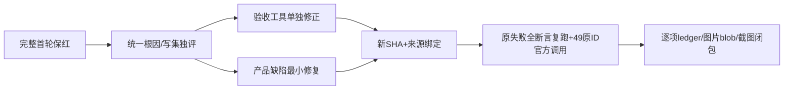

# T1246 集中阶段提案（只读分析，尚未实施）

本轮产品候选为 `533224f334c43cdb81a344424e420cad93784dd1`。原170已结束131PASS39FAIL；单测/类型门首轮仍在主线程收尾；本文不修改冻结产品、v2断言或驱动，不启动复跑。新增59首轮已封存于 `round-1/new-native-v2/FINAL_FIRST_ROUND.json`：4框架通过、55失败；journey 4通过、50失败、5未满足前置，0 skip/retry。官方生成call 0，49入口未验；CLI状态进程仅前置。

## 实际原因与最小写集

|编号|真实现象/源码消费者|集中最小改法|可写范围|
|---|---|---|---|
|NT001|44用例在 `Journey.noIndependentModels()` 的 `models===[]` 断言停止，含42生成key。`backend/.../ai.seed.ts:75–108` 确实保留7个空能力DTO。|合法能力库存精确为 `research.analyze, planning.contract, planning.outline, script.rewrite, copy.generate, review.insights, copilot.assist`，唯一id、同当前user；逐行 provider/modelName/secretReference==空、hasSecret===false、baseUrl===null，并确认服务Codex。任意额外已配置槽、本地无key HTTP provider、modelName/baseUrl非空均拒绝；保原ledger对每个实际call身份/原thread/turn对账。不能只删断言或只看hasSecret。|新59独立测试副本 acceptance-support.ts；v2不动|
|NT002|4用例期待 `main` 但 topics/production 当前真实容器不具该标签。|逐38真实page建立对应AppShell＋页面已确认标题/可操作对象或data-page/data-slot标记，要求真实200/已认证scope/精确URL，无Application error/权限空壳。动态页先公共创建原ID，DOM核原项目/output/title；不能用body随意非空代签。|新tests route-ready映射及browser/native/dependent消费|
|NT003|INT-ENGINE-FAIL假状态缺严格必需 `version`，use-assistant-engine.ts safeParse→真实‘状态暂未核实’。|先 `localCodexStatusSchema.parse` 验证明确合成fixture，保持合法unauthenticated/无图能力断言与503不改后端偏好。假上游只状态，不生成，不签官方。|browser.spec.ts fixture|
|NT004|scheduled flywheel 创建真实account后，scheduledJobs.create却因无选中账号AccountRequiredError停止。|公共创建且加入本组的原account，cookie/localStorage＋x-account-id与group同时绑定（最终realpath/UI/返回资源对应账号）；真实未登录最终needs_reconnect可以记录外部限制，但本例需先完整跑到该原任务状态。后续已授权协议fixture覆盖模型阶段，不能把零任务称登录受阻。|support scope与dependent recipe|
|NT005|新恢复/Pi目前固定throw Blocked，属于验收工具未交付。|恢复用下述独立protocol树；Pi可关联原suite实际本地HTTP生成case/testId、任务/公开结果/fixture次数与只读ledger；原settings模型探针PASS只签探针，不签生成。保v2真实BLOCKED，不冒称本例已生成。|新增独立protocol/Pi测试工具与证据|
|NT006|旧intelligence strategy_backed错误认为只能旧历史恢复。|真实公开RSS采集＋明确手工逐字稿＋公共保存定位版本，经 `intelligence.projects.enqueue`→radar_project_upgrade父→topic_preview子；`radar-project-queue.service.ts:122` 明确调用 strategyBacked:true，无需伪造历史。逐父/子冻结与实际官方call。|dependent recipe，原公共入口不改|
|NT007|script.source_similarity缺原reference/候选且直接BLOCKED。|真实RSS/manual transcript→previewTopic→confirmTopic创建原project reference→projects.scripts.generateCandidate→原task成功候选→acceptCandidate触发原similarity；核reference/sourceDigest/sourceSnapshot、CAS版与独立call。不能拿任意UUID替来源。|dependent recipe|
|NT008|reconstruct、comment、ASR、成片视觉的当前准备不完整。|逐族交付合理前置：reconstruct公共保存明确标为用户导入的来源作品/原逐字稿、comment受控采集协议原signal绑定、ASR原资产预约/音视频字节+现有离线准入缓存、render原production工程/真实成片；官方文本/视觉call另核。若真实公开链无合法注入，必须准确列到源码服务/资格阻碍，不能固定新组空数组免测。不伪造采集/ASR产物、不新建绕过权限端口。|明确新fixture/probe目录，需逐族独评|
|DR006|原T1070两例真实保存后截图evidence()抛 `resolve is not defined`。driver:104用resolve替ENV，但源仅import join。|仅机械输出consumer用原已导入join或已核绝对RUN_DIR拼接；保全部原断言与输入。重新100库存/逆构/完整consumer/SHA，独评后复跑原2全用例。|driver/prepare-browser-driver.cjs 与生成受控tree/manifest，不改原spec/assert|

产品BC003由主线程独占：coverchip `selectors/copilot.ts:75` 和 `features/copilot/content.tsx:599–605` 仍要求独立生图模型。IMAGE_MATERIAL_PREFILL本身没有该要求。集中新增case应真实点击coverchip→精确prefill免独立API且未自动POST→同本例原task官方生成；缺参考资格保原task实际状态，不造成功。产品修后绑定新候选，不能继续冒用533的原字节。

## 预算的真实消费者

`uiOp` 在action前启动waitForResponse；原响应观察120s不能覆盖action120s＋HTTP120s。提议命名外层300000ms（120000 action＋120000 request＋60000 ACK/read余量），内部action/request各仍120000，trigger失败时观察promise要显式消费异常并按page/context清理；不续原任务期限。

结果观察为原持久任务默认30分钟加末次请求/结算；更长原deadline保留并读原ID。每个 `expect.poll` 里真实request单独120000，独立观察/外层要覆盖末次在途请求和清理，不能只增test上限。新测试逐case计算成功链串行预算，而非统一猜6小时：响应/UI/capture/asset adoption/全部原结果循环都列消费者，未限长数组不能假定一张图或删多结果。图片series两个真实task依次观察，至少2×原剩余期限加2次request/settlement以及全部采纳/blob/截图。

INT-ROUTES当前25入口 ×（2viewport ×[goto120+页面就绪120+截图120+geometry读120]＋reload120+页面就绪120+正文读120）＝33000秒；setup最多7次120秒、final截图120秒、cleanup180秒，保守声明至少34140秒，原5小时不足。若补完整38入口，同消费者界为51300秒（14小时15分）；每个无SDK独立timeout的geometry读取需明确120秒有限观察与页面关闭清理。不可拿这个声明冒称实际每项已执行，也不修改原任务deadline。可串行拆成独立route cases降低单例outer，仍必须38入口唯一完整且保持实际UI断言/库存绑定，不删除覆盖。

## 恢复协议 fixture：完整生产解析和绑定，不写库造unknown

产品 `codex-app-server.ts:46–61` 只有锁定@openai/codex平台包vendor executable，生产/UI/env不存在任意 executable入口。保此门，不加后门。T1238 `codex-read-recovery.integration.test.ts` 的旧造库started/unknown fixture仅服务恢复测试，不能代签新浏览器来源。

集中阶段建立独立protocol checkout＋全新数据/media/auth日志根；253产品源码及11 Workerbundle SHA原字节保留。依赖必须完整私有clone，不依赖正在构建的unit树；假JSONRPC executable替换前证明owned realpath、无store/official硬链接/符号链接越界，先原子unlink/replace为新inode再写/chmod。前后核official59树与包原vendor SHA不变。此fixture明确另依赖SHA，不能称官方Codex/包原可执行验收。命令不读取/复制凭据，不向真实上游转发，不操作用户HOME/CODEX_HOME；日志仅合成fixture数据。

保生产resolve/版本验证/初始化/config/read/account/read/model能力/MCP禁用/原CodexRpcSession解析。公共Copilot UI保存本次source message并提交；fixture `thread/start` 与 `turn/start` 产生其协议实际合成ID，turn-start响应后等待原host持久recordProviderTurn＋bindCodexCall ACK，发送真实部分消息后受控stdio断开，不直接修改任何任务/ledger。Worker按原admission=true catch→settleExternalChatTurn unknown，真实原task变unknown_result。绑定ACK同步可沿生产串行事件链：先发turn/started通知，再发本轮dynamicTools中实际存在且effect=none的项目读取item/tool/call（参数只用本例公开返回projectId、通过原tool schema）；CodexRpcSession.chain先await通知→runCodexNativeTurn.bindTurn→原recordProviderTurn/bindCodexCall，再消费tool请求。只有收到真实宿主工具成功回执才断开stdio；不用睡2秒当proof，不新增工具授权。最终只读原ledger实核源/task/call/实际session/providerTurn/codexCalls同一对ID及原startedAttempt。usage两个族：未发usage帧保null；明确合成usage通知后再发第二个原effect=none工具并收到ACK，串行链保证原observedUsage持久化再断开，恢复后累计不能变零/冒充官方收费。

公开execution.tasks.command resume只用原ID/key，恢复端 `external-chat-worker-run.ts:84–90` readCodexCall＋recoverExternalChatChildren＋thread/read 原turn。fixture将第一次完成结果持久在自己的协议状态文件，thread/read仅返回原turn；审计resume以后turn/start0、新提示0，thread/read原ID，原call不supersede/no retryOf、original startedAttempt与attempt进位、deadline不延、assistant源message/task/providerTurn完全对应。首次真实usage已观测就保累计，未观测usage保持null，不能伪造收费/真实官方token。

拒绝族独立原task：跨组404、取消后resume不重发、原turn未完成仍unknown、错误或无binding不自动生成。不能为获得unknown直接写DB。所有故障必须由受控真实协议/网络边界触发，并保原调用最多一次。恢复完成后停自有Next/Worker再只读原库对账，不能并发开启同PGlite。UI只签实际触发/原partial状态卡/原完成消息截图；内部call只读ledger签协议闭包。

## 冻结与执行前独评

集中write set仅新测试/命名fixture/驱动生成及证据目录（产品BC003另主线程）。正式实施前原59/170红不覆盖，新candidate/source253状态＋11Worker/新测试driver/协议executable SHA＋deep realpath/数据root/实际child cwd全部绑定。新protocol不是官方49批次；官方仍独立fresh无API根逐49运行，每项task/call候选读回/图片200原文件hash单独闭合。4旧browser pass仅窄scope：T1245筛选、不含detail close；NAV读回文稿、不含LED047性能，不借文字标题扩大结论。
