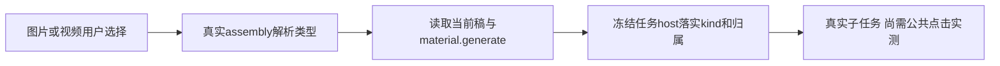

# 功能入口与图标首轮分诊

冻结候选533224f；只读核对实际首轮三条FAIL，未改原产品或断言、未复跑。来源SHA见同目录function-key-icons-source-binding.json。

function-key-invariant首例PASS证明扫描仍生效，第二例仅material.generate.image/video不在实际工具集合。不能从名字不相等推断死链接：chat-assembly.ts175明确解析这两个用户选择的类型，181–186在项目上下文置顶context.artifact.text→material.generate，210不把类型命令冒充工具名；普通无项目仍保material.generate。chat-material-task-host.ts59从原冻结命令取forcedMaterialKind并传真实prepareMaterialGeneration，再经prepareTaskCommit/wake原素材任务。原host.test已有image/video种类与当前稿读取/取消/旧来源拒绝断言。静态生产者链成立，当前浏览器semantic-material-generation停在旧“打开AI助手”定位器前，不能补签点击或生成。

集中最小候选仅frontend/src/test/function-key-invariant.test.ts：保原穷尽生产扫描和其他unknown失败；明确类型入口须通过实际assembly确认真实工具定义与序列并保host种类落实，不用空洞allowlist，不把不存在的alias注册为真实工具、不改为泛包含或删除失败用例。集中后的动态原例及公共chip提交仍需要执行。

icons两红的当前生产集合分别新增canvas及wechatOfficial/kuaishou。T1022已确认平台原值且SPEC72明确后两值；T1101确认原画布真实入口。集中最小候选仅frontend/src/test/icons.test.ts：精确加入canvas与两个合法平台的实际本地标签/字形/配色，保穷尽键、对象freeze、未知fallback和无网络metadata断言。不能因多了键删除穷尽守门或把新平台误说未批准产品变更。

