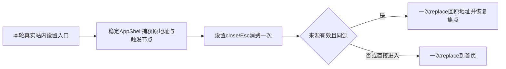

# 设置直接进入后的可靠返回：单一窄修提案

**仅只读提案，尚未批准、未实施。** 冻结候选533保持。实际短诊断 direct /settings close→about:blank 已发生；原完整两条则在 fresh 独立重执行2PASS、3次back都/accounts。因此只能针对已证明的直接进入返回缺陷提案；不能把原170两FAIL归成double-back、113组或并发问题。完整补充报告为 settings-full-history-runs/2026-10-11T17-19-06-539Z/FINAL_DIAGNOSIS.md，原红保留。

现源码 SettingsDialog:239-249用history.length>1决定router.back；直接地址也会带浏览器初始about:blank/站外历史，故该值不能证明上一站属于CreatorOS。AppShell:90-104仅记/projects/new触发节点+path用于焦点，没有设置来源。ShellRouter:396只读当前pathname，usePrimaryNavigation:20-43只做目标去重/transition。NewProjectDialog也用length，不能用其判断复用。OverlayController的同页 query 删除及触发焦点是可遵循的局部模式，不是可直接消费的跨/settings返回tracker。

本轮沿用已加载项目oil-ui-pro0.10.0与T1022 UI_RULES；只修关闭/导航/焦点行为，不提出视觉改版或新的IA。

## 一套具体最小方案

在稳定AppShell内增加**仅设置专用**的内存context（新 settings-return-context.tsx）。它只从本次实际站内入口采集来源，记录 generation、当前origin、原完整 pathname+search+hash、实际settings目的地址、当前creationScopeKey及可选真实trigger节点；不从query、document.referrer、localStorage/sessionStorage、Next私有state或Navigation API恢复来源。无已有全站返回tracker，不能声称复用现成能力。

AppShell现有React click capture保/projects/new逻辑，追加匹配同源 /settings 链接的来源记录：只普通左键、未默认阻止、target=_self/缺省、无download；不截组合键/新窗口，不拦其他route或copilot本地query路径。usePrimaryNavigation在其真实去重/接受目标后，调用同一context记录再执行现有router.push；程序化入口与链接记录共用，实现仍沿原路由，不建立另一个按钮行为。当前源码没有别处显式router.push/replace('/settings')消费者，故不授权全部页面。

记录状态收敛为 none→pending→active→consumed。pending必须在本稳定宿主观察到相同settings目的route后激活；取消/失败/离开其他route使pending失效，源本身/settings时不能覆盖原返回记录。重复点击同目标不覆盖来源；跨宿主重载、失去匹配generation或creationScope变更后无有效记录。user级设置仍允许无账号/无组，scopeKey只是防迟到/串回原编辑上下文，**不能调用要求有效组或模型凭据的creationWorkspace.assertCurrent**。不用来源记录自动恢复/改写账号组cookie或用户选择。

SettingsDialog在close/Escape/遮罩统一一次性关闭：先以同步closing ref防重复，消费匹配本次激活generation的来源；再次验证来源same origin、非/settings且实际同源相对地址，拒绝跨域、//站外、javascript:/about:、损坏或旧记录。有效时仅 **router.replace(原pathname+search+hash,{scroll:false}) 一次**；无有效来源仅 **router.replace('/',{scroll:false}) 一次**。不调用back，不先back再push，不解析浏览器历史资格，不以blank作为期望。替换当前/settings条目后仍留在应用内；这是在SPEC中需要明确的具体关闭行为，不伪称已经获批。

关闭统一入口让Radix onCloseAutoFocus不要抢先把焦点还给dialog内部；由稳定宿主在真实返回route提交后恢复原trigger（仍connected、可见、不inert且scope匹配）。原trigger消失时落到实际返回页的可访问heading/main；没有返回页面时不聚焦旧上下文。只单次render-frame同步，不轮询/阻断导航；清空消费记录，防下一次deep-link复用旧return。原query/hash原样拼接，既有copilot=open/surface/prefill、outputId及筛选参数不删改、不重新编码或重建业务查询。

## 原编辑器与公共合同的边界

ProjectVideoSessionHost在ShellRouter:421作为稳定宿主保留原session，visible只控制同project/output/scope的展示；dirty/busy/pending/imports和真实dispose/恢复原回执仍归它。新return context不得key重挂AppShell/ProjectVideoSessionHost，不dispose、不重新建任务、不修改owner、outputId、原deadline或draft digest，不调用read/save来猜目标。既有AppShell contentFill无重挂测试和ProjectVideoSessionHost原dirty/在途测试须回归；实际公共工程测试必须验证返回同project/output、相同未保存字节、同在途task/call及焦点。其它article/graphic本地draft并无本次已证明的通用稳定session合同，本提案不能以返回URL正确代签这些dirty数据已保存/保留，也不授权改其editor。

不改backend/contract/settings任何schema、public operation/body或model资格门；不把公开body改passthrough，不新增returnUrl任意输入。现有highlight解析不变。新record是private、fixed字段/状态的内存对象，非法或旧来源安全首页fallback；它不是用户授予数据/权限的凭据，backend原owner/CAS仍独立检查。现有copilot same-page local路径与原query守门只回归，不能改为server整页导航。

## 最小写集与必要验收

产品4处：新增components/shell/settings-return-context.tsx；改AppShell capture/context宿主；改usePrimaryNavigation接受设置目标后的同入口记录；改SettingsDialog统一close/context消费/onCloseAutoFocus。ShellRouter、Sidebar、VideoSessionHost、OverlayController、copilot-navigation、NewProjectDialog、公共schemas均只读/回归，不在产品写集。

新增context测试穷尽pending/active/consumed、重复/失败/过期、scope missing允许及scope变更、同源完整query/hash、恶意外域与损坏源；现有AppShell和primary-navigation测试增真实宿主捕获/程序入口及重挂/ABA防回写；新增settings-dialog-return.test.tsx走实际Dialog统一关闭，不仅helper。新增e2e/settings-return.spec.ts用真实按钮：fresh直达（含已有about:blank或站外历史）close与Esc→首页；/accounts侧栏close/Esc→原页；带非平凡query/hash的工程原址→settings→close原字节同query、原dirty/在途不重发/触发焦点；回退/刷新/来源过期安全首页；重复close一次replace；modifiedclick/外域不污染来源。跨域拒绝为纯private record负例，浏览器不触外站或收费模型。保原settings两完整body原断言，再实际跑；保所有首红，新增至少2分钟正请求观察与完整外层预算，真实1366/390/Esc/焦点截图并独评，运行LED047/LED053相关门。

所有存在来源下面列旧SHA并逐字核533；新增路径明确尚不存在。本表是提案的精确最小写集，不是已签实施/已签产品PASS。

| 路径 | 角色 | 原SHA256 |
|---|---|---|
|`frontend/src/components/shell/app-shell.tsx`|proposed-product-change|`eb734f9c2b85f3fec5c7dfc16712aa48f52fd11339bdf6c01a96368eb282c76f`|
|`frontend/src/components/shell/use-primary-navigation.ts`|proposed-product-change|`824161e234864db367a532363c443842d714858ed724661fe6c12ea46fa61206`|
|`frontend/src/features/settings/settings-interactive-region.tsx`|proposed-product-change|`f28a433c2fba7c88f3d6e8771a6ede80fdbc680672c9b51512f8aeac25372edd`|
|`frontend/src/components/shell/app-shell.test.tsx`|proposed-existing-test-change|`68e7e35e5433b3e2b28e52e0313cb2a8945816d9bbad0776f483c3e003e71873`|
|`frontend/src/components/shell/use-primary-navigation.test.tsx`|proposed-existing-test-change|`6d3f1623676d894bf04209d842e2889ecff7382ff60c57920548eda96433971e`|
|`frontend/src/app/(creator)/shell-router.tsx`|read-run-only|`a57e9da3d474ff111a9fc400452521d34d544f302c337e5642470b221bf1f3fa`|
|`frontend/src/app/(creator)/layout.tsx`|read-run-only|`ffc7a4d064740cb10979d0f750f164dc5ebd8bc9b73cb0d73f8fd9a840e13b93`|
|`frontend/src/components/shell/sidebar.tsx`|read-run-only|`5a233257d2980e42b3e846fca826f11aa1f95a6c2047a09baf826924b3d3a3a9`|
|`frontend/src/components/overlays/overlay-controller.tsx`|read-run-only|`c671d1aafae649dbc043c729de32366a793e84ac1c3e235ad41a183883345d2f`|
|`frontend/src/components/overlays/new-project-dialog.tsx`|read-run-only|`2d99258d9a26f3cb219b5973c839ebaaea0255e05f7185882489a2f20b73040f`|
|`frontend/src/lib/copilot-navigation.ts`|read-run-only|`a57e558e27c706a9edeceaf9ab8d0dc1c7be80294bfc4b09b3f931983611efcd`|
|`frontend/src/lib/copilot-navigation.test.ts`|read-run-only|`2b73e57eef244cc07c807e55e926de0a1f88fb6a8dc079357308ff43f0130000`|
|`frontend/src/lib/creation-workspace-scope.ts`|read-run-only|`3f1080ec0769955cb69f2d8cf23315406057919e13435345150e5cfbc9b2ac64`|
|`frontend/src/features/reference-editors/project-video-session-host.tsx`|read-run-only|`80efb86d1121c08c4f8eab79d43a93eac3838f16473f8f3e93dbc6c3d0617b18`|
|`frontend/src/features/reference-editors/project-video-session-host.test.tsx`|read-run-only|`4b4c7472124acb183b4f15d2ed41beee794125646ce79b31d77b19ce0a97f706`|
|`frontend/src/features/reference-editors/project-video-session-registry.ts`|read-run-only|`dd6d47a2ce4b38d3b26a4231d88408884b76d1188f472660b0b3c89427425010`|
|`frontend/src/components/ui/dialog.tsx`|read-run-only|`ef0a8b1da82a5079c59979e364c69cd7051e6c6992cea5ffaf02530b6566f2e5`|
|`frontend/src/features/settings/settings-interactive-region.test.tsx`|read-run-only|`9f3c017892c8f5c8dbd3e9473e533f0508879a65dbbb26e4601dc2d444943606`|
|`frontend/src/features/settings/settings-page.test.tsx`|read-run-only|`7f1fd5281bc07202566b31c9743d45a875988b848691e3a4b3b64b9e2d715681`|
|`frontend/tests/e2e/settings.spec.ts`|read-run-only|`4283e507e25ad9270a6f7fcb41ae2bca7e64d209ba45838a40efc12909648e13`|
|`frontend/tests/e2e/settings-responsive-layout.spec.ts`|read-run-only|`975f1a4f426562c3cfaad3f691bcd1b0d555f4f8bf017b8ae924715d9b6d47ea`|
|`frontend/tests/e2e/overlay-routing.spec.ts`|read-run-only|`1317d8b2983491b1f3f99aae3af43ff00d8fb8dee8e11839d3331511ffcf4297`|
|`frontend/src/components/overlays/overlay-routing.test.tsx`|read-run-only|`41a2ae0e40669c537a52223c61dd74add756f99691ea241c6062cb6ea2458c54`|
