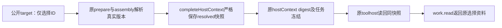

# T1097 精确写集与旧源码映射（只读）

正式SPEC SHA：`a91ed0a64f2cd482cbbdc7f232ecafebef71a662d94e19b87b0cb4d2856d3d96`。原产品基线：`533224f334c43cdb81a344424e420cad93784dd1`。本报告只核路径、旧字节和消费者闭包，不独评自身提案、不授予实施准入、不修改SPEC/源码/原断言，不执行测试或模型。

大白话：已有三个冻结链文件均已进入SPEC；下面把“原测试”展开到真正文件。其余支持模块只读/回归验证，不据此批量授权。

## 当前闭包结论

未发现必须再授权的产品源码文件。`chat-host-context.ts`、`chat-assembly-types.ts`、`chat-turn-preparation.ts`均在正式SPEC并真实存在。产品写集共有41条（含6条新增）；支持叶子不因被读取而变成可修改模块。source map中所有现有源码/测试均与533原字节一致，SPEC是本次新合同，单独绑定current/old SHA。

需要把测试简称展开：work-creation合同实际在`contract/tests/ai-public-message.test.ts`，`work-editor.test.ts`实际在`contract/tests/work-editor.test.ts`。没有独立现有`work-creation.test.ts`。三个建议增补的精确测试路径单列，不静默视为已授权。

## contract_product

| 精确路径 | 状态 | 原533 SHA256 |
| --- | --- | --- |
| `contract/src/resources/work-writing-context.ts` | 明确新增，当前不存在 | 无，不伪造旧SHA |
| `contract/src/resources/work-candidate-adoption.ts` | 明确新增，当前不存在 | 无，不伪造旧SHA |
| `contract/src/resources/work-editor.ts` | 已有，原字节一致 | `cdb72233b401b845adca70b569024316e804a1b713f0606e24311336d6775a2c` |
| `contract/src/resources/work-creation.ts` | 已有，原字节一致 | `792f20c7e1d93a7272974054134629813a2b3f041f4aa8f6b02062467c49db9c` |
| `contract/src/resources/ai-public-message.ts` | 已有，原字节一致 | `12ee680df05b4922a157b760832aeda3fb9cd503e332a49acc7479980f7972fd` |
| `contract/src/resources/assistant-system.ts` | 已有，原字节一致 | `a258e187b20bd54c994d2bbff7a25e281506ced3862ca8f92963f0916cbc063b` |
| `contract/src/operations/ai.ts` | 已有，原字节一致 | `f0774d320edac0afa7c26f15cc2c12a6e58158dca7b7534a278f7bbb775e1afb` |
| `contract/src/operations/articles.ts` | 已有，原字节一致 | `90965ac1599736c645012f11b78e0f387599ca25012543c0234c7e016a579f45` |
| `contract/src/operations/graphic-posts.ts` | 已有，原字节一致 | `6ada9a6b8f919d925478de4ff12c1a96afc6235b4f95f14b0e478c6a8bfe709b` |
| `contract/src/index.ts` | 已有，原字节一致 | `5aafcf93e5df118f6db5acdd60ca44c014fe105d4edf8da8acabe5269531937a` |
| `contract/src/workspace-operation-scope.ts` | 已有，原字节一致 | `c657f02191bacfd3381ca7b4215f11920a1aba31c3ecd3a43b96bec56f1a39ce` |
| `contract/src/cli-policy.ts` | 已有，原字节一致 | `04926f4bc6b9ef2620983c633c07585b974f01d03dcadeacb84da72984fd9659` |

## backend_product

| 精确路径 | 状态 | 原533 SHA256 |
| --- | --- | --- |
| `backend/src/application/generation/work-writing-context.ts` | 明确新增，当前不存在 | 无，不伪造旧SHA |
| `backend/src/application/generation/work-creation-root.ts` | 已有，原字节一致 | `4b9fed9754fef552cbeeeb638193048d93caa132b8e9f02da1f28ec2563f9ddb` |
| `backend/src/application/generation/work-candidate-adoption.ts` | 明确新增，当前不存在 | 无，不伪造旧SHA |
| `backend/src/application/generation/work-candidate-projection.ts` | 明确新增，当前不存在 | 无，不伪造旧SHA |
| `backend/src/modules/ai/work-candidate-source.service.ts` | 明确新增，当前不存在 | 无，不伪造旧SHA |
| `backend/src/modules/ai/chat-proposal-source.service.ts` | 已有，原字节一致 | `cbf2961a08a2cf228b70574fa45d69e62166bfff0cce7936581821108da6b0e7` |
| `backend/src/modules/ai/chat-host-context.ts` | 已有，原字节一致 | `1a2e2b78460eebd40632065ab98b5d1bcd2ba0d7106d26d7421bd8cc77d8b0dd` |
| `backend/src/modules/ai/ai.service.ts` | 已有，原字节一致 | `b0f336496e9e58cbd0bc60f11997838b0374718173b587c5c54b907f5de7d756` |
| `backend/src/modules/ai/ai.transport.ts` | 已有，原字节一致 | `4a4610fc314f6fea6f1aa38bed599d7a8d777f70f50eab8c767eb2ce28936682` |
| `backend/src/modules/ai-runtime/work-editor-candidate.ts` | 已有，原字节一致 | `396cd5979874ed4b021ffaad92623b0af6c8020f8ef07e7a668fc4c5a05ebdc9` |
| `backend/src/modules/ai-runtime/chat-work-editor-tool-host.ts` | 已有，原字节一致 | `e3764dad2e7cfff8473019b9c1eb31e12a49a562677098cf14ddaa058be47943` |
| `backend/src/modules/ai-runtime/chat-work-creation-tool-host.ts` | 已有，原字节一致 | `e490a57f8b7b4ebfac2b3b9c2266fbf281815981b8bd2393f6ebffd549ebc330` |
| `backend/src/modules/ai-runtime/chat-assembly.ts` | 已有，原字节一致 | `dc35a2c20d031e79e1c2e09dec8a8f9156cac42003a6c41b534981490f693985` |
| `backend/src/modules/ai-runtime/chat-assembly-types.ts` | 已有，原字节一致 | `e744c008c4d7034185b73806fa687d8014ff1be61a7a690fb65aed4702fea758` |
| `backend/src/modules/ai-runtime/chat-turn-preparation.ts` | 已有，原字节一致 | `4bcd064091f18250f1aaf97f6efdcdc06d4b426158dbdc0604cc67e404977ef5` |
| `backend/src/modules/articles/articles.service.ts` | 已有，原字节一致 | `edd2ab1793d000897e71c0ce36976cb778082768be2517373839ce2aeff9c81c` |
| `backend/src/modules/articles/articles.transport.ts` | 已有，原字节一致 | `e580151f10859b957ce14b651763b63672567bbb186b28150fd9bb7fea431156` |
| `backend/src/modules/graphic-posts/graphic-posts.service.ts` | 已有，原字节一致 | `6105e2170aae0a3b503c26a95b128f683c39e045d346c59d2ca5cf1e663b01fa` |
| `backend/src/modules/graphic-posts/graphic-posts.transport.ts` | 已有，原字节一致 | `97cbc1cdcee5107653baf1b1761eaf8186effc22d587029b1ce30b0f4bfabdf2` |

## frontend_product

| 精确路径 | 状态 | 原533 SHA256 |
| --- | --- | --- |
| `frontend/src/server/persistence-client.ts` | 已有，原字节一致 | `1a1b90f4acce497cc4a532612b77802865e12cc4b82fa044c50820b701bf1e2d` |
| `frontend/src/server/prepare-chat-reply.ts` | 已有，原字节一致 | `34d8f8099c65cda0313de9520b5a057ad3a1b47d6d9ac27e2b91e0eb36ae8abd` |
| `frontend/src/features/article/article-workbench.tsx` | 已有，原字节一致 | `8c8cbeec1a9712249892d2fc6be3856a2c0cd53c549bcea7945ba7bd91102af6` |
| `frontend/src/features/draft-workbench/draft-chat-request.tsx` | 已有，原字节一致 | `0685de879b73d5293ba627700642601c32ddf518b8f0eadd3b9810211b198730` |
| `frontend/src/features/draft-workbench/work-creation-request.ts` | 已有，原字节一致 | `376a05d4b809bfef5b900ce7fa9832dca19c669b1ef859fbe2fb3bb7c515d952` |
| `frontend/src/features/draft-workbench/creation-flow-ctas.tsx` | 已有，原字节一致 | `27cca5b5602ae7718d995082f65dc8b8a92131c397665dd63875e9f34909df16` |
| `frontend/src/features/copilot/conversation-persistence.ts` | 已有，原字节一致 | `158eb5da7b57e8c0559b10c6b6c9d33cc6f17da71abed90b81fdabc9347ddaf2` |
| `frontend/src/features/copilot/ai-copilot-content.tsx` | 已有，原字节一致 | `f0359d37a6a4d85ada788920ac4eb36a11dce20aedd09916a44885abc59ec87e` |
| `frontend/src/features/copilot/chat-work-editor-card.tsx` | 已有，原字节一致 | `1af168c089aecc67a4251217d96869c7c5de5610dae23a5d708eb40ed6ba8015` |
| `frontend/src/features/copilot/chat-work-creation-card.tsx` | 已有，原字节一致 | `925ce0b5a1c26615afa72883c00dc77649149e9b88563c25272d2a8a587b49aa` |

## new_tests

| 精确路径 | 状态 | 原533 SHA256 |
| --- | --- | --- |
| `contract/src/work-candidate-adoption.test.ts` | 明确新增，当前不存在 | 无，不伪造旧SHA |
| `backend/src/modules/ai/work-candidate-source.service.test.ts` | 明确新增，当前不存在 | 无，不伪造旧SHA |
| `backend/src/application/generation/work-writing-context.test.ts` | 明确新增，当前不存在 | 无，不伪造旧SHA |
| `backend/src/application/generation/work-candidate-adoption.integration.test.ts` | 明确新增，当前不存在 | 无，不伪造旧SHA |
| `backend/src/application/generation/work-candidate-projection.test.ts` | 明确新增，当前不存在 | 无，不伪造旧SHA |
| `frontend/tests/e2e/t1097-assisted-work-candidate-adoption.spec.ts` | 明确新增，当前不存在 | 无，不伪造旧SHA |

## exact_existing_tests

| 精确路径 | 状态 | 原533 SHA256 |
| --- | --- | --- |
| `contract/src/assistant-system.test.ts` | 已有，原字节一致 | `fff4016197b673c7e79b0eb83901d8b14da165650e8fd787e35da34bafd9bf9f` |
| `contract/tests/endpoint-bootstrap.test.mjs` | 已有，原字节一致 | `d789ae86ae7344452ebdbd7e554658f808ed81840c8628ad48496a71e83aea2e` |
| `contract/tests/registry.test.ts` | 已有，原字节一致 | `a26b8120063bded2b489ca198564a5ddbcbee9ec7d8ab73aacc8be913cd94d7d` |
| `contract/tests/work-editor.test.ts` | 已有，原字节一致 | `214e715a065aba4141426f7945f41b8355f75ee7c0f7cbd27211ec1f486d58e5` |
| `contract/tests/ai-public-message.test.ts` | 已有，原字节一致 | `d68c6eda0c6eb1f66d9256cd9a3e2313cda5bde6d90b2852e0351726de79f474` |
| `frontend/src/features/article/article-workbench.test.tsx` | 已有，原字节一致 | `ebd11cf898eb5d8ece2771e8634dcaac69973d1aacc3ca2972b863dda33aa783` |
| `frontend/src/features/article/article-workbench-save-race.test.tsx` | 已有，原字节一致 | `acb7b23b69f42f18b0b7302f6993f632d48efd023871517784005fa4e522a440` |
| `frontend/src/features/copilot/chat-work-editor-card.test.tsx` | 已有，原字节一致 | `e2ec73e05ed1ab32950112942a96840b5268f0f7b76977fed8f4b87ce2ef341d` |
| `frontend/src/features/copilot/chat-work-creation-card.test.tsx` | 已有，原字节一致 | `f1c28e5e74cd3afce22a916c12b1126ce2c61e12b1502b22128511772adfb7f7` |
| `frontend/src/features/draft-workbench/work-creation-request.test.ts` | 已有，原字节一致 | `2cb9443898719f303cf2d1ad4576ab1cf56bf863f49df749227b62012220097f` |
| `frontend/src/features/draft-workbench/creation-flow-ctas.test.tsx` | 已有，原字节一致 | `43ef6054c857a3065a26d39e7bb0e232825ef0a79b8caaa6d664e4ed88fb7893` |
| `frontend/src/features/copilot/conversation-persistence.test.ts` | 已有，原字节一致 | `69d4c098b34bf3d6ee254cfa81c6d2755a6dc039392193eeeca3e256d151fc31` |
| `frontend/src/features/draft-workbench/draft-chat-request.test.tsx` | 已有，原字节一致 | `4700d008edc41e2fce74c9ba64a96445ec0e5e30d1c805523a5714dfc6821533` |
| `backend/src/application/generation/work-creation-root.test.ts` | 已有，原字节一致 | `150c7a24f37671ec49f8a0350ecbd18474e5161d38abfe94d09016bc44cb5b1c` |
| `backend/src/modules/ai-runtime/work-editor-candidate.test.ts` | 已有，原字节一致 | `aacdf9379c8eb5e81ef9b2985e9ec46ef09af217d8b83677ac6dff4a0ff186f0` |
| `backend/src/modules/ai-runtime/chat-work-editor-tool-host.test.ts` | 已有，原字节一致 | `e488ec56be537a658b3b30c264837cf6fb1991a84f5fd6900153b38ddb45a26d` |
| `backend/src/modules/ai-runtime/chat-work-creation-tool-host.test.ts` | 已有，原字节一致 | `8c4858cbe26cc996195d650b92e96226202b278b36d04ba3bb53f22e36d61739` |
| `backend/src/modules/ai-runtime/chat-assembly.test.ts` | 已有，原字节一致 | `1829fe2e89c1373db0e09a43f39b913e65d5c82be19916dcdd778dcc8d6d4470` |
| `backend/src/modules/ai/work-creation-chat.integration.test.ts` | 已有，原字节一致 | `120d1ff08df42794c23dc05a290cc0d6bf14c2afc4ed10f819633157cc8ec36e` |
| `backend/src/integration/chat-work-editor-worker.test.ts` | 已有，原字节一致 | `c1d3efbf34bdb1b86e07e7ee4ecc9391516a35bddc08b94449d0191f4e113f5e` |

## suggested_exact_test_write_additions

| 精确路径 | 状态 | 原533 SHA256 |
| --- | --- | --- |
| `backend/src/modules/ai/chat-host-context.service.test.ts` | 已有，原字节一致 | `8436699406efcb1b6d5cee9749786816e88a525908dd477ae215dd9ae5c21911` |
| `frontend/src/server/prepare-chat-reply.test.ts` | 已有，原字节一致 | `a965a74928573e455ce2d950f76c27e75fa342211242083c2adb92b0b195c78f` |
| `frontend/src/features/copilot/ai-copilot-content.test.tsx` | 已有，原字节一致 | `fafd6d5bd345d53607b1b0a8aeedc9d9ada88171918dfa4cb04fe05fa6ecfe01` |

## verification_only_no_write_authorization

| 精确路径 | 状态 | 原533 SHA256 |
| --- | --- | --- |
| `backend/src/modules/ai/chat-host-context.service.ts` | 已有，原字节一致 | `ace427b8cad238fd56329424303919226fb745f6a64edf6469cc9001032f00a8` |
| `backend/src/modules/ai/chat-turn-submission.service.ts` | 已有，原字节一致 | `a562f61ad86305ff64c9953b340b6bae869cd88472242027f52977f512ee2495` |
| `backend/src/modules/ai-runtime/chat-context.ts` | 已有，原字节一致 | `2c465dc2a19a1d1e0b0bf16729b90532098d6e4b5fcbd255cb2baa156cfb02aa` |
| `backend/src/modules/ai-runtime/chat-assembly-tool-deps.ts` | 已有，原字节一致 | `63c18718dd5a425ab5cb8abcaea52b105502449c8edd4071f0bdf2b0fd1a9429` |
| `backend/src/modules/ai-runtime/creative-context.ts` | 已有，原字节一致 | `64218e7a05be6b936d6af9dc696a395a3ad887cd9f93df33a7121efa9c414c31` |
| `backend/src/modules/ai-runtime/chat-model-messages.ts` | 已有，原字节一致 | `3a9c4f692f5e658a05cea79b952ba2b3062872bf71bfa5253e96ab8adde726d4` |
| `backend/src/modules/ai-runtime/chat-tool-definitions.ts` | 已有，原字节一致 | `6d887db42a10c5fe703fc0fc6eb77568353aeb0f35a3a89e11f7f435028e6de4` |
| `backend/src/modules/ai-runtime/chat-tools.ts` | 已有，原字节一致 | `1f737085ed0f1cec960747df0d405e048e7fef9a4975fdf0c705464500adb752` |
| `frontend/src/app/api/chat/route.ts` | 已有，原字节一致 | `c45e23ef619b9ad37947cb39440b63cb7de4d252c24cb52b2c8298d8d8c59f39` |
| `backend/src/modules/ai/chat-turn-submission.service.test.ts` | 已有，原字节一致 | `6a9558285ab197c1ee81c5527425cd46418a287b243d7f2c146241088d4b4b41` |
| `backend/src/modules/ai/public-chat-options.service.test.ts` | 已有，原字节一致 | `598de22a86ce11ac58363c06a3dac1b4328ba12093681ffb05011cfd6a83ad4a` |
| `frontend/src/server/public-chat-options.integration.test.ts` | 已有，原字节一致 | `ddda8b6ff9e0c4996eb94bef6022e86e26aa31569faf82504dc4551389569eab` |
| `backend/src/modules/ai-runtime/chat-tool-definitions.test.ts` | 已有，原字节一致 | `a3899b5d9e975ab29415343bf5d2a1ed143b5e187d420d29672771dad740d46d` |
| `backend/src/modules/ai-runtime/chat-tools.test.ts` | 已有，原字节一致 | `c3eadefeb911e72c16dfffef05e91825fb4b8c147988b4d7572050bd5ea9febc` |
| `backend/src/application/chat/assistant-system-root.integration.test.ts` | 已有，原字节一致 | `d192f72b5a193cb92303ead1806ca7d735c25dea0344b7905c5ad78e70143c35` |
| `backend/src/modules/ai-runtime/chat-system-tool-host.test.ts` | 已有，原字节一致 | `38ca68d172e887740d1161a8036717f1a0b3b7588be5aa8a955fc8804573acee` |
| `backend/src/modules/ai-runtime/chat-host-input-error-recovery.test.ts` | 已有，原字节一致 | `c68593fcba97a9d4aba103ca36b9e5eda062cceb1252d13201d876dc16f085b3` |
| `frontend/tests/e2e/wechat-article-workbench.spec.ts` | 已有，原字节一致 | `e95cf6934602f5be9f388310a8b553b869d97ee93359b213e68fe5962cb97e94` |

## 严格冻结的实施连接点与读证据

1. `prepareDurableChatTurn`先建立基础hostContext（chat-turn-preparation:55附近），再调用prepareChatAssembly，最后validate完整completeHostContext。新增resolved资料应从已列assembly返回值进入completeHostContext后再落原digest；不能只留modelMessages/system或target IDs。该文件已有两次strict validate，新增字段必须在已列chat-host-context strict schema明确声明。

2. `chatHostContextDigest`对完整canonical hostContext计算摘要；`readChatHostContextPair`严格parse+摘要校验。`chat-host-context.service.ts`最终完整structuredClone读回，没有已确认新字段拣取遗漏，所以本表不授权其产品改动。必须验证目标选择与resolved快照一一对应，伪文本不能通过公开input进入。

3. `prepare-chat-reply.ts`把runtime.context、readEditorTarget/readCreationTarget及ChatRuntime真实port传prepareDurableChatTurn；ChatRuntime声明及port装配在已列persistence-client.ts。新解析port类型和转发必须在这两个已列文件及chat-assembly-types中一致，不能在frontend实现资料业务。

4. `chat-work-editor-tool-host.ts` / `chat-work-creation-tool-host.ts`从reader.read恢复完整hostContext；当前只取chatContext目标并调用read/propose。两文件已列，必须明确取原resolved资料传work.read；恢复不改为resolve最新positioning/file。read结果strict schema分别位于已列work-editor.ts/work-creation.ts。

5. `chat-context.ts`只import共享WorkEditorTarget/WorkCreationTarget；`chat-assembly-tool-deps.ts`只透传目标；`chat-model-messages.ts`消费assembly.system。新增resolved内容可沿已列assembly/result传输，不能据此默认授权这些叶子。`/api/chat/route.ts:218-234`用共享schema解析完整target后原样加入chatContext，未发现逐字段丢writingContext；保持支持只读/公共回归。

6. neutral或任何明确品牌版本不得再混入当前global定位/未选额外文档。chat-assembly:262沿现assembleCreativeContext参数即可设置excludePositioning；creative-context:482已有excludeHistoricalCreatorContext，可抑制附加knowledge/signals/learnings而保project事实。策略在已授权assembly落点；本表没有证据要求改整个creative-context或素材/定位repository。

7. chat-tool-definitions:97确实发行chat-tools-work-director-v1。当前work参数定义不含target、writingContext或read结果类型；新增read结果本身不要求改这个version发行者或工具描述。若实施选择改参数/描述，则须补精确写集及新旧冻结版本策略，不能拿现v1字符串掩盖定义改变。

## 只提更精确的合同建议，不修改SPEC

A. 建议在work-writing-context资源明确后台resolved snapshot严格结构（选择、真实品牌版本snapshot/guidance、每个asset/file/ref/text及truncated事实），并在hostContext绑定它与同target.writingContext的相等性；公开输入仍仅ID。旧target及旧hostContext均缺字段时保持缺字段，不能default注入neutral/空列表或重算旧digest。该规则可在已授权schema、assembly、preparation及host tests落实。

B. 当前60000规则是真实每份资料UTF-16前缀，旧articles.service:301-306另外附明确截断通知；它不是20份合计60000。SPEC已选保每文件原规则，建议resolved字段区分实际提供原文前缀与通知，original/provided长度必须来自实际读取。不改为latest file，不把未提取当空合法资料；20份与重复pair拒绝沿原约束。

C. 事实confirmed保留条件建议明确：同真实fact ID且除reviewState外原内容及sourceRefs规范字节相等，才可继承base的用户状态；新增/修改事实不能沿模型给的confirmed。采用时设置needs_confirmation，并保持原候选/原digest不变，最终预览需展示实际投影状态。它是确定性身份校验，不用语义相似度。

D. metadataSource清除发生在后台投影，不能通过放宽typed_snapshot受保护字段让模型改变。title/summary未采用时各自refs也完整沿base；tags候选缺字段不可选。已有方案选择的整组来源混合处理需覆盖相同字符串但来源不同、optional tags缺失、部分采用及历史metadataSource三族。以上需在正式投影/卡片用例验证，非本报告PASS。

## 本次没有扩大授权的边界

新增文件旧SHA为null且明确proposed_new；source-map不会给它们虚构历史字节。verification_only只是读/运行原回归，不能据此改产品或原断言。公众号旧按钮族归T1096授权校准边界并保首红，不恢复按钮，不拿原未达后置算T1097 PASS。没有App授权、真实生成、视觉或采用验收发生。
