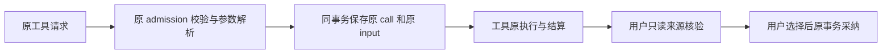

# T1097 外部工具原始输入的最窄持久化建议（只读评审）

产品候选：`533224f334c43cdb81a344424e420cad93784dd1`。本报告不是实施或合同批准；没有运行测试、数据库、模型或 App，也没有修改 SPEC、产品、原断言和首轮结果。9 个真实消费者 SHA 及冻结字节比对见同目录 `t1097-external-input-readonly-port-source-binding.json`。

## 原合同事实

`backend/src/modules/ai/external-task-tool.service.ts:44–73` 在 `leases.withLease(ref,"admission")` 内读冻结模型输入、锁原任务和业务映射、核原根回合及白名单，先用真实 `tool.parameters.safeParse(request.input)` 解析，再由 `z.json().parse(parsed.data)` 得到实际调用的 input。行54的调用摘要为：

```ts
`sha256:${chatInputDigest({turnCallId,toolCallId,toolName,version:toolVersion,input})}`
```

`chat-turn-submission.service.ts:22` 的 `chatInputDigest` 是 `canonicalJson` 后 SHA256（返回不带前缀的 hex）；不能改成 JSON.stringify 摘要或把字段名 version 改为 toolVersion。原 operationKey 另外用 JSON.stringify 两个调用 ID，不能混为同一种摘要。

`contract/src/internal/execution-worker.ts:150` 的严格 `externalTaskToolCallSchema` 只存 schemaVersion/kind/turnCallId/toolCallId/toolName/toolVersion，原 input 没有保存。行284 `executeExternalTaskTool` 是严格调用入口，input 为 JSON，现有消费者上限为 JSON.stringify(value).length ≤ 1_000_000。`external-chat-turn.service.ts:205–213` 从已结算结果生成工具卡，input 固定 `{}`，不能用卡片还原 typed_patch/snapshot 原参数。

原 replay 分支核原 call 的 parent/inputDigest/providerResult 全等，直接返回原 settled 结果或 unknown（`external-task-tool.service.ts:63、82–85`），不会再次执行。不能用 replay 请求或候选反向猜原 input。

## 建议落点与严格单条字段

建议在已有 `execution_tasks.payload` 添加独立命名空间 `externalToolInputs[call.id]`，仅新 call 入场时，在原 reserve 同一个 admission 事务内写入后端已解析的 input。`schema/intelligence.ts:138–151` 已有 payload JSONB；`execution-lease.service.ts:21–33、51–54` 的原任务行锁与事务可承载此写入，无需新表、Worker 原始数据写端口或进程通用权限。

单条严格合同建议如下（这是待正式 SPEC 定名的建议，不是已存在类型）：

```ts
{
  schemaVersion: 1,
  callId,       // 原 execution_calls.id；与 map key 相同
  turnCallId,   // 原 external_agent 根 call.id
  toolCallId,   // 原 provider tool ID
  toolName,
  toolVersion,
  inputDigest,  // 原完整 sha256:hex
  input         // z.json；原已解析参数及现有 1_000_000 上限
}
```

字段严格拒绝多余项；ID 使用现有 operationKeySchema，名称/版本保留现有 256/128 上限，摘要为 `^sha256:[a-f0-9]{64}$`。映射上限服从原调用数量门（最多1000），不新增次数/期限。写入保留 payload 其他字段且不改 modelInput/hostContext 及其原摘要，不将 ctx.source=user 混入 Worker 的 admission ctx.source=ai。用户采纳只读服务仍需独立 user 入口。

新插入 call 与输入记录必须原子提交/回滚。已有 call 的输入记录不可覆盖；**旧调用缺记录一律不从 replay 回补**。这既保原幂等响应，也不伪造历史来源。未知/started 调用、缺原输入的旧历史可以继续原对账，不可因此获得采纳权或重发权。

新只读候选来源服务应校验映射 key=callId、记录字段与原 call/根 parent/task/冻结 tool 定义一致，复算上述原摘要并要求与 call.inputDigest 相同，再核原已结算成功 outcome、候选完整 digest、源 user message/任务/会话/组/hostContext 等原来源链。Codex/ACP 原 session/providerTurn/native binding 校验必须继续独立成立；该 map 不是 native binding 或授权替代物。冻结版本参数若没有可用解析器，不可用最新工具版本重新解释旧原 input。

不建议把 input 塞进 providerResult：现存严格 schema 与 replay 的 deepStrictEqual 会牵动原 identity 与兼容分支。也不要塞进 codexCalls[root].tools：`external-chat-call-tree.ts:16–27` 明确将外部短读/候选 call 与普通 Worker tool 区分，后者还绑定不同 operationKey/白名单；复用会污染真实调用树。



## 最窄后续实施范围

`external-task-tool.service.ts` 新 call reserve 原子保存；`contract/src/internal/execution-worker.ts` 仅严格已保存记录类型；原外部工具服务测试；正式 T1097 已列的新候选来源服务及其公共链测试。现有 executeExternalTaskTool request/result 和 Worker 工具消费者无需新增通用接口。至少验证新参数精确保存、同键 replay 不覆盖、事务失败无孤立 call/输入、跨任务/跨组/错 parent/版本/digest 拒绝、旧缺 input 拒绝采纳但原 settled replay 保持、unknown 不获得重发/采纳权。严格来源服务的成功验证必须走真实 Codex/ACP 外部原 call 链，不能仅构造 map 单测代签。
