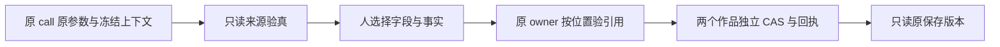

# T1097 正式 SPEC 独立窄复评

结论：**合同评审 PASS，五项阻断已关闭**。最终 SPEC SHA256 `8221447156d8ae0194ab343cde1413a378e2fa18a552dbf869b576b5eb26b232`，产品冻结候选 `533224f334c43cdb81a344424e420cad93784dd1`。作者 root，评审者 codex_route_inventory，原窄提案作者为另一 agent。该 PASS 仅为这份合同的可实施性与范围准入，不代签产品实现、TDD、公共模型/E2E、types、Gate 或 App。

原报告 `t1097-formal-spec-independent-review.md` 及原阻断 SHA 保留。48 个原评审真实来源的当前 SHA 与原报告和冻结产品逐条均一致，证据见 `t1097-formal-spec-independent-rereview-source-binding.json`。原参数9源补核见 `t1097-external-input-readonly-port-source-binding.json`。复评未编辑 SPEC/产品/原断言，没有执行测试、模型、PG 或 App。

## 五项阻断闭合

| 原项 | 最终合同的具体闭合 | 判定 |
|---|---|---|
| CR1097-01 原外部 editor 参数不可取得 | §2 固定 payload.externalToolInputs[真实call.id] 严格记录，仅新 call admission 同 reserve 事务持久已解析 input 与原 hash，旧 replay 不回填；providerResult 及 Worker 端口不改；真实 patch/snapshot 两族与同终文换 kind/edits 拒绝纳入 AC4 | 关闭 |
| CR1097-02 全部 refs 当前重验反杀旧稿 | §4 明确沿 owner 原位置/同ref 历史保护保存正文，原旧图/file失效不提前整单拒绝；新/改变引用与真实授权撤销保原门；原 receipt 在当前 CAS/动态资料之前重放；AC4 保留旧资料失效公共链 | 关闭 |
| CR1097-03 assisted 范围不互斥 | §3 只允许文章微调/联合文章、联合图文；独立 graphic/production source 明确拒绝新操作，继续 manual；ctx.source=user 仅 assisted，manual schema 独立导出供 assistant-system | 关闭 |
| CR1097-04 resolved/事实/refs 字节合同歧义 | §1 固定 resolvedWritingContext 全字段、真实历史 snapshot、selection/project/ref/file 对应、每文件60000 UTF-16、摘要和 read 输出；§3 固定文章/图文不同投影、metadataSource 删除键、fact两份完整摘要及 id/text/refs 精确状态继承 | 关闭 |
| CR1097-05 原端口/版本/测试写集遗漏 | §5 原参数协议4产品/4原测试与精确现有公共链路径纳入；§2 固定有 writingContext 的4工具 v2 prefix:原 definition hash、旧目标 v1 原定义/摘要不变；CLI READ/workspace/endpoint 真实登记仍在范围 | 关闭 |

## 图文全局 sourceRefs 稳定 union 专项

当前 `graphic-posts.service.ts:192–208` 先按全局与 cardId 位置分别对照 priorRefs，仅相同位置/精确 ref 命中历史保护；新增 asset ref 走 assertAssetFile，项目/脚本/作品/雷达分别原窄授权口。新的 `candidate.sourceRefs` 后接 `base.sourceRefs` 按规范 ref 字节稳定去重，只保双方真实证据，不从字段名称或文本推断引用。

由此：保留 base 全局 ref 仍在全局位置，对后来不可用的旧资料沿原豁免；同一个 ref 同时出现候选与 base 全局时只保一个，不产生重复拒绝；只存在旧卡 refs 的 ref 若被候选移入全局，属于新位置，**不能从旧卡借历史豁免**；卡 refs 沿其原 cardId 分别核。该合同与现 owner 安全门可组合，不需要放开跨位置历史保护或在 adapter 提前全量查 active。文章同理沿 `articles.service.ts:120–169` 的 title/summary/sectionId/factId 和原 imageUse 位置对照，未选字段/keep事实保其原字节。

此处是静态可实施性判断。后续必须真实测试全局 retained/重复/new/ref跨位置、原file失效、跨组拒绝和完整 source→assisted→receipt 链；本轮未把 helper 或旧保存链签作这些新分支 PASS。

## 合同落实时需保持的事实

- 原外部参数长度门是 `JSON.stringify(input).length <= 1_000_000` 的 UTF-16 字符串长度，不是 UTF-8 字节；最终 SPEC 已改准，不可换 Buffer.byteLength 收紧中文。原 input 摘要严格保 `version:toolVersion` 字段名、canonicalJson 和 sha256 前缀。
- 新记录仅服务端新 admission 原子保存；不是用户可写证明或 native binding 替代物。source 身份/旧 history/hostContext/父 root/provider thread/turn、settled 成功与 frozen tool 原参数仍各自校验。旧缺参数 editor 准确冲突，原 unknown/settled replay 保原行为；不能制造新调用来补历史。
- resolved brand 只用真实 statement/masterSnapshot，neutral/空资料仍合法；旧缺 snapshot 不拿 live profile 猜原资料。恢复读冻结来源，而不是重新装配最新文档；v1/v2 选择以原目标/冻结版本为准。
- replace facts 按完整原候选核摘要，但投影新/改事实强制 needs_confirmation；模型 supplied confirmed 不是用户确认。metadataSource 混合来源删除可选 key，不造 null 或 tags refs。
- 两个 artifact 的 receipt 各自以完整 intentDigest 和明确 expectedAiTaskId 识别，不能使用唯一 execution_call_id 的 ai_task_results 代替；同 key 改选择即使最终文档相同仍冲突。ACK 恢复不增模型、不覆盖后续手工稿。
- 单次120秒/test180秒只是消费者底线，保更长原预算；实际 driver 外层须覆盖两成员完整串行/模型排队/启动清理，继承原任务剩余期限，不能续期。1366/390 真实视觉/交互证据、Codex与Pi各自公共链和 Gate 仍待集中实施验收。

SPEC 尚未 canonical 同步，DEC、BACKLOG/manifest/context 精确写集准入及完整首轮结束门仍由 root 闭合。该复评不解除冻结，不授权现在修改产品/原失败或运行 v3。
