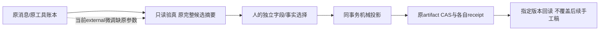

# T1097 正式SPEC独立评审

结论：**需修订，当前不签准入PASS**。绑定SPEC SHA256 `a91ed0a64f2cd482cbbdc7f232ecafebef71a662d94e19b87b0cb4d2856d3d96`，产品候选 `533224f334c43cdb81a344424e420cad93784dd1`。作者root，评审者codex_route_inventory；先前窄提案作者为另一agent。本次只读源码/合同/提案与架构；48个实际来源逐一同冻结commit字节一致，见t1097-formal-spec-independent-source-binding.json。没有启动测试、模型、PG、App或更改产品/原断言。SPEC尚未canonical同步、DEC/控制面尚未闭包，此报告不称已批准。

## 阻断发现

### CR1097-01：Codex/ACP微调的原参数证明在当前账本不可取得

SPEC §2要求冻结原input/typed_patch或snapshot与inputDigest核验。external-task-tool.service.ts:54–65只保存原参数摘要、external_tool身份，没有保存input；external-chat-turn.service.ts:210–213为该卡投影input:{}。work.editor.candidate只含完整候选/changes/summary/imageRequest，没有原typed_patch edits及kind。同一最终文档可由不同patch或snapshot得到，无法从候选逆推出原参数；不能构造猜测snapshot过摘要，更不能用当前UI/model补证明。Pi原model回执确有参数；creation proposal的原参数可由targetDigest/article/graphic构造再核其原inputDigest，这不能代签editor。

最小SPEC修法：明确新external_tool在原admission/lease受控事务中持久原已schema解析input及原digest的协议，住原execution payload/原call既有载体、不新增候选表/DB迁移/用户可写证明。加入backend/src/modules/ai/external-task-tool.service.ts、必要contract/src/internal/execution-worker.ts及其原测试精确写集；只读source消费该真实不可变参数。原已开始/历史缺参数proof按原现状准确冲突，不追加伪proof、不重发turn/model。需真实公共Codex/ACP patch与snapshot两族source-read→adopt回归，换kind/edits但同文档仍拒绝；新source接口不能把合法当前微调整族固定拒绝。

### CR1097-02：所有refs当前重验可能反杀旧稿合法正文保存

§4无receipt“验证所有refs/真实file”未明确沿原owner的历史引用例外。当前articles.service.ts:133–137对同location同ref保历史字节；:157–169已选旧图片失效仍可保精确历史引用保存正文。图文assertDocument也对unchanged refs/files保历史。若新adapter在owner前强制全部引用/旧图片当前active，正文、未选元信息/facts原样的合法候选会整单失败，这是本任务新增门造成的可用性回归。

最小SPEC修法：新增引用、真实归属/授权撤销继续原门；保留base中同location相同引用与旧不可用图片按现owner历史规则，不强取最新版本替代。receipt重放仍先原owned identity与精确intent再回原版本，不查动态资料。增加原旧图片/文档不可用、未选字段不变但正文可安全采用的公共链AC；不能靠删除图/事实、假资源或放宽跨组权过门。

### CR1097-03：assisted成员范围在正式节尚未互斥固定

窄提案明确图文assisted仅work.creation.propose成员；正式§3只写“文章和图文增加assisted分支”，source工具又允许work.editor.propose（可为graphic_post或production）。§1/AC4要求独立图文精调和视频不变。实施者可因此将独立图文编辑切到新投影/元信息选择语义，或误把production source列为可采用。

应固定：articles assisted仅work.editor.propose的wechat_article或work.creation.propose的articleMember；graphic assisted仅work.creation.propose的graphicMember。独立graphic/native原manual编辑器路径保留；source响应支持哪些owner与采用拒绝门逐项明确，不能仅靠UI隐藏。ctx.source=user限制落在assisted入口，manual/body与system.action原保存不新增该门；manual schema单独导出供assistant-system .omit/.extend，禁止对union调用旧方法或passthrough。

### CR1097-04：严格解析后上下文与投影字节合同仍有字段歧义

前端选择writingContext形状已固定，但后台“经解析的refs/原文/guidance/截断事实和摘要”没有对应严格schema、字段名、digest定义和work.read输出位置。事实两digest也只称规范摘要，未固定前缀/输入；graphicDocument没有titleSourceRefs/summarySourceRefs，仅整篇sourceRefs与card refs，而§3泛指“对应title/summarySourceRefs、现有各字段refs”。这些字段影响strict hostContext摘要、原tool输入、前后端预览与最终exact document，不能由两层各自猜。

需在SPEC固定：resolved writingContext的唯一strict schema、选择和resolved关联/owning project、brand历史snapshot/guidance及selected sourceMaterials的精确assetId/assetFileId/ref/label/text/truncated事实，摘要采用哪份canonicalJson及格式；不接受客户端guidance，不自动添未选文档。首次品牌当前可选性用现readPositioningCenter/currentStatement核，历史原任务仅冻结snapshot，不拿getStatement任意历史版本冒首次当前选择。按owner列投影：文章title/summary与各自refs一起选择，tags无refs；图文只保既有sourceRefs/card refs的真实集合，不造字段类型；metadataSource混合时删除可选key而非写非法null。事实摘要建议明确原完整base.factItems与原完整candidate.factItems的canonical字节，UI计算与后台一致；投影再按id+text+sourceRefs精确相同比较保原用户confirmed，新/改项强制needs_confirmation，模型提供confirmed不构成确认。keep原字节不变，微调replace拒绝，不能将采用replace勾选等同事实confirmed。

### CR1097-05：精确写集须补当前消费者及实际测试路径

CR01所需原参数端口不在现写集。现“contract/src/work-editor.test.ts”不存在，真实为contract/tests/work-editor.test.ts；registry.test.ts实际contract/tests/registry.test.ts；work-creation严格历史/公共目标当前覆盖在contract/tests/ai-public-message.test.ts；公共联合链为backend/src/modules/ai/work-creation-chat.integration.test.ts；微调Worker链backend/src/integration/chat-work-editor-worker.test.ts。不得用“所在原测试/上述”授权通配删覆盖。还应明确当前tool-definition版本策略：chat-tool-definitions.ts:97把四work工具冻结chat-tools-work-director-v1，头部约束实现语义变更须升版本。新语义若升v2必须登记该文件/测试且显式v1 reader/旧目标分支；若经判定仅添加可选信息、不改v1执行语义，需写其理由及缺writingContext旧任务保持原结果/摘要的测试，不能按当前新策略重算旧候选。

## 已成立的设计与实施可行性

- 唯一新增只读source操作必要且可实施：现work候选没request/source，当前source reader只支持system/canvas；不能简单增加工具名。原sourceMessage→chatTaskId→business/execution/history/hostContext与call树都已有真实事实；新reader独立work union，完整candidate含原内层digest和target全部参与外层sha256，保旧现存candidate字节、不补legacy候选行。候选与当前卡不等保卡冲突；CLI READ/workspace group/external transport注册及endpoint inventory须同契约运行。
- 用户字段选择由application纯机械projection执行，留SEMANTIC_BOUNDARY_ALLOW；frontend仅控件/版本同步、组合根仅注入service ports，符合物理房间和模块间不跨repository边界。选文档现material-link分页+assets.readDocumentFileSource可复用，不需素材/定位repository或新SDK。60000 UTF-16截断须明确真截断，各原file版本独立读；neutral与空资料合法。品牌guidance必须后台derive精确statement/masterSnapshot，不随current/live profile补写。
- 原artifactVersions确有adoptionKey/adoptionSourceDigest/aiTaskId和getVersionByAdoptionReceipt expectedAiTaskId（默认null，assisted必须明确原task）；两artifact独立receipt正确，不能挤execution_call_id唯一ai_task_results。intent摘要覆盖operation/output/完整source/base/规范字段/事实选择/policy，避免同文档不同选择偷换key。owner createPreparedCandidateVersion内部口保原CAS与人的createdByType，不公开document override。
- 原store绑定组合根workArticlesFor/workGraphicFor/workAssetsFor/workProjectScriptPortsFor已存在，可在一个tx装配reader/owner。须实际核依赖未闭包到外层db、锁序、receipt先于CAS/动态资料与新写父门；这不是孤立helper即可证明。新版本不动后续手工稿，receipt重放不重发模型。
- 历史目标缺writingContext保持原parse/digest，无neutral注入；source unknown/started不可采纳、没有provider binding或模型状态证据准确冲突，不把未知usage/turn虚构成已验；0模型增量采纳不等于0模型生成。Codex无需独立API与Pi兼容是分别真实链证据，不互相代签。
- 油UI边界按项目skill0.10.0+UI_RULES局部保原tokens/组件/选择区、候选卡与原稿身份；事实/元信息取舍、pending/ACK、冲突和saved-not-synced在对应对象反馈。一份候选失败不清另一份，两次采纳分别同ID。1366/390逐真实操作、真实截图/trace与目视审查需后续实际发生，本轮无画面评审PASS，不另选视觉方向。
- 正动作/request/expect>=120s、test/hook>=180s是各consumer底线；联合来源分页/两成员保存、模型排队/原task剩余期限与trace清理外层须覆盖完整串行，保更长预算/retry0。不能仅全局180s容纳多个120s动作；原在途unknown恢复不续期。当前SPEC需集中阶段给出实际逐链driver预算清单再运行。

## 复评与控制面边界

上述五项固定后复评精确新SPEC SHA；不要按本报告先改冻结产品或原assert。DEC与BACKLOG/manifest/context写集仍由root集中按已授权流程闭包，不把待评合同称已批准，不要求用户重复批准已授权集中修复。所有首轮红与未达后置保持；本报告没有TDD、实现、模型、浏览器、四types、boundary/orphan、reconcile或App PASS。
