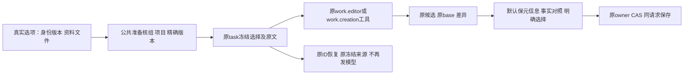

# T1097 正式编导与联合创作合同：独立只读方案约束

当前源为 T1246 冻结 `533224f334c43cdb81a344424e420cad93784dd1`，不是已修实现或已准入方案。用户方向已确认：除视频外联合生成，右侧编导微调；旧“根据脚本扩写文章”不恢复。本文供root补正式SPEC及独立评审，不修改产品/SPEC/BACKLOG、不运行模型、App或测试。

已加载项目 oil-ui-pro 0.10.0、账号组 UI_RULES；只核现有任务流程。复用现有 LazyDisclosure、单选/复选、Dialog、候选预览、NoteRelay、Button与品牌tokens，不另做风格探索。当前源码不能代签实际视觉与操作证据；正式实现前保原相关区域基线，实施后独立目视1366×900/390×900。

大白话：选“中性”就按中性方法写；选一个真实身份版本、勾一份资料，就把它们的原版本交给这一次编导。AI只能给候选。已有标题、摘要、标签先保留，事实变动能对照，确认后再采用；恢复旧任务仍用它原来的身份、资料和稿件版本。

## 当前缺口与已有可复用合同

1. `ArticleWorkbench` 的身份/资料控件真实存在（588-608），状态分别 `useBrandProfile`、`activeBrandProfile.id`、`selectedSourceIds`；唯一消费在无按钮调用的旧generate374-380。正式prepareForTurn345仅返回WorkEditorTarget身份/base/digest/selection；它和 `WorkCreationTarget` 都没有选项字段。因此这项是已授权失效控件修复，不是旧按钮测试校准。
2. 当前真实ID字段可直接沿用语义：`brandProfileVersionId`（positioning statement版本ID）、`sourceAssets:[{assetId,assetFileId}]`，选定文件冻结后不可再换成currentFileId。现 `articles.service.ts:294-321` 生成路径已具备真实资料检查及有界原文；`persistence-client.ts:3091`核当前project material-link再 `assets.readDocumentFileSource`，后者463按同asset的真实file读取 `file.extractedText` 而非当前asset投影。原引用是 `{kind:'asset',id:assetId,versionId:assetFileId}`；project引用是 `{kind:'project',id:projectId,versionId:project.updatedAt}`。旧生成方法不能重启来复用这些检查，抽出窄只读装配端口即可。
3. 品牌解析3101读当前statement并核version/profile/masterSnapshot，返回 `{profileId,versionId,guidance}`。这是初始用户选择准入可复用规则，但不能在原任务恢复时重新读最新statement来替换旧选择。positioning现有 `getStatement`/真实历史masterSnapshot可读取同原版本；正式方案应明确首次选择需当前可选版本，任务冻结后仍是该版本原snapshot。没有历史snapshot/真实来源就报原错误，不猜填新品牌。中性选择是明确null/neutral，不能与“缺字段自动默认品牌”混淆。
4. 联合链现有完整根：`WorkCreationTarget` 为 schemaVersion1/clientRequestId/projectId/compositionId/compositionRevision/scriptSourceRef/scriptConfirmation/articleMember/graphicMember。成员必有outputId/artifactId/baseVersionId。`work-creation-root.read`已核composition真实成员、原已保存脚本、两文档精确版本；targetDigest是裸64hex。`propose`核同script引用和当前素材真实file，输出articleDigest/graphicDigest。不能把选择脱离target单独放在临时prompt，导致恢复、targetDigest或幂等同请求可换资料。
5. 微调target为真实 projectId/outputId/owner/contentType/savedBase.{artifactId,versionId}/documentDigest/selection，documentDigest为sha256前缀。typed_patch有明确操作与前值digest；typed_snapshot对文章已保护factItems/来源/图片/布局，仅放开title/summary/tags及section文字。不要错误说微调现在可以随意替换事实，或为了做事实对照而解除现有facts保护。微调现确可改标题/摘要/标签，而候选采纳无默认字段保留层。
6. 联合card现按整个成员文档保存；`saveWorkEditorCandidate`把proposal.article/graphic原样传 `createArticleVersion/createGraphicPostVersion`，CAS使用原member.baseVersionId，再读receipt.versionId精确版本核一致。它没有事实旧新对照/字段选择。UI只改原proposal/candidateDigest再沿旧key保存会破坏候选身份及原请求恢复；不能这么修。

## 正式SPEC必须冻结的最小合同

**选择与来源。** 在当前文章编导目标及联合目标增加窄严格选项结构（建议字段仍叫brandProfileVersionId/sourceAssets；最终名称由SPEC冻结），明确neutral与用户选定品牌版本、原稿保护策略版本；不要给production/native视频target扩选项。空选保持中性/无额外文档、仍可合法创作。选项只存真实ID，不接受前端传“已读原文/guidance”当可信来源。backend经原owner服务核user/group/project链接、active文档及同file提取，解析真实品牌版本snapshot；在公共准备→原hostContext/任务输入冻结，并把同ref及有界真实text/guidance交给原read工具。20份/重复pair与60000字截断通知等原约束复用，不新增关键字推测身份或资料。

联合文章控件的选择归属应在SPEC说清：它属于当前项目文章成员的写作上下文，是否同时作为图文共同方法由已批准联合创作定义明确；不能随图文当前平台号变化自动换身份，也不拿另一project的控件状态。当前文章local state仅组件生存期，联合按钮在脚本CreationFlowCtas；需要通过既有DraftChatRequest的scope+project通道持有真实选择快照，文章切Tab/卸载不能悄悄丢选择，切组/项目不能带过去。用户按现按钮确认时冻结；submitted-unknown恢复原snapshot，不读现在勾选项、不续预算、不autoSend新任务。

**模型可见与真实消费者。** 两种目标都走现 `aiPublicChatContext`/prepareDurableChatTurn/assembly/hostContext，schema strict完整传播。后台first read须含有已核选项来源；同target摘要及绑定证明须覆盖该选择。read/propose/重连保原thread/call/turn/source，不重新取最新资料。合同应明确参考资料只包括该次明确勾选的文档及原必需脚本/稿件/Brief，不能在旁路自动全量添加未选项目文档；验收核完整system/messages/tool输入与read回执，不仅helper返回值。中性选项不能被全局品牌模板重新当本轮写作身份覆盖。更新原Skill说明只描述已加严格字段，不另添独立API/生成器、不能让模型写库。

**元信息保护等价约束。** 联合和微调对已有非空title/summary/tags默认保留；空项允许沿现脚本 metadataSource及sourceRefs补充；明确要求改某字段时，显示前值/候选值并由用户明确选择采用该字段。保留对应sourceRefs、metadataSource、未选字段、图/布局和原section/card身份。规则由明确字段选择执行，不用语义关键词猜“用户可能想改标题”，也不要求用户再次批准已授权修复。整稿候选可照常返回，不能因模型带了未选元信息而hard-fail正文：候选仍可审阅，未选字段机械保原值，合法正文继续安全采用。

候选原始receipt/原digest不变；采纳选择及将写的最终文档是另一个冻结UI命令，原expectedCurrentVersionId、精确base、原tool/task来源与完整选择共同组成稳定请求身份。发生网络unknown用原body/key核回执，不能改checkbox后仍用旧key。最终读receipt指定versionId→exact document→current版本/dirty输入同步核对保留。不允许绕 `withEditorCandidateSave/boundEditorCandidateSave` 比较，也不重算一个假的原模型candidateDigest。

**事实审读等价约束。** 联合文章候选必须能同原base事实清单对照：真实旧项与新项、每项sourceRefs、reviewState，空显示无。事实替换单独显式选择确认；不选事实时正文可采用且原事实保留。已有confirmed事实不得仅凭模型输出宣称自动确认新事实，新增/改动事实按原needs_confirmation合同处理；事实状态更新只有用户明确操作。并发base/事实版本变更要CAS拒绝且保候选，不拼当前新稿事实掩盖冲突。微调仍守现facts不可改门，仅对实际被允许的元信息/正文差异审读，不扩大typed_snapshot可写范围。

这些是等价结果约束，不先代写一种已通过的方案。最小可接受方案可以复用原文章字段采纳机械projection/CAS语义，接到当前正式候选；不得造articleCandidates假行或把work.creation候选伪装wechat.article-draft旧任务。若实现选择在backend材料化受选字段，则为当前真实候选新增窄adapter/原owner入口的严格selection结构；若用现完整owner保存命令，则UI必须保持原candidate与明确选择独立，最终正文由经验证的机械projection产生，并核原base/refs。最终跨层方案及具体operation字段需独评后才能实施。

## 具体候选最小write_set

| 文件/叶子 | 必要原因 |
|---|---|
| contract/src/resources/work-editor.ts、work-creation.ts | 限article/联合严格选择与上下文回执、保护策略/版本；保旧target历史事实 |
| contract/src/resources/ai-public-message.ts及其现消费者测试 | 公开目标严格传播；不能漏掉public入口/类型或允许前端注入可信原文 |
| 新backend/src/application/generation/work-writing-context.ts（或同等窄leaf） | 复用原链接/精确file/品牌版本service port的只读解析，所有权留原service；不放业务到frontend/Worker |
| backend/src/application/generation/work-creation-root.ts | read/propose真实选择/同digest与原来源；不重新生成 |
| backend/src/modules/ai-runtime/work-editor-candidate.ts、chat-work-editor-tool-host.ts、chat-work-creation-tool-host.ts | 原冻结target到真read工具/恢复闭包、元信息策略机械投影；保facts/ID/refs保护 |
| backend/src/modules/ai-runtime/chat-assembly.ts、frontend/src/server/prepare-chat-reply.ts（仅真实类型/装配必要处） | 公共准备核原target及冻结完整上下文、原Skill说明；无新side模型 |
| frontend/src/server/persistence-client.ts | 组合根注入原material-link/assets/positioning只读端口；不在frontend新写领域算法 |
| frontend/src/features/article/article-workbench.tsx | 现可见选择接正式prepareForTurn/共享snapshot；不再依赖不可触达generate函数 |
| frontend/src/features/draft-workbench/draft-chat-request.tsx、work-creation-request.ts、creation-flow-ctas.tsx | 当前project/scope选项通道→联合原预约冻结→unknown同请求恢复 |
| frontend/src/features/copilot/chat-work-creation-card.tsx、chat-work-editor-card.tsx | 旧新事实/元信息审读，冻结采用选择，原owner CAS/精确版本读回；预览不落正式 |
| backend/src/modules/articles/articles.service.ts + contract原articles adopt/write operation（仅采用projection方案实际需要时） | 接当前真实候选的受选字段机械材料化；保原所属/基点/CAS，不能fake legacy candidate；最终SPEC应选定才纳入，不先广改 |
| 原定位/素材服务若已有getStatement/readDocumentFileSource可读所选历史版本 | 优先只复用；没有真实缺口证据不加入无关service/migration写集 |

相应测试限定现 `article-workbench.test.tsx`、`work-creation-request.test.ts`、`creation-flow-ctas.test.tsx`、`chat-work-creation-card.test.tsx`、`chat-work-editor-card.test.tsx`、`contract/tests/work-editor.test.ts`、work-creation合同覆盖、`work-creation-root.test.ts`、`work-editor-candidate.test.ts`、两真实tool-host测试、原 `work-creation-chat.integration.test.ts`/`chat-work-editor-worker.test.ts`，以及独立本轮真实public UI旅程。资源/export barrel或原operation注册只在新增类型/入口实际需要时纳入；不新增数据库表、模型SDK、API密钥、engine owner或视频能力。

## 独评与验收须有的可反驳证据

1. 原实际可见radio/checkbox操作→公共提交同sourceMessage/task ID→执行冻结选项→真实read工具回执→当前模型输入，neutral/选定品牌/一份文档/不选文档各一族；两个不同文件版本与未选文档独立sentinel，完整输入证明确切原version、未提供的内容没有冒称已读。wrong group/project/file/未提取/假brand拒绝且零模型；合法无文档仍可生成与手写保存。
2. 切组/Tab/品牌更新/文件current变化、返回ABA、保存dirty与正在提交、submitted-unknown恢复，用原task/source/thread/turn/call/预算/read-only证明，未选新选项不得污染原任务；历史无新policy的target按历史合同回放，不现场升级。Codex/Pi均走现统一transport；Codex仍无独立文本图片API要求。
3. 完整文章+图文joint同script/sourceRefs/两成员基点候选，预览前正式稿0变更；分别采用而非自动写另一成员。已有title/summary/tags/metadataSource及facts默认原样；空字段补脚本真实metadata refs；用户选择改一个字段时其余字节/refs不变。
4. joint事实增删改、confirmed→新候选、空列表，旧新对照真实截图与用户确认记录；未选事实仍能采用合法正文；selected facts并发CAS拒绝不丢候选。micro typed_snapshot/patch 保原facts/图/布局/来源/身份，未请求元信息不改；允许明确改标题时可实际交付而非被全新quality门整单反杀。
5. 采用请求unknown重放同key/body只得到原receipt，checkbox变化不能偷换原请求；receipt exactversion document与该次最终采用内容/来源hash一致，另一次人工编辑dirty不覆盖。原取消/重复点击/双窗口冲突与Pi旧恢复保持。
6. 原article9红按钮不恢复；将每个业务后置断言映射到上述真实入口，同时明确本次first未到下游。不以共享helperPASS代签UI/当前49官方生成；真实UI screenshot/trace逐case与scope/task绑定，read tool成功不是模型生成完成。frontend/contract/related backend-worker、boundary/orphan、LED047/LED053以及SPEC要求的公共链测试实际跑，结果诚实分开。

尚未形成准入SPEC、尚无实现/测试/真实模型/视觉PASS。root应把以上最小实际方案和write_set补到T1097正式SPEC，独评完成后才集中实施；这不要求用户重选已确认联合创作方向。
