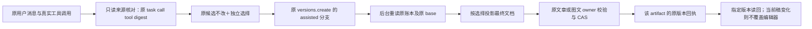

# T1097：原候选、独立选择与后台材料化的窄采用契约提案

这是供正式 SPEC 选择的单一候选方案，不是已审批实现或评审 PASS。只读绑定 T1246 产品候选 `533224f334c43cdb81a344424e420cad93784dd1`；40 个实际源文件与该提交字节一致，完整 SHA 见 `/tmp/t1097-narrow-candidate-adoption-source-binding.json`。未改源码、断言、SPEC 或 BACKLOG，未跑模型、测试、App 或用户库。

范围仅为文章编导，以及联合创作的文章、图文两个成员。图文独立编辑和视频保持现状。身份/资料上下文的准备及任务冻结沿前一份 T1097 报告，不在本提案扩出新创作方向。联合事实取舍落实已有用户授权，不再另设外部批准点。

大白话：候选原文不改。用户另外勾选要采用的标题、摘要、标签，事实另行对照确认。后台从原任务账本取真正的候选，把这次选择机械应用到原稿，再交原作品服务保存。文章和图文各自保存、各自返回原版本；请求结果不明时只重读、重放同一份采用请求。



## 1. 现在真正发生的公开调用

- `frontend/src/features/copilot/chat-work-editor-card.tsx:87` 的 `saveWorkEditorCandidate`，对普通 `work.editor.candidate` 使用 `result.apply.body`，对联合成员构造完整 `proposal.article/graphic`。公开请求只有 `{expectedCurrentVersionId, document, clientRequestId}`。没有 taskId、callId、toolCallId 或可信来源摘要。原两条 `versions.create` 的严格 body 也只有这三个字段。
- `withEditorCandidateSave/boundEditorCandidateSave` 是前端 Map：按 requestId 比较 candidate 的规范字节，并复用 pending Promise。它不向后台传来源，也没有持久服务端验真能力。另一个 `adoptAssistantDocumentThroughEditor` 的 system.action 路径确实传 source，但不能把它的保护算给普通 work 候选。
- `createChatProposalSourceService.read` 已有真实 task/history/hostContext、Pi tool claim 和 Codex/ACP provider parent/turn/binding 验证；但白名单只含 system.action.propose/canvas.*，要求候选有 request/source。当前 work.* 结果不具备这两个形状，不能仅把工具名加进 Set 就复用。
- `createAssistantActionAdoptionService` 按 executionCallId 写 ai_task_results；`backend/src/schema/ai.ts` 对 execution_call_id UNIQUE。一个联合 propose 调用产生两个独立成员，直接复用这条采纳回执会使第二个成员冲突。
- 原 owner 已有可复用回执：文章 `article-edit:<clientRequestId>`；图文 `graphic-post-edit:<clientRequestId>`。`ArtifactsService.getVersionByAdoptionReceipt(ctx,artifactId,key,digest,expectedAiTaskId)` 及 repository 的 artifact 锁、receipt-before-CAS/父项目新写入校验均实际存在。两成员 artifact 不同，同一原 call 不妨碍分别建立 artifactVersion。

## 2. 唯一建议的公开合同

### 2.1 一条只读来源解析操作

增加 `ai.workCandidates.source`（GET，group scope）。路径 `/ai/conversations/:conversationId/work-candidates/source`；严格 query 为 `{sourceMessageId, toolCallId}`。它只读已有账本，不创建任务、候选或版本，不调用模型。

响应严格为 `{assistantSource, toolName, candidate}`：

- `assistantSource = {taskId, callId, toolCallId, candidateDigest}`，四字段形状复用现有 assistantProposalSourceSchema。
- toolName 只允许 `work.editor.propose` / `work.creation.propose`；candidate 是对应原完整成功结果的严格 union，不添伪 legacy 标记、不重写 resultText。
- taskId 是业务 aiTask ID；callId 是经过真实 reusedCallId 链核对后的原 executionCall ID；toolCallId 是该原调用真实身份。请求的显示 toolCallId 可以是经合法重用链证明的后继 ID，响应仍归原调用。
- candidateDigest 明确定义为 `sha256:SHA256(canonicalJson({source:{taskId,callId,toolCallId},candidate:原完整成功work结果}))`。不是文档内层 candidateDigest，也不是裸 articleDigest/graphicDigest；所有原字段及原 target 都参与，原摘要字段不覆盖。
- 请求 sourceMessageId 经原 `readChatTurnSnapshot` 读取 owned 会话/用户消息；其已保存 modelMetadata.chatTaskId 精确定位原任务，再验证 input/history/hostContext 映射。不是从最近消息文本猜任务，不扫描所有任务取第一个同名工具。没有唯一合法原调用就返回真实冲突。
- UI 活跃轮使用该轮提交已返回的 x-source-message-id，必须按轮保存到候选来源上下文，不能拿全局最新 preparedReceipt 填旧卡。历史轮使用真实 assistant.modelMetadata.sourceMessageId；现 `toUIMessages` 丢这部分信息，需要保留 typed 来源上下文并传卡。后台始终重验。不得根据“最近一条用户消息”猜填。
- 读回 candidate 必须与当前预览卡的完整原结果规范字节相等；不相等保留原卡和错误，不用后台结果静默替换用户正在确认的候选。

这条 read 是为现有未带 source 的真实 work 候选补齐可信 provenance，不需要先改宿主输出 schema、重签旧账本或建候选表。

### 2.2 原两条 versions.create 加严格 assisted 分支

保留现有手工 body 原样。新增有明确判别的严格分支；两分支互斥，未知字段仍拒绝。原 operation ID/路径/普通 response `{versionId,document}` 不变。

文章 `articles.versions.create` 的 assisted body：

```ts
{
  adoptionMode: 'assistant',
  expectedCurrentVersionId: string,
  assistantSource: { taskId: string, callId: string, toolCallId: string, candidateDigest: string },
  fieldSelection: Array<'title' | 'summary' | 'tags'>,
  factSelection:
    | { mode: 'keep' }
    | { mode: 'replace'; expectedBeforeDigest: string; proposedFactsDigest: string },
  policyVersion: 1,
  clientRequestId: string
}
```

图文 `graphicPosts.versions.create` 的 assisted body 相同，但没有 factSelection（文档无 factItems）；fieldSelection 同为 title/summary/tags；只接原 `work.creation.propose` 的图文成员。outputId 来自原 params，backend 据原 target 确定成员，不接任意 member/document。

- assisted 分支**没有 document/edits/target/candidate 正文**。模型也不能调用公开采用动作：`ctx.source` 必须为 user；不向原模型工具表暴露新采用能力。普通手工保存仍由真实编辑器发原 body，不能把 assisted body 降格改成 manual document 来规避来源校验。
- fieldSelection 为无重复明确集合；digest 统一采用字段固定顺序的集合规范化。已有非空元信息默认不勾选；空字段可由 UI 显式默认勾选，并按实际最终选择提交。可选 tags 若原候选未提供，则不显示可替换标签选项，后台也拒绝选择一个候选缺失字段；候选实际提供空数组时才允许用户明确清空。后台不根据行业词、语义或模型建议自动改选择。
- factSelection replace 只允许联合文章；微调文章只能 keep，并继续核 factItems 与原 base 深等。替换时两个摘要分别对应用户看到的原 base.factItems 和原 candidate.article.factItems，后台按规范字节验证，不收客户端的新事实正文。
- 联合事实 diff 展示原/候选完整条目及 sourceRefs，明确勾选才 replace。这个确认是采用界面里的事实选择，不是新的任务批准流程。

**必须处理的真实类型消费者：** `contract/src/resources/assistant-system.ts:79-80` 现在对两条 body 使用 `.omit(...).extend(...)`。body 改 union 后这些方法不能继续调用。应导出两条现有 manual body schema；system.action 的 article.save/graphic.save 仍只由 manual schema 派生，不让模型获得 assisted 分支。不能改成 passthrough 或放开任意 JSON。

## 3. 后台可信来源 port 与投影

新增窄 `WorkCandidateSource.read(ctx,assistantSource,store)`，配套上面的 resolve 只读方法。与现 source service 共享或提取下列精确验证原语，保持 system/canvas 现验真行为不变；work 是单独类型分支，不放宽全工具白名单。

1. 原 user/group/account；原 business→execution 映射、原会话与 sourceMessage、原冻结 history/hostContext 摘要；项目必须是 original hostContext 项目。保留原 task/call，绝不通过新任务取得“证明”。
2. 原调用为 settled 成功 proposal；Pi 必须有真实领取、模型/tool binding 和 receipt identity；Codex/ACP 必须有真实 external_tool identity、正确 parent external_agent、原 native providerTurn/protocol/binding/inputDigest。unknown/started 工具不能采用，读取不能 reserve/dispatch 模型。
3. 冻结工具名、version、effect、execution、parameters；真实原参数符合该冻结版本，候选 target/base 对应 original hostContext。editor 原 input.base/baseDigest、typed patch/snapshot与原已保存文档确定性重算结果相等；creation 原 input.targetDigest/article/graphic 对应原输出及两成员 target。不能要求 work 候选有伪造的 `request` 字段。
4. 合法 Pi reusedCallId 只可向较早原调用追溯，参数、成功 outcome、原来源字节一致；循环、错任务、错输入均拒绝。
5. 旧 schemaVersion1/frozen tool 定义按明确受支持的原版本解析，不能用新 writingContext 的当前定义强迫旧账本升级。若提取当前 reader 的“当前工具定义等于 frozen”逻辑，需要针对已知旧 work 版本建立精确兼容解析；不得把其它 system/canvas 的严格规则去掉，也不得生成历史领取/turn/摘要。

纯投影 port `projectWorkCandidate(base,candidate,fieldSelection,factSelection,policyVersion)` 只落实选择，注释 SEMANTIC_BOUNDARY_ALLOW；不做内容语义判断：

- 微调：从已验证原 candidate 文档开始；未选择 title/summary/tags 则恢复原 base 对应字段及配套 titleSourceRefs/summarySourceRefs。factItems、section 身份/来源、图片/布局等原受保护字段与 base 保持原既有深等约束，不借事实选择解除保护。
- 联合：维持当前合法联合候选正文、卡页/图片结构的既有能力，再对元信息及 factItems 作选择。keep 保留 base.factItems；replace 取原候选完整事实条目和 refs。所有真实图片/file、sourceRefs、成员/原脚本证据继续经原 owner 校验，不能只将已选择正文引用换成新 ID。
- metadataSource 是**整组**脚本元数据来源，不能把它当每字段来源。全部元信息沿 base 时保留 base.metadataSource；全部沿同一已核候选时可保留候选原 metadataSource；混合来源时不声明单一整组 metadataSource，使用现有 title/summarySourceRefs 及原候选来源回执追溯，未提供的新 refs 不猜填。该受控清除必须在预览差异中体现，并在 SPEC 固定；不是静默把当前 project.updatedAt 伪造为新来源。
- 微调的 protected metadataSource 不得被模型更改。混合字段投影如产生整组标识不再适用，只由后台上述明确规则处理，其原历史值仍在 base version；不得放宽 typed_snapshot 对其它受保护字段的限制。
- tags 无字段级 sourceRefs，不添加不存在的 refs 类型。保留原完整 source digest 与原文版本，使新增标签可追到真实候选，不伪称 base 全部元信息已被原模型生成。

## 4. 事务、CAS 与两个成员的真实回执

应用 adapter `backend/src/application/generation/work-candidate-adoption.ts` 组合上述 source reader 和原 owner port，不获得第二套数据库/候选表/任务生命周期权。

- 入口严格 parse assisted body，assert ctx.source=user；确认原 target.outputId、project/artifact/base 与 params/expectedCurrentVersionId 一致，不按当前账号或最新偏好重绑。
- 原 membership/workspace 校验沿现服务，保存时遵守现 membership/组→父项目→artifact 锁及归属规则。原 settled call 同事务重读/锁定，与观察到的 resultText/inputDigest 相同。来源服务接受同一 tx store；原 owner/refs/artifacts 端口也必须全部使用该 store，不能回到外层 db。
- 来源及 owned artifact 身份核实后，**先查该 artifact 原采用 receipt**，再作当前版本/项目状态/动态资料校验。精确已有 receipt 返回原 version/document，不覆盖之后用户的新稿、不重读最新身份/资料、不调用模型。
- 无 receipt 才读原 base 精确版本、验证本次事实 diff、机械投影，走原 owner 的 refs/file 校验。原 artifact repository 以 expectedCurrentVersionId 作当前 CAS，保父项目新写入门。原 target 被迁移、归属改变/撤销或当前版本已变就返回冲突，保原请求，不自动换 base 或重发。
- owner 增加**后台内部** `createPreparedCandidateVersion` 端口，与现 manual createVersion 共用原保存核心。该 port 接后台验证后的 finalDocument、采用 key/digest/aiTaskId；transport 不接受这些 override。应用 adapter 不跨模块直调 repository。
- 新 key 为 `article-assisted:<clientRequestId>` / `graphic-assisted:<clientRequestId>`（原上限以内），保存到既有 artifactVersions.adoptionKey；adoptionSourceDigest 为下述 intent digest；aiTaskId 为原业务任务 ID；createdByType 保持人的采纳。查 receipt 显式传 expectedAiTaskId，不能沿用默认 null。
- 两份作品的原 artifactId 不同，因此同 call 可形成两条独立 artifactVersion receipt；每份 CAS 与回执各自提交，第二份失败不抹掉第一份。无需 ai_task_results 新类型/唯一索引改动，无需新候选表或迁移。

## 5. 请求摘要与结果不明恢复

`intentDigest = sha256:SHA256(canonicalJson({operationId,outputId,adoptionMode,assistantSource,expectedCurrentVersionId,fieldSelection:规范集合,factSelection:文章实际选择,policyVersion}))`。clientRequestId 是回执 key，不参与内容选择，但原 pending body 原样保存；同 key 的上述任一意图字段变化均拒绝，包括两种选择偶然投影成同一文档的情况。不能仅 hash finalDocument；现 graphic manual digest 仅含 output/base/document，assisted 必须另走此完整 intent。

候选卡采用前冻结 `{原workspace,operation,params,body}` 到现按 scope/project 隔离的待确认记录；unknown/网络 ACK 丢失只重放这份原 body 和原 key。恢复按钮不重新计算当前勾选项、最新 source、base 或偏好；用户选择有变化先显示原 pending 状态，不能自动产生新采用 key。成功后按 response.versionId 读精确版本，compare response.document；不再拿原完整候选作相等预期，因为投影后文档应反映已选择字段。current 不等于这个版本或编辑器有后续输入，则显示已保存但未同步，不覆盖。

保留 withEditorCandidateSave 的本地防重/race 作用，但绑定内容应包括 immutable 原候选、source 和独立选择；不能把投影文档写回 candidate/candidateDigest。AI task、原调用 receipt、frozen hostContext、主脚本 ref 及两个 member base 均不修改。

## 6. 本次采用契约最小候选 write_set（正式 SPEC 冻结后才实施）

这是采用子闭包，身份/资料准备的上游写集仍以前一份报告为准。

**合同及路由：**

- `contract/src/resources/work-candidate-adoption.ts`（新增 source 读返回、assisted body/selection/policy 类型）
- `contract/src/operations/ai.ts`（唯一新增只读操作）
- `contract/src/operations/articles.ts`
- `contract/src/operations/graphic-posts.ts`
- `contract/src/resources/assistant-system.ts`（改用导出 manual schema）
- `contract/src/index.ts`（导出新类型）
- `contract/src/workspace-operation-scope.ts`
- `contract/src/cli-policy.ts`（新增固定只读操作范围；不加自由写入口）

**后台 source、adapter、原 owner 及组合：**

- `backend/src/modules/ai/work-candidate-source.service.ts`（新增，读原账本/两种工具原版本）
- `backend/src/modules/ai/chat-proposal-source.service.ts`（仅提取双方共用身份验证原语；system/canvas行为保持）
- `backend/src/modules/ai/ai.service.ts`
- `backend/src/modules/ai/ai.transport.ts`（AI_OP_IDS/实际 read dispatch）
- `backend/src/application/generation/work-candidate-adoption.ts`（新增 source→projection→owner 装配）
- `backend/src/application/generation/work-candidate-projection.ts`（新增纯机械投影）
- `backend/src/modules/articles/articles.service.ts`
- `backend/src/modules/articles/articles.transport.ts`（严格分支转发，不能只摘旧三个字段）
- `backend/src/modules/graphic-posts/graphic-posts.service.ts`
- `backend/src/modules/graphic-posts/graphic-posts.transport.ts`
- `frontend/src/server/persistence-client.ts`（仅组合 read/adopt ports，store全链一致）

原 artifacts service/repository 已有需要的 key/digest/aiTaskId/receipt/CAS 能力，**本提案不预列它们产品修改**；实施若发现缺口应拿实际证据补 SPEC。原 work 工具结果无需加 source 或伪 request；原 ai schema/迁移无改动。

**前端真实采用与历史上下文：**

- `frontend/src/features/copilot/conversation-persistence.ts`（保留真实历史来源）
- `frontend/src/features/copilot/ai-copilot-content.tsx`（原轮来源→卡，活跃轮关联）
- `frontend/src/features/copilot/chat-work-editor-card.tsx`
- `frontend/src/features/copilot/chat-work-creation-card.tsx`
- `frontend/src/features/draft-workbench/draft-chat-request.tsx`
- `frontend/src/features/article/article-workbench.tsx`（原 editor save binding 消费 source/selection，不回退 manual）

**最小验证写集：**

- `contract/src/work-candidate-adoption.test.ts`（新增）
- `contract/src/assistant-system.test.ts`（manual action 派生及严禁 assisted action）
- `contract/tests/endpoint-bootstrap.test.mjs`、`contract/tests/registry.test.ts`（精确新增一操作、按正式端点集断言，不能泛改数量洗绿）
- `backend/src/modules/ai/work-candidate-source.service.test.ts`（新增 Pi/外部真实 binding 与历史精确拒绝族）
- `backend/src/application/generation/work-candidate-adoption.integration.test.ts`（新增同真实数据库事务、两个 owner、receipt/CAS/组）
- `backend/src/application/generation/work-candidate-projection.test.ts`（新增受控投影原语）
- `frontend/src/features/copilot/conversation-persistence.test.ts`
- `frontend/src/features/copilot/chat-work-editor-card.test.tsx`
- `frontend/src/features/copilot/chat-work-creation-card.test.tsx`
- `frontend/src/features/article/article-workbench-save-race.test.tsx`
- `frontend/tests/e2e/t1097-assisted-work-candidate-adoption.spec.ts`（新增真实公共 UI/same-ID）

现有文件均按精确源绑定可核。新增路径是提案，不声称已存在。测试驱动预算与截图输出在 T1246 隔离 driver 中按正式 source/driver SHA绑定；不在旧首轮证据上补签。

## 7. 独立评审/采用验收必须看到的闭包

1. 真实 source read→assisted versions.create 公共请求：只有原 identity/选择，无 document。后台 ledger 原 task/call/tool/turn/hostContext 相同，原模型调用增量0。
2. title/summary/tags 默认保留与明确采用；事实 keep/replace 旧新对照，微调 replace 拒绝；未知字段/混入 manual document 拒绝。最终预览与后台投影输出一致；title refs、混合 metadataSource 和事实 refs 不假归属。
3. 同联合原 call 两成员实际各自新版本，分别原 artifact/current CAS、采纳后 exact version 读回；一份有冲突另一份已保存仍可读，不能用一条 ai_task_results 回执代签两份。
4. 原请求一次 ACK 不明→刷新→原 body/key 重放，只一版本；后续手动编辑不被覆盖。同 key 换选择而最终doc相同也冲突。按原范围恢复，切组/跨组拒绝。
5. 原真实历史 work 候选按旧 frozen定义/target/base 采纳或返回真实现状冲突；没有 rewriting历史、补假source/claim/turn。manual versions.create、system.action article/graphic save 与独立图文/视频原功能保持原合同。
6. 用户点击候选预览→字段选择→事实对照→采纳→真实当前稿与指定版本回读，在1366×900/390×900实际留图、目视与同ID请求；API链和 helper不能替代 UI操作证据。预算/unknown恢复按LED053；旧首轮红保留。

结论：该方向在现有 owner、artifact receipt、原真实 task ledger 上具备实施基础。当前缺的是上述来源 port、严格 assisted 请求和后台受控投影的已批准合同及实现，不是需要再建候选表或另发模型。本文件等待正式 SPEC 与独立复核，未授予实施准入、未签任何实际采用 PASS。
