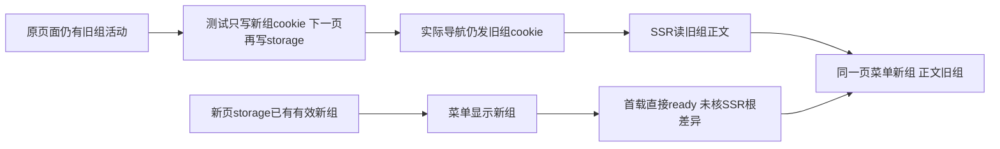

# T1246 原浏览器首轮追加分诊：组根、技能、隔离上传与知识

独立只读，不改源、断言、driver、不重新运行、不新建伪候选、不启动 App 或官方生成。冻结候选 `533224f334c43cdb81a344424e420cad93784dd1`。本轮截图用于核行为与真实 scope，不做视觉改版；若实施 UI/视觉修复须按项目 oil-ui-pro。

观察时原 scenario-index 124项，87实际passed、37实际failed，整个170首轮仍在运行。这里只分诊尚未覆盖族，不重复 Copilot BC001-003、不把新59首轮4PASS55FAIL/官方生成call=0算49生成验收。精确来源绝对路径/SHA（23文件）见 `/tmp/t1246-browser-additional-source-binding.json`；选中原错误/截图/case ID见 `/tmp/t1246-browser-additional-selected.json`；三条组相关真实 trace 中仅筛选范围 header/operation/status见 `/tmp/t1246-browser-group-trace-observations.json`。没有读取真实凭据或运行库。

## BA001：自动化两例在目标正文到达前失败；有测试竞争，也有首载同步缺口

案例：`8cf1aa680fa498b7616c-970fa63bd6a10887733c`（切组保原 job ID/排期），`6d09fca92676595ee8d1-925a30d511adcca21d02`（真实立即运行/待扫码）。前者生成测试:139初次期望2jobs得到0，尚未执行 UI切到B/回A；后者:253当前组名字不匹配，未执行开关或runNow。因此不是已证明原job删除、切组丢排期或runNow准入损坏。

真实 trace：第一例 addCookies 注入目标 `grp-81b98377-733`→addInitScript→goto `/automations`，但该真实GET Cookie是 `grp_legacy_acct-81b98377-37`；时间15:25:17.635Z。第二例15:27:27.570Z同样GET发旧legacy cookie。截图均侧栏目标新组，正文仍 `@t1022-1` 和0任务。任务创建API原explicit x-group-id正确且200，不据正文0推断backend给正确目标读回0。

测试初始化最小写集：`frontend/tests/e2e/automations-group-media-jobs.spec.ts` 的 openGroup和 `automations-run-now-public.spec.ts` 的首载目标建立。当前 page.goto('/')未等待账号组初始化结束，直接在活跃旧文档外部addCookies；当前旧doc的storage还是旧组，addInitScript只在下个doc生效，旧doc异步请求/初始化可重新同步旧cookie。真实trace足以证实新cookie未成为导航cookie，但没有单独记录是哪一个脚本赋值，不能虚构特定异步调用。集中后先待初始group ready且通过真实UI选择本例组，或同时在当前doc同步LS/cookie并停止竞争，明确核目标cookie/storage再导航；必须实际保留同ID任务/排期、返回原组、晚回写保护、开关与runNow后置断言，不改2为0。

同时确认可达产品初始化缺口：`account-switcher.tsx:99-118` 对有效storage组选中 shouldPersist=false 时直接 complete(scope)；`workspace-initialization.tsx:38-43` 只核 scope等于readCreationScope（同一storage），没有核 layout initialScope 的真实SSR根。本轮真实截图已暴露菜单/正文scope分裂，T1022 Shell要求同一组上下文，T1199默认显示当前组真实全部任务。即使测试操作有竞争，也不能把这个已呈现裂缝称正确产品行为。

候选最小产品写集是上述两 shell 文件及原初始化/切组测试：首载未ready时核 actual初始SSR scope 与当前合法storage scope，不同则沿原刷新闭包同步后ready；保已ready工作台、dirty、前台任务保护、ABA/取消/原组已提交任务，不全局强刷、不放宽backend组校验。先用当前两红案例真实公共链验证fixture归因，再独立覆盖有效storage新组+SSR旧组首载；不得增加模型/登录准入来解决。当前不预签哪一个改动足以令全两例通过。

## BA002：空组 Skill 首写案例的初始根假设漂移，后四个真实UI旅程已发生PASS

案例 `41050249d47ab09b44f8-452e9ace5f8248c451ed`，首失败生成测试:201，断言初始当前组选项必在新create的anchor/groupA二者中。实际在两组创建前已待 account-switcher ready，合法初始已有seed迁移组 `@t1022-1`。两次create是真用户域创建，不等于当前组切换；reload保当前有效组，source `resolveCurrentGroup` 明确保持合法stored组。此断言不属于 T1234公共Skill定制要求，不能让产品为测试自动切到新建组。

最小测试写集仅 `frontend/tests/e2e/group-skill-customization.spec.ts`：读取真实当前组并验 active及镜像，再通过真实UI显式切anchor/A；或不限定旧根只有两个新组。新组仍真实active/空members且首overlay/revision为空；保settings→可编辑system→明确PUT→同组get→刷新→跨组拒绝。此失败未到settings或PUT，不能称空组Skill按钮仍disabled。

同首轮独立四例实际PASS（不同case ID）：`02c8831d8b2cee5f6098` 首写/刷新/二次CAS/跨组版本，`423785e0a5cb655ecee8` 双页CAS冲突保草稿，`5f46a3ee6f7111f081eb` RSC/原回执迟到与ABA，`dad7adaf2e2937b1a61b` 历史回滚/恢复默认。保这些真实操作证据，但不拿它们补写失败首例的特定前置/同casePASS；不签新59未跑Skill能力或官方生成。

## BA003：上传隔离与六个T1062案例是在路径前置拒绝，未触发真实上传/采用

媒体案例 `37c0a50c9e3744722adf-720e6f026bb155ed6457` 在生成测试media-root-isolation:93首失败，before API创建/上传。原guard检查 dataRoot 必在 node os.tmpdir()之下，还要求basename前缀creatoros-playwright-；六个T1062（原111-116索引）同类 assertPrivateRuntime 在 beforeEach拒绝 realpath(os.tmpdir()) containment / basename前缀。原 Playwright config允许预设环境DATA_ROOT，本轮原console记录 `/tmp/t1246-original-533224f-20261012`，不是原config自行 mkdtemp 的系统临时目录+前缀。本轮为独立owned/tmp根不等于测试已证明其fresh数据/目录provenance；不能为修绿删除guard或把任意绝对路径都放行。

T1226规定fresh临时根、worker共享环境、media同根、不得改HOME/真实媒体，不授权任意预设root；目前失败说明验收配置与原guard合同不兼容，不是产品媒体root错误，更没有本例公开PUT/blob/错组拒绝的body证据。

集中测试infra最小写集：本轮运行器建立在 realpath(os.tmpdir())下的新的 creatoros-playwright-* owned mkdtemp根，逐run冻结/data/media/env一致，以原安全断言原样运行；或独立评审一个只接受本轮确切owned/fresh根provenance的guard方案，不能广泛允许/tmp、仓库、用户主目录。不得沿旧本轮库偷偷搬作fresh数据。ASR案例还要求真实离线cache/network admission（原固定commit证据需核本候选）；路径通过并不代表ASR准入已交付，不改成云端/fakeASR。产品assets/media/blob/publicschema零改。

## BA004：项目复盘无scope首载产生真实 AccountRequiredError，暂不签纯组复盘损坏

原all-routes `66d28c9c49bf28775f51-a9d66ebd122c84407a70` 真实捕获console `readReviewHistory…AccountRequiredError: legacy workspace requires selected account`，首失败49行consoleErrors[]。当前测试每新context直接访问旧fixture slug ai-native-browser，不先选择合法真实组/项目。RSC `review/page.tsx` 用未选组account的session创建serverClient；`readReviewHistory` 调 listReviews，backend `reviews.service.ts:116-123` 的 workspaceKey(ctx) 在无group/account下抛，再被前端:321明确记录后降级空。

这是实际发生的首载无scope请求错误，不能按标题称已确认纯组选中后复盘失效，也不能删除consoleError断言隐藏真实业务读失败。集中先让 route矩阵在真实既有/本例public创建的项目及有效组下验证，保单shell、无外网、无业务错误；如应支持无scope首屏，则route/readModel必须明确“尚未选工作区”不发需workspace的读，保持真正DB/transport失败仍可见，不通用吞catch。最小待核写集 `frontend/tests/fixtures/routes.ts`/`all-routes.spec.ts` 的真实project前置及 `frontend/src/app/(creator)/projects/[projectId]/review/page.tsx`/`review-workspace-data.ts` 初始资格路径。需要独立复现/同scope证据后才认定产品修正范围，本轮不新增测或SQL。

## 其他已确认漂移及真实正证据边界

`/experience`两失败：当前真实server redirect('/knowledge')，T1239明确T118旧独立经验页退役。最小是旧experience.spec和routefixture重定向断言，保复盘采纳/翻案→知识真实条目的独立要求；不能称这些操作本例已验。导航7数量、project-overview mode等也有明显旧结构痕迹，本报告不逐项签产品故障或大幅改UI，未核全部批准DEC的仍待分类。

知识库 `knowledge-library.spec.ts` 两实际case `667626e4230c44a2bab0-bf779f39a876596898c0` / `f63dc0db3360905efac3` 均PASS（1366/1024真实读写/整理/项目引用）。画布全部已结束的13案均PASS，其中 `23f3a61ee9d7cd098d2f-840c89ee9bbc88375ed1` 真实资产独立上传→取消不写→选用追加原canvas精确file。模型回执fixture案的PASS仅限其声明交互，不代签模型生成真实性；这些真实正证据不补媒体隔离失败case的链，也不补原生App。T1070两例 `resolve is not defined` 已由browser owner精确确认DR006为本轮机械输出迁移缺import，真实保存后evidence函数失败；owner另做准确driver写集，本报告不重复签产品缺陷。

整体首轮尚未完成，无任何源码修复或复跑。下一步首轮集中修时每项保原红、原case、原未到下游，并单独绑定产品SHA/新driverSHA及真实runtime。
