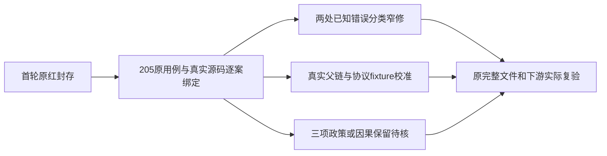

# T1246 最后精确追加：独立合同评审

结论：**PASS_CONTRACT_ONLY，findings=[]**。只准入本版明确的修法与写集；不签实现、工具准入、测试通过、官方模型、安装版或 App，不记录控制面、不自行解冻。

本次模型身份为 **unknown/inherited**。评审对象是 integration 的 T1246 SPEC，SHA256 `fae56e87e751a17012f0be7b929eed400e2813e33a1076a31537c96f5b114d7a`；先前 `b295cb6f…` 的实际独评及 `REV:fbf854b33596` 保留，不改写。冻结原候选仍是 `533224f334c43cdb81a344424e420cad93784dd1`，当前工作区有先前获准的实现，不能称当前源码全部等于首轮候选。

独立来源核验在 `t1246-consolidated-final-additional-independent-source-binding.json`，SHA256 `a542067204ab59db7a80c73c8b08dfacf68e92fdd2ce79fc52dd4a68b53fd87f`。实际核验追加 **71** 个路径的当前和冻结 SHA 全匹配声明，只有 **2** 个追加路径是先前获准的当前实现变更：FF001 account-binding、PB001 publication-cover。46 组正文诊断含 **205** 个唯一 `(file,title)`，无遗漏或重复；169 条历史来源绑定是 **132** 个唯一文件，169 条均实际匹配冻结 Git 对象，不能把169称独立文件数。本次155个去重来源的当前/冻结字节分别保存。

大白话：原红结果留下来。补真实父链、当前协议和测试环境，让原断言真正走到下游；只修两个已证明的错误分类问题。未知授权政策和两个并发用例的因果仍待原整链证据。

## 新增产品两点

**B016** 的因果成立：`chat-tools.ts` 的 `local.workspace` catch 将宿主端口的已知 `statusCode=503` 转成普通脱敏结果；`chat-host-tool-adapter.ts` 根据 `record.error` 返回不可重试 `no_evidence`，未收到原机器分类。原 `chat-local-tool-host.test.ts` 的瞬断用例明确要求 `transient/retryable=true`，并要求私有正文不泄露、端口仅调用一次。现 `chat-host-input-error-recovery.test.ts` 也明确定义401/403权限、503暂时失败与未知异常脱敏。仅原两产品文件内部传递固定可信分类足够；不得将公开任意 `error` 字段当可信状态，不扩大工具清单、重新执行或披露原异常。类型/身份只能来自原宿主捕获路径，普通伪同名类不能获安全文案资格。

**B043** 的因果成立：`durable-generation-model.ts` 原调用已经分类并结算，抛出 `GenerationFailure`；`chat-text-node-worker.ts` 又用 `generationFailure(error,false)`，包装错误已没有原 HTTP 状态，故降为未知并错误转向complete。`structured-worker-generation.ts` 已使用现有 `findGenerationFailure`。仅文本消费者优先读取原错误链中的已知失败、未知才原分类，是现有命名端口内可实施的窄修。保原call、原fence、原结算与fail回执；不在此增加供应商重试、改变费用或持久截止。

B043 准入**不等于** B044 授权模型的未知候选可以废弃。当前 `allowUnconfirmedModelRetry=true` 对该节点的政策仍待裁决；本版明确不得改变该policy或把原 `unknown_result/零整稿子任务` 期待洗成 `partial/retry_wait`。B045/B046 只准原 HTTP 角色分类、正预算和setup/清理闭包、真实按任务trace；不得以15秒注册栈猜产品死锁，不得把后例running改成功。三项仍属未闭合验收。

## 测试校准边界

- **B002/B005—B008/B019/B020/B024/B025/B036/B037**：当前repository/SQL/服务端口要求真实父项目、review、平台账号、组、资源、AI业务映射和原执行父call。补同原owner的真实fixture与事务链是必要动作；负路仍须到原采纳/回滚阶段，公开创建早拒绝与明确历史兼容负fixture分别保留。不得删foreign父、noop ownership、SQL trigger或注入失败。
- **B003/B004/B011/B012/B014/B015/B032/B033**：真实PG等待要观察原group锁；固定AAC必须找回原字节，缺offset仍未验；媒体仅owned根；单调clock只验证实际120秒期限；transaction spy核真实对象；setup异常也回收原host/spies。测试fixture import可排除，但生产边界和真实越界反例必须保留。源码归因不代签排除死锁、精度或清理泄漏。
- **B009/B010**：T1238正式迁移合同与当前journal确有0133，idx107/when1791043200006；旧前缀/hash仍逐条保留。runtime route是原创建阶段冻结事实，命令前后完整snapshot相等保留；不得恢复空payload或删除route。
- **B013/B021—B023/B034**：T1022明确缺指标与测得0不同、部分覆盖不可伪填0，空组创作与隐藏账号保历史；当前review-context明确无稿/无指标证据边界，scoped lookup原null不泄露。仅准确校准已证明的字段、计数或状态，并补原p1可比增长与跨组appendSnapshot拒绝，不能删新p2或旧下游。原七operation清单须固定完整旧四项和现有三项，不从实际列表动态生成期望。
- **B017/B018/B026/B028/B029/B031/B038/B040/B041**：T1085已规定按冻结工具/消息角色分root和child，stream仅编码。当前宿主保存的 `__creatorosOutcome` 属展示事实，原业务DTO仍严格解析；只剥明确wrapper，未知字段拒绝。T1238整体工具目录不等同旧宿主子集，web.read仍受effect/权限冻结。长工具结果应由原tool.result.read取得完整真实内容，不猜截断JSON、不提高预算。Pi真实公共chat端口/宿主卡投影不可用generic端口替代；模型明确query不再由代码拼关键词。
- **B027/B039/B042**：当前execution spec、continuous预算类型及LED053允许无显式总期限，明确期限/调用与token上限仍冻结，单次正请求>=120秒与取消/心跳不变。T1026正式终态工具失败版本只对原已结算不可重试失败提交partial；正常授权可用链保持succeeded。T1024正式活性合同确有同任务两次length续写；fixture的4模型/1工具/usage20应精确核原账本，不扩为任意请求数。

本版只按组内原用例修法，全部writeSet都在先前198或新增71精确来源范围；没有授权整文件机械换终态、放宽业务schema或删断言。先解除第一fixture阻断后若出现第二个产品问题，必须补实际原因与精确合同，不能利用此次评审扫改。

## Shell、T1062 与已准入实现的区别

新增设置context已让真实Shell消费Next `usePathname/useSearchParams`。原缺这些接口的测试补真实URL mock是宿主装配修正，保原UI行为与断言；本版追加清单中8个测试，加先前已准入 `app-shell.test.tsx` 共9个Shell相关消费者，不能把mock当真实导航证明。设置四产品源码与旧冻结差异只是来源事实，本次不追签实现；真实往返仍需公共E2E、焦点、scope ABA、dirty工程、原在途task/call/deadline/供应商调用计数证明。协议fixture仅证明协议，不能代官方语义或App。

T1097正式SPEC `8221447156d8ae0194ab343cde1413a378e2fa18a552dbf869b576b5eb26b232` 仍仅引用既有独评。当前严格manual/assisted union造成原T1062 helper三处字段读取需明确manual窄化；保 `saveInitializedArticle` 公共请求、真实保存/原version读回与全部原字段/assert。不能断言cast出assisted document或把两分支混入合法手工请求。

FF001当前仅投影已知执行route、剩余public body仍strict；PB001当前仅save与原request共用完整publicRevision。BA001与设置当前已批准变化均与原freeze区分，既有窄回执41/34/37/13等不相加、不能替代首轮失败或全部公共旅程。原App用户明确暂不授权，AC5保持未验。

## 结论与实际未发生事项

无本次规格阻断。允许由父线程按正式reviewctl流程登记本版合同，再仅实施明确写集；本Agent未更改SPEC/产品/原测试/用户决定/canonical，未运行模型、服务器、PG、浏览器或App。原400红、两个collection、首轮39浏览器红、新59与模型0call全部保留。最终全部相关文件、故障/usage/当前权限/CAS/原ID/截止/费用、boundary/orphan/timeout/reconcile仍需真实执行；不能宣称全绿或完成T1246。
