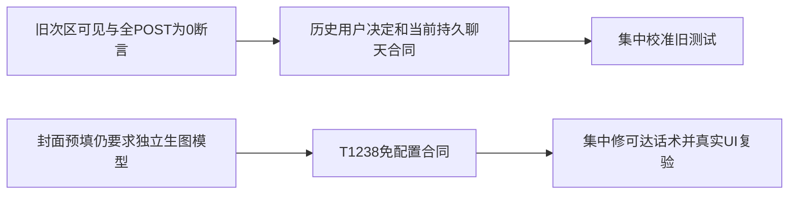

# T1246 Copilot 首轮独立分诊

候选为533224f334c43cdb81a344424e420cad93784dd1；只读，不修改产品/断言、不重跑。精确绝对源路径与SHA见 `/tmp/t1246-copilot-first-source-binding.json`。

## BC001：已批准移除的次区仍被原断言要求可见

原case `398e1e2dd9ad70ed36f5-fcf91ee232c21f1ceebf`，原ai-copilot.spec.ts:19，实际隔离副本:40在copilot-dashboard等待120000ms失败。来自实际body的scenario-index.ndjson位于 frozen integration `docs/verification/t1246/round-1/533224f/browser-original-dr005/scenario/`，已目视其截图：单AppShell、居中助手浮层、消息空态、composer与7个真实快捷chip，未出现次区。

合同映射：BACKLOG-archive.md:71 T-354明确用户2026-07-16真机要求删冗余次区，并保快捷chip/底层任务轮询；现组件单测:211–218严格断言dashboard/recommended/recent/continuing/quick-entries/smart-recommendation均不存在。旧page-specs §16以及selector文件fixture-only注释未更新，不构成恢复已退役UI的许可。未找到单独T354 SPEC/DEC，因此依据真实归档用户决定与现消费者闭包，不虚构新规格确认。

最小集中写集：原 `frontend/tests/e2e/ai-copilot.spec.ts` 第1例（不是改当前冻结生成副本）。将退休区域映射为不存在，并断言仍存在的快捷chip真实button和prompt区域；保单AppShell/sidebar/header、aria-modal、居中/非右抽屉与已实际PASS的关闭/ESC/Back三例。本例首次停在dashboard，原quick-entries/smart-recommendation后续断言并未实际执行，不能称3条都运行失败。

## BC002：fixture-only“不POST”已被真实持久聊天合同取代

原case `398e1e2dd9ad70ed36f5-1f5c45fadccdf95473d0`，原:68，副本:84实际body收到7个POST（5 dispatch、1 Next stackframes、1 /api/chat），对[]断言失败。此证据只证明有真实提交，未证明收费模型或成功答案。其50ms settle不符合当前有限正观察预算，应在集中校准时以真实事件/状态等待至少120s正上限，不能靠固定sleep。

合同映射：当前T1024明确真实聊天任务/消息提交与原ID恢复，T1026明确不得删除合法发送/流式/取消/错误恢复以通过门卫；T1238:46保公开聊天executionEngine显式选择及可信默认冻结。当前form在ai-copilot-content.tsx:3475显式preventDefault并调用submit；:1744发送真实sendMessage，transport:1117携executionEngine，:3601为真实submit控件。原注释“no onSubmit/no network”与現已确认行为冲突，不是产品应停止网络提交。

最小集中写集同一原spec第5例：以真实当前公共提交合同替代“全部POST为0”，明确区分初始化/读取dispatch、Next开发诊断与用户本次提交；保空输入禁发、打开/预填不自动发、点击发送仅一次/原source与冻结engine、错误可见及原任务不重发。可验证无配置Pi提交的真实错误回执，不得为了旧结构测试额外收费调用或虚构模型成功。不可仅把[]改成array非空，因为初始化POST本就会出现。

## BC003：仍可达的封面/旧图片预填与Codex合同冲突（产品文案缺陷）

T1238:4、9、40、70与DEC-T1238-001明确Codex文本/图片不调用或要求独立API模型；DEC-T1238-002在可信偏好就绪前不得呈现文本/图片配置引导。T1057仍需独立图片模型是明确被取代的合同候选，不可用它压过新决定。

实际源：selector copilot.ts:75封面chip预填要求“走我在设置里配置的生图模型；如果没配置…告诉真实原因”；该chip经ai-copilot-content.tsx:3534–3541 → applyQuickPrompt:1897原样setPrompt，没有按assistantEngine调整。URL functionKey fallback表:599–600 material.generate与:605 cover.generate另包含“没配生图模型…指路设置”。这些字符串会成为用户发送给当前引擎的指令，足以误导本可走Codex的请求，是确认的静态可达需求违背。生成图片素材chip当前使用IMAGE_MATERIAL_PREFILL语义稿件指令，本身没有独立模型配置要求；不能把全部图片入口都归此根因。已退役recommendedCommands中的同文案不是新增可达UI证据。

最小产品写集：`frontend/src/fixtures/selectors/copilot.ts` 的可达cover chip预填；`frontend/src/features/copilot/ai-copilot-content.tsx` 的可达material.generate/cover.generate fallback；对应原prefill单测在`ai-copilot-content.test.tsx`（若已有selector单测可就地补，勿为清旧注释扩大产品范围）。话术尊重当前真实引擎/能力，不把独立图片API配置作为Codex前置；保Pi合法配置路径和真实能力/登录错误，保用户发送确认、不自动发、functionKey、原项目与参考封面ID、候选采纳门。不修改backend chat-assembly的参考封面真实资格门：DEC-AI-043:1–4要求真实published/日期/coverAssetId、自动语义选择，无合格参考诚实停止；配置是否可用由真实任务回执判断，不能用local.tools猜配置。不可为消文案缺陷放松归属、预算或静默Pi/API回退。

本轮已核的首截图仅证明chip真实存在，未点击该chip；新59相关图片body尚未执行。根现场观察应保其原截图/回执来源，本文不补拍为PASS。修后需实际Codex服务值+7空默认DTO/无secret的UI点击预填→明确提交→同task/call/thread/turn→候选/file/blob回读；内部API通过不能代签这个chip的UI消费。

## 新59交叉核对边界

截至读取live-issues时只有2个真实旅程回执。INT-ENGINE在noIndependentModels对[]断言失败：返回7个默认DTO，provider/modelName/secretReference为空、baseUrl null、hasSecret false；这是“存在默认行”而非配置污染。settings.service listModelConfigs只是rows.map公开DTO，合同并不保证fresh list为空。此失败发生在后续引擎切换/UI验收前，不代签下游。建议集中修新增support的前置断言为无实际配置/secret的精确字段证明，并保逐key原ledger API0，不删除前置。

INT-ROUTES是/topics HTTP200但main缺120s，当前没有充分归因，保持未知。它不证明Copilot或图片body失败/通过。原两红+三真PASS、所有未达断言和新两红都保原证据；首轮完成前不改source/assert或重跑。

