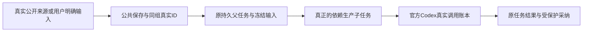

# T1246 六族公共生产入口只读核查

冻结产品 `533224f334c43cdb81a344424e420cad93784dd1`。源码来自 `/private/tmp/t1246-native-runtime-533`；逐文件旧533 SHA、私有当前 SHA、integration/ canonical 当前 SHA 见同名 JSON 的 `sourceMap`。本审查只读代码/首轮工件，没有 HTTP、模型、PG、App、ASR 或渲染执行。首轮官方生成调用仍为 **0**。

六族里，strategy、来源相似度、用户真实导入重建、真实成片审核有现行公共准备链；评论信号与抖音转写后处理需要真实平台/媒体资格，普通空组与任意上传不能代替。静态可实施不等于当场成功，旧59首轮失败/阻断保持不变。

## reconstruct.project

原首轮 case `05d77e355062c9acafd9-d6f57ee72c9b5996b112`。**公共生产可实施；真实作品输入尚未交付**。

公开 projects.create 接受 source=imported、platformRef；service 只 requireWorkspace 后按 source 设置 review。读稿遍历同项目 output_script 当前版本，优先 contentData.transcript，其次 contentText。原新59仅寻找现有 imported 行，不是公开入口不存在。

公共入口：

- `projects.create POST /projects`
- `projects.outputs.create`
- `artifacts.create`
- `artifacts.versions.create`
- `ai.tasks.create POST /ai/tasks taskType=reconstruct.project`

**输入与资格：** 同一个真实可写组/项目；task.projectId 与 inputData.projectId 相等；source 必须 imported；至少一个真实非空 output_script 当前逐字稿；所有 IDs 从实际创建响应取得。不能把手动新创作品谎称真实平台采集。

**最窄合法夹具：** 最窄：有权使用的既存历史作品及人工核对逐字稿，公开登记为用户导入，原稿保存 createdByType=user；platformRef 只填实际可证值，没数据保空。不声称采集/ASR/已发布指标实测；指标 0/空可由原读侧诚实处理。纯人工测试作品可测协议，但不能代签历史作品真实来源。

**外部前置：** 不要求新供应商或登录；需要真实作品/文本的使用授权与明确输入身份。平台采集覆盖若要宣称，另须真实采集绑定。

**实际消费者错误（源码预测，未当场触发）：** `仅 source='imported' 的历史作品可重建`；`项目无逐字稿，无法反推重建`；`历史重建项目与任务归属不符`。

**应读回的真实状态与闭包：** prepare 前置失败应保实际 ai task 与准备错误；不能由 driver 固定 throw 伪称产品阻断。完成走 reconstructed-artifact 专用非候选事务，须核原 business/execution/call、真实生成稿与 origin=reconstructed，不能强套 awaiting_confirmation+listResults>0 的通用候选 helper。

证据：`backend/src/modules/projects/projects.service.ts:1044`、`backend/src/modules/ai-runtime/reconstruct-business-adapter.ts:12`、`backend/src/application/generation/media.ts:79`、`backend/src/modules/artifacts/reconstructed-artifact.service.ts:58`。

## comment.qa-sift

原首轮 case `05d77e355062c9acafd9-95513ea51f6e7b0e3a99`。**模型消费者可达；fresh browser 公共评论生产依赖真实采集资格**。

signals 无公开手工写 op。ingestion 原四 batch-push 已退役。真正写入是 comments collector 取平台评论→ingestComments→candidate.ingestAudienceSignal；后者用 ingestionRunId/source=ingestion 与账号归属。target.awemeId 可走单作品读取，或真实 published publicationIds（最多20）走精确选择。

公共入口：

- `scheduledJobs.create POST /scheduled-jobs sourceKind=comments`
- `scheduledJobs.runNow POST /scheduled-jobs/:jobId/run-now`
- `jobRuns.get / jobRuns.listByJob`
- `audienceSignals.list GET /audience-signals`
- `ai.tasks.create taskType=comment.qa-sift`

**输入与资格：** 真实合法平台账号/组与作品来源；run/job/task/signal 同归属。comments input={signalId,rawText,likeCount|null}，执行前按 IDs 重读当前正文，不信客户端原文。无信号不能拿知识 UUID 或仅创建 ingestion run。

**最窄合法夹具：** 公共 browser 当前最窄是合法真实抖音作品+已授权真实账号采集，不打开未获授权登录。已有 test-only collector readComments/readCommentsForWorks 端口可提供明确受控平台响应，真实 service 入库/去重+真实 Codex 可以另做服务集成覆盖，但冻结 composition 没有公共切换夹具入口；该结果不能算 fresh browser/真实平台采集闭包。禁止添生产后门、假 cookie/profile、SQL signals。

**外部前置：** 平台读取及可能登录许可；当前未交付真实资格，不能仅用任意公开 RSS 代评论。

**实际消费者错误（源码预测，未当场触发）：** `评论已删除或不属于当前工作区`；`选中的作品不存在或当前账号不可采集`。

**应读回的真实状态与闭包：** 真实 DouyinNotLoggedInError 使 job_run=needs_reconnect，当前 markWaitingUser 有装配时保任务等待；legacy fallback markFailed，需读回实际状态。其它抓取异常 job_run=failed/task failed。新组无作品可能真实采0成功，它只证明采集运行，不证明 qa-sift 已调用。

证据：`contract/src/operations/candidate.ts:112`、`contract/src/operations/ingestion.ts:112`、`backend/src/application/collection/comments.ts:55`、`backend/src/application/collection/comments.ts:140`、`backend/src/modules/ai-runtime/knowledge-generation-business-adapters.ts:35`、`backend/src/modules/ai-runtime/scheduled-collection-runner.ts:307`。

## transcribe postprocess

原首轮 case `05d77e355062c9acafd9-2d4693048e322256eb0d`。**真实 public transcribe.douyin 可到后处理；资产 ASR 不能代替**。

projects.transcribe 原公共提交锁目标、读取真实 Douyin锚与已有稿、冻结 awemeIds；Worker 顺序真实取流→ffmpeg抽音→ASR→runTranscribePostprocessInWorker→saveTranscribeArtifact。outputs.production.editor.transcripts.create 只创建 asset.asr owner，虽然真实上传媒体可识别，却没有目标文本后处理消费。

公共入口：

- `projects.create source=imported with truthful platformRef.platform=douyin/externalId`
- `projects.transcribe POST /projects/:projectId/transcribe {attemptId}`
- `ai.tasks.get / execution.tasks.get original ID`

**输入与资格：** 原project/真实awemeId、同group、无既有该aweme逐字稿、attemptId16..128；取得真实音频并经实际 ASR 分片/settled回执聚合。后处理只读完整已确认 ASR 原文，冻结 sourceDigest/template/modelIdentity；不能注入人工稿当ASR或手调 internalport。

**最窄合法夹具：** 可用的最窄公共输入是有使用权、匿名原平台取流可达的真实 Douyin 音视频，沿现有取流不替换域名；匿名失败转登录详情需既有真实授权账号，未授权时停止在真实 waiting_user。本地 WAV/MP4 可以验 asset.asr，但该key还未覆盖。test-only source extractor/ASR provider seam 不可假算官方生成；不得伪ASR产物。

**外部前置：** 本地 Whisper 默认 small；ffmpeg + Transformers/ONNX runtime + 对应完整真实模型权重。仅 env.allowLocalModels=true 不证明离线命中/不下载；先核独立 task cache 的模型/配置/tokenizer/ONNX 文件和依赖，再实际离线识别原字节。此次未核权重完整性，也未跑ASR。保 HOME/CODEX_HOME，不复制auth。云ASR需要独立配置，与本轮免独立模型验收不合，不能引新供应商。

**实际消费者错误（源码预测，未当场触发）：** `ValidationError: 该项目没有关联抖音作品(无 platformRef.externalId),无法抓取逐字稿`；`ConflictError: 该项目已经有逐字稿，不支持重复抓取`；`后处理需要完整已确认的 ASR 原文`；`LOCAL_WHISPER_MODEL_LOAD`；`LOCAL_WHISPER_AUDIO_DECODE`；`TRANSCRIBE_LOGIN_REQUIRED`；`TRANSCRIBE_SOURCE_UNAVAILABLE`；`TRANSCRIBE_CAPTCHA_REQUIRED`。

**应读回的真实状态与闭包：** 来源登录/验证码/不可用走 GenerationFailure waiting_user 真实安全码，保原task/runtime；普通ASR失败原 item=failed→最终 failed/TRANSCRIBE_ITEMS_FAILED，已完成子集不丢；Host/付费回执不明走 unknown_result 原ID，不重发。缺后处理模型/预算会保原文 result.applied=false，转写成功本身不证明 Codex后处理。应核 transcribe:<awemeId>/postprocess:<digest>/model/N 原 tokens ledger +真实Codexbinding与 applied结果。

证据：`backend/src/modules/ai/project-transcription-submission.ts:77`、`backend/src/modules/production/production-transcripts.service.ts:60`、`ai-worker/src/execution/transcribe-worker-run.ts:33`、`ai-worker/src/execution/transcribe-worker-source.ts:58`、`backend/src/modules/execution/execution-transcribe-postprocess.service.ts:55`、`ai-worker/src/execution/transcribe-postprocess-run.ts:20`、`ai-worker/src/runtime/multimodal-whisper-local.ts:264`。

## video.visual-review

原首轮 case `05d77e355062c9acafd9-b9dbd73a2d12175fa241`。**真实 public render生产可实施；不能只list或用素材图片审核**。

保存真实工程并 render 当前冻结revision，经 createEditorRender→execution.tasks.create→exec.video.render。执行器在真实成片产出后 ffmpeg contact-sheet visual-review.jpg→原 parent running 与期限冻结→专用 Codex审核 child。不存在独立公共 video.visual-review op；list renders只读无触发。

公共入口：

- `assets.uploads.create→实际PUT→assets.uploads.complete`
- `outputs.production.editor.save→outputs.production.editor.render POST /outputs/:outputId/production/editor/render {revision,requestId}`
- `execution.tasks.create POST /execution/tasks spec.taskType=video.render (公开API替代入口，非UI证明)`
- `execution.tasks.get→execution.tasks.confirm→真实同资产文件 blob200/hash`

**输入与资格：** 同scope project/output、真实active原asset+精确assetFileId/digest；save严格body={expectedRevision,requestId16..128,plan,source:manual}，render严格body={revision正整数,requestId}。已有原editorVersion=3不得强行覆写/降级；该旧renderer准备应新独立output使用支持的v1/v2合法工程，或者明确公开execution.tasks.create API覆盖。props/mountAs必须引用已物化真实字节；真实ffmpeg/ffprobe/Chromium就绪。审核JPEG1..24MB由renderer生成，parent必须 exec.video.render/running；原期限需至少完整120s+收割余量，不人为续期。

**最窄合法夹具：** 最窄：有授权的本地短MP4（真实音视频文件）公共上传，明确手工编辑简单合法工程；可用本轮自己生成的确定性短测试媒体，保FFmpeg命令/字节SHA/ffprobe结果，不能声称AI或真人原片。制作默认安全layout不为洗绿删质量断言；确认 renderManifest 待采纳→同taskconfirm→真实videoasset文件读取。无需平台/登录/ASR。

**外部前置：** 现有 Chromium/ffmpeg/ffprobe 本地依赖+官方Codex真实登录/视觉能力；此审查不调用。

**实际消费者错误（源码预测，未当场触发）：** `随包渲染组件 ffmpeg/ffprobe 缺失或不可用。`；`原视频剩余期限不足完整审核预算，已保留生成的成片`；`成片审核原视频任务不存在`；`原成片审核尚未完成，请核对执行`。

**应读回的真实状态与闭包：** 渲染失败真实 task failed；审核是可选非阻断：skipped/unavailable可能仍有合法成片 awaiting_confirmation，不能以render成功算该keyPASS。必须原parent + child payload.stageKind=video.visual-review/requestDigest + kind=model settled + officialCodexbinding/result + actualcontactsheet/成片资产证据。Pi无视觉配置返回null；Codex仍实际resolve规格。

证据：`backend/src/modules/production/production.service.ts:391`、`frontend/src/server/persistence-client.ts:2065`、`backend/src/modules/execution/video-render/executor.ts:1254`、`backend/src/modules/execution/execution-video-visual-review.service.ts:33`、`backend/src/modules/execution/execution-video-visual-review.service.ts:59`。

## intelligence generation

原首轮 case `05d77e355062c9acafd9-2b1dc2b77d87e0c163d6`。**strategy_backed 当前公共生产可实施；旧草稿“只能历史恢复”判断错误**。

radar_project_upgrade 原父在122行调用 startTopicPreview strategyBacked:true，topic_preview子经原 generationbridge/Worker 消费 strategy模式，再真实 ensureRadarProject；不是只能恢复历史。公开 previewTopic 不接 strategyBacked 字段，传 positioningVersionId 也不能强制旧模式。

公共入口：

- `intelligence.sources.create POST /intelligence/sources runInitial=true→intelligence.runs.get真实状态`
- `intelligence.transcripts.uploadManual POST /intelligence/transcripts/upload-manual {itemId,inputMode:paste,text}`
- `positioning.profile.upsert→positioning.statements.create POST /positioning/statements {oneLiner,keywords exactly3,productAnchorIds:[]}`
- `intelligence.projects.enqueue POST /intelligence/projects/enqueue {itemIds,positioningVersionId,idempotencyKey}`

**输入与资格：** 真实item及sourceSnapshot属于原scope；非空 done transcript；定位母版先真实保存，再建statement版本（有masterSnapshot），getStatement校验同属主；父按item固定幂等，原已在途任务不随偏好/版本变化重建。需逐父/子冻结group/engine/deadline，非只模型helper成功。

**最窄合法夹具：** 有限真实公开RSS或受控自有HTTP RSS，经现有公共采集产生snapshot；内容源URL与内容Hash真实。可明确手工稿，不冒称原视频ASR。受控localhost能否通过source/URL安全校验尚未证明，不绕SSRF；优先现已使用W3C公开RSS或自有公网授权源。保存人工定位不需模型API。

**外部前置：** 真实RSS网络读取；无需平台登录或ASR。官方Codex可用与此审查分开。

**实际消费者错误（源码预测，未当场触发）：** `ProfileRequiredError: a CreatorProfile is required before a positioning statement`；`批量升级缺少定位版本`；`请先等待这条作品的逐字稿完成，再生成改写稿`；`作品缺少来源快照`。

**应读回的真实状态与闭包：** RSS read真实run可 succeeded_with_items/succeeded_no_change/partial/blocked/failed；无item不进入生成。radar父等子 retry_wait，子failed/blocked/cancelled/paused→父 blocked原child/code；catch RADAR_PROJECT_BLOCKED。成功需真实topic_preview officialcall及 strategy output/persistence，原first blocked仍保留。

证据：`contract/src/operations/intelligence.ts:444`、`backend/src/modules/intelligence/radar-project-queue.service.ts:122`、`backend/src/modules/intelligence/intelligence.service.ts:4542`、`backend/src/modules/positioning/positioning.service.ts:788`。

## script.source_similarity

原首轮 case `05d77e355062c9acafd9-cf9175ae94d765127f5b`。**公共候选采纳可实施；V3摘要漏显式attach与模型前硬门**。

confirmTopic只产topic/provenance，不自动给现有j.project建reference；必须真实attach或promote桥。script_candidate父必须succeeded且checkpoint真实referenceIds/candidateText。accept先查同task已采纳版本，再原reference/hash重读与连续30字确定性硬门，之后 evaluator才建立原source_similarity独立ai任务。

公共入口：

- `真实RSS/manual transcript→intelligence.transforms.previewTopic→execution.tasks.get succeeded`
- `intelligence.transforms.confirmTopic POST /intelligence/transforms/:transformId/confirm-topic`
- `projects.intelligence.attach POST /projects/:projectId/intelligence {topicId,itemId,sourceSnapshotId,idempotencyKey}（或实际candidates.promote桥，不可假自动）`
- `projects.scripts.generateCandidate POST /projects/:projectId/scripts/candidates {referenceIds,strategy,idempotencyKey}`
- `projects.scripts.acceptCandidate POST /projects/:projectId/scripts/candidates/:taskId/accept {editedText?,idempotencyKey}`

**输入与资格：** 原topic已confirmed、item/snapshot完全匹配；project/reference同组；原source transcript hash仍一致；script_candidate ownerType=project/ownerId=project/status=succeeded。sourceDigest由 backend 按 reference.id/transcript.hash/text生成；不能由driver任意拼UUID/digest。

**最窄合法夹具：** 使用上面RSS/manual来源并真实模型生成候选。若要确保测试到语义模型门，可明确用户编辑自写与来源没有连续30字复用的候选，但须保实际原candidate/task/reference；不固定低相似输出、不删除high-risk测试。若真实模型判high，记录有调用但采纳拒绝，不能改threshold。

**外部前置：** RSS真实来源+官方Codex前置两个真实生成，不能计为本key两次独立验收；用原reference与独立similaritycall区分。

**实际消费者错误（源码预测，未当场触发）：** `Intelligence topic provenance not found`；`itemId 与已确认选题的来源作品不一致`；`sourceSnapshotId 与已确认选题的来源快照不一致`；`Project 稿件候选尚未生成完成`；`候选稿与来源逐字稿高度相似，请修改或重新生成后再采纳`；`来源逐字稿已变化，请重新采纳`；`相似度评估尚未完成（<original taskID>：<real status>），请稍后重试采纳`。

**应读回的真实状态与闭包：** 高连续复用在模型前拒绝是合法保护而非生成失败；语义调用unknown/waiting/未完成只保原similaritytask，accept不写稿。核原script_candidate.sourceTaskId/projectId/ref/sourceDigest与独立 kind=model settled score；low/medium才保存artifactVersion.aiTaskId=原script_candidate。幂等accept命中已版本不会新调用，不能拿replay当新官方call。

证据：`backend/src/modules/intelligence/project-reference.service.ts:167`、`backend/src/modules/intelligence/project-script-candidate.service.ts:202`、`backend/src/modules/intelligence/project-script-candidate.service.ts:228`、`backend/src/modules/ai-runtime/script-similarity-business-adapter.ts:15`。

## 集中修复范围建议

当前需要补的是验收 driver 的真实准备和逐key读回，不是新增生产端点、绕过归属、手工 SQL 置终态或新供应商。保原49 key与原case身份；修 `integrated-dependent.spec.ts` 的六条 recipe 与 `acceptance-support.ts` 的真实默认DTO检查/分族终态读取，新增明标 input/provenance/媒体离线前置工件。具体新文件在最终driver写集另审，不把本建议当已准入。

评论尚不能在未授权真实平台资格下签 fresh browser end-to-end；现有 test-only collector 边界最多另做明确标记的 service integration。ASR后处理未交付真实Douyin音频+完整本地权重准入，也不能仅以环境变量或原资产ASR成功签覆盖。任何缺输入须实际公共链达到原真实错误/任务状态，或明列未运行；不能在业务body固定 throw 再宣称“已验证缺外部能力”。

后续逐 key 必须分开列：合法输入准备、公共触发（UI按钮或明确API覆盖）、原父/子/参考/文件ID闭包、官方模型真实 settled/unknown ledger、用户采纳及真实字节。模型前合法拒绝、可选降级、已采纳重放都不可签新生成成功。本报告不批准模型调用，也不修改SPEC或任何产品/测试源码。

JSON SHA256：`41af67465f1285e7c6e00e1a4c9378f2bd6710c12208f62f9d18736663caab66`。
