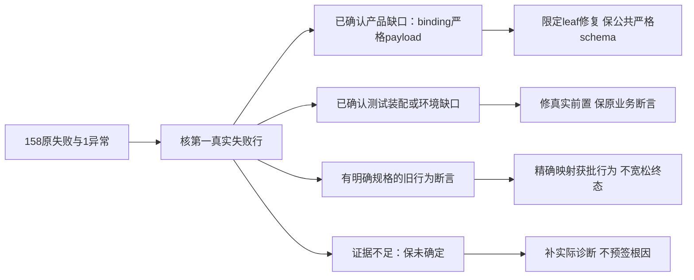

# T1246 前端首轮最终堆栈补充分诊

只读分诊；未改产品、原测试、运行器或断言，未复跑、访问用户库、启动 App、认证或官方模型。冻结源 `533224f334c43cdb81a344424e420cad93784dd1`。此为追加证据，不重写先前 `/tmp/t1246-frontend-first-additional-diagnosis.md`、settings/Copilot/Worker 报告或首轮红结果。

实际最终范围：559文件，520PASS/38FAIL/1SKIP；5078用例，4911PASS/158FAIL/8SKIP/1TODO；另有1个未处理异常。读取 integration 的 `docs/verification/t1246/unit-first/frontend-failures.json`、`frontend.json`、`frontend.log`。逐158原案例、原失败信息、首个项目栈行、分类候选与最小写集见 `/tmp/t1246-frontend-final-case-diagnosis.json`；精确源绝对路径/SHA及冻结源核对见 `/tmp/t1246-frontend-final-source-binding.json`。Vitest JSON 的 suites 数包含嵌套套件，不能替代日志559文件。没有把一次失败之前已通过的断言抹掉，也没有将未到下游改签PASS。

## 先前四族的最终栈补充

**FF001 account-binding-stage 10红 + local-platform-binding 4红，产品缺口维持确认。** 七个快速正例首栈在原 `account-binding-stage.integration.test.ts:32/:35/:80` 的终态匹配（具体列号在案例JSON）；三例180秒外层终止仅记录 `STACK_TRACE_ERROR`，栈落37/44/68的用例声明，不含它们内部实际观察阻塞点。恢复例66首断言期待failed；Vitest缩略对象没有保存实际status，不能擅补真实值。四条公开小红书/快手/公众号/视频号装配亦未succeeded。源码直接证据仍是 `persistent-task.service.ts:353/366` 为所有kind附加可信 `executionRoute`，binding `.execute:61` 与 `.recover:103` 用公开四字段严格schema直接parse完整内部payload，额外键会拒绝；正常路径在createStaging前，恢复在discard原staging前。没有原 `accountBinding.error` 对象文本被本次记者保存，不能把推导的Zod字符串伪装成实际日志。

原两个负例的框架PASS保留，但只断status=failed，不能证明身份不匹配/目录finalizing分支已到达。集中最小产品写集：`backend/src/modules/platform-account/account-binding.service.ts` 统一业务leaf投影，在原可信内部payload处只分离已知 `executionRoute`，其余四业务字段继续严格parse；缺route历史仍兼容，其他未知字段仍拒。route若核验复用 `contract/src/internal/execution-engine.ts` 结构合同；不为非AI绑定新增模型/CLI/密钥可用性准入，不改公开schema成passthrough，也不取消所有持久kind冻结。恢复保原run/staging、fence/lease、目标真实身份与组成员版本。原stage/local-binding两测试文件补可信Pi/Codex metadata、legacy无route、未知字段、原staging恢复discard、两个负例实际阶段回执，保原目录采用/取消/资源释放及不重复成员断言。依据 T1069/T1110真实绑定与T1238内部冻结合同；不以此扩大账号产品能力。

**FF002 douyin-throttle 两红，等待预算/假Page装配问题。** 最终仍只有外层180014/180006ms终止，没有真实平台错误分类回执。FakePage真实sleep传入timeout，test的download60被公共消费者clamp到120000；completionWaitMs合串行完整观察更长，outer180000不足。最小仅原测试：受控Page事件明确投递真实失败协议，并断公共路径仍传>=120000，或外层完整覆盖实际串行与cleanup；保content-error不触发账号退避、acquire次数及throw来源，不降生产预算。与LED053一致，未证实公网平台消费异常。

**FF003 article 9红，全部首失败确为已退役按钮缺失。** 最终原调用点：辅助openAux16→80/111/119/137/154/174/300；直接227/294查“根据脚本扩写文章”。DEC3671/T1097已经明确旧单独扩写入口不恢复。但事实清单/品牌选择/精确资料引用/元数据保护等业务后置断言没有跑到，不能将9例整单删除。集中修旧测试入口映射到已批准的真实联合创作及原编导提案链，保CAS/人工稿/引用/fact/metadata断言；T1097尚需实现的新选项与正式候选细采纳必须在其单独SPEC评审后做，不能当作本轮旧断言校准顺手扩产品。此前保存fixture版本回执不一致仍是独立需要保留的缺口，不被此次按钮归因消除。

**FF004 chat-task-submission 两红，最终确认实际partial。** 失败字符串完整序列化了原execution task：review.script和publish.package实际 `status:"partial"`，首失败均原120行旧succeeded断言。T1228及真实tail projection合同明确空正文被工具拒绝且无交付、末次模型stop为partial。最小只精确 `empty ? partial : succeeded`，不改宽松union、不补假正文、不重发；保原124-126零子任务、零prepare及真实拒绝内容，当前没有到达它们的PASS。原私有15秒观察/45秒外层另须按LED053覆盖原剩余期限和cleanup，CLI180秒不会覆盖私有消费者。

## 其余红族逐族最小写集与证据限度

下表测试路径均在 `frontend/`；绝对路径与SHA在绑定JSON。`测试`表示首故障装配已证实，不表示它修好后业务必全绿。`未确定`不可归旧债或产品全绿。

| 原失败文件（数量） | 分类与实际第一失败 | 最小集中写集、需保断言、SPEC/合同 |
|---|---|---|
| src/test/function-key-invariant.test.ts（1） | root另独立核：两个UI command alias已有真实assembly与host消费，不是静态死链 | 只该测试：保持穷尽扫描，两个alias走真实工具定义/序列及冻结kind校验，不塞进ALL_CHAT_TOOL_NAMES或空allowlist；T265/T1238。来源证据由root归档 |
| src/test/icons.test.ts（2） | root另核canvas/公众号/快手新增已有T1101/T1022依据 | 只该测试精确扩已批准映射，保完整freeze/local metadata，不用length宽松比较 |
| src/server/legacy-frozen-source-read.integration.test.ts（4） | 三例旧104schema接当前composition，在执行旧迁移前缺assistant_execution_engine；另一真实CHAT_RUNTIME_UNAVAILABLE原因尚未暴露 | 仅该测试先维护真正旧schema构造/原104账本，再沿当前真实migrator升级后启当前消费者，不能让当前repository在104schema创建新引擎偏好；保0130旧归属/原receipt/source深等与新增0133 lineage。第一例需保子进程stderr/exit/加载诊断，当前不能与WF005私有bundle自动同因。T1089旧归属/T1238迁移 |
| src/server/persistence-client.favorites-diagnostics.test.ts（2） | 测试静态找旧签名（缺signal）导致index=-1；当前4110真实同adapter有signal，4114诊断字段、4121folders→4143collectsId→4147videos齐全 | 仅该测试核当前函数/真实装配行为，保requestId/collectorAccountId、精确旧夹名→真实ID/FOLDER_MISSING、无secret。禁止删这条边界；T536/当前持续控制signal |
| src/server/platform-worker-entry.integration.test.ts（1） | 真实平台账号worker-entry-test不存在，Worker前OwnershipError | 仅该测试通过原公共fixture建立真实account/group/project/output再发同工具；不关闭ownership；T1022组与真实发布账号 |
| src/server/review-insights-worker-entry.integration.test.ts（3） | 真实平台账号insights-entry-test不存在；不是lost receipt/invalid模型分支失败 | 仅该测试建立真实帐号/组/作品与数据快照；保各case模型回执、lostReceipt/invalid、采纳前零写，不签尚未到达分支；T1022复盘事实归属 |
| src/server/script-worker-entry.integration.test.ts（2） | malformed实际3模型请求vs旧<=2；retry明确ConflictError禁止复制任务重置预算 | retry最小该测试使用正式原execution resume、保原task/attempt/budget，不复刻新任务。malformed先核第三请求内容/format repair冻结预算，当前只count不足签合法修复/产品重复调用；不得直接<=3洗绿。T1238原ID未知只读/TLED053预算 |
| src/app/(creator)/layout.guard.test.tsx（1） | 零平台号旧全页绑定门缺失 | 仅该测试按T1022合法空组创作前置，保未选组/无资格态与真实权限拒绝；不能恢复强制平台号门 |
| src/components/shell/zero-account-guidance.test.tsx（1） | 旧“先添加创作账号”全文缺失 | 仅该测试按T1022空组创作指导核真实按钮/链接，保平台绑定的明确可选能力，非全局绑定才能创作 |
| src/components/overlays/new-project-dialog.prefill.test.tsx（2） | 旧flexible选择与getPreferences调用未发生 | T1050正文5/28已明确删除新建时画幅与创作模式。仅该测试改真实多选/旧数据兼容默认不提交模式；不恢复退役selector/偏好请求，保失败不崩和创建选择 |
| src/components/ui/creator-date-picker-antd.test.tsx（1） | 空日期测试用真实当天，断9月而执行10月 | 仅该测试冻结本例北京时间或读取同冻结锚点；保空值无InvalidDate、日期格式/跨UTC边界，不改产品当前日期 |
| src/features/copilot/chat-diagnosis-card.test.tsx（1） | error态实际诚实“尚未确认锁定完成…原任务”不匹配旧锁定失败文本 | 仅该测试核实际error/原任务/锁次数0，而非字面旧copy；不得借文本校准签真正confirm成功；原盲预测确认门/unknown合同 |
| src/features/projects/publication-result-actions.test.tsx（12） | 旧mock全局client不再被useCreationClient冻结transport消费；未mockscope/真实dispatch | 仅该测试用本例合法group/account冻结客户端或受控真实dispatch，mock精确同ID响应；保expectedAbsent/revisionId/dirty/重复记录拒绝、迟到与主动清空、可预览才采纳。不得改产品回全局client或跳过scope；T1022/T1238/原封面CAS |
| src/features/projects/quick-create-work.test.tsx（3） | 已有LS account；仍mock旧全局client，新createBrowserProjectCreationSession真实createClient/fetch不消费api mock，故泛失败/0push | 仅该测试接冻结transport/真实scope；保多选根脚本、原projectID不重建/逐output原幂等key/源正文，不改路由目的或生产资格；T1050/1051/T1022 |
| src/features/projects/work-editing-recovery.test.tsx（2） | 旧“选择已有图片”button缺；现朋友圈AssetPicker真实“选择朋友圈配图/加入配图” | 仅该测试走实际控件，保项目引用成功才追加精确file、失败保正文不连图、去重。不以只按钮存在代签真实资源link；原朋友圈编辑/素材确认合同 |
| src/features/settings/check-update-card.test.tsx（8） | 根Dialog新增真实上报区，partial mock缺getReportingStatus造成TypeError | 仅该测试补符合原上报contract的空/关闭状态及真实engine preference读；保更新无开放跳转、授权撤销不挡公开更新、web空态。不关产品reporting以修测试 |
| src/features/settings/identity-section.test.tsx（5） | 同getReportingStatus缺装配，身份区断言前抛错 | 仅该测试补完整薄client mock/engine读，不变真实PATCH昵称、injectedidentity/refresh断言 |
| src/features/settings/settings-interactive-region.test.tsx（52） | 缺client.getPreferences使preference.ready=false，文本/图片模型区大多数首查询缺；另ASR copy、disabled pointer等不可凭共因预签全52 | 仅该测试及其fixture先补真实完整get/patch preferences默认Pi/显式Codex、逐例awaitready和错误/加载覆盖；保T1236所有同scope/ABA/单probe/Pi历史数据，与T1238Codex无独立文本/图片配置要求。明确ASR按需文案、服务列表差异须在首前置通过后再按获批合同核，不删下游 |
| src/server/__module_integration__/assets.persistence-client.test.ts（2） | registry11vs16；usage先Projectnotfound旧fixture项目slug | 仅该测试完整owned上传/project/output引用；registry逐ID映射真实视觉模板/fileDownload/files等原资源合同后精确freeze16，不仅改数，保无ctx非mock/多租户/用料反查 |
| src/server/__module_integration__/content-calendar.persistence-client.test.ts（1） | registry8vs14含真实group calendar/cadence与target | 仅该测试逐新组op核T1022并保完整原账号op/无ctx/非法scope/实际transport；不删新增组op |
| src/server/__module_integration__/data-foundation-prefer-real.persistence-client.test.ts（1） | fabricated acct-of-user-zyongzhu不存在 | 仅该测试public真实account/group/导入作品，不让fixture冒充可信account；保真数据优先与绝不回假canonical数据。T1022/数据底座 |
| src/server/__module_integration__/knowledge.persistence-client.test.ts（1） | GROUP_RESOURCE_SCOPE_CONFLICT引用账号组不存在；旧comment仍称无需建account | 仅该测试真实publicworkspace/知识条目；保创建→列表/无越权/真实空，不放松资源scope触发器。T1022/T1239知识owner |
| src/server/__module_integration__/platform-account.persistence-client.test.ts（1） | accounts新增collectionPlanReadiness有T1199依据 | 仅该测试精确原7IDs/无ctx与真实handler，原contract endpoint-bootstrap404总数另报告；不删合法readiness |
| src/server/__module_integration__/publication-cover-bytes.persistence-client.test.ts（1） | fabricated account不存在，字节绑定/恢复下游未到 | 仅该测试建真实account/group/project/output再接真实file；保bytes/MIME/hash/不可读0save/同请求恢复/解除pair，不松权限 |
| src/server/__module_integration__/publishing.persistence-client.test.ts（3） | registry7vs8视觉笔记export；其余2fakeaccount不存在 | 仅该测试真实owned父链、逐ID核原visualNotes export合同后精确freeze；保外部key幂等、原revision/发布transition。不提前签真实发布 |
| src/server/__module_integration__/query-services.contract.test.ts（1） | registry3vs5新增groupOverview/dailyReport | 仅该测试逐新增op核T1022/T1199真实服务/无ctx，不盲数5或删新增服务 |
| src/server/__module_integration__/search-indexing.persistence-client.test.ts（2） | knowledge假组/publish假帐号在索引之前被真实owner门拒绝 | 仅该测试真实public根及发布作品，不直写伪parent；保await消竞态/搜索tab精确命中/跨租户不可见 |
| src/server/intelligence/share-import-runner.test.ts（1） | 最后一例tasks:{}缺get/heartbeat；首poll.catch leaseLost→abort，import0 | 仅该测试补原claim同attempt/owner运行态与heartbeat（同族前例已齐），保transcribeAfterImport:false、原任务/fence/control；不删生产轮询或默认升级转录。T482/continuous控制 |
| src/server/ingestion/chromium-guard.test.ts（2） | test20ms不生效：DEFAULT=completionWaitMs([180k,180k])=370k，Math.max；outer180k先终止 | 仅该测试使用独立受控timer推进公共实际370k，或外层完整>=该串行/cleanup，保晚context实际close/占用队列/人话错误。不得production降20ms。LED053/原浏览器shutdown门 |
| src/server/ingestion/douyin-cdp-comment-diagnosis.integration.test.ts（1） | 真stderr：foreign OwnershipError正常，start UnsupportedOperationError；共享transport仅analytics，正式dispatch83 preflight请求publications.get不支持 | 仅该测试把同真实publishing读transport并入公共装配，使用原owned事实行；保impact拒绝、跨号、SQL同key一次/丢回执unknown、作品失效仍close、真实Chromium观察隐私。不得绕CLI preflight或虚构浏览器已执行；评论诊断原公共合同 |
| src/features/reference-editors/noterelay/native-bundle.test.ts（4） | host owner缺projectId，当前真native先拒“作品归属缺失” | 仅该测试传完整合法project/output/sourceVersion/group或account，保所有原DOM/独立实例/原分页/导出断言，保像素fixture明确限制，不改native门/不称真实PNG像素PASS；T1022真实editor根 |
| src/app/api/v1/auth/auth-routes.test.ts（3） | 旧canonical用户固定user-zyongzhu，真实本例库最早主用户user-p-1 | 仅该测试隔离本例用户fixture并通过同真实getLocalUser核主用户（或合法fresh库明确建立）；保无/garbagecookie本机直通/logout撤销，不改产品单机用户选择/T046 |
| src/app/api/v1/local/reset-workspace/route.test.ts（4） | 运行器真实注入owned CREATOROS_APP_DATA_DIR，本例只stubDB_DIR；合法marker写优先app根而非自建tmp；noDB例app仍在故200 | 仅该测试显式隔离所有实际dir变量：legacy分支APP_DATA_DIR空，新壳优先分支本例ownedapp；无目录例清两者。保三重保护/真实marker/no实际reset/幂等；不改产品优先级、不猜HOME，绝不动用户根。T332新壳兼容合同 |

## 未处理异常：测试回调跨例残留已证实

真实 log16234：`Cannot update an unmounted root`，栈明确 `settings-interactive-region.test.tsx:303:58` 的 `mockRouter.refresh.mockImplementationOnce(()=>tree.rerender(...))`。该案例因preferences前置缺失，按钮click之前已失败，queued once回调未消费；beforeEach174只有mockClear（保implementation队列），cleanup卸载tree，后续“toggling自动保存”真实refresh消费旧rerender，React抛错。最小写集同该测试：beforeEach mockReset刷新spy并建立本例default implementation，每例由真实等待ready后注册一次回显；关闭owned pending/cleanup。保原refresh与保存回显生命周期断言，不改生产router.refresh、不吞unhandled、不写框架结果PASS。当前报告明确该异常可能影响后续case，不能用整体其余PASS掩盖。

## 集中阶段边界

确认产品写集仍仅binding leaf；Copilot图片prefill另BC003产品缺口、shell首载组同步另BA001。T1097新选项/元数据采纳范围与旧按钮测试校准分开。其余本报告多数是测试前置或被明确规格替代的断言，按表最小写集准备SPEC后独评；registry所有新增ID必须逐服务映射，不只改数字。legacy CHAT_RUNTIME_UNAVAILABLE与script malformed第三请求未充分诊断，继续保UNKNOWN。所有缺前置的官方49仍call=0，不能改称模型验收。原浏览器最终131PASS/39FAIL（独立库存由browser owner），原图片快捷必须后续真实click→prefill免API说明→同ID结果核验，不能内部API替代UI。

## 与root独立五族结论交叉后的追加（不覆盖首轮）

上述legacy第一例UNKNOWN已进一步缩小：原第一case44直接getChatRuntime，尚无build；该文件build只在后三个case206出现。当前composition6036真实resolveExecutionWorkerPath失败即保workerEntry=null，getChatRuntime6875明确抛CHAT_RUNTIME_UNAVAILABLE。这与root取得的首红加载条件一致，是用例顺序依赖的独立Worker准备缺口，不能删严格getter或签账号/文章能力损坏；最小该测试统一beforeAll/package-ready明确合法真实bundle，保来源SHA/真实启动。首红结果仍保留。

legacy后三例已交叉核：fixture.historical让createConfiguredDb绕过当前migrator，244就getChatRuntime读旧104库，到347才createDb跑最新迁移；当前偏好服务在前段就读取0133列，所以提前失败。旧104生产冻结记录与当前升级/运行阶段必须分开，保原旧104 ledger、原frozen字节、settled原receipt不重新执行、0130仅owner变化，并额外正确核当前0133迁移。不手工ALTER补列、不让新producer偷偷改旧ledger、不盲把105改最新数；精确fixture构造方案仍需独评。

script retry也交叉确认：原180-216先取消旧任务再用retryOf复制新任务，AI service978已有T915批准的预算防重置门。最小原case应保取消后复制拒绝的实际Conflict；另用原可恢复waiting_user通过公开resume验证同ID/预算，不把cancelled任务变可恢复、不恢复旧clone。malformed第三请求仍未由原HTTP请求内容分类，不能仅<=3校准。favorites signal和platform/review phantom账号与root因果一致，所有产品冻结源仍未改。
