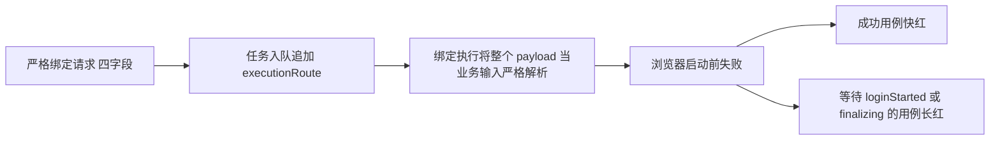

# T1246 前端首轮：账号绑定、抖音限流、文章与聊天提交独立分诊

候选：`533224f334c43cdb81a344424e420cad93784dd1`。独立子 Agent 只读核对真实源码、现行合同、首轮已结束的四个文件摘要；模型标识继承且工具未确认，不自报特定型号。没有修改产品、断言、冻结 driver、任务状态，没有重跑或调用模型/登录/真实用户数据库。本轮是合同与行为核对，无视觉改版；未来实际 UI 改动/视觉评审须加载项目 oil-ui-pro。

源码绝对路径与每文件 SHA：`/tmp/t1246-frontend-first-additional-source-binding.json`（24文件；其中20个产品/测试文件逐一与实际 frontend-unit 来源比较全部一致）。原案例名、首轮时长：`/tmp/t1246-frontend-first-additional-cases.json`。真实日志：`/Users/zyongzhu/.codex/worktrees/integrated-dev-acceptance/Thirdspace-creator/docs/verification/t1246/unit-first/frontend.log`。整个首轮仍在运行，尚无这四族完整最终 Vitest 失败堆栈；下面不把静态必然性冒称十个案例均已有独立动态根因证明。

| 文件 | 已发生首轮 | 当前归因边界 |
|---|---|---|
| account-binding-stage.integration.test.ts | 12项 / 10 FAIL / 580276ms | 确认正常新绑定的产品输入兼容缺陷；十例分别首次失败行仍待最终堆栈 |
| douyin-throttle-integration.test.ts | 14项 / 2 FAIL / 360047ms | 确认 Fake Page 真实计时与外层180秒冲突，未证明产品限流/归属错误 |
| article-workbench.test.tsx | 19项 / 9 FAIL / 7888ms | 已退役按钮断言、保存读回 fixture 不一致；身份/资料等已登记产品缺口保留 |
| chat-task-submission.integration.test.ts | 14项 / 2 FAIL / 183427ms | 两个 empty=true 的旧 succeeded 断言与已确认 partial 合同不一致；后置零子任务待验 |

## FF001：账号绑定可信运行字段混入严格业务输入，正常绑定必在启动前拒绝

具体证据：`backend/src/modules/execution/persistent-task.service.ts:353,366` 对所有 kind 无条件将 executionRoute 注入持久 payload；`:738,784` 返回 claim 时直接 asPayload，不剥离宿主字段。`contract/src/resources/platform-accounts.ts:33` 的 accountBindingStart 是 strict，仅允许 groupId/platform/expectedGroupVersion/idempotencyKey。`backend/src/modules/platform-account/account-binding.service.ts:61` 在 createStaging 前用公开 body.parse(claim.payload)；`:103` 持久恢复也在 discard 前用同样的全 payload 解析。新绑定经该服务 enqueue，必带额外 executionRoute，所以这条真实公共链必然先拒绝未知键。不会到 login/identity/目录采用/事务完成，也不会进入本次准备期要守住的 ownership 门。T1238 FR-1238-4要求运行路由冻结，§任务与模型合同称其为可信 runtime；没有授权将运行元数据变成公开绑定业务字段或破坏非 AI 绑定。

这解释摘要形态，但不伪造每例错误消息：新账号、旧账号、四本地平台七个快红均期待 succeeded；取消用例先 observe(loginStarted)，组更新和目标租约取消先 observe(finalizing)，三例各约183秒。在上述前置解析失败下，后三者观察永远不满足，不是已证实生命周期自身死锁。重启用例的已持久 staging checkpoint 也会在恢复全 payload 解析处拒绝，未到 marker/discard 闭包。

两个 negative 首轮真实 PASS 仅断言 status=failed、目录/账号未变，没有验证失败来自跨组真实身份拒绝或 DB success trigger。它们可能在更早解析阶段已失败；保留实际 PASS，但不能据此宣称这两个下游分支真实到达。本轮没有读取真实运行库或补拍分支证据。

集中修最小产品写集优先仅 `backend/src/modules/platform-account/account-binding.service.ts`：建立绑定 leaf 的统一持久业务输入读取，只剥离已知可信 executionRoute 再对其余四字段调用原 strict body schema；execute、recover 以及 read/taskPayload 的持久读回使用同一边界。不能通过四字段任意白名单投影忽略其余未知键（会丢失原 strict 拒绝），不能改公开 schema passthrough，也不取消全部 persistent kind 路由冻结，scheduled父仍需传子。reserveInTransaction 原已验证公开 input 无 route，保持原输入 hash/idempotency 与归属校验。

既有真实 route 校验位置：`contract/src/internal/execution-engine.ts:2,8-10` 的 executionRouteSchema.strict / frozenExecutionEngine，生成由 createExecutionRoute 负责；persistent.enqueue:353对显式 route 只取值，没有额外 schema.parse，绑定服务本身未用冻结 engine 消费者。绑定修复如验证存在的可信 route，最多复用既有结构校验（旧缺字段仍合法），不能调用 resolveModelSpec、Codex 登录/能力、API key 或模型预检为非 AI 绑定新增准入。模型执行引擎与绑定 platform 不能关联推断。

必须保持恢复 discard 的原 stagingKey/runId，以及 user/group/version、租约、fence、真实 identity、原目录 marker 回滚和最终浏览器 stopped确认。原12案保留，集中后的增量测试建议：正常持久入队确有合法 Pi/Codex route 时两者仍到达 createStaging/login/identity/commit；旧无 route 原任务恢复保持合法；带 route 的持久恢复 discard 使用原 staging/run；另一未知业务键仍被拒绝，公开请求携带 route仍被原 strict拒绝。测试可在 owned库构造损坏持久字段，不伪造服务 PASS。两个 negative 案必须记录到真实跨组身份/DB finalizing拒绝分支及其错误回执，不靠更早 failed满足。若需新精准 testfile，候选为现有 backend binding service测试与本 integration test，不能新增宽松测试 fixture 替换公共链。当前十案逐个动态首失败行仍等原最终堆栈。

## FF002：抖音错误映射两个 Fake Page 在250秒才失败，180秒测试先结束

两例原案例 ID（保持原名称）：`[gate-F6 错误映射] download 超时 + 有「暂无数据」toast → report('content-error')(图集不退避)`（180014ms）；`[T-176 错误映射] download 超时 + 无 toast → report('content-error')(导出 DOM 脆弱,不再退避)`（180006ms）。

真实消费者：测试 `frontend/src/server/ingestion/douyin-throttle-integration.test.ts:545-595` 注入 downloadTimeoutMs=60，并用永不触发 download 的 Fake Page；`:477-497`、`:654-674` 的 waitForEvent 使用原 opts.timeout 的真实 setTimeout。生产 `douyin-cdp.ts:2814` 由 executionTimeoutMs 将60提高到120000；`:3049-3054` 为点击+下载 completionWaitMs([120000,120000])，含10000余量，实际传250000；若 DOUYIN_EXPORT_DEBUG=1 则再加120000=370000。`contract/src/timeout-policy.ts:7-20` 为真实下限与加总消费者。首轮180秒外层早于 Fake rejection，两个 report('content-error') 后置断言未到达，不能证明限流回退被产品破坏；也不能把 production timeout 改回60ms。

最小测试写集是上述一个 integration test：错误映射测试通过受控 Fake 导出点击/事件路径确定性拒绝同类原下载错误，同时记录并精确断言生产收到的合法长 timeout；保留原 public fetchDouyinWorkListExport、creator-center acquire一次、原错继续抛、有/无 toast 两分支和 content-error不污染 cooldown 的断言，别替换成仅 withDouyinChannel helper。若坚持真实等待超时来覆盖 elapsed timer，则外层须覆盖250/370秒加完整前序导航及 cleanup，原60短注入不代表实际执行预算。选择应诚实记录 fixture 行为，不隐式猴补短 timeout。修后再运行 timeout-policy Gate 和这条公共 fake platform 链。本次未发生平台真实下载，不称真实账号限流验收 PASS。

## FF003：文章九个失败不能统一删除为“旧测试”，也不能恢复退役按钮

授权依据：`orchestrator/DECISION_LOG.md:3671` 用户确认“除视频外的一键生成…然后再去微调”；`docs/features/t1097-article-director-options-diagnosis.md` 明确旧“根据脚本扩写文章”按钮已按联合生成/右侧编导方向移除，不为旧测试恢复。当前 `article-workbench.tsx` 仍有旧 generate()、身份/文档选择状态与恢复候选 UI，但无该按钮调用入口。

原 `article-workbench.test.tsx:16` openAux 打开真实 LazyDisclosure 后等待不存在的旧按钮，默认 findByRole 约1秒。这不是已证实折叠状态 fake 死锁；正常打开 disclosure 也没有按钮。下表保留九个失败的业务含义，不以入口退役抹掉尚有要求的能力。

| 原失败案例（简写对应完整 cases JSON） | 当前合同映射 / 未到下游 |
|---|---|
| 同字号、无页头小字 | 先因 openAux 等退役按钮失败；现稿面字号/层级/小字断言仍有意义，未实际验证，不能删整案 |
| Brief缺失仍手写/通用候选 | 入口改为正式联合创作/编导；手写及没有 Brief 时合法候选可用性保留，本轮未到候选 |
| 生成只候选、明确采纳才写入 | 保留正式候选→预览→明确采纳，不能改成直接保存；旧 API UI路径未到达 |
| 默认品牌版本/中性写作 | T1097确认当前选择只接旧不可触达 generate；属于已登记产品缺口，不只是旧 selector |
| 显式项目文档精确 fileVersion | 同 T1097，正式目标未消费选择；不能以删除 chooser/test 宣称功能退役 |
| 事实旧清单/新清单采纳前对照 | T1097登记正式联合候选审读缺口；旧恢复候选存在 diff UI 不证明新链有效 |
| 手工编辑保 section/source/NoteRelay | 修改和保存请求先发生，最后查不存在旧按钮；另有严格读回 fixture 不一致，保存闭包未成功 |
| 首次脚本元数据继承、主入口 | 初始标题/摘要/标签断言先执行；旧主按钮不再是已确认入口，元数据保护仍保留 |
| 已有稿候选不重写标题/摘要 | 旧入口提前失败；T1097未证明 typed_snapshot 正式链等价保护，不删保护断言 |

保存夹具具体不一致：第七案 test:214 返回 versionId=v2/document=current（改前），默认 getArticleVersion 仍返回v1旧稿。生产 `article-workbench.tsx:429-431` 精确比较 v2和本次提交修改后的 document，真实 stderr 明示“保存回执与指定版本读回不一致，未清理恢复记录”。测试仅检查 create 请求发出就继续查旧按钮，不证明实际保存成功。邻近“只能从当前账号 active 图片…”首轮 PASS 也有该 stderr，只证明请求/选择断言到达，不能代签成功保存。最小 fixture 修改应根据真实提交的 document 返回同 v2 exact/latest，随后断言保存完成；必须保留 `article-workbench-save-race.test.tsx` 对指定版本读回不同拒绝、并发更新/恢复记录不清除等严格门。

最小当前可校准写集：`frontend/src/features/article/article-workbench.test.tsx`，调整机械 selector/fixture，保留稿面、真实ID、可用性、候选采纳边界、明确文件版本和元数据断言；正式链断言应落在真实批准入口，不能把旧 mockGenerate API替代正式交互。品牌/资料接线及事实/元数据保护产品写集暂只登记 `article-workbench.tsx`、正式 editor/creation target 的真实消费者；T1097明确尚未形成准入实施SPEC，应按现有产品流程收敛，不在本轮只读归因中擅自实现或签通过。未来 UI评审加载 oil-ui-pro，当前不做视觉改版。

## FF004：审核/发布物料两个空稿的父 partial 已有确认合同，不需补伪文字

精确定位 it.each 第7/10项：`frontend/src/server/chat-task-submission.integration.test.ts:53` 的 review.script 和 publish.package，均 failures=0、empty=true；`:109` contentText=""。标题不打印 empty，不能把它们误报为普通审核/物料生成失败。原两项真实首轮 FAIL 24270ms/20734ms。

现行 `docs/features/t1228-chat-child-partial-verification.md` 已记录相同空稿、明确新父失败投影合同：`chat-turn-submission.service.ts` 冻结 toolFailureReceiptVersion=1；`chat-receipt-projection.ts:90-96` 末次工具 error/blocked+sideEffect=none+无 proposal/committed+模型最后stop => partial，旧缺标记任务保持旧事实。原 test:120 无条件期待 succeeded，与该精确空稿合同漂移。空整稿没有“可审/可用整稿”就是应拒绝的输入，不能补伪文本、追加另一段上下文、强迫 parent succeeded 来修绿。

最小写集：仅此 integration test，对 empty 精确期待 partial、非 empty仍 succeeded，不能放宽为 succeeded或partial集合。保留 :123-126 零子任务、zero childRequests/fixture.prepares、tool receipt error/sideEffect none/taskId null、明确可审/可用整稿说明；保留其他十个正常/准备失败恢复族、原ID/原attempt/幂等/归属。原 :120 先失败，后置零 child/真实错误回执未到达；不可沿用原两案 FAIL 偷标后置 PASS。

LED053另有真实短消费者：内部 vi.waitFor timeout15000、私有测试45000不被 CLI180000自动替换。集中校准应单次有限观察>=120000，独立外层涵盖串行等待/恢复/清理；持久任务原deadline与 unknown仍不可续期/自动重发。这不是将已观察 partial 解释成纯超时，也不需要修改真实 runtime 投影产品。

## 后续执行边界

所有首轮红日志、截图、原断言和原 case ID保留；本报告无产品 PASS。完整失败堆栈到齐后，核 FF001 每案首失败行/持久错误再确认精确动态映射，不能拿笼统总数签十案同根因。不得因上述修复放松 profile authority、组版本、租约、严格保存读回、模型冻结或候选采纳。

新59当前共用前置 models[] 判断把七条全空默认 DTO误判为独立模型配置已由独立只读核对，首红保留后才集中纠正验收工具。Codex图片快捷文案另见 `/tmp/t1246-copilot-first-diagnosis.md` BC003：必须在前置修后新增实际 coverchip click→真实prompt prefill→免独立API语义→不自动POST→明确用户提交的 UI 验收；内部 asset.generate/cover.generate API与 ledger只算对应API覆盖，不能代签页面入口。当前冻结 driver 未动，相关未跑 body不标 PASS。
