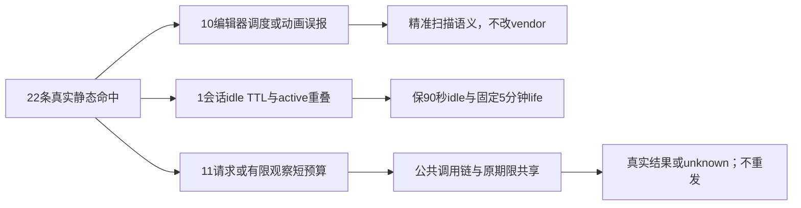

# 真实22条短预算命中：只读消费者归因

结论：10条冻结第三方编辑器误报、1条原合同idle TTL（存在active重叠风险）、11条真实正执行/有限结果观察。四个第一方源及五个冻结vendor源与实际失败回执SHA全部相同。本次没有运行测试、浏览器、PG、原生App或模型；不修改源或断言。原两次22FAIL、原T1248三PG skip都保留。

T1248实际verify为exit1，后续7组各自通过不覆盖本22消费者；当前报告不签全系统预算或功能通过。完整逐源SHA及实际原日志SHA见同名JSON。

## 逐项归因

|ID|源与原命中行|分类及真实消费者|最小候选约束|
|---|---|---|---|
|TP22-01|`frontend/public/reference-editors/doocs-md/native/chunks/codemirror-C3tEDw1q.js:10081`；400ms|VENDOR_IDLE_SCHEDULING：CodeMirror后台解析ViewPlugin：requestIdleCallback调度最迟执行400ms；不是终止工作。|不改vendor；门只按API真实语义识别idle调度。|
|TP22-02|`frontend/public/reference-editors/doocs-md/static/js/md-codemirror-CzoyEQLj.js:11`；400ms|VENDOR_IDLE_SCHEDULING：同上minified CodeMirror后台解析调度。|不改vendor；与native counterpart同消费者登记。|
|TP22-03|`frontend/public/reference-editors/doocs-md/static/js/md-index-D9fKRfoA.js:12`；2000ms|VENDOR_IDLE_SCHEDULING：组件mounted时requestIdleCallback(()=>a(),{timeout:2e3})，fallback setTimeout600ms；推迟布局/编辑器初始化。|不改vendor；该timeout仅回调调度deadline。|
|TP22-04|`frontend/public/reference-editors/kuaitu/js/index.770609ce.js:63`；300ms|VENDOR_UI_UNMOUNT_DELAY：popover hide之后300ms销毁popper节点，非业务等待。|不改vendor；只识别此已绑定的UI卸载消费者，不忽略所有destroy timer。|
|TP22-05|`frontend/public/reference-editors/kuaitu/js/index.770609ce.js:92`；300ms|VENDOR_UI_UNMOUNT_DELAY：ImagePreview close设置visible=false，300ms后destroy/onRemove。|不改vendor；保动画时序。|
|TP22-06|`frontend/public/reference-editors/kuaitu/js/index.770609ce.js:92`；300ms|VENDOR_UI_UNMOUNT_DELAY：确认弹层remove设置closing=true，300ms后closing=false/destroy。|不改vendor；保动画时序。|
|TP22-07|`frontend/public/reference-editors/kuaitu/native/native.js:38974`；1ms|SCANNER_IDENTIFIER_SHADOWING：Axios mergeConfig u.timeout=y；y为合并策略函数，值不是1ms。静态numeric按全文件同名Map查绑定，忽略词法scope导致错误解析。|只修扫描器词法绑定/函数不可当数值；保timeout真正静态数值扫描。|
|TP22-08|`frontend/public/reference-editors/kuaitu/native/native.js:53491`；300ms|VENDOR_UI_UNMOUNT_DELAY：popover hide销毁与minified行63同族。|不改vendor。|
|TP22-09|`frontend/public/reference-editors/kuaitu/native/native.js:59840`；300ms|VENDOR_UI_UNMOUNT_DELAY：ImagePreview close销毁与minified行92同族。|不改vendor。|
|TP22-10|`frontend/public/reference-editors/kuaitu/native/native.js:60642`；300ms|VENDOR_UI_UNMOUNT_DELAY：确认弹层remove销毁与minified行92同族。|不改vendor。|
|TP22-11|`frontend/src/server/ingestion/douyin-cdp-comment-diagnosis.ts:194`；90000ms|SESSION_IDLE_TTL_WITH_ACTIVE_OVERLAP：T1027固定90秒idle TTL；touch在step开始挂timer，timer abort整个session且排队close，所以长active动作会被误作idle中止。|不将TTL改120秒；active期间暂停idle，真正闲置后重挂，固定5分钟life不续期。需独评生命周期规则。|
|TP22-12|`frontend/src/server/ingestion/douyin-cdp-comment-diagnosis.ts:203`；1000ms|POSITIVE_FINITE_OBSERVATION：inspect Promise.race evaluateHandle vs1秒reject，迟到handle dispose；有限DOM结果观察。|以受原session绝对deadline约束的>=120秒正观察槽；保晚到dispose/原DOM隐私限额。|
|TP22-13|`frontend/src/server/ingestion/douyin-cdp-comment-diagnosis.ts:240`；1000ms|POSITIVE_FINITE_OBSERVATION_OUTER：observe整段work包1秒，内部先inspect1秒再jsonValue/property/handle/dispose；相等外层反杀内层。|完整共享绝对deadline或外层覆盖内层与全部串行/清理，不再独立同值竞速。|
|TP22-14|`frontend/src/server/ingestion/douyin-cdp-comment-diagnosis.ts:322`；5000ms|POSITIVE_PROFILE_CHECKOUT：start ports.open借真实exclusive profile，5秒到即session abort；queue/busy分类。|checkout正预算>=120秒，但原life剩余先耗尽立即停；保signal取消队列与busy/停止证明。|
|TP22-15|`frontend/src/server/ingestion/douyin-cdp-comment-diagnosis.ts:324`；15000ms|POSITIVE_NAVIGATION：start HOME goto domcontentloaded15秒；runStage记录dispatched后导航错误unknown。|显式受同session deadline的正导航预算；不新增重试/平台请求。|
|TP22-16|`frontend/src/server/ingestion/douyin-cdp-comment-diagnosis.ts:354`；5000ms|POSITIVE_PAGE_ACTION：advance重验真实token后单click5秒noWaitAfter；再observe。|共享原剩余期限，保action count/CAS/unknown/同key不重点击。|
|TP22-17|`frontend/src/server/workbench-artifact-render.ts:98`；15000ms|POSITIVE_BROWSER_LAUNCH：离线HTML导出chromium.launch15秒，非已有真实browser lease。|>=120秒启动槽；完整导出outer覆盖launch+setup+goto+output+cleanup。|
|TP22-18|`frontend/src/server/workbench-artifact-render.ts:112`；15000ms|POSITIVE_DOCUMENT_LOAD：受控render.invalid唯一document goto load15秒；所有其他网络拒绝。|>=120秒加载槽；保offline/JSdisabled/CSP/唯一资源白名单。|
|TP22-19|`frontend/src/server/workbench-artifact-render.ts:115`；20000ms|POSITIVE_OUTPUT_WAIT：PNG screenshot20秒；同分支PDF within(page.pdf,20000)为漏扫20秒消费者。|PNG/PDF均>=120秒；PDF超时真实关闭owned browser，迟到输出不采纳。|
|TP22-20|`frontend/src/server/workbench-browser-host.ts:168`；10000ms|POSITIVE_RECOVERY_LOOKUP：recoverStoppedProfile两种mode串行，每个profile_location socket由10秒AbortSignal截断（socket自身125秒）。|每次正读取>=120秒，明确2次串行+cleanup+DB结算的outer；保持物理profile精确摘要。|
|TP22-21|`frontend/src/server/workbench-browser-host.ts:180`；15000ms|POSITIVE_RECOVERY_CLEANUP：recoverStoppedProfile发原scope action cleanup（不是仅stop_proof），15秒abort；Rust清理bound owner lanes再取OS/hub停止证明。|>=120秒恢复/清理观察槽；正等待与用户取消分开，超时只保占用不释放/重放。|
|TP22-22|`frontend/src/server/workbench-native-client.ts:47`；10000ms|POSITIVE_NATIVE_RPC_IDLE_TIMER：send socket.setTimeout10秒在无活动时终止真实file/command/recovery请求；发送后保NATIVE_RESULT_UNKNOWN；数据活动会重置idle timer。|请求>=120秒并有完整absolute request bound，host signal即时消费；Rust10秒IO和Windows counterpart必须一起核闭包，不重发原operation。|

## 公共消费者与预算闭包

- CDP：`analytics.comments.diagnose` → analytics transport → comment-diagnosis service（owned已发布douyin作品真实externalId）→ persistence-client端口 → host.start/step → exclusive openContext/原gateway.acquire → goto/click → DOM观察与自然response冻结。start为checkout→newPage→gateway→goto→settle间隔→observe；advance为前置inspect→gateway→再次inspect→click→settle→observe。不是孤立evaluate。原会话固定5分钟deadline不续期，每动作CAS/同key回放、unknown禁止重点击、仅实际context关闭后释放占用保持。1秒inspect与1秒observe外层相等，后者还有句柄投影与清理；不能两者改同120秒又签嵌套正确。step开头touch挂90秒abort，真正120秒active会先被idle中止；只区分active与闲置，不改变90秒数字。自然response的500ms finish窗口也是漏扫的有限收尾观察（对pending allSettled竞速）；settleMs1000是间隔，DOM50ms软访问/节点/字节限额是隐私/资源约束，不把这些全改120秒。

- HTML导出：GET `workbench.artifacts.render` → workbench-public transport → persistence-client.render → representation（原task/artifact/version/hash及registered资源证明）→ renderTrustedWorkbenchHtml → launch→newContext/newPage/route→goto→PNG screenshot或PDF→close→private目录清理。不存在独立完整render outer或caller signal。PDF `within(page.pdf(),20000)`漏扫；newContext/newPage/route/close的库默认/无显式消费者也必须在提案内核。已有真实Chromium测试三个60秒body，不在verify所选7组，不能据7组PASS签导出。需保唯一document白名单/offline/JSdisabled/CSP、原输出有效字节/20MiB/并发2和归属，不改成伪截图。

- 浏览器恢复：原browser.open遇同物理profile占用以及reconciliation → getRecoverableWorkerProfile → mode primary/anonymous最多2次profile_location → 原scope action **cleanup** → Rust cleanup_bound_owner_lanes → stop_proof → 再核原lease/ref → releaseAfterWorkerStopped。命中180不是纯只读stop_proof；真实cleanup可能清原bound lanes。底层Node browser socket已有125秒idle，却被10/15秒外层abort反杀；两mode完整串行和后置DB/清理外层要闭合。Rust browser.rs对cleanup/stop_proof采用原精确身份路径并在普通expires检查前处理，不能为了改预算泛延长30秒admission TTL、释放未知profile或切新scope。5秒reconciliation只是重试间隔。dispose会等reconciling，当前没有有限batch/cleanup独立完整预算。

- Native：已冻结合法workbench capability → chat-workbench-capability-host真实readLease/参数 → host.dispatch(scope.signal) → native-host / artifact-host → nativeClient.invoke短DB准入 → send Unix socket（macOS）/named pipe（Windows文件能力）→ Rust IPC真实文件/command端口 → postlease → 原ledger；另public files.reconcile → backend strict stopped原call快照 → named readonly receipt reader → 同send。10秒socket是活动空闲上限，会被数据滴流延长，未形成完整绝对RPC边界；send没有signal，host只有前后检查。底层Rust ipc.rs read/write均10秒、Windows IO_TIMEOUT_MS10秒、browser_ipc.rs read10秒/write120秒均未被本22捕获。只改Node为120秒依旧不能签公共慢请求链。保持dispatch前拒绝/dispatch后unknown、原operationId、原attempt/fence、写入receipt只读核对、无自动重发；停止任务后readonly对账不得借新请求budget续期/重新执行原任务。

## 最小候选写集与授权边界

T1066/LED053已确认两分钟原则、完整串行外层与共享原absolute deadline；T1081仍只有待办根因登记，无精确独评SPEC。T1027正式合同又显式写1秒观察/固定5分钟life/90秒idle。因此此报告只提出候选；parent本次明确授权基于本轮集中修复及AGENTS规则新建T1250 SPEC、DEC，再独评。不能伪称更早已批准这4产品具体改法，也不能将原T1246单个诊断测试路径出现当作所有生产路径授权。

候选必须至少覆盖：原四第一方源、必要native-host/artifact-host和named readonly recovery service/adapter信号传播、Rust ipc.rs/ipc_windows.rs/browser_ipc.rs真实下层，以及精确check.mjs/check.test.mjs分类修法。扫描器修复不得整目录排除vendor、忽略所有timeout/destroy或靠文件名打豁免；应真实API、词法binding和已绑定动画消费者+反例测试。需要公共transport/representation端口增加取消/预算传递的文件应在新SPEC列清，不能实施时自由扩模块。

验收须真实公共慢于30秒而小于合法预算的成功、完整串行尾轮、原deadline耗尽无续期、即时取消及真实owned清理、同operation/call unknown不重发、CDP原TTL/动作计数/响应限额、profile cleanup/stop proof negative拒释放。真实原生安装/App及平台账号未跑仍明标待验；纯协议或隔离浏览器成功不能代签App。

本次源绑定由实际读取生成；没有修改任何列出的消费者。
