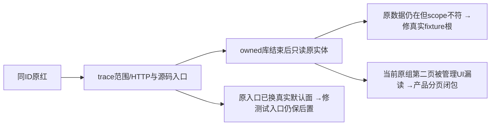

# 原失败余项深核（只读，不修复）

候选533224f334c43cdb81a344424e420cad93784dd1，完整原54/170为131PASS39FAIL。以下只读原trace、实际截图、冻结源码、已结束owned库；没有新增任务、API/模型调用、产品改动、测试改动或v3运行。各首失败仍原样保留。原失败case ID与截图见 ORIGINAL_39_FAIL_TRIAGE.json，以下编号与其39行一致。

## D01：第38行微信入口是真实分页产品缺陷

原GET /accounts Cookie准确为grp-81b98377-6348，不能归为没有选组、缺登录或假外部前置。trace正式 accountGroups.list：shell page1/100返回100行不含本组，shell page2/100返回13行包含本组；管理页 query page1/pageSize100/includeArchived:true返回100行同样不含本组。两真实手工账号为acct-81b98377-6352/6355；accounts.list真实返回62行且含两账号，不是本例账号列表缺页。

当前 account-group-manager.tsx:62–70 reload仅一次page1/100，preferred=current组6348在all中缺失，fallback首个active旧组；右区members来自旧selected，微信查看数据链接还要求selected.id===currentId，故目标成员/link不渲。这是实际当前组可合法存在而管理UI漏读，不是尚未触发报告收集的外部限制。T1022 §3.1/§页面与T1159 AC-REPORT-ENTRY要求当前真实组成员入口，T1161明确微信转组仍在管理details内，不能恢复顶部重复按钮。

最小产品写集：frontend/src/features/platform-account/account-group-manager.tsx及其原test。沿现有typed公开list/get完整分页、真实current scope/epoch/in-flight/取消，避免缺页fallback别组；完整管理列表/目标组选择与原已归档/手工登记/转组dialog保护保持。数据量>100时必须实际核目标current组、member原ID、真实链接/隐藏/转组焦点，不删除历史组、不将pageSize无限加大或仅对该硬编码target开门。AccountManagerPage SSR初始100可以保初始快照，但不能令最终合法current组永远不可操作。accounts数组本例完整62；若同消费者支持更多账号，须沿原同user分页/成员get保证旧账号操作，不伪称缺身份证明。

原t1159 spec当前创建/选组/0报告前置无需改成更少历史或早插数据；其body仍需保完整两个账号×三窗口、管理展开/取消焦点、同步身份拒绝与0run/0浏览器、同ID刷新返回。该首轮没有到这些后置，不能签通过。

## D02：第18、20行平台能力与绑定入口

/accounts正式 AccountManagerView现在只渲AccountGroupManager，当前能力为role table「各平台能力」(manager:135)，扫码按钮为「扫码绑定小红书账号/快手账号」，需要当前active选中组与QR capability。旧PlatformCapabilityOverview组件虽保留源码，已不在正式/accounts组合；bind-xiaohongshu-scan/view-xiaohongshu-works属于未渲的旧多平台scanner。第18行trace有正式能力读取，不因旧slot不存在判能力服务没装；第20行没有触发任何真实accounts.bind.start或原stub platforms.bind.begin。

批准依据T1022 §3.1与§4绑定组入口，T1113 installed capability一致性，T1069组内登录真实持久binding。当前AccountBindingPanel startAccountBinding/getAccountBinding/cancelAccountBinding沿accounts.bind.*，成功accept必须原groupId/platform/accountId匹配且真实accounts.get同id/platform，onChanged刷新；旧stub status=bound+bindAttemptId DTO不能冒充新run succeeded。

第18最小写集仅platform-work-catalog.spec.ts：显式真实current组，按正式能力表/行/可用原因核；保账号作品真实空目录与具体account ID，不能只找任意table签完。

第20首断点是原UI合同漂移，但后置「绑定后查看该平台作品」不能简单删除。进一步核正式PAGE_SPEC.md:7–18（2026-10-05）明确没有pages.groupWorks，:89是历史设计候选，不应拿该planned操作判当前缺功能。当前真实侧栏有发布中心/publishing与运营分析/daily-report，均装GroupWorkspaceFilters：可选原组的平台/真实accountId（含historical）与日期。DailyReportPage/ReportPeriodWorks显示该范围的真实publicationId/projectId作品、原指标和复盘，故AccountRow没有旧view-*直链本身不证明组内作品无法查看。总览仅汇总，正式逐作品读取在发布/分析。

不过旧原case20明确断言platform-work-catalog的data-account-id与「尚无已核验的作品目录」，原case18还保catalog-completeness/粉丝总量未知；这些external catalog状态与published project works投影不是同一结果，不能只改为任意发布空态或分析页就签该原目标。/accounts/works正式page:20–30用显式accountId+当前组active member/version核验；非微信走client.listWorks/readMetrics。platforms.works.list合同与backend listWorks并不排除小红书/快手，读取原user/account的真实platformWorks与目录完整性。因此这两平台的合法目录消费者保留，但全当前frontend装配的目录link只有manager微信成员，非微信旧view按钮仅未mounted scanner；新的非微信AccountRow只隐藏/恢复/转组。原已绑定active小红书/快手目录可发现入口丢失可列为产品缺陷候选，不必新建目录或后台数据接口。父线程要求按T1022保旧入口；最小manager+原tests给当前真实active成员accountId数据入口，将转组放原details，守UI_RULES:25「每行最多一个直接动作，管理动作放更多」。真实扫码权限没有因此扩展。

另发现同入口后续的源码闭包风险（静态证明，未新运行）：PlatformWorkCatalog worksUrl:75–82没有model.accountId，所有选作品、下一页作品/账号指标/作品指标链接仅cursor/workId。在当前group模式ctx.accountId=null时，点击后/accounts/works无法得到账号，回ZeroAccountGuidance；可能另选账号时更不能依live fallback。catalog原unit甚至assert旧缺accountId URL，因此补首屏入口时须同platform-work-catalog.tsx+原test保冻结真实accountId与原cursor/workId，并通过正式组page读回同账号。不能仅按钮出现就签目录全部功能；原case20首轮未到该下游，不能假称新运行已复现。

历史隐藏/转出仍有独立授权边界：显式page仅active member，backend ownedAccount:257–261还要求account.status=active；组published事实另有历史筛选，不能直接将当前live目录放开给转出成员或跨组历史。若集中验收要求隐藏账号原external目录可读，必须按T1022:54/:68原冻结历史事实授权服务端只读路径，保新采集/登录/实时身份的active门；缺的group事实不可编造。该历史目录回路尚未实际首轮执行，报告精确门，不用全局删除status/member检查解决。

绑定成功导航原测试属于声明的UI响应fixture而非真实扫码：集中应交付当前持久binding上游隔离fixture，经真实公开service产原run/account/成员，再真实按钮/明确原accountId与目录状态闭环；或明确只签UI合同fixture并保真正公共binding尚未验，不能route伪装真实平台/全功能PASS。不能为验收访问用户平台登录。

## D03：第19行第二平台项目是旧组/新账号混根

第一个原project-81b98377-3922真实属account3919/group grp_legacy_acct-81b98377-3919；第二个project3964真实属account3960/group grp_legacy_acct-81b98377-3960，公共projects.get各自explicit x-account-id均200，第一次跨号读取项目3922返回404。第二次页面GET实际同时带旧group3919和新account3960；fixture selectAccount只设置account cookie/下个文档account LS，没有改变已有current group。组优先，所以第二项目不见；没有数据丢失或backend跨号误读证据。

最小仅platform-work-catalog.spec.ts：公开创建两真实独立组与账号、资源均按其冻结scope，或从真实成员关系公开读回各原组再通过真实UI选组。不能猜grp_legacy_拼接ID、让两个原隔离项目同组或放宽项目ownership。保跨账号/跨组404、targetPlatforms、发布草稿、同project ID的页面标题/输出/版本与原内容。

## D04：第21行B-roll原方案仍在，测试停在新的默认剪辑面

正式截图已实际查看：标题删除素材真实验收，OpenCut native空时间轴，顶部有「返回制作页」。原outputs.production.editingPlan.confirm真实200，对production4047/output4031保存confirmedAt及decisions；页面GET/RSC同account4011/legacygroup4011正确。ProductionEditorSession reference默认true；只有onOriginal之后才渲originalContents，并可沿legacy文档保原ProductionWorkbench。原workbench:319–337仍正式读原recordingConfig.videoEditingPlan；notice不是退役slot。

最小仅production-broll-remove.spec.ts：在真实同project/output native标题确认后点击「返回制作页」进入原方案，再核confirmed notice/原assetID，执行原剔除、新revision、direction/排除列表、刷新不恢复旧素材等完整后置。遵循T1053/T1062原生入口及原方案/历史保存，不能将测试改成任意空native时间轴截图签剔除、不能删ProductionWorkbench或把候选当确认。

## D05：第3行非法SRT任务真实failed、没有模型call

trace原ai-task-81b98377-317 queued→running→failed，execution exec_e564dbe9-b07a-4166-aeb8-1a8149f5bd17，errorCode VIDEO_DECISIONS_FAILED，attempt1；已结束原库只读execution_calls为空。没有取消命令、外部模型或成功候选。旧runner parseSrt空数组抛备料错误，catch记录failed后调用旧ai.cancelTask；新video-decisions-worker把此业务callback仅记录failure，最后无candidate抛GenerationFailure('failed','VIDEO_DECISIONS_FAILED')，worker-runtime按其outcome正式commit failed；signal abort才cancelled。

这是可解释的状态映射变化，尚未找到要求非法输入必须cancelled的现行SPEC条文，不能为测试把生产failed改cancelled。集中建议仅ai-reliability-recovery.spec.ts按当前明确备料失败核failed+确切code/原task/attempt/模型call0；真正用户cancel用显式原任务cancel命令另核cancelled和0重发。保终态停轮询、真实错误、刷新重建与明确重新运行retryOf原task，不接受failed/cancelled任意集合，也不假造成功/换ID。若集中合同评审发现原取消语义仍强制，则再精确扩产品写集；当前不先签免审修绿。

## D06：第23行母版仍存在，写legacy-null后UI转组；独立六问UI又已退役

原profile-81b98377-4236/current_statement posstmt4238已只读证实仍在，account4233/group_id=null；oneLiner原文未丢。原API写时只有x-account-id。原GET /positioning先account4233，初始化后RSC真实Cookie grp_legacy_acct4233。workspaceFilter的group模式只读group_id=本组，不能读null历史；渲染真实空组Copilot起点有明确数据原因。T1022/T1062要求历史孤立account显式归组，不按现成员扩大group读取。

2026-08-01定位SPEC明确不再独立六问/前采UI，联网不进主链；当前母版继续下游直到新候选被采纳、历史/CAS/跨scope拒绝仍必须守。旧test还期待独立positioning-discovery-workflow/联网补充固定表单。

最小recent-data-safety.spec.ts：本例从公开真实group scope创建正式母版/statement，并真实选原组再进入当前Copilot；若验历史null族，沿已批准公开迁移预览/原digest/确认归组，不SQL stamp或放宽SQL。保原正式statement ID/版本历史直到候选采纳才变、scratch明确不隐含旧资料、搜索地域仅在合法显式联网工具表面另核，不重建退役问卷。读库证明仅数据存在/归属，不签UI修后已可见。

## D07：第22行排期同样是legacy-null写后转组读取

原cal-81b98377-4193仍planned，planned_date=2099-12-31，account4179、project4182、group_id=null。原GET /publishing?month=2099-12为account4179，RSC切grp_legacy_acct4179。publishing-schedule-projection:329–331有group时正式listGroupCalendar，严格groupFilter不读null；原2099时间/排期没有被删除，不能改月份或expect1→0。

最小publishing-center.spec.ts：公开创建真实组/成员/project/calendar均冻结同group，明确目标account/membership；真实选组且保持2099目标月。保原project、排期行同ID、70/30、移除旧重复列表与两窗口全部断言。历史null若需支持走正式显式资料迁移，不能借本例扩大组读范围。

## D08：第24/25行搜索已是SQL真值/空查询短路，旧固定3卡与重复输入失效

原/search无query，无本例资源准备；trace初始化选首迁移组37。正式route用session ctx调用pages.search.get，query-service:423–432明确hasQuery=false空串不查询，docsByType空。原test却在空query要求可见项目grid且固定3卡；空grid无尺寸得到hidden，不是已有真实项目搜索不到。T051 2d正式search-page.tsx文档明确唯一输入在TopHeader HeaderGlobalSearch，重复page输入退役；第25仍找search-page-input。

最小search.spec.ts：空query按真实0核完整可操作输入/类型/过滤/无假数据；另公开创建3个同组真实project，真实header输入唯一query，逐同ID结果/链接核原3卡，不删项目/知识/素材/视频组结构与URL q/type状态。保跨组无结果，不能在搜索生产代码塞fixture。批准合同为Task5真实SQL读侧与T051 URL状态/空串处理，不用只改locator或空白HTTP200当检索通过。

## D09：第26行1024自动折叠侧栏，旧promo入口仅展开渲染

原最终截图已实际查看：1024×768侧栏是64px图标条，原稿页真实内容在，右编导栏按xl规则未显示。sidebar.tsx:240监听max-width1024并collapsed；:294–302仅!collapsed渲SidebarContextualCard，:557「打开 AI 助手」在该卡里，因此当前DOM不存在该文字。原test在imageButton隐藏时直接找此文本，没操作真实「展开侧栏」按钮(data-testid sidebar-collapse-toggle/aria-label)。原大屏两种预填断言已发生，但最终窄屏及零发送闭包未完成。

最小semantic-material-generation.spec.ts：在当前窄窗口先真实点展开侧栏、再可见合法助手入口，核当前项目选择/确认稿来源与正确scope，不复用隐藏旧input；若改用当前项目编导入口必须保同会话身份与原消息数、预填文本/候选图数/单视频/不自动提交。T129/T150响应式折叠与2026-08-14语义素材SPEC AC00/预填行为不支持让缩小窗口永久强显宽右栏。无需产品去掉响应式或恢复promo图标文字挤满64px。

## 边界与仍未定因

root另核settings两例about:blank关闭返回、shell focus/spacing。全原红保留，新59官方49仍call0未验。D02已确认非微信原目录入口未装配且不能用发布/分析投影代签；历史目录授权与新增入口后原账号分页闭包须集中审查。D05非法SRT状态映射的最终合同批准仍需集中独评；其余以上各链均有明确首断点证据。所有集中修建议尚未实施，更没有修后PASS。

## 原证据与查询透明性

- selected-trace-readonly.json：13个相关原trace的SHA、scope cookie（只保两个scope字段，不复制认证Cookie）、公开operation/状态与原ID筛选。
- original-selected-ledger-readonly-first-query-errors.json：首次只读查询成功读回母版/project，但stop_reason列不存在令后续只读事务abort，原错误保留。
- original-selected-ledger-readonly.json及second.json：仅结束owned库的BEGIN READ ONLY/ROLLBACK、无迁移/服务初始化/写任务；后一份含calendar原归属。首次脚本引号syntax error是诊断工具未启动库，终端回执仍保，非产品/测试用例失败。
- 完整原FINAL_FIRST_ROUND/results/scenario/trace不改。下面source-binding对本次实际读源码/SPEC留SHA，不继承历史PASS。

## 原39表的余12项最新补充索引

本报告是ORIGINAL_39_FAIL_TRIAGE.md/json里原待核行的后续只读证据，不回写其原错误/截图或冒充修后结果。行3→D05；18/20→D02；19→D03；21→D04；22→D07；23→D06；24/25→D08；26→D09；38→D01。D01为已证实当前产品分页缺陷；D02亦有当前合法非微信目录入口缺失，另有静态原账号分页风险，历史目录授权与D05的最终状态合同仍待集中审查，其余各首断点已有精确消费者及scope/数据证据。
