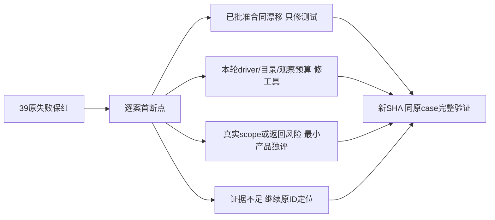

# 原170首轮39失败逐案分诊（只读）

候选 `533224f334c43cdb81a344424e420cad93784dd1`。原54spec完整实际首轮131PASS、39FAIL，0skip/retry/flaky，170张真实最终截图。完整首轮回执SHA `327e1b78367758c19fad677c8d07913d23874ae55abf3d849335cabcc30069bd`；完整原红、trace与body先后保留。以下只签首个已发生断点；没有运行后续步骤不签通过。后台/前端/type首轮仍由主线程收尾，尚未进入集中修复。

“待定位”行列的是调查源，不能直接当授权产品写集。其余最小写集也须集中独评、修后绑定新SHA并同case完整复跑。原断言漂移需有批准合同依据；不得删业务后置断言、改空/错误为成功或用其他case代签。

|序号/原case ID|首断点/实际结论|归属|最小写集或待核源|集中修复要求|
|---|---|---|---|---|
|1 / `398e1e2dd9ad70ed36f5-fcf91ee232c21f1ceebf` opens the centered dialog from any page via ?copilot=open|`ai-copilot.spec.ts:40:67` BC001：T354已退役dashboard次区；真实弹窗打开，首断言仍找退役slot。|已确认原合同漂移|frontend/tests/e2e/ai-copilot.spec.ts|改验当前真实输入、快速入口、单弹窗；保打开不发生成。|
|2 / `398e1e2dd9ad70ed36f5-1f5c45fadccdf95473d0` submit button does not post a real network request|`ai-copilot.spec.ts:84:22` BC002：T1024/T1026真实持久聊天已替代submit无POST；实际7个POST含/api/chat。|已确认原合同漂移|frontend/tests/e2e/ai-copilot.spec.ts|拆打开/预填不发与明确提交一次原消息/原task真实请求，不把任意POST签成功。|
|3 / `78c95fd594dd575ec449-d42c1ed4c6ebb279cf35` 视频决策失败可见、终态停轮询，重新运行显式携带来源任务|`ai-reliability-recovery.spec.ts:149:6` 原无效SRT任务真实终态failed，测试硬等cancelled；尚未核该任务原receipt及取消来源，不能改期望洗绿。|待定位|frontend/tests/e2e/ai-reliability-recovery.spec.ts；backend/src/modules/execution/execution-video.service.ts（调查）|只读原任务/输入/状态/receipt，区分明确cancel与非法输入失败后才能定写集。|
|4 / `66d28c9c49bf28775f51-234ab65402bd8d1f3b8d` route project-overview (/projects/ai-native-browser) renders with single shell and correct active state|`all-routes.spec.ts:35:28` T075真实project root已统一project-workspace顶栏，shell-router与对应测试一致。|已确认原合同漂移|frontend/tests/fixtures/routes.ts；frontend/tests/e2e/all-routes.spec.ts|按当前同一项目阶段条核顶栏/真实project前置，保单壳/标题/可操作内容。|
|5 / `66d28c9c49bf28775f51-a9d66ebd122c84407a70` route analytics-review (/projects/ai-native-browser/review) renders with single shell and correct active state|`all-routes.spec.ts:49:29` BA004：旧fixture slug无选组/账号首载，readReviewHistory真实AccountRequiredError；未验合法纯组复盘。|前置与产品责任待区分|frontend/tests/fixtures/routes.ts；frontend/tests/e2e/all-routes.spec.ts；frontend/src/app/(creator)/projects/[projectId]/review/page.tsx（条件性调查）|真实公共创建项目并选原组后核console；若无scope首屏应可用，明确缺工作区资格，不吞业务错误。|
|6 / `66d28c9c49bf28775f51-5839d001c13f1e01acb5` route experience (/experience) renders with single shell and correct active state|`all-routes.spec.ts:46:26` T118c/T1239经验独立页已退役，真实redirect /knowledge。|已确认原合同漂移|frontend/tests/fixtures/routes.ts；frontend/tests/e2e/all-routes.spec.ts|验正式redirect、知识当前路由；复盘采纳/翻案独立链不得省略。|
|7 / `66d28c9c49bf28775f51-f186a8ca4c212fd720d3` route search (/search) renders with single shell and correct active state|`all-routes.spec.ts:40:28` sidebar PRIMARY_NAV明确/search无独立主nav项；原所有路由必须一条aria-current假设不成立。|已确认原合同漂移|frontend/tests/fixtures/routes.ts；frontend/tests/e2e/all-routes.spec.ts|逐路由声明当前合法nav归属，无入口路由期待0；仍验真实搜索字段/结果/单壳。|
|8 / `66d28c9c49bf28775f51-d79ab2f37da89909c2fc` route settings (/settings) renders with single shell and correct active state|`all-routes.spec.ts:40:28` settings实际aria-current为0；须结合本地弹层背景路由核其当前nav合同，不能统一所有页都改0。|待定位|frontend/tests/fixtures/routes.ts；frontend/tests/e2e/all-routes.spec.ts；frontend/src/components/shell/use-primary-navigation.ts（调查）|核直接访问与从账号页本地打开两种背景语义，保原返回位置与可见弹窗。|
|9 / `826b944a90800335c80d-29f41b2bbed70474183c` lists the seven approved primary nav items|`app-shell.spec.ts:37:25` 真实PRIMARY_NAV已有13入口，含定位/雷达/选题/画布/自动化，T118c经验入口已移除；旧七项清单过时。|已确认原合同漂移|frontend/tests/e2e/app-shell.spec.ts|用当前已批准IA完整清单逐项核实际href/顺序/可操作，不能仅改数量13。|
|10 / `826b944a90800335c80d-9f1ba789128856c63381` focus order: sidebar -> top header -> page content|`app-shell.spec.ts:83:22` 原12次Tab上限少于现13主nav链接，首轮未进入header；尚未证明实际焦点顺序错误。|测试观察范围不足，产品顺序仍待核|frontend/tests/e2e/app-shell.spec.ts|按可见实际focusable导航数+有界完整路径核header→正文，保跳转与无焦点陷阱断言。|
|11 / `826b944a90800335c80d-4077f0e7e007a8275809` applies shared page spacing tokens in the browser|`app-shell.spec.ts:202:20` 实际firstElementChild gap normal；dashboard真实main仍gap-section-gap。应先核app-page-content首子是否初始化boundary/内容容器。|待定位|frontend/tests/e2e/app-shell.spec.ts；frontend/src/features/dashboard/dashboard-page.tsx（调查）|等待已确认dashboard内容后测真实布局节点；实际tokens偏离则再最小产品修，不改normal为期望。|
|12 / `8cf1aa680fa498b7616c-970fa63bd6a10887733c` 切换账号组只改变工作区列表，回到原组后原 job ID 与排期仍相同|`automations-group-media-jobs.spec.ts:139:82` BA001：真实GET仍发旧legacy Cookie，菜单为目标新组而正文0jobs；尚未进行切B/回A。|测试竞争＋已确认产品风险|frontend/tests/e2e/automations-group-media-jobs.spec.ts；frontend/src/components/shell/account-switcher.tsx；frontend/src/components/shell/workspace-initialization.tsx；对应初始化/切组tests|fixture先真实选择/核cookie+LS；产品首载合法LS根与SSR初始根不同须沿原受控refresh后ready，保dirty/ABA/取消。|
|13 / `6d09fca92676595ee8d1-925a30d511adcca21d02` 组内真实作业通过立即运行准入并保原任务显示待扫码|`automations-run-now-public.spec.ts:253:63` BA001同根：实际GET旧组，正文@t1022-1；未到runNow。|测试竞争＋已确认产品风险|frontend/tests/e2e/automations-run-now-public.spec.ts；同上一行产品两文件与tests|保真实本例组、原jobID、待扫码/开关/runNow后置，禁止改组名字为旧组。|
|14 / `b64559fc4465ec32f46c-c9e4a01ada78a3a6ab2c` renders the adjudication workbench on the /experience route|`experience.spec.ts:28:27` 同T118c/T1239真实redirect导致知识页标题；原经验裁决页退役。|已确认原合同漂移|frontend/tests/e2e/experience.spec.ts|按批准合并知识页与复盘真实裁决链更新原合同，不重建退役页。|
|15 / `41050249d47ab09b44f8-452e9ace5f8248c451ed` 空账号组通过设置页定制官方 Skill 的首写入口可用|`group-skill-customization.spec.ts:201:48` BA002：原活跃合法迁移组已存在；创建两新组不代表自动选中新组，首断言未到Skill编辑。|已确认fixture前置漂移|frontend/tests/e2e/group-skill-customization.spec.ts|读取真实当前组并显式UI选择本例空组；保首写/CAS/刷新/跨组版本全部后置。|
|16 / `37c0a50c9e3744722adf-720e6f026bb155ed6457` T-1226 上传、公开下载与错组拒绝都使用本轮隔离媒体根|`media-root-isolation.spec.ts:93:85` BA003：本轮/tmp数据根不满足os.tmpdir真实父路径＋creatoros-playwright-*前缀；未上传。|已确认验收工具前置|docs/verification/t1246/driver运行根生成消费者|新fresh mkdtemp位于realpath(os.tmpdir())且原前缀，media/data/env一致，原guard不放宽。|
|17 / `d9613b8836b17a7105de-3b722d27bb7db20a75f4` 重新打开后真实回到首页，并保留新号/已有作品两条连续路径|`onboarding-and-small-sidebar.spec.ts:76:24` onboarding-steps.ts:168组模式真实标题将平台账号加入账号组；旧测试还硬等单账号绑定抖音标题。|已确认账号组合同漂移|frontend/tests/e2e/onboarding-and-small-sidebar.spec.ts|区分组/旧account真实scope，验组完整6步/两条路径/重开行为，不只换一条文案。|
|18 / `ff88aeb912d54d19c019-07fb539b46563c1a126c` 平台作品页按当前账号显示真实空目录和待核验能力|`platform-work-catalog.spec.ts:31:66` 旧platform-capability-overview在/accounts不见；真实新组管理页面与旧能力组件仍存在，未核批准IA/实际入口。|待定位|frontend/tests/e2e/platform-work-catalog.spec.ts；frontend/src/features/platform-account/account-group-manager.tsx（调查）|明确组选中/账号身份与当前各平台能力表真实入口后更新；不能删能力核验或签空目录下游。|
|19 / `ff88aeb912d54d19c019-cfdcf5687c7b5f5352b8` 本地账号完成多平台目标项目与发布草稿，账号归属隔离|`platform-work-catalog.spec.ts:98:66` 第二平台项目真实创建API成功但页面标题未见；fixture只写account Cookie/LS，未冻结/清除旧group，疑作用域分裂尚无trace定因。|待定位|frontend/tests/e2e/platform-work-catalog.spec.ts；shell范围相关源（调查）|逐原projectID对账请求scope、SSR根及DOM，保跨账号404/目标平台/发布草稿全部断言。|
|20 / `ff88aeb912d54d19c019-9d7913f6044d65d5c8a4` 账号页绑定成功后可直接切换到对应的小红书与快手作品页|`platform-work-catalog.spec.ts:128:53` 旧bind-xiaohongshu-scan测试id不见；新组管理真实扫码能力按钮需核原接入/批准入口。|待定位|frontend/tests/e2e/platform-work-catalog.spec.ts；frontend/src/features/platform-account/account-group-manager.tsx（调查）|选当前正确组真实能力表入口；fixture上游明标，不执行用户平台登录，保身份/成功切换同ID。|
|21 / `90d32f0826f75e4378df-34912ade6a99810c4747` 已确认分镜剔除 B-roll 后写入新版本，刷新也不会恢复旧素材|`production-broll-remove.spec.ts:236:74` 已确认分镜notice未呈现；production源码仍有该slot，不能归为退役。|待定位|frontend/tests/e2e/production-broll-remove.spec.ts；frontend/src/features/production/production-workbench.tsx（调查）|原decisions/task/project/receipt scope与确认状态真实读回，定位未呈现来源后再定产品或fixture。|
|22 / `4f3e74964b66d244a3b5-d02911a1d5be5b1c6704` 真实项目排期出现在 70/30 日历视图，旧重复列表已移除|`publishing-center.spec.ts:97:34` 已排期项目日历month=2099-12无entry；尚未核同project排期、scope、目标月时区/真实视图筛选。|待定位|frontend/tests/e2e/publishing-center.spec.ts；frontend/src/features/publishing（调查）|按原projectID/排期字段同scope核；不能改1为0或随意month替换。|
|23 / `8e7a9a57a62b196b6936-eead317e609b857c2ca4` 已有定位进入从零前采时，正式母版和历史始终可见，搜索默认国内中文|`recent-data-safety.spec.ts:134:24` 原已创建定位母版未在真实positioning页显示，当前只见Copilot起点；旧新账号scope及母版归属未对账。|待定位|frontend/tests/e2e/recent-data-safety.spec.ts；frontend/src/features/positioning（调查）|核原母版版本/历史同scope及当前UI入口；保正式母版不可被候选覆盖、国内中文搜索范围。|
|24 / `f4a36a9939d689d57a9d-16a12204dc96e9f901a5` renders the global search structure on the /search route|`search.spec.ts:74:34` 真实project-result-section节点空grid隐藏；无本例公开搜索数据准备，不能凭标题判产品检索失败。|待定位|frontend/tests/e2e/search.spec.ts；frontend/src/features/search/search-page.tsx（调查）|真实创建可搜索原project并核查询/结果ID，空数据按真实0；原其他结果族不偷删。|
|25 / `f4a36a9939d689d57a9d-45aa1522353ea5990897` URL ?q=... is reflected in the search input value|`search.spec.ts:101:25` T051 2d退役重复page-input，真实查询字段在TopHeader HeaderGlobalSearch，源文件明确该消费者。|已确认原合同漂移|frontend/tests/e2e/search.spec.ts|按真实共享header输入核q并操作URL/实际结果ID；不恢复sr-only假输入。|
|26 / `ab4ba88af7a7cf4851d3-7777bc4d99ffaf6b4a45` 图片按确认稿需要预填多个候选，视频默认预填一个候选，点击不自动发送|`semantic-material-generation.spec.ts:143:55` 本例大屏图/视频预填已到；1024宽侧栏打开AI助手入口缺，源码仍有该入口，可能侧栏折叠/响应式定位。|待定位|frontend/tests/e2e/semantic-material-generation.spec.ts；frontend/src/components/shell/sidebar.tsx（调查）|核当前可点击真实全局按钮/可见状态，保同会话预填、多候选/单视频、点击不发请求；非共用main截图。|
|27 / `87418b536bb3b16b9965-9d167bbc2a2b29b9bb07` renders the settings structure on the /settings route|`settings.spec.ts:233:16` 设置关闭后真实URL为about:blank，等/accounts失败；handleOpenChange history.length>1→router.back，需核本地开弹窗是否push历史。|待定位，真实返回风险|frontend/tests/e2e/settings.spec.ts；frontend/src/features/settings/settings-interactive-region.tsx；frontend/src/components/shell/use-primary-navigation.ts（调查）|读取trace实际opening/closing history操作，若local开未push需产品回原背景，不能改预期about:blank/首页。|
|28 / `87418b536bb3b16b9965-1daf9239c5bf49000f59` [T-1232] 外观主题与密度按本地消费者持久并返回刷新|`settings.spec.ts:298:16` 同设置关闭about:blank断点，外观持久验证尚未到刷新回读。|待定位，真实返回风险|同上一行|保关闭返回/accounts、刷新主题/密度原值与重新打开同原配置，不能用另外探针PASS代签。|
|29 / `a8c4891f095c8a8e2a8e-78c06f6ccaa7f5fd8b4e` 纯组无平台账号仍可通过真实创建弹层创建项目、保存画布和打开原生剪辑|`t1062-group-native-rough.spec.ts:333:118` BA003：assertPrivateRuntime在beforeEach拒绝目录，未进入功能body；两ASR例另需真实离线cache/admission。|已确认验收工具前置|docs/verification/t1246/driver运行根生成消费者|与媒体例同真实os.tmpdir mkdtemp根；ASR按当前候选交付真实cache/admission，保原guard和原声/手工降级断言。|
|30 / `a8c4891f095c8a8e2a8e-4a616b4b5d877c355ca2` 同组多个账号/平台筛选保留dirty和真实native实例，公共保存始终冻结组根|`t1062-group-native-rough.spec.ts:333:118` BA003：assertPrivateRuntime在beforeEach拒绝目录，未进入功能body；两ASR例另需真实离线cache/admission。|已确认验收工具前置|docs/verification/t1246/driver运行根生成消费者|与媒体例同真实os.tmpdir mkdtemp根；ASR按当前候选交付真实cache/admission，保原guard和原声/手工降级断言。|
|31 / `a8c4891f095c8a8e2a8e-ca78d653a89a51c55966` 跨组时取消真实在途素材响应，旧组晚到结果不能回写或继续保存|`t1062-group-native-rough.spec.ts:333:118` BA003：assertPrivateRuntime在beforeEach拒绝目录，未进入功能body；两ASR例另需真实离线cache/admission。|已确认验收工具前置|docs/verification/t1246/driver运行根生成消费者|与媒体例同真实os.tmpdir mkdtemp根；ASR按当前候选交付真实cache/admission，保原guard和原声/手工降级断言。|
|32 / `a8c4891f095c8a8e2a8e-408b513e0317a7efece3` 真实迁组历史画布保留account出处，group归属可读写；错误组读回明确结束loading|`t1062-group-native-rough.spec.ts:333:118` BA003：assertPrivateRuntime在beforeEach拒绝目录，未进入功能body；两ASR例另需真实离线cache/admission。|已确认验收工具前置|docs/verification/t1246/driver运行根生成消费者|与媒体例同真实os.tmpdir mkdtemp根；ASR按当前候选交付真实cache/admission，保原guard和原声/手工降级断言。|
|33 / `a8c4891f095c8a8e2a8e-d6ac7f086c19a59f1b17` 真实默认ASR与原生原声：普通AAC完整自然播放、单独核对、明确采用与保存刷新|`t1062-group-native-rough.spec.ts:333:118` BA003：assertPrivateRuntime在beforeEach拒绝目录，未进入功能body；两ASR例另需真实离线cache/admission。|已确认验收工具前置|docs/verification/t1246/driver运行根生成消费者|与媒体例同真实os.tmpdir mkdtemp根；ASR按当前候选交付真实cache/admission，保原guard和原声/手工降级断言。|
|34 / `a8c4891f095c8a8e2a8e-6dc193773c32133c3858` 真实默认ASR与原生原声：非零视频起点仅此项手工降级，原工程仍可保存|`t1062-group-native-rough.spec.ts:333:118` BA003：assertPrivateRuntime在beforeEach拒绝目录，未进入功能body；两ASR例另需真实离线cache/admission。|已确认验收工具前置|docs/verification/t1246/driver运行根生成消费者|与媒体例同真实os.tmpdir mkdtemp根；ASR按当前候选交付真实cache/admission，保原guard和原声/手工降级断言。|
|35 / `a8c4891f095c8a8e2a8e-e6085f74588844d59da3` 真实首载RSC一直未交付：有界超时后显式整页重试，同B根可创建保存回读|`t1062-group-native-rough.spec.ts:883:25` 旧注释说15s，但实际WORKSPACE_INITIALIZATION_TIMEOUT_MS=120000；外层error观察也120000无独立余量，本轮未看到error。|已确认预算观察缺口，产品终态待核|frontend/tests/e2e/t1062-group-native-rough.spec.ts|保产品120s原deadline，观测覆盖启动/真实120s刷新＋至少请求/settlement余量；仍实际核超时阻留/整页retry/晚响应不解锁。|
|36 / `e350765340916b502f9a-1807c0969f844b2c0026` 真实文章保存、指定版本刷新、同项目编导窄屏打开、NoteRelay HTML交付|`t1070-director-editor.spec.ts:75:21` prepare输出迁移为resolve(...)但原test只import join；真实保存后evidence()ReferenceError。|已确认本轮driver回归DR006|docs/verification/t1246/driver/prepare-browser-driver.cjs|仅路径表达式用原已导入join或准确新增consumer依赖；完整252逆重构/inventory/SHA独评，不改生产或原assert。|
|37 / `e350765340916b502f9a-3a87c779b994624d42ef` 真实图文三卡保存刷新，NoteRelay翻页与ZIP可用，旧图片入口与历史保留|`t1070-director-editor.spec.ts:75:21` 与上一行同evidence()，真实图文保存后证据阶段失败；下游未代签。|已确认本轮driver回归DR006|同上一行|保旧红与原HTML/ZIP/历史后置，修driver后同原case完整跑。|
|38 / `10645feaadfc4eb9725d-37a520db61507269907f` T1159 两微信账号从组成员进入真实0报告，刷新返回与身份拒绝|`t1159-wechat-native-report.spec.ts:50:26` 组内成员只选当前活动组才显示微信报告链接；本例注入组cookie/LS后链接缺，尚未读实际当前组选中/成员sameID。|待定位|frontend/tests/e2e/t1159-wechat-native-report.spec.ts；frontend/src/features/platform-account/account-group-manager.tsx（调查）|核真实当前组/成员/账号/链接href；不得伪造externalAccountId或登录用户平台，保0报告/错组/身份拒绝。|
|39 / `bf4a1cd0b0748cf23b48-209b5f7d65fc4e79a89e` 公众号文章经独立模型 Worker 生成候选，用户审读采纳后刷新回读|`wechat-article-workbench.spec.ts:194:41` T1097/DEC3671移除旧根据脚本扩写按钮；本例在articles.candidates.generate响应观察120s停止，trace没有该POST/模型call。|已确认旧入口漂移，独立Pi链未验|frontend/tests/e2e/wechat-article-workbench.spec.ts；frontend/src/features/article/article-workbench.test.tsx（已有unit同根）|按当前批准公共AI入口接本例真实PiHTTP fixture、原candidate/task/Worker/采纳/version，保来源与原人工题摘要不覆盖；不能拿手写PASS/模型probe替代。|

## 确定性集中写集边界

- 已确认产品scope风险：`frontend/src/components/shell/account-switcher.tsx`、`workspace-initialization.tsx`与其原测试。只同步首载SSR/当前合法根差异，保dirty/ABA/后台冻结与权限；两红自动化fixture同时按真实UI选组。
- 新59另确认BC003产品预填缺陷：`frontend/src/fixtures/selectors/copilot.ts:75`、`frontend/src/features/copilot/ai-copilot-content.tsx:599–605`及原prefill tests。仅Codex已读服务值不再要求独立图模型，Pi原合法能力保留；本首轮未产生官方生成，不能预签修后闭包。
- 设置返回about:blank两例为真实风险，尚不能凭close源码直接签定因；先核打开历史消费者再决定最小产品修复，不改返回目标以洗红。
- DR006只改prepare输出消费者；fresh根只改本轮driver目录建立；T1062刷新观察只加外层独立完整余量，不延长生产任务deadline。
- 其他待定位行禁止笼统写旧债。本表不声称39均已定因，更不声称已修复。

## 官方49、Pi与协议恢复的实际边界

新59v2实跑4框架PASS55FAIL（journey4pass50fail5blocked），官方49生成key call0，均未验。原公众号Pi案第39没有到生成响应/Worker模型调用；原手写文章PASS与settings文本probe PASS只签各自步骤。后续精确方案见 `docs/verification/t1246/V3_CONCENTRATED_PROPOSAL.md`，所有入口逐原task/call/thread/turn/child/输出或assetFileID绑定，UI入口必须实际点击与同ID结果消费；无按钮的内部key明确公共API覆盖。

协议恢复要由公共聊天实际生产者触发绑定/stdio断ACK，fresh私有protocol树owned vendor新inode替换；不得人工SQL造unknown、读取/复制凭据、改共享store或官方binary、重发新turn。Pi同ID真实HTTP fixture候选→原版本采纳/读回必须交付实际用例；当前尚未实施。

## 原证据索引

- 完整逐案JSON含原错误、URL、截图绝对路径与原case：`ORIGINAL_39_FAIL_TRIAGE.json`。
- 原首轮：`533224f/browser-original-dr005/FINAL_FIRST_ROUND.json`、`results.json`、`scenario/scenario-index.ndjson`、全部原trace。
- 只读同行报告与source SHA已原文封存于 `readonly-diagnoses/`，其原路径/SHA载于逐案JSON。同行部分记录在124/170时形成；不得将中途87/37等计为本轮最终131/39。
