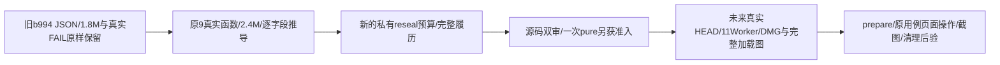

# 原验收工具预算履历续版候选

本目录是 ROOT 在真实纯预算失败65266392之后授权的最窄源码续版，未执行。原27cf215项、c6a959、原9工具、旧b994 JSON、原170/new111/first100、54文件配置、SQL和断言均保持原字节。原pure child66912 code1、wrapperEOF1、209ms/closed/group0及完整原始日志永久保留；原wrapper未到after的状态不补写，独立只读after另记。

给人的操作思路：旧封存值是履历，当前真实函数决定下一份预算。旧JSON和新预算都核对，准备工具拿到同一提交的实际Worker和DMG后才可以使用新封存值。当前只有源码候选与语法解析，任何页面body、生成、App验收仍未由本次操作验证。

读取顺序：`SOURCE_TOOL_BINDING.json` → `CANDIDATE_DELTA.json` → `TOOL_27CF_CURRENT_RUNNER_BUDGET_FORWARD.diff` / inverse → `budget-test.cjs`、`tool/reseal.cjs` → `lineage/original-b994-manifest.json` → 全六私有prepare/verify/launch与同代tool → 完整正逆差异/机械proof → `STATIC_PARSE_RESULT.json`。原27cf完整源码独评5b184bbb仍作为未变部分履历，不代新源码和运行准入。

此次只改两份实际代码：

- `budget-test.cjs`读取本目录保留的旧b994完整JSON，核历史startup=1.8M/outer=49,181,520,000；读取当前原9 verifier真实导出的纯originalRunnerBudget，核startup=2.4M/outer=49,182,120,000，逐个字段比对，只有startup与outer各增600,000，其余所有字段相同。当前根manifest的170个listedBodies和54文件budgets须与该历史JSON完全相同；当前函数对当前根manifest和历史JSON推导也须相同。新revised原outer=49,197,000,000，保持原2.4M消费预算，禁止降函数去贴旧JSON。只调用纯公式和截止predicate；没有verify/Git/SDK/helper/supervise/服务调用。
- `tool/reseal.cjs`在 future 原profile私有新manifest写入前，逐SHA核原9当前函数和旧b994归档，按同一真实originalRunnerBudget重封完整runnerBudget全部字段；与批准私有verifier的纯推导严格全字段相等。runnerBudgetPreviousSeal及joint originalRunnerBudgetLineage保原JSON、旧SHA和真实producer函数履历。历史JSON实际文件SHA纳joint sourceFiles并经原完整source守卫每次重核。原manifest当前实体不应用，仍只是future私有输出；源码文件和任何用例不改变。

同族消费者核对：原assertOriginalRunnerBudget逐个完整字段检查runnerBudget，原launch source/runtime/最终verify与config仍原完整消费者；所以只改单个pure数字不能修复future prepare，必须让新封存JSON和真实函数一致。新111的v3RunnerBudgets只由expectedBodies(103/7/1)和既有完整常数推导，不消费JSON.runnerBudget；这次不改new111的任何预算、断言、配置或SQL。已有原runner revised派生对当前2.4M原基线增加14.88M，prepare的S/R/S/R及9.96M、S1.14M/R2.04M、ready2.46M、ledger3.24M/3.84M、entry5.22M/final3.18M/三清理7.2M全部保持。

前代五项来源守卫不变：actual source/owned动态库角色及firstexists、source raw stdout/stderr/closed receipt/upstream全SHA、metadata两个Python实际file schema、supervisor真实monotonicClose late0、完整future/单birth长预算。实际默认headless-shell1223与fullChrome独立完整实现、Helpers、Node/PG/addons及fixture ffmpeg新联合图仍待future actual collector；protocol只有已批准的私有Codex新inode CJS替换，不对CJSotool。原9与Doocs29b3不改，生产de1a属T1251，11907只属workbench-file-recovery测试minimum。

当前2个变更CJS语法实际0；13个未变parser输入是与27cf严格相同的字节，原实际parser回执SHA仍保持，不重复执行。预算pure与reseal均未执行。所有首次syntax失败、5d36/27cf CONCERNS、65266392真实pureFAIL和诊断更正均不删除。

新源码双审、下一次onlypure独立准入、final cleanHEAD/实际native完整交付、同HEAD11Worker/DMG receipts、fresh bootstrap/联合actualotool与raw、实际private copy图/完整runtime双审都pending。本次禁止metadata/reseal/prepare/list/services/browser或产品copy运行。App继续按用户暂不授权保未验收。
