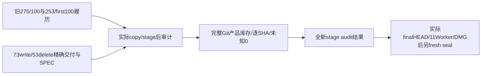

# 最终源码范围审计源码候选

仅SOURCE准备，未执行Git/审计或写最终结果。旧f5d0 partial-latest的275源/100driver原字节保持，7391的343输入、旧first100/253来源和所有真实FAIL均不改。当前T1254 delivery4b55的73write/53delete未由本脚本应用；没有预签finalsource PASS。

审计在ROOT实际copy/stage后，读取真实copy/stage receipt与双审源码，写入 `docs/verification/t1246/round-2/final-source-audits/` 下全新文件名，不覆盖旧partial/任何manifest。该receipt的严格schema目前为候选，ROOT需给真正receipt映射与SHA再形成exact runtime准入，不能把candidate的productionCopyNotExecuted字段读成已复制。

范围：275原source+仅新增73 delivery写=348存活source、100driver、53独立删除。旧b994完整归档中的first100原SHA、253路径/round1ExpectedSha256/旧sha与合法当前partial变化来源保留。每个新增交付路径显式对应T1254精确SPEC和4b55逐路径SHA，scope不是通配豁免；完整709候选文件和5冻结文件也逐hash/size/mode/uid核。Spec9原SHA保持，T1254 SPEC必须由ROOT提供精确SHA。

真实Git消费者只有5个各240k：HEAD、NUL安全完整status、cached/others产品库存、unstaged名字、cached staged变更。外层单出生3M=entryIO600k+5×240k+afterIO600k+写结果余量600k；每条完整future及最终post-write monotonic检查。当前大库存消费者保64MiB输出容量，不修改旧9工具。完整产品根包含整个frontend（public/scripts/src-tauri/package/tests/generateddriver），backend/contract/worker/mcp/reference、timeout工具及root pnpm/package；未授权Git改动必须0，原first100不刷新。

输出只说明真实copy/stage后的源码范围，明确 `stageAuditNotFinalCommitSeal=true`、finalHEAD/package/worker/runtime pending，不把旧HEAD或source比较当包/浏览器PASS。现在仅一次 `--check` 语法0，没有执行任何审计主体。
