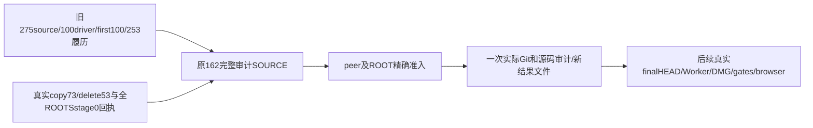

# 已实际交付后的源码审计fresh候选

只绑定源码与真实回执，未执行审计主体或Git。本目录audit-source.cjs与原162完全逐字相同；保原allROOTS unstaged0 guard，不缩小。原162/7c466、f5d0 partial/旧343、所有历史FAIL不覆盖。

真实证据：ROOT先实际stage275原source+100driver，后Doocs copy自然EOF0并精确stage73writes+53deletes；combined94838与allROOTS0f97均真实0。cached实际449是与HEAD的自然差异计数，不强凑501。当前HEAD仍533，未commit/package/11Worker/gates；本audit只写新的stage-source结果，不签finalHEAD/package/runtime PASS。

输入fresh绑定包括94838真实copy/stage、0f97全部ROOTS stage0、此前375 staging proof、f5d0、4b55、旧b994归档、原9个SPEC/T1254 SPEC、348source+100driver的当前只读SHA和53absence。当前physical448已读取零漂移，只说明字节绑定，不是audit/Git执行PASS。正文仍检查first100原SHA、253来源/当前批准delta、完整709产物/5冻结文件、5个真实Git全库存/NUL status/所有ROOTS unstaged0、unknown0。

原162实际--check0按同字节复用，未重跑无必要解析；源码scope不变。误推测缩Gate的b7候选已保存为not-accepted且never-executed，不消费。source/runtime准入仍待peer+ROOT；收到后才调用固定Node和实际完整动态运行依赖守卫。本文件不设置reviewed=1，不执行copy/metadata/reseal/services/browser或提前写finalsource PASS。
