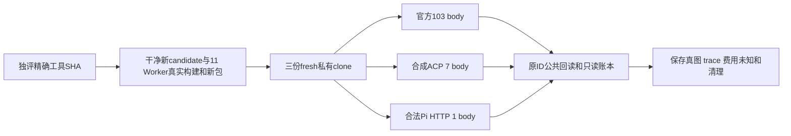

# T1246 V3 独立验收工具候选

当前只完成静态源码、列举与类型检查；没有启动 Next、浏览器、PG、模型或 App。此候选不使用旧533包或旧dist冒充新产品验收。原170/59/失败和trace封存。

59逻辑旅程、49生成键与38路由分别映射。新增settings7与T1097两视口另列，不改59分母；共111实际列举body（official103/protocol7/pi1）。框架PASS、能力探针和BLOCKED不代签官方模型。只有本case原task/call/source/冻结route/provider thread-turn/candidate/图片blob与原文件账本闭合才签生成。

唯一产品来源是最终干净candidate；源253完整状态及全产品库存、9源/9driver/两只读原测试、11bundle和依赖真实path执行前后核。当前manifest sealState明确pending，prepare将拒绝启动；root统一真实build/package后重封source与workerBuildCandidate，重新独评精确manifestSHA。sourceCommitAtPreparation仅provenance，不用自引用要求它等于包含manifest的新HEAD。

三profile分别使用独立nonce/private tmp checkout/data/media/auth/TMP/Next/cache/证据。完整私有依赖副本逐symlink拒绝escape，没有shared pnpm workspace软链。HOME/CODEX_HOME保原值，不重命名/复制auth；official使用原合法本机账户。protocol仅私有vendor新inode受控JSONRPC，不向官方转发；真实ACP adapter执行，MCP effect-none read成功后自然EOF，unknown/binding必须原host持久，不能业务DB写造未知。control只能release已真实inflight未ACK turn；fixture事件日志只读。protocol专有initdb/postgres/新loopback端口/PIDbirth库可在途READ ONLY；official/Pi只在Next/Worker全部关闭后读own PGlite。

工具静态准入后，运行环境必填：CREATOROS_T1246_TOOL_REVIEWED=1、CREATOROS_T1246_REVIEWED_MANIFEST_SHA256=独评精确SHA、CREATOROS_T1246_PACKAGE_READY=1、CREATOROS_T1246_FROZEN_CANDIDATE=新40hex、CREATOROS_T1246_PACKAGE_SHA256=真实64hex、CREATOROS_T1246_PACKAGE_RECEIPT=本候选真实RESULT.json。随后 `node driver/prepare-runtime.cjs official <全新24hex nonce>` （另两profile各新nonce）只准备，再 `node driver/launch.cjs <该profile evidence/runtime-binding.json>`。不得执行pending manifest或复用旧root/server。

正动作/HTTP/expect/有限观察最短120s；case72000s、原T1097 18000s保持；uiOp300s覆盖action120+HTTP120+读包60，observer1980s+末请求120；各profile外层完整串行body+独立fixture teardown/hook/启动/报告/2400s清理（批量ps与close证据完整槽及960s余量），performance单调60s分段避免int32溢出，正常立即结束。持久任务原deadline/continuous/cancel不改、不续期、不新建retry恢复。预算消费者与逐body声明见budget-consumers.json，实跑再次输出actual-budget。

所有结果仅evidence/<nonce>/<profile>或reviews。原settings7/T1097只读输入仅机械迁单一helper到本轮无历史输出helper；settings三声明预算900k/1200k/1800k提高72000k，完整body逆构；T1097全部原18M/420k/300k/assert保持。每个失败即时journey/liveissues真实登记，结束再集中修。缺aweme/登录仅从真实公共资格返回记录，不假ASR或评论，不直接throw伪外部前置。官方允许现有Codex及公开W3C RSS服务器；浏览器只same-origin HTTP/WS，不请求平台登录、不启动App或平台发布。

静态列举与类型回执见reviews；初次模块解析错误及显式testRoot遗漏产生0body红均保留，不计功能失败。最终正式跑前必须重新完整--list与所有SHA守门；运行后保存readonly-ledger/逐key判定/PNG索引/trace/原usage未知及owned cleanup surviving=0，不能把工具计划签可用。

DR011同型：V3 expectedBodies严格exact103/7/1整数先于runtime/PG，完整outer由同一v3RunnerBudgets派生，缺失/NaN/0/extra拒绝；不变111/49/38/59映射。

最新PG出生门同时约束startup首connect与ledger connect，marker/pidfile/真实birth+uid+ppid/executable/loopback URL均先核，SQL后二次proof保留。PG完整启动槽1500秒，含initdb与最后ownership/连接/查询/关闭余量；两启动槽原更长保留。V3独立ledger槽1800秒，涵盖child verify两git240秒＋preproof120秒＋完整SQL/关闭960秒＋480秒余量，outer同步派生，原任务期限不变。纯Node31失配只签spy构造/连接0，不代签真实PG或SQL运行。
