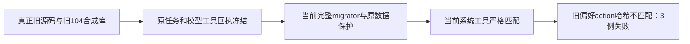

# 原服务入口与旧冻结任务校准实测

当前两组入口原六例真实 **6 PASS、0 FAIL**，65.42 秒、exit 0。原断言保持：通过公开账号创建与公共任务接口运行真实 Worker，再验证候选、采用、重复与并发回执、非法内容及真实指标资格。复盘夹具采用 `accounts.create` 返回的真实 `account.id`，没有凭空账户或宽松成功断言。

legacy 原四例真实 **1 PASS、3 FAIL**，55.62 秒。第一例构建前置已补齐，真实公开账号/项目/稿件读取通过。后三例由 Git 对象 `6e4689b3180f91189110208267708ad72b03ae64` 的真实旧源码与旧 Worker 合成物理 104 库；旧偏好 schema 没有新引擎列。旧模块、旧 schema、锁定同版本 Pi core、原 104 迁移账本、冻结内容与原受控 localhost 模型/工具步骤均保留。当前 migrator 执行完整当前 SQL 后，全部迁移 hash/时间与原冻结数据检查已通过；随后原回合尚未完成，不能签升级闭环通过。

独立私有诊断真实 1 PASS、17.468 秒，仅定位字段，不冒充原用例或历史用户库实测。`catalog-differences.json` 保存原冻结定义和逐 JSON pointer 差异：旧 `system.read` 等于当前 catalog v2；`system.action.propose` 中 `settings.preferences.save` 新增 `assistantExecutionEngine`、`initializeAssistantExecutionEngine` 导致版本哈希由 `8d426601…` 改为 `ea89720c…`。当前 `matchFrozenAssistantReadCatalog` 比较所有系统定义，因此只读回合也被偏好 action 新字段阻断。此前“T1097 proposal 可能变化”的猜测已经证据排除。

最小后续修法需要正式增加已知旧偏好 action 的固定严格 schema 版本，并对整个冻结工具定义完整匹配；不得接受任务自报 schema、改原冻结字节、取消原权限/回执核验或只允许工具名。当前授权仅测试文件，我未修改生产 host 或 schema。

每轮原错误、JSON、退出与预算、源码前后及 11 bundle 哈希均保留。私有 producer 早期失败与修复因果也保留：缺少旧真实 identity/course 输入与旧 Pi core 的动态加载闭包，最终使用 Git 原文件及锁定同版本真实依赖；不是假模型/假 Agent。运行只使用 owned PGlite 和受控本地 SSE/HTTP，无 App、真实模型、foreign PG。共享 dist 独占窗口已交回 root。

类型检查本轮仍 exit 2，仅第一轮封存 generated 测试的 T1062 union 三处与 DR006 `resolve` 一处；本轮三原服务测试没有类型错误。完整构建输入在运行前未做全源快照，不能补造；实际构建命令及前后 11 bundle 绑定已保留，当前源码哈希另明标为 EOF 后观察。
