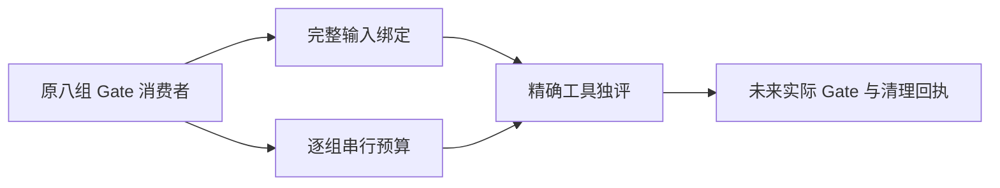

# 最终 Gate 工具只读评审

当前候选不能准运行：问题在执行工具的输入和预算证明，尚未运行或判定产品 Gate 结果。原 timeout 两次 22 个失败全部保留。

- **FG001**：runner 的固定目录及扩展名过滤漏掉 scanner 真正读取的 Git 跟踪 Rust/脚本/vendor 库存、orphan 三份控制文档，以及 hyperframes 测试真实读取的安装文件与补丁。需按消费者绑定内容和存在性，前后重核。
- **FG002**：96,000,000ms 是固定声明，没有覆盖原八组完整 case/hook/更长配置、Node 测试及嵌套进程的可核对推导。两个原 `spawnSync` 没有有限执行上限，其中无短外帽子本来就是原断言；不能默改原政策、断言或用通常跑得快补理论闭包。需先确定有限观察工具边界并独评。

入口一次 monotonic 截止、原 393f 每 child 2,160,000ms 生命周期、保 HOME、owned 八根/noPG 防护及非零保留方向可接受；它们没有代替上述缺失。全部精确当前源 SHA 见同名 JSON。本报告没有启动服务、PG、App、模型、构建或测试。
