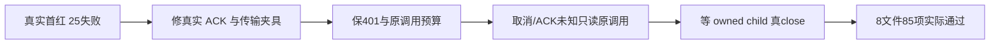

# Worker 八族集中校准真实结果

原首轮25FAIL保持原样。本轮先用原八文件做 fresh RED：83项25FAIL/58PASS，Whisper实际180s超时。按已批准范围只修改八个测试文件，未修改生产恢复政策、B043产品文件、共享dist或原验收日志。

最终独立受控执行：8files/85PASS/0FAIL/0skip，exit0，24.783秒；外层30,000,000ms覆盖原串行case、Vitest hooks/teardown、私有构建/启动及清理，清理120,000ms。HOME/CODEX_HOME原值保留，清真实App/PG/供应商变量，私有bundle预加载禁fetch。真实Chromium读固定HTML，真实上游ACP stdio fixture排空4096通知；不作为官方供应商/原生App/UI生成验收。

|族|修复及保留|
|---|---|
|WF001 ACP|补原call/thread真实bind ACK，并核同signal/唯一bind、4096尾队列、唯一结算；原20s测试上限提高180s|
|WF002 research|真实百度空页→DuckDuckGo固定HTML解析；原查询/结算/真实浏览器关闭断言保留，30s外层提高180s|
|WF003 Pi|429/503纯候选retry_wait+superseded，401保持rejected；中断无done/单HTTP/原call/128预算；普通伪status无可信response/retry-after；原usage未知不重发保持；新增用户取消和结算ACK丢失两项unknown不重发负例|
|WF004 replay|原初始坏输出按两次合法格式修复逐回执推导，真正耗尽才failed/consumed3；未知/篡改/多余/取消拒绝全部保留；不假定重复同类修复必须不同digest|
|WF005 private bundle|测试私有外置依赖按正式execution清单保@openclaw/fs-safe，真实SDK ESM不内联import.meta；新增stderr/exitCode/signal/entry失败诊断，全部child禁fetch，unknown reserve一次不startCall；请求期限120s、观察300s、cleanup120s、case480s，真close后完成。只是源构建私有包，实际App包由root独立检验|
|WF006 raw research|明确Bing指定baseUrl与真实finalURL一致，保单访问/空页不切引擎/导航错/no host settlement|
|WF007 prompt|按真实 producer typed confirmedContext 保contentRole与reason；rewrite_only生产规则未改|
|WF008 Whisper|崩溃后先证明未提前完成/不新建，明确owned terminate ACK后才await；迟到旧exit不污染新owner保留|

第二次校准17个失败来自新增断言漏真实第三个signal参数和错误假定重复格式修复摘要不同；纠正测试前提并保日志。第一个绿色尝试工具cwd错导致0body，日志也保留。ai-worker类型检查实际exit0。

全局timeout-policy Gate真实失败：check.mjs:64读取tracked库存触发git ENOBUFS；后续自测5PASS不意味着Gate通过。根Agent已收到，不擅自扩大修改工具写集。绑定文件逐项列原533与当前SHA，所有红/绿/工具回执均保留。
