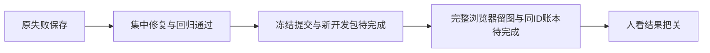

# 本轮集中修复与回归

已应用Codex结果读取、状态宿主回收、选题确认、编导工作区/草稿和Doocs窄屏修复，尚未完成新包与完整浏览器复验。App原生自动化按用户决定保留未验。

| 当前源码实际检查 | 结果 |
|---|---|
| Native公共协议回归 | 43通过 |
| 编导组件回归 | 49通过 |
| 选题确认公开链 | 12通过 |
| 状态service→真实fork→producer | 5通过 |
| LED-047完整回归 | 最终174通过；之前162/12与169/5两轮失败保留 |
| 前端全部类型 | 通过，非overlay |
| 边界、孤儿、语义门 | 通过；原基线违规/警告保留 |
| 超时策略完整门 | 158 Vitest、11 Node、5 Windows策略检查通过 |

聚焦109项均retry=0。外部SDK与模型为明确fixture，不代表官方模型、实际费用或App验收通过。Doocs代码范围独审通过，实际390/1366截图、保存回读与导出仍需新轮E2E。

实际日志分别保存在 regression/、gates/、source-review/；source-application/封存修改前字节与精确候选SHA；原round1/round2失败和未达后置均保持。完整浏览器分母仍为170/103/7/1及Doocs2，不以局部回归减少原验收范围。
