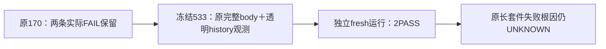

# 设置两条原完整用例：独立补充诊断

两条完整原 body 实际 **2 PASS、0 FAIL、0 SKIP、retry 0**，Playwright 52.227 秒，launcher 52.810 秒 / exit 0。产品与原断言未改，原170首轮这两条 FAIL 原样保留。此次 fresh 单独运行未重现原失败，**原长套件首次失败根因仍 UNKNOWN**。

| 同一实际 test ID | 原170首轮 | 本轮原完整 body | 返回证据 |
|---|---|---|---|
|87418b536bb3b16b9965-9d167bbc2a2b29b9bb07|failed，:233 waitForURL 120s，about:blank|passed，13.617s；:158 body|close 与 Escape 各一次 back，随后各自 popstate 到 /accounts|
|87418b536bb3b16b9965-1daf9239c5bf49000f59|failed，:298 waitForURL 120s，about:blank|passed，6.932s；:283 body|close 一次 back 后 popstate 到 /accounts；刷新并重新打开，浅色/紧凑真实保留|

三次 back 调用时都从本轮 /settings、history.length=3、Next state 发起；原始 history 60 行，navigation 到 about:blank 为0。此处使用实际 back/popstate/navigation 事件，不由 history.length 推断站内资格，也不把 before/after 同步记录当作 back 完成。逐 case startTime/endTime 与全部事件、真实 attachments/hash 见 FINAL_DIAGNOSIS.json。

独立准入由 codex_route_inventory 对精确 f2ef 工具出具，报告SHA ed10bf370f35ab7b4810b3b0876302a8d2595f192b9ea9d22c24256f129a1741。本轮三个私有文件逆构0差；两实际 test timeout 各74,100,000ms，project672,660,000ms，外层5,530,920,000ms分段计时原样执行；actual expired=false，正常完成立即退出。没有缩等待、重试、跳过下游、改预期或使用短sidebar探针代替完整正文。

实际证据共 14 PNG、2 trace ZIP（含同一图片附件的字节副本），逐文件SHA/bytes已存。目视了第一条390px外观面板和第二条1536px浅色/紧凑面板；其余截图都按原用例真实生成。

前后完整绑定：产品253、Worker11、原测试100、原生成100、共享driver8、原config1、私有源3均0差；私有工具4与Node SHA无漂移。Next使用唯一 .next/t1246-4295ca2b1c2f9fbb，Worker没有重建；所有11 bundle 与打包来源SHA相符。Next仅清理自己自动加入的types include/import，保其他并发变更。

实际owned runner/Next/Chromium都退出，清理后 members=[]、61349 listeners=[]，没有强杀，也没有向外来进程发信号；fresh os.tmpdir数据和证据保留。HOME/CODEX_HOME保父原值。清理后对这一owned PGlite仅做READ ONLY SQL：execution_calls全表0、model/external0、非空独立model配置0；无App/模型/foreignPG调用。查询工具原文和SHA另存。

本轮完整 execute.log 保留 Next 在导航期间的 Error:aborted / ECONNRESET / uncaughtException 与开发降级 master-key 提示。两用例 errors=[]、externalNetworkAttempts=[]、退出0，并不能消除这些服务端日志；其真实因果未在本轮确证，不隐藏，也不归为已修。

原 suite / 群组113 / 并发上下文差异仍未证明。direct /settings 的短探针 blank 属另一条路径，不计本两例覆盖；不得因此签所有设置返回正确或49模型能力已验。
