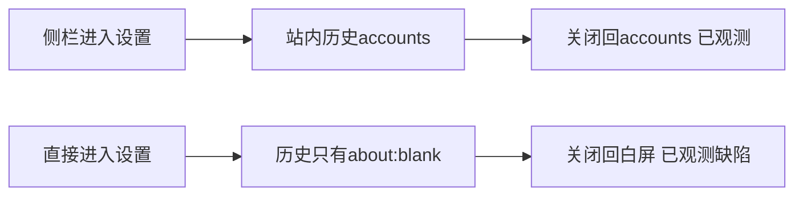

# 设置导航历史补充诊断

冻结候选533224f；独立诊断进程60183实际exit0，完成于2026-10-12 00:55:07（北京时间）。这表示工具正常退出，不表示原设置用例PASS。

短侧栏流程：真实/accounts→侧栏设置→外观→关闭，记录一次history.back并回到/accounts。直接进入/settings：关闭后一次history.back进入about:blank，期望站内首页的120秒观察未满足，真实白屏截图与trace保留。两者表明history.length>1不能证明存在站内可返回页；短侧栏成功不能解释原完整分类/外观两例的失败，不据此猜double-back，也不签T1232完成。另准备完整原两条body的透明历史记录补充，原首轮失败保持。

仅本轮隔离数据与本轮Next61348。253产品源码及11Worker前后字节一致，外部网络尝试0，模型调用0，未运行App。真实启动时的fetch TypeError是服务未就绪的连接拒绝观察；最终已就绪，未隐藏事件。服务及listener原PID退出，61348无监听；数据保留不清空。清理收据与工具/结果/四PNG/二trace的精确SHA见SEALED_OBSERVATION.json。

