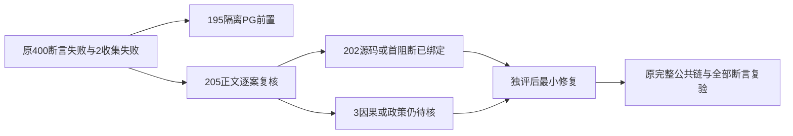

# backend正文已确定的窄修复合同（首轮只读）

候选533224f334c43cdb81a344424e420cad93784dd1；原400 failed assertions、2 failed collection suites。195 PG前置已有独立工件；余205正文FAIL已全部逐案映射，其中202源与首阻断已绑定，另3仍因果/政策pending，不以全文件首错代替因果。原日志/全部断言/源码保留，无修复、无复测、未解冻。完整case原stack、file/Git对象SHA及候选write set见backend-known-body-source-map.json。

大白话：首轮红测保持原样；先补真实测试环境和合法父链，再按实际服务合同核结果。一个用例越过第一道门，后面仍可能出现第二个问题，所以源码归因不等于修后通过。

## B001 PRODUCT_PUBLIC_DTO_LEAK（16 case）

真实saveCover raw revision只剥userId，private visualAdoptionKey/Digest落入严格公开revision；request回读同raw DTO亦参与receipt等值比较。14直接Zod，2negative被同前置遮蔽，不是16独立根因。

候选最小写集：backend/src/modules/publishing/publication-cover.service.ts。

仅在原service统一save与request公开revision投影，复用现有public revision字段/schema。保私有DB键、strict、归属、CAS、digest、原receipt、所有原18用例和被遮住negative下游；不得公开内字段或放宽schema。

复核要求：实际原18全例+真实save/get/历史receipt重读、并发旧CAS、精确file与metadata、negative正确下游；当前未修/未重跑。

## B002 FIXTURE_IDEMPOTENCY_KEY_COLLISION（2 case）

两文件均beforeAll共享DB和同user/account。provider-job 65/67先写pause/resume，119/121另一task复用；call-ports false/true两case 87/89复用pause-after-crash/resume-after-crash。原receipt按user/account/idempotencyKey、digest含taskIds，故第二个case真实拒绝；不是requestId相同导致。

候选最小写集：backend/src/modules/execution/execution-provider-job.service.test.ts、backend/src/modules/execution/execution-worker-call-ports.integration.test.ts。

仅测试命令key按真实本case task ID区分（同case重放仍同key），保原租约检查、unknown usage、不重发供应商、真实子进程/账本；不修改生产幂等fingerprint、冲突规则或断言。

复核要求：两原完整文件真实执行，第二case须到达未知usage/旧提交者拒绝等原下游；当前未修/未重跑。

## B003 FIXTURE_REAL_PG_LOCK_OBSERVER_DRIFT（1 case）

T1074真实本轮owned PG 50028到达父删除/公共采用。新原组FOR UPDATE在parent SELECT前，旧waitPgLock仅观察intelligence_collections；它未识别account_groups等待，120秒后throw，finally才release原held delete。不能归55422或宣称已复测排除产品锁。

候选最小写集：backend/src/application/chat/assistant-system-root.integration.test.ts。

仅真实锁观测按实际原组等待证明blocked后释放父事务；保删除提交后公共采用拒绝、无孤儿/回执、其余75全例。不能删除组锁/放宽owner/仅提高超时或跳过。

复核要求：原T1074完整公共链实际复测并保PG blocker/blocked query证据，排除产品死锁仍待；当前未修/未重跑。

## B004 ENV_ORIGINAL_FIXED_MEDIA_MISSING（6 case）

六case真实缺T1062_CANONICAL_AAC_FILE/原固定AAC，在canonicalAacFixture:17或integration:36前置失败；不是PG，也未进入这些case的provider/精度正文。

候选最小写集：无产品/test写集；原输入来源待查。

先查找保全原固定AAC与偏移AAC真实来源/SHA，再由隔离runner提供原既有env；不得新合成AAC替代固定样本或改断言。未找到原样本前保NOT-VERIFIED。

复核要求：同原六case用真实保全字节完成原公开Source/受管抽音/provider/get/adopt；normal原输入主线程已真实找回（canonical-aac-source-discovery-supplement.json锁来源SHA），offset原输入未找到且未替代；六原首红保持，未复跑。

## B005 FIXTURE_REAL_PARENT_NOT_SEEDED（26 case）

这些原文件真实createDb后未seed所声明项目/复盘父行，旧项目端口noop无法满足当前真实repository父链锁门。submission project p、execution project-1/2、learnings-project-scope project-abc、reviews project-1、application project-1/2、adoption source-project/p1/p2、reflow review-1均为原代码字面ID。原stack精确父资料门拒绝，而非PG环境。

候选最小写集：backend/src/modules/ai/ai-task-submission.service.test.ts、backend/src/modules/ai/ai.task-execution.integration.test.ts、backend/src/modules/ai/ai.learnings-project-scope.integration.test.ts、backend/src/modules/reviews/reviews.contract.test.ts、backend/src/modules/reviews/reviews.acceptance.test.ts、backend/src/modules/learnings/learnings.contract.test.ts、backend/src/modules/learnings/learnings.acceptance.test.ts、backend/src/modules/learnings/learning-adoption-key.integration.test.ts、backend/src/modules/learnings/review-adoption-scope.integration.test.ts、backend/src/modules/learnings/learnings-calibration-reflow.integration.test.ts。

仅各原测试初始化seed同原user/account/项目ID的真实项目，review/sourceTask存在则同真实父链；保持多用户场景独立真实ID，不能同全局project-1冒充两用户所有权。保原replay/并发/input快照/DTO/全业务断言；不把noop ownership改成生产放行，不改workspace门。review acceptance B与A各原owner fixture应分case setup而不是同ID跨owner。

复核要求：各原完整文件到达真实下游；negative真实跨owner、不存在/已归组分支仍拒绝；当前只读、未seed/未跑。

## B006 FIXTURE_ACTUAL_GROUP_MISSING_BEFORE_RESOURCE_WRITE（31 case）

这些case原fixture仅字面account，无相应真实legacy组；0114将legacy account stamp为grp_legacy_<account>，0121:13真实核group存在后才资源写入，故SQL引用账号组不存在。部分negative被此前置遮蔽，不能以原失败证明注入回滚已执行。knowledge stats已有seedStatsProjects的正常case已越过组门，不归此族。

候选最小写集：backend/src/modules/knowledge/knowledge-proposal-adoption.service.test.ts、backend/src/modules/knowledge/knowledge.db-schema.test.ts、backend/src/modules/knowledge/knowledge.repository.integration.test.ts、backend/src/modules/ai/agentic-proposal-adoption.integration.test.ts、backend/src/integration/research-material-adoption.test.ts、backend/src/modules/ai-runtime/agentic-browser-worker.integration.test.ts。

仅这些实际case/原fixture seed同原user/account的真实平台账号并走已有ensureLegacyGroups，或测试本来group-only时seed实际组与相应context。保全部原scope/多tenant/候选user采纳/原子rollback/replay；不可删SQLtrigger/允许虚构group/给所有case共享一条fakegroup。原negative注入必须到达原LINK_FAILED/INJECTED_FAILURE/LEGACY_SECOND_FAILED。

复核要求：同原全文件真实PGlite+SQL+公共service回归；源码证明fixture缺口不等于修后PASS；当前未修/未跑。

## B007 FIXTURE_TASK_COMMIT_FAKE_EXECUTION_PARENT（6 case）

原binding execution-parent/parent没有真实executionTasks行；ai-task-commit.ts:35/36按实际父user/group/account验证，新继承route依原父冻结，当前六case在父校验拒绝，未到原回滚/replay/input冻结。普通task-commit还需原project真父，不是只塞parent字符串。

候选最小写集：backend/src/modules/ai/ai-task-commit.integration.test.ts、backend/src/modules/ai/script-draft-task-submission.integration.test.ts。

仅测试fixture通过已有persistent enqueue/claim+真实tool call ledger按本case原owner准备真实父execution，binding同parent/call/digest，保原Pi/Codex父继承、public task不可接管/不同call拒绝、事务回滚、input不可变；按当前门seed实际project。不能放宽父归属或把call键随便改成通过。

复核要求：两原完整文件及原负路到正确phase；当前未修/未跑。

## B008 FIXTURE_RESOURCE_REFERENCE_IS_NOT_REAL（1 case）

usedCount case已有真实组/project，直接插asset干扰link却entityId=used.id仅为knowledge，不存在assets行；B用户干扰link亦直接引用A knowledge，而非同B owner真实资源，当前SQL不能允许虚构/越权引用。这是该file16红中单独1case，不能统一改group seed。

候选最小写集：backend/src/modules/knowledge/knowledge.repository.integration.test.ts。

仅此test补真实asset干扰资源（可相同id但assets实际行同组），B引用真实B资源或显式真正grant，保持知识usedCount=2/unused0和跨用户不泄露目的；不要用删干扰项或删grant门通过。

复核要求：原usedCount全部assert与原repo完整多tenant文件；当前未修/未跑。

## B009 TEST_MIGRATION_TAIL_ASSERTION_REVIEW_REQUIRED（3 case）

当前真实journal idx107/when1791043200006的0133助手引擎列为108条。原legacy-source两例仍钉107条/旧104+3/尾0005，legacy-scheduled仍只等0004/0005；正升级当前实际append0006，前三条旧尾与旧ledger原保真断言已执行到此。

候选最小写集：backend/src/legacy-source-migration.test.ts、backend/src/legacy-scheduled-job-migration.test.ts。

仅原当前尾数量及完整0133新尾断言校准，固定当前108/004-006，保原old104/105历史hash、前缀逐行不改、0130身份及完整旧数据snapshot/双启/幂等。不能运行时派生期望让任意尾通过或删除旧hash。需主SPEC确认测试合同新增0133。

复核要求：同两原完整文件，PG族另走owned helper，不能以三个assert校准代签191ENV下游。

## B010 TEST_RUNTIME_ROUTE_RAW_PAYLOAD_ASSERTION_REVIEW_REQUIRED（1 case）

非转写mixed source_sync经真实enqueue366冻结runtime executionRoute，原case158 raw payload仍期待{}；原命令前accepted snapshot与replay snapshot完全相等已过，失败仅创建期已有已知route字段。

候选最小写集：backend/src/modules/execution/transcribe-command-receipt.integration.test.ts。

仅校准原创建payload含准确受控Pi runtime route，并保持没有转写FIELD、无额外业务字段；原命令前后全snapshot相等必须保。不能删route或放宽任意payload。

复核要求：原43全例+同key恢复不重复/其它kind不变；当前未修/跑。

## B011 TEST_ISOLATED_MEDIA_ENV_EXPECTATION（1 case）

runner明确CREATOROS_MEDIA_ROOT为本轮own tmp。真实media-root.ts:24先读该env，原settings defaults test503却固定真实homedir，故值不同；不是产品写用户库/不是PG。

候选最小写集：backend/src/modules/settings/settings.service.test.ts。

仅原default test明确env fixture并恢复旧env，覆盖配置tmp和缺env原homedir解析；保持noopMigrate与纯路径assert，不触真实home媒体写/迁移。

复核要求：原完整20cases+已有media-root test，两分支仍原语义。

## B012 TEST_OLD_SHORT_WAIT_ASSERTION（1 case）

原case传timeout20ms/poll2ms，真实executionTimeoutMs按已批准LED053 clamp最低120000；实际busy等待120004ms/acquire49681，于原<30计数失败。仅获取资源重复，不是重新执行业务；取消/非busy错误仍即停。

候选最小写集：backend/src/modules/execution/chat-web-profile-wait.test.ts。

仅测试用受控单调clock覆盖真实120s期限、原busy错误同实例/获取权限重核/取消/非busy零重试；完整test/hook budget180s或更长。不能把产品降20ms、用任意上界放松执行数量或删deadline核。

复核要求：原8全例+实际公共timeout smoke首补已发生1PASS单独回执；此fixture未修/跑。

## B013 TEST_REVIEW_EVIDENCE_PLACEHOLDER_CONTRACT（3 case）

当前真实review-context:39-47缺script/metrics明确注入证据边界，comments仍空；原三case要求所有块为空/全部标题省略，实际只新增诚实边界，原真实材料marker其余用例通过。

候选最小写集：backend/src/modules/ai-runtime/review-facets.test.ts、backend/src/modules/ai-runtime/review-insights-injection.test.ts。

仅这三个原空材料assert明确期望诚实证据限制，并仍核未虚构正文/指标、comments空/无替换占位残留、真实marker注入。需主SPEC确认现语义；不能把真实缺稿描述删回隐藏证据边界。

复核要求：两原文件真模板+bindPrompt完整回归，非真实模型E2E。

## B014 TEST_CREATIVE_CANVAS_TRANSACTION_PORT_SIGNATURE（1 case）

getReference原真实public生成在当前同tx中收到4参，原expect仅三参；实际原file-old/link checksum/assert已过，到19第四真实PgliteTransaction多参失败。

候选最小写集：backend/src/modules/creative-canvas/creative-canvas-series-reference.test.ts。

仅spy期待纳入真实transaction参数（核实际对象，不任意忽略参数），保ref/file-old精确ID、checksum、原attempt不重发、legacy currentFile及跨owner全部原断言。

复核要求：原2例完整公共生成/replay，无产品变动。

## B015 FIXTURE_SPY_RECURSION_AND_SETUP_CLEANUP（4 case）

四RangeError原stack重复test57 originalSupervisor→Vitest mock332→test57；原工厂54每case从当前模块取得，56spy安装且74createHost位于75try之前，setup throw可留下前spy，下一case把wrapper当original。不能把STACK_TRACE_ERROR那一例自动归该因。

候选最小写集：backend/src/integration/chat-generation-worker.test.ts。

仅原test捕获未mock真实工厂，安装/启动纳入同清理闭包，任何setup异常也恢复原spies和本例owned server/host；保持真实crash/ACK丢失/账本/未知使用断言，不删故障注入或切假Worker。

复核要求：原21完整顺序执行，crashTwoNodes注册STACK error单独待核，仍不签修后PASS。

## B016 PRODUCT_RETRY_CLASSIFICATION_SWALLOWED（1 case）

原真实local.workspace端口503带statusCode，chat-tools旧catch先转脱敏字符串；adapter66把record.error判no_evidence不可重试，70之后classifyLlmError看不到原503。原host-input-error-recovery35现合同要求瞬断transient且不泄露private，不能把原assert机械改false。

候选最小写集：backend/src/modules/ai-runtime/chat-tools.ts、backend/src/modules/ai-runtime/chat-host-tool-adapter.ts。

仅短host内部传递已知机器分类到既有adapter；公开错误仍脱敏，未知非typed错误不泄露，保持取消/权限/冻结定义和一次调用；候选最小产品写集须独评。

复核要求：同原完整文件真实执行，保留首轮原失败及全部下游/assert；当前只读诊断、未修改/复测。

## B017 FIXTURE_CHILD_HTTP_ROLE_USES_OBSOLETE_STREAM_FLAG（13 case）

全部13红fixture仅 !input.stream 判子生成。当前modelFor405→Pi events22固定models.stream；doGenerate80同消费流，锁定Pi真实HTTP stream:true。子调用被fixture当根第二轮，收到候选已准备好而非真实开场JSON/401/429/取消/断连；13完整原后置栈保留。

候选最小写集：backend/src/integration/chat-hooks-worker.test.ts。

只原HTTP fixture按真实工具声明/消息角色确定根与授权子节点，stream仅决定响应JSON/SSE编码；保13情景/完整请求数/usage17/原调用ID/ACK丢失/崩溃恢复/未知不重发。已有T1085 38/40/42明确该校准，不改生产Pi或把unknown改成功。

复核要求：同原完整文件真实执行，保留首轮原失败及全部下游/assert；当前只读诊断、未修改/复测。

## B018 FIXTURE_CHILD_ROLE_FIRST_BLOCKER_MULTIPLE_CAUSES_REMAIN（15 case）

15例可确认首个HTTP角色分派错误同B017：generation41仅 !stream，真实Pi子流进根SSE，成功文本亦触发原format recovery。不能以该首阻断认定15例修后均绿；原badOutput需另核当前诚实partial、重放ACK/多次结构化repair请求数不能删。4RangeError归B015，crashTwoNodes STACK及positioning持续running暂不在此族。

候选最小写集：backend/src/integration/chat-generation-worker.test.ts。

仅原fixture按明确根/各节点角色编码原合法/坏输出/拒绝/崩溃协议，保持原case input/调用计费/操作ID/不重发；解除第一阻断后逐case核后续合同，未知STACK/positioning保pending。

复核要求：同原完整文件真实执行，保留首轮原失败及全部下游/assert；当前只读诊断、未修改/复测。

## B019 FIXTURE_PUBLIC_CHAT_PREPARATION_NOT_INJECTED（5 case）

真实ai.service838要求prepareChatReply，旧两fixture仅resolveTaskRuntimeData和已废结构化copilot adapter。5case在公开messages.create即报聊天执行服务未装配，未达真实fork/transport DTO。

候选最小写集：backend/src/integration/copilot-worker.fork.test.ts、backend/src/modules/ai/ai.contract.test.ts。

按现有prepareChatReply+原chat dispatcher真实组合注入，保message/AI task/execution原子预约、真实fork、success/auth/retry/重复唤醒不重复请求和两个wire DTO；不得改公开入口回退旧独立结构化任务或stub生产放行。

复核要求：同原完整文件真实执行，保留首轮原失败及全部下游/assert；当前只读诊断、未修改/复测。

## B020 FIXTURE_REAL_CHAT_BUSINESS_MAPPING_MISSING（2 case）

两例只直接enqueue随机ownerId但没有真实aiTasks copilot.assist行/aiTaskId/modelInputDigest。reader17严格业务映射拒绝，原pageErrors含工具结果业务与当前任务不符；不是分页offset不对。

候选最小写集：backend/src/integration/t1026-tool-result-read.integration.test.ts。

仅fixture走原真实chat submit准备业务/执行映射与另一独立任务，保真实Worker/Pi notice→reader→原全文末尾/截图/分页ID/跨任务拒绝和全两例；不可取消reader业务ownership门。

复核要求：同原完整文件真实执行，保留首轮原失败及全部下游/assert；当前只读诊断、未修改/复测。

## B021 TEST_NULL_METRIC_AND_PARTIAL_SERIES_CONTRACT_REVIEW（2 case）

趋势p1相邻100→120可比，但同日p2首样无baseline，repo383 complete要求samples等于两日作品数故真实plays null/sampleCount1，旧期待整体20会冒充完整。empty publicationIds rollup sum397无真实measured返回null，旧datafoundation283期待0。

候选最小写集：backend/src/integration/group-platform-facts.integration.test.ts、backend/src/modules/projects/data-foundation-prefer-real.integration.test.ts。

两个原case须固定未知null/coverage/sampleCount/complete并另对真实p1子集验证增长20，不能删newp2；空真实指标null并保snapshotCount0、导入优先与128000真实值。需SPEC确认当前诚实指标合同。

复核要求：同原完整文件真实执行，保留首轮原失败及全部下游/assert；当前只读诊断、未修改/复测。

## B022 TEST_SCOPED_EXTERNAL_LOOKUP_NULL_NOT_ERROR（1 case）

resolvePublication1077为scoped查找，repository597-601真实WHERE user/factFilter返回rows0??null，跨组过滤确实无结果；原首assert期待throw故失败，后续appendSnapshot跨组拒绝未执行。

候选最小写集：backend/src/integration/group-platform-facts.integration.test.ts。

仅原第一assert校准null不泄露，并必须保并执行第二跨组appendSnapshot rejects和数据库无新增事实；不放宽查找范围。需SPEC明确null旧公开lookup合同。

复核要求：同原完整文件真实执行，保留首轮原失败及全部下游/assert；当前只读诊断、未修改/复测。

## B023 TEST_ANALYTICS_OPERATION_LIST_OLD_INVENTORY（1 case）

原静态列表期待4项，真实新comments.diagnose/failures.list/retry已在公共transport注册与原独立comment测试覆盖，实际7项。

候选最小写集：backend/src/modules/analytics/analytics.acceptance.test.ts。

只精确新增三个现存op登记期望并核endpoint/policy对应，保旧四项、所有原ownership/domain断言，不用运行时复制实际列表作期望。

复核要求：同原完整文件真实执行，保留首轮原失败及全部下游/assert；当前只读诊断、未修改/复测。

## B024 FIXTURE_INVALID_SELECTED_PLATFORM_ACCOUNT（1 case）

原雷达共享组例getWorkspace带不存在filter-only-platform；真实lockWorkspaceMembership34必须账号存在active/成员同组后才读共享内容，旧假筛选不合法。

候选最小写集：backend/src/modules/ai/group-task-scope.integration.test.ts。

仅原fixture创建真实同组平台账号及成员作为筛选，仍核共享组集合不变/跨组不见；空组null独立case仍保，不删除平台归属核验。

复核要求：同原完整文件真实执行，保留首轮原失败及全部下游/assert；当前只读诊断、未修改/复测。

## B025 FIXTURE_PLATFORM_DRAFT_OUTPUT_PARENT_MISSING（1 case）

fixture-output从未seed真实contentOutputs及projects，真实Worker1请求已到候选，confirmTask落草稿assertOutputOwned链在publishing372拒绝，因此ADOPTION_RECEIPT_LOST注入尚未触发。

候选最小写集：backend/src/modules/ai/platform-adapt-execution.integration.test.ts。

仅fixture seed原owner真实项目/output/合法发布目标账号与成员，保持Skill冻结、Worker、公共adopt、故意丢失回执/并发单条revision、原请求1和queued恢复全部下游；不能stubownership或删除receipt-loss。

复核要求：同原完整文件真实执行，保留首轮原失败及全部下游/assert；当前只读诊断、未修改/复测。

## B026 TEST_STORED_CARD_WRAPPER_PARSED_AS_STRICT_BUSINESS_DTO（2 case）

两例实际outcome.data strict已通过95，之后104直接strict.parse持久part.output；新projection121含受控__creatorosOutcome展示事实，故unknownkey。不是联合创作业务数据泄露或strict失效。

候选最小写集：backend/src/modules/ai/work-creation-chat.integration.test.ts。

仅原test同时核真实wrapper状态/sideEffect/callId并剥已知wrapper后strict业务DTO，再保两份全文、原采纳owner/CAS/幂等全部下游。未知其他字段仍拒绝，生产/公共schema不放宽。

复核要求：同原完整文件真实执行，保留首轮原失败及全部下游/assert；当前只读诊断、未修改/复测。

## B027 TEST_CONTINUOUS_BUDGET_PRIOR_BOUNDED_ASSUMPTION（7 case）

原5business期待默认deps bounded上限，当前service62仅显式spec steps/tokens/deadline冻结continuous，其余null；原2browser无explicittimeout当前deadline null，旧期待授权后60s总截止。真实长期任务当前合同允许continuous，不等于单次请求无限。

候选最小写集：backend/src/modules/ai-runtime/agentic-business-execution.service.test.ts、backend/src/modules/ai-runtime/browser-task-authorization.service.test.ts。

需主SPEC/DEC逐明确参数族新合同：explicitlimit合法保留/归一/原freeze重放不可变/无explicit限null、browser授权时间冻结及准备失败可恢复、每次请求>=120s和取消/心跳仍真实；不可机械替换所有预算或删旧counterexample。测试两个文件最小候选，产品尚无确定缺陷。

复核要求：同原完整文件真实执行，保留首轮原失败及全部下游/assert；当前只读诊断、未修改/复测。

## B028 TEST_CODEX_TOOL_INVENTORY_T1074_OLD_SUBSET（2 case）

两例旧T1074禁止web.read，当前T1238全功能目录明确worker.web-read/effect committed在owned目录19受权限冻结允许，旧宿主子集不再是整体工具清单。

候选最小写集：backend/src/modules/ai-runtime/chat-assembly.test.ts。

仅原topics/canvas断言校准批准的web.read执行方式/效果/参数与目录一致，仍禁止未审工具、CodeBuddy旧子集、保真实定义/授权，不准任意host进worker或新增provider调用。

复核要求：同原完整文件真实执行，保留首轮原失败及全部下游/assert；当前只读诊断、未修改/复测。

## B029 FIXTURE_TRUNCATED_TOOL_RESULT_PARSED_AS_FULL_JSON（3 case）

三例HTTP模拟模型extractToolData41直接JSON.parse全部tool文本；真实Pi投影已加本次传输仅显示结果首…notice，原SyntaxError发生模拟模型，无实际模型自修复/采纳正文。

候选最小写集：backend/src/modules/ai-runtime/agentic-research-worker.integration.test.ts。

仅模拟模型按实际分页notice调用受控tool.result.read/原evidence read取真实登记结果，保长首/尾窗、snapshot证据、cookie保护、跨进程trace、maxCalls20/10/8三族和自修复/候选用户采纳；不得删notice/提高budget/substring猜JSON。旧精确调用数变化需明确协议核算，不能任意放宽。

复核要求：同原完整文件真实执行，保留首轮原失败及全部下游/assert；当前只读诊断、未修改/复测。

## B030 TEST_TRUSTED_REJECTION_PHRASE_CHANGED（1 case）

未授权仍真实拒绝；原test38期待尚未授权，实际46为明确需用户确认写入的安全文案。

候选最小写集：backend/src/modules/ai-runtime/chat-script-draft-preparation.test.ts。

仅原明确文案断言校准，保真实unauthorized false/坏决策/伪锚点/截断来源全部拒绝，不能改变授权语义。

复核要求：同原完整文件真实执行，保留首轮原失败及全部下游/assert；当前只读诊断、未修改/复测。

## B031 TEST_GENERIC_PRIVATE_ERROR_NOT_TRUSTED_PUBLIC_MESSAGE（1 case）

原fixture抛普通Error业务中文并期待直接卡片透传；当前安全catch未知异常改诚实中性错误，原状态error/sideEffect none仍成立。不能和B016机器503丢分类混为一谈。

候选最小写集：backend/src/modules/ai-runtime/chat-video-edit-tool-host.test.ts。

需核实际业务端口是否已typed安全错误；原test普通Error须核脱敏中性卡，若覆盖已审业务文案另用现typed错误并冻结receipt版本。保删除/取消/错误kind/不产生候选，不让普通异常泄露。

复核要求：同原完整文件真实执行，保留首轮原失败及全部下游/assert；当前只读诊断、未修改/复测。

## B032 TEST_ARCHITECTURE_GUARD_SCANS_ONLY_FIXTURE_IMPORTS（1 case）

原G5扫描所有模块ts/tsx连test一起扫描，实际20offenders全部原test(.test.ts/.integration.test.ts)引用MockObjectStorage，未报任何产品文件。真实worker/service对象存储边界仍应独立守卫。

候选最小写集：backend/src/modules/assets/assets.acceptance.test.ts。

仅测试扫描按已物理定义排除fixture测试，保实际产品文件/不把执行module整体放白；补原真实产品越界反例校验，不删除G5。需主SPEC明确testfixture不是产品依赖。

复核要求：同原完整文件真实执行，保留首轮原失败及全部下游/assert；当前只读诊断、未修改/复测。

## B033 TEST_WORKSPACE_LOG_SCOPE_SHAPE_CHANGED（1 case）

原媒体精确探针5更新等原断言已过，到日志期待accountId字符串红；assets.service234 workspaceKey当前传{kind:legacy-account,id:acct-a}给日志333，真实范围相同。

候选最小写集：backend/src/modules/assets/assets.legacy-media-backfill.test.ts。

只日志assert精确WorkspaceKey/id与计数(eligible5/updated5/failed0/skipped0)，保当前账号签名1000ms+1920/并发/最多5/真实探针全部业务；不得改范围为任意账号。

复核要求：同原完整文件真实执行，保留首轮原失败及全部下游/assert；当前只读诊断、未修改/复测。

## B034 TEST_LAST_ACCOUNT_ARCHIVE_OLD_EMPTY_GROUP_POLICY（2 case）

两旧末号保护例要求拒绝，当前archive218先owner验证然后允许隐藏末号，注释组允许无账号/不删历史，当前用户空组创作合同明确无需平台账号。

候选最小写集：backend/src/modules/platform-account/platform-account.service.test.ts。

需SPEC确认旧末号限制已批准撤销；仅两个例准确核最后active隐藏成功/组内容历史仍可读/陌生owner拒绝，保原多账号与真0空，不删除归属门或直接移除测试。

复核要求：同原完整文件真实执行，保留首轮原失败及全部下游/assert；当前只读诊断、未修改/复测。

## B035 PRODUCT_BINDING_RUNTIME_PUBLIC_DTO_PROJECTION（16 case）

producer353/366给任何kind payload加runtime executionRoute，binding61/103直接public strict.parse claim/row.payload使原正常binding staging前失败。16原stack多为后置status/call断言，静态producer/consumer缺陷明确但各negative下游未验。

候选最小写集：backend/src/modules/platform-account/account-binding.service.ts。

仅binding消费前精确投影已知runtime字段，其余public保持strict，executionRoute原冻结仍持久；不给非AI绑定强加modelkey。保原真实profile/扫码停止清理/取消/恢复/事务/回调23例，另未知字段拒绝。父主已交独评，不在本分支实施。

复核要求：同原完整文件真实执行，保留首轮原失败及全部下游/assert；当前只读诊断、未修改/复测。

## B036 FIXTURE_VIDEO_CHAT_REAL_PROJECT_PARENT_MISSING（4 case）

四例createConversation projectId=project仅字面且createDb无真实project；当前AI repository真实父锁workspace-write35在聊天提交前拒绝。assertProject noop不能代替DB父锚，未到模型/剪辑候选/ACK/crash。

候选最小写集：backend/src/integration/chat-video-edit-worker.test.ts。

只fixture为各原user/account seed真实同原project及所需output，保持真实submit/worker/短host/ledger/parts/原候选revision3、lostAck/crashAfterCandidate只调用一次/晚到revision4不替换；missingPlan下游按批准终态partial另核，不能放宽parent门。

复核要求：保原首轮case/log/JSON与全部assert；同完整原文件实际复验并记录每个后续阻断。当前只读，未实施/复跑。

## B037 FIXTURE_NEGATIVE_CREATES_PUBLIC_FORBIDDEN_PARENT_BEFORE_ADOPTION（2 case）

原negative task helper公开createTask先绑定foreign(other账号)project；当前公共创建即真实parent门拒绝，发生在后面的expect confirmTask reject之前，所以两例红不代表采纳越权放行。

候选最小写集：backend/src/integration/research-material-adoption.test.ts、backend/src/integration/structured-target-adoption.test.ts。

保新增公共createTask真实早拒绝且0任务/知识/链接；原采纳跨owner负路用严格隔离DB中明确历史未采纳AI任务fixture及真实foreign项目（不冒充生产公开创建成功），记录属于旧数据回读族，原adopt拒绝/零部分链接/awaiting_confirmation仍全部到达。需SPEC审核既有历史兼容输入fixture范围，不能简单把expect上移删除下游。

复核要求：保原首轮case/log/JSON与全部assert；同完整原文件实际复验并记录每个后续阻断。当前只读，未实施/复跑。

## B038 TEST_EDITOR_STORED_WRAPPER_EXPECTS_RAW_DTO（2 case）

Pi/Codex两例真实长候选/摘要/全文分页/真实candidateDigest前断言已过，110期望part.output精确raw expected。当前projection121添加__creatorosOutcome宿主展示事实，属于B026同已批准wrapper合同。

候选最小写集：backend/src/integration/chat-work-editor-worker.test.ts。

只原输出assert精确核wrapper+known字段剥离后完整expected深等，保>60000字/两section/原ID/digest/真实public用户采纳和原owner回读、不重发/恢复；不能toMatchObject吞未知业务字段。

复核要求：保原首轮case/log/JSON与全部assert；同完整原文件实际复验并记录每个后续阻断。当前只读，未实施/复跑。

## B039 TEST_TERMINAL_REFUSAL_PARENT_PARTIAL_CONTRACT（5 case）

五例工具确实返回error/sideEffect none（Redfox未配置2、research不可用1、整稿明确未授权1、局部改稿无变更1），当前submit94冻结terminalToolFailurePolicyVersion1，worker268有terminalToolFailureCallIds则partial；旧expect succeeded不符诚实父任务终态。不是正常生成链失败。

候选最小写集：backend/src/integration/chat-redfox-worker.test.ts、backend/src/integration/chat-research-worker.test.ts、backend/src/integration/chat-script-draft-worker.test.ts、backend/src/integration/chat-script-patch-worker.test.ts。

仅这些明确拒绝族父状态partial及真实拒绝引用/展示notice校准；保模型全文、原调用ID、只有原请求、不启动搜索/无子draft/无修改候选、用原账本佐证明确拒绝，正常available/授权/changed成功链保持succeeded。不得全文件机械换partial。需SPEC明确终态合同。

复核要求：保原首轮case/log/JSON与全部assert；同完整原文件实际复验并记录每个后续阻断。当前只读，未实施/复跑。

## B040 TEST_SEARCH_QUERY_OLD_KEYWORD_APPEND（2 case）

两例旧query期待模型明确查询后追加原材料。当前prepareChatResearchQuery3-7只归一空白、保模型查询，userMaterialQueryTerms仅供旧快照读不做代码语义追加；原preparation5已有精确用户 查询断言。

候选最小写集：backend/src/integration/chat-research-worker.test.ts。

仅原2query expect保持模型用户 查询/新查询，仍核原context冻结、count10、坏输入拒绝、结算幂等/真实来源、权限/恢复原call→新modelcall不重执行；不能恢复写死关键词追加。

复核要求：保原首轮case/log/JSON与全部assert；同完整原文件实际复验并记录每个后续阻断。当前只读，未实施/复跑。

## B041 FIXTURE_GENERIC_AGENTIC_PORT_BYPASSES_AUTHORITATIVE_CHAT_CARDS（4 case）

completed/approval/denied/repeat四例真实submit冻结toolOutcomeProjectionVersion1，但旧fixture使用createExecutionAgenticToolPorts而非chat工具端口，缺宿主结算后受控card projection（其中wrapper/denied approval事实）。commit72逐项与持久事件等值核卡拒绝，原4实际ConflictError聊天工具卡尚未确认。

候选最小写集：backend/src/integration/durable-chat-tool-ledger.test.ts。

仅fixture接原真实createExecutionChatToolPorts+真实approve/persistent approval service与受控projection，保真正Pi Worker/账本/model receipt绑定、未知不重发、approval拒绝/重复调用reuse/错版本&fence&账号拒绝、并发commit幂等及全部messagesparts。禁止删除assertCards或把worker任意chunks当授权。

复核要求：保原首轮case/log/JSON与全部assert；同完整原文件实际复验并记录每个后续阻断。当前只读，未实施/复跑。

## B042 TEST_LENGTH_CONTINUATION_PRIOR_TWO_REQUEST_COUNT（1 case）

原length fixture每个tool后模型永远finish_reason length，当前Pi loop257-258允许两次受控续写，总真实requests4，旧123固定2。初始result.partial与text已过；不是供应商业务工具重发证据。

候选最小写集：backend/src/integration/durable-chat-tool-ledger.test.ts。

仅明确原length模型续写族按真实4请求/4model1tool/准确usage20冻结预算与两次上限，保原execute一次/原token结算、checkpoint恢复/未知、完整后置安全门。若保持旧2输入必须原业务输入另明确禁止续写，不能偷偷缩合同。需SPEC准入当前受控续写。

复核要求：保原首轮case/log/JSON与全部assert；同完整原文件实际复验并记录每个后续阻断。当前只读，未实施/复跑。

## B043 PRODUCT_TEXT_NODE_KNOWN_FAILURE_DOUBLE_CLASSIFIED（1 case）

reject429已有HTTP明确拒绝。durable-model45-50把错误包成GenerationFailure retry_wait且settle superseded；text-node22再次generationFailure(error,false)仅识statusCode，已包装Error无statusCode降unknown。26调用complete，原log5486/5489实际completeChatScriptDraft+settleAgenticTool HOST_PORT_REJECTED，最终unknown_result。结构化消费者已有findGenerationFailure，文本消费者缺。

候选最小写集：ai-worker/src/execution/chat-text-node-worker.ts。

候选仅text-node保留findGenerationFailure已知优先，然后未知才分类；用原完整scriptdraft8/hooks14与明确401/403/400/429、ACK丢失、取消、未知提交反例验真实账本和原ID，单次请求预算>=120s、不自动重发。不得把原known错误降unknown或在此无条件retry供应商。需独立产品review。

复核要求：保原首轮case/log/JSON与全部assert；同完整原文件实际复验并记录每个后续阻断。当前只读，未实施/复跑。

## B044 PRODUCT_SCOPE_REVIEW_UNKNOWN_CANDIDATE_DISCARD_AND_FAILURE_LOSS（1 case）

crashUnknownChild原fixture准确destroy授权模型流；当前text-node13显式allowUnconfirmedModelRetry=true，使可丢候选网络故障生成retry_wait/superseded，再被B043二次分类吞失后走complete，以unsupported授权错误结束partial。原期待unknown_result并且0整稿子任务。已证前置机器分类丢失；候选可废弃政策与该授权节点原unknown合同需要单独裁决。

候选最小写集：ai-worker/src/execution/chat-text-node-worker.ts。

保B043typedfailure修复后对此原例实际回执归因；授权判定节点是否允许superseded由原SPEC/DEC明确，未知提交原task/call保留、不自动重发/零子task。不能直接把expect改retry_wait/partial或共享所有节点allow=true。候选text-node写集需独评分节点policy，未定实施。

复核要求：保原首轮case/log/JSON与全部assert；同完整原文件实际复验并记录每个后续阻断。当前只读，未实施/复跑。

## B045 FIXTURE_REAL_TIMEOUT_PRECURSOR_NEEDS_ISOLATED_CAUSAL_RECHECK（1 case）

crashTwoNodes JSON只有Vitest注册STACK_TRACE_ERROR，原完整backend.log8566明确Test timed out in15000ms，不是未知栈等于死锁。原HTTP子角色也错误；settle多子共享allSettled等待直到两子，15秒timeout发生后清理/spy异步可能影响positioning。没有当场trace证明两子为何未齐。

候选最小写集：backend/src/integration/chat-generation-worker.test.ts。

仅原fixtureHTTP角色修复+真实更长test/hook>=180s、所有setup/ownedhost/settlement barrier清理闭包，保真实两node同时崩溃/2settled/未知不重发/回放全部assert；必须隔离原完整文件记录子请求/call/停止ACK证明，不能仅加timeout便签因果或删并发。

复核要求：保原首轮case/log/JSON与全部assert；同完整原文件实际复验并记录每个后续阻断。当前只读，未实施/复跑。

## B046 CAUSAL_PENDING_AFTER_TIMED_OUT_MULTI_NODE_FIXTURE（1 case）

positioning紧随原crashTwoNodes15秒timeout后出现running而非succeeded；前例cleanup/spy持续异步为源码候选，HTTP角色共错误。当前原JSON/log缺该任务子call/请求/host结束stack，不能确认是生产定位生成问题或仅fixture泄漏。

候选最小写集：backend/src/integration/chat-generation-worker.test.ts。

最小当前候选仅同原fixture清理/HTTP分类，保持positioning case原input、真实schema与已知合法oneLiner/原scope；生产写集为空。独立原完整文件复测trace前保UNKNOWN，不把running改成功或剪掉用例。

复核要求：保原首轮case/log/JSON与全部assert；同完整原文件实际复验并记录每个后续阻断。当前只读，未实施/复跑。

## 账户绑定公共边界（首轮根因与后续targeted回执分开）

原account-binding.integration.test.ts 16/23失败。生产producer给payload加executionRoute，业务startBinding strict直接parse claim/row payload；静态可核其staging前失败。原16case中多为后置status/call断言，不把它们说成16个直接Zod堆栈。最小候选仅account-binding.service.ts在消费前精确剥已知runtime字段，剩余公开字段仍strict；保存父route冻结，未知字段仍拒绝，不给非AI绑定加model前置。原negative下游、取消/回滚/profile/恢复/callback全保。父线程现已归档../round-2/unit/focused-ff001-pb001.json（相邻focused-ff001-pb001-result.json实际exitCode0）：封面原18+绑定原23，实际41PASS/exit0；该后续窄回执不覆盖冻结候选首轮32红，不代签全部suite/public/E2E。

## 完整首轮状态

四包实际EOF：contract 456PASS/43FAIL；Worker1437PASS/25FAIL；backend6492PASS/400FAIL/1SKIP；frontend4911PASS/158FAIL/8SKIP/1TODO，另真实unhandled1。frontend文件520PASS/38FAIL/1SKIP（rawJSON521passed包含未执行skip文件，不膨胀PASS）。typechecks exit0/0/2/2，两个真实缺历史源码fixture与frontend原resolve导入详见MINIMAL_FIRST_CLOSURE_CONTRACT.md。此报告不签安装版或原生App，用户暂不授权原生。
