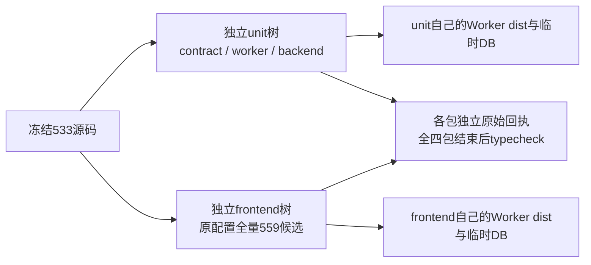

# 独立 frontend 首轮执行环境复核

冻结树 `/Users/zyongzhu/.codex/worktrees/integrated-frontend-unit/Thirdspace-creator`，HEAD `533224f334c43cdb81a344424e420cad93784dd1`；主线程实际 frozen install 回执 `/tmp/t1246-frontend-unit-prep/install-exit.json` 为 exit 0。runner 开始前再次读取该回执、核同 HEAD 与 253 项源码 SHA，并实际子进程核 Socket preload 和 `NODE_PG_FORCE_NATIVE` 已删除。

原 `frontend/vitest.config.ts` include 精确为 `src/**/*.{test,spec}.{ts,tsx}` 与 `scripts/**/*.{test,spec}.mjs`，保留原 exclude。冻结静态候选是 559（src 528 / scripts 31 / spec 0），详情 `frontend-frozen-discovery.json`；这不是最终 Vitest 收集/用例结果。测试全目录含 e2e/visual 等共 705 个静态匹配，不擅纳入或删掉原配置范围。CLI retry 0 覆盖原配置 retry 2，bail 0、无 selector、新 exclude、断言或快照改写。

实际复核原源码消费者：

- backend 32 / frontend 15 个测试文件调用 `ai-worker/scripts/build.mjs`，如 backend `src/integration/chat-worker-entry.test.ts:22` 与 frontend `src/server/chat-task-submission.integration.test.ts:30/65/153`、`script-worker-entry.integration.test.ts:59`。build `:7/14/22/30/38/42/47/51/53/56/59` 逐个写固定 `ai-worker/dist/*.cjs`，没有共享构建原子锁。各树独占生成输出，解决确定的同树竞争；不称修改了生产构建协议。
- 对原配置内 frontend `src/scripts` 测试消费者检索，未发现直接 PG SQL、postgres URL、psql、pg_dump、pg_restore、pg.native 选择。生产组合根经测试默认使用临时/内存 PGlite；原 Worker 集成用例如 `script-worker-entry.integration.test.ts:66–69` 明确清 DATABASE_URL 并提供 mkdtemp PGLITE 路径。runner 本身先清继承 DATABASE_URL/PGLITE_DATA_DIR/PG*、配置本轮独占 runtime 目录，未读取真实 `.env`。此项是源码与启动环境审查，不称系统级文件或网络防火墙。
- 原 `workbench-native-host.test.ts:135–137` 需要真实模型/packaged runtime opt-in，`workbench-browser-host.test.ts:367` 需要 CFT opt-in；runner 清继承 CREATOROS_* 后不开启这些 flag，保原 SKIP。仍需以最终报告列具体跳过数，不签这些原生路径通过。
- `scripts/desktop/package-local.test.mjs:137–158` 虽使用 `/Applications/CreatorOS.app` 断言，实际传入 `vi.fn` spawn/remove/rename 与假 exists；无实际安装或 App 启动。其行为合同是测试证据，不是 App 截图/会话证据。
- 本地授权文件默认 `local-read-grants.ts:40–44` 在当前工作树 `.auth`，测试另传临时文件；此树新建且初始 clean，与用户 canonical/安装 App 数据分离。各 package runtime 临时目录和实际 cwd 保留于 exit 回执，不更改 HOME/TCC/激活状态。

机器当场 `hw.memsize=34359738368`（32 GiB），fresh frontend 开始前 `memory_pressure -Q` 空闲 33%，后续观测 44%。这是瞬时真实资源观测，不承诺整个执行永久不出现资源问题。fresh frontend PID 98159/session 50222 已 actual started 后，才精确核并 SIGTERM 原等待 controller PID 92667，实际该控制进程 exit 143；backend PID 87818 不变。新 controller 等待同一 frontend 回执和 backend，四包 Vitest 完成后再串行四包 typecheck，frontend typegen 只在独立 frontend 树。详见 `controller-deduplication.json` 与两个 runner 的证据副本。

本复核不改产品源码/测试/断言，不替代官方模型、浏览器、系统认证或原生 App 验收。用户当前暂不授权原生 App，保持未验。

后补实际消费者定位：`frontend/src/server/persistence-client.ts:1202` 调用 `createConfiguredDb()`；`backend/src/db.ts:401–410` 先消费显式 DATABASE_URL/PGLITE_DATA_DIR，`:415` 在 NODE_ENV=test/VITEST 且无显式目录时选择 memory-pglite。runner 删除真实继承连接/目录，保留各原用例自行指定的 mkdtemp 路径，并非通过模拟 DB 响应“通过”。

