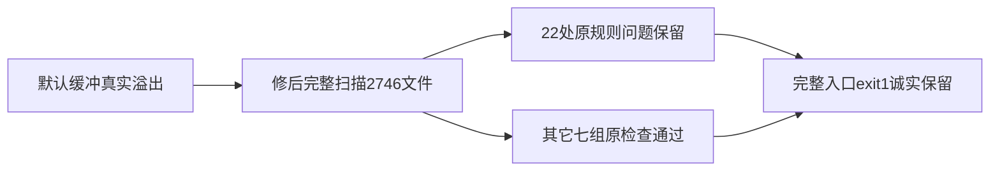

# T-1247 当场实施与完整入口结果

独立SPEC审核后真实reviewctl PASS（integration REV:10d3c405ae0f；canonical REV:b75c6d75921d），taskctl start实际审计。只修改check.mjs原git读取参数为有界32MiB/120000ms；默认ENOBUFS红保留于source-binding.json与T1246 worker-calibration/timeout-policy.log。

修后静态扫描实际完成2746文件，无ENOBUFS，但原规则报告22处短预算/疑点，9个文件，exit1。原check/hyperframes自测6 PASS。新隔离完整verify八组全部实际执行，最终exit1，耗时32053ms；其余七组均PASS。完整超时门仍为FAIL，22原问题需按既有T1081/LED053精确consumer继续诊断，不通过本任务扩大写集或吞规则。

完整入口使用fresh APP/DB/media/browser/auth/workbench/backup根、禁默认/旧PG和模型密钥；HOME保留。独立外层96360000ms覆盖八组原完整串行有限预算、96000000ms内层及360000ms清理，原部分更长局部预算不缩。所有实际PIDbirth、无超预算、exit1、processClosed=true、remainingOwnedGroupMembers=[]载于full-gate-attempt1-exit.json，源码载run-full-gate.cjs。这里的工具修复不代表T1246全功能或App通过。

大白话：名单已经读完整，门卫现在真正报出了后续问题；没有把后续问题藏掉。

