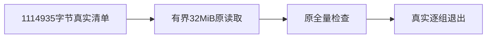

# T-1247 独立规格审核

当前规格SHA `56a28107d562949c983d196a73867c82583ff3633c46eb64cba02cb2fd15c09f`。未发现阻断，严格JSON已放 `round.json` 供主线程reviewctl裁决；本子Agent不输出verdict或record。

真实只读重现：17741个tracked路径、1114935 bytes，清单SHA `fc2226c348a81eb6e87266a656f80645a309e5b8ae0c65d7d49510df376c79a2`；默认execFileSync返回ENOBUFS/errno -55/SIGTERM。以32MiB/120000ms读取真实完整清单成功。工具源码当前4494050c...cd24没有新参数；审核未写工具。

唯一行窄修保留UTF-8/NUL、原排除与逐文件检查、全库存统计及exit1；有限缓冲超出仍失败。verify.mjs仍顺序实际运行原8组并汇总非零，不以库存成功替代全Gate。原失败日志封存；实施后AC1-4及独立外层、隔离环境、清理尚待主线程真实执行。

