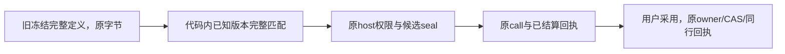

# T1248 已知历史候选工具兼容实施与真实验证

已落实获批5产品、5测试精确写集。代码内固定旧偏好六字段schema与当前schema分别生成完整已知原型，当前工具hash不变；旧任务只从原冻结定义匹配可信版本。host与root采纳source采用同一版本，原参数、effect、claim、ack、源摘要、范围和CAS检查保留。

正式第三评审回执后，全5文件实际344 PASS、0 FAIL、3 PG SKIP（347总例）；原历史恢复4个完整body实际4 PASS。旧104合成库的全迁移hash、原冻结字节、已结算不重放、原completion、130归属、foreign/fence及同source重放均由原断言验证，旧producer与原测试未改。旧/当前偏好候选经实际backend host、seal、账本、公共采用与同receipt重放；顺序篡改在原冻结digest门拒绝，并实际观察owner.adopt=0；unknown-only在host早退前显式拒绝，合法无system子集保持原行为。

proper contract/backend类型、boundary、orphan实际exit0。原legacy轮2101源SHA前后相同，11包SHA与owned组0存活收据均保留；共享窗口已释放。此局部Worker构建不是最终开发包。

全timeoutverify实际exit1：staticcheck在9个非T1248写集文件命中22项，后7测试组全部通过。逐命中与真实源SHA在timeout-check-failures-binding.json，不写全绿，不接受为risk，不跨写其它scope。原3 PG锁竞争用例本轮未执行，需后续fresh owned PG与兼容增量，不用PGlite结果代签。任务尚未complete；最终冻结、重包、原170和官方模型49及App仍由主会话各自验收。

真实RED与中间失败全部保留：初始3失败、第一绿色尝试新JSONschema断言红、聚焦9/1偏好fixture误假设、wholefirst341/1/3新增全局顺序门反杀原成功、合法子集新增RED、unknown-only新增RED、最终wholethird344/0/3。wholefirst外层9M不足覆盖其声明全串行，不能作为预算Gate；最终outer500M覆盖保守347×1.2M及hook/startup/cleanup，正常53秒立即结束。临时second343不是owner0补强后结果。wholefirst完整源bytes未当场归档，只有实际patch与记录SHA，报告不伪原档。

完整来源/门状态/限制见IMPLEMENTATION_RESULT.json，原 first 与 formal review 文件未覆盖。这里的账本和local SSE是真实受控fixture，不是官方生成、历史用户数据库或原生App验收。
