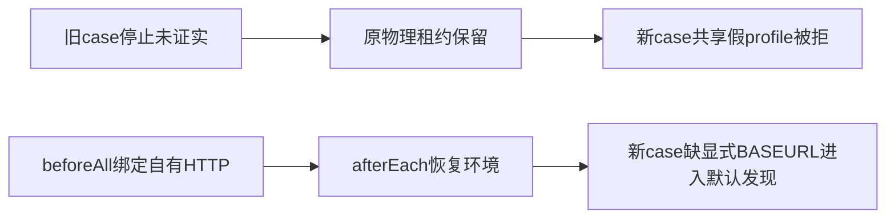

# 两条完整回归首红的隔离分诊

两条慢链都在慢操作前失败。hosts 的旧负例明确保留未停止档案租约，新例共用假原生物理身份；CDP 的全局清理恢复了 beforeAll 的自有HTTP环境，第二例可进入默认CLI连接发现。两项均保留首轮失败，不用此前focused绿代签全文绿。

FI001候选只给新增慢例独立PGlite；原unknown负例仍保留原租约。首红只记录 failed，不能把推导的 BROWSER_PROFILE_BUSY 写成现场已观察。

FI002原源码没有删除账号：只删除publication。真实404不足以证明账号被其他case删除；严格消费者指出 env 回滚导致目标漂移。候选只重绑本server的监听与合成token。不得通过放宽真实账号权限、SQL造账号或修改生产resolver洗绿。

运行前还必须为runner加 task-specific CREATOROS_CONNECTION_FILE 指向自有不存在路径；漏掉显式受控HTTP时应在本地拒绝发现，不能读HOME默认用户连接。该工具候选尚未授权/实现，本报告不准runtime。

完整源SHA、原tests/result回执及两个私有diff在 source-binding.json。未运行测试、连接、PG、主App或模型；没有读取用户连接描述符。
