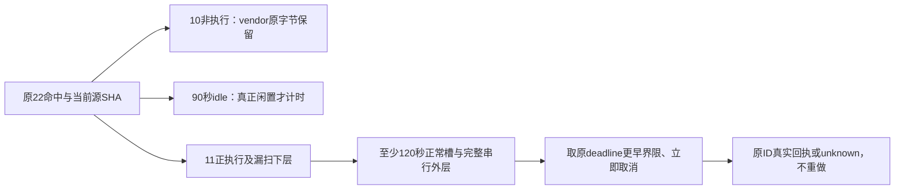

# T-1250 独立只读 SPEC 评审

结论：**PASS_SPEC_ONLY，findings=[]**。核对最新 SPEC `0c9468d57923af45971f54b3e3500ff82936e74aded1af9363ad37cfc477bcc4`，两树字节一致；24 个限定源当前 SHA 与候选绑定全部一致。此结论只准入合同，不证明实施、测试、Windows、官方模型、开发包全功能或原生 App。

原 22 条失败仍完整保留。实际为 9 个不同文件：5 个冻结 vendor 文件中的 10 条调度/动画/合并策略命中、1 条原 90 秒 idle TTL、11 条正执行或有限观察。独立读取真实邻近消费者确认分类，未将 peer 报告直接当运行证明。

## 逐项复核

|合同|真实源码与判断|
|---|---|
|原期限|CDP start 创建固定 300 秒 expiresAt；原 touch 会在 step 开始挂 idle。SPEC 保 life=300s、idle=90s，active/idle分离；共享同一观察绝对deadline，剩余不足允许沿原期限立即停止，不重新补120s。|
|完整串行|render 含 setup、launch、goto、PNG/PDF 和真实 close/private目录清理；恢复含最多两mode查询、真实cleanup、stop_proof和DB fresh复核。SPEC 明确全部内层及独立清理余量，不把单次120s当整段outer。|
|取消与未知|native host 当前仅调用前后查signal，send无signal；原receipt读取事务外已有control但没传读端口。限定私有参数将signal送入原owned连接，派发前effect0、派发后unknown及原named receipt，不新增写重试。|
|停止证明|Rust cleanup 真调用 cleanup_bound_owner_lanes；stop_proof核原bound scope、profile/lease、inflight、hub lanes/hosts/pending与OS无进程。SPEC保持所有条件，断连/false/unknown不能释放占用，也不延30秒admission权限。|
|IPC下层|mac读写10s、Windows IO10s、browser读10s/写120s真实存在。SPEC要求partial bytes不续冻结观察期限、完整请求与响应串行外层；保peer PID、ACL、大小限制及OVERLAPPED取消回收。实际安全收尾需要后续消费者证据。|
|扫描分类|requestIdleCallback三条只决定最迟调度；六条是已证明关闭UI后的unmount；Axios timeout:y真实邻近function y为合并策略。SPEC只准真实API/词法绑定分类，短请求、reject、page action、非UI destroy和未知变体仍拒；不改vendor/缩库存。|
|验收范围|明确实际公开CLI/CDP、公开产物→Chromium、backend lease→bridge及Node Unix→Rust，保旧成功与>30秒、取消/断连/迟到/负例；Windows不可用即未执行。工具另须独评，helper不能代签公共链。|

## 标准类型与保留的失败

未裁剪标准 frontend tsc 真实 exit2：原100生成稿内 T1062 `document` 三处、T1070 `resolve` 一处，共两文件四错；实际日志/退出回执/输入绑定已只读核。最新 AC-1250-GATE 明确不修改、删除、排除这批库存；保完整非零回执。只有新增错误确为0且上述源SHA仍与首轮一致，才可按项目范围外旧债规则在任务证据中明确保留。不能因此声称标准全局类型、T1246整体、打包或全功能通过。

`SPEC_CANDIDATE_SOURCE_BINDING.json` 的 specSha256 仍为历史 ba618 候选；24 个源 SHA 是准确的。本报告直接绑定最新0c9468并记录历史字段，未把旧文件元数据冒充最新SPEC签章。正式control记录由主线程处理。

本审不执行长测试或新增公共链，不修改产品、测试、vendor、SPEC、任务状态；现有 PG27/78 源窗口未结束前 backend 唯一 signal 路径保持只读。具体源码 SHA、原日志 SHA及七组观察在 [INDEPENDENT_SPEC_REVIEW.json](INDEPENDENT_SPEC_REVIEW.json)，正式 initial packet 为 [spec-review-initial.json](spec-review-initial.json)。
