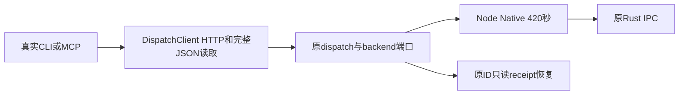

# T1250 CLI传输预算只读追加提案

结论：现有精确实施写集不包含`mcp-server/src/dispatch.ts`，此处需要SPEC精确追加与独立评审后实施。未改产品、未开HTTP/PG/App/模型；未跑300秒实验，以下是实际安装源码证据和可实施提案，不签公共链通过。

`mcp-server/src/cli.ts:10/:267/:281`和`src/index.ts`均装配同一`DispatchClient`。`dispatch.ts:154`登录和`:221`业务POST使用默认global fetch，无signal、局部dispatcher或全程body预算；`unwrap()`继续读取JSON。`--timeout`仅`cli.ts:243`的tasks wait观察，不控制HTTP。真实安装Node25.9.0/内置Undici7.24.4的`internal/deps/undici/undici`源码9165/9166默认bodyTimeout/headersTimeout均300000；13616实际fetch委托dispatcher且未覆盖这两个选项。AbortSignal控制取消，不提高300000这个内层上限。

真实已经存在的公共慢链是`frontend/src/server/workbench-file-recovery.test.ts:313`→原`startLoopbackCliFixture.run`→真实`runCliCommand`→HTTP→`workbench.files.reconcile`→原backend readonly readReceipt→`workbench-native-client.ts:103 send`。单Native RPC已经420000，合法结果可能在第300秒后返回，故CLI短门反杀。原journal fixture还保同幂等键读回、两个predispatch原CAS/冲突与总8请求断言。native-host和browser-host现有真实用例大部分直接host/service，不是CLI；不能声称它们已经覆盖HTTP预算。

## 最小可实施方向（待独评）

优先在原`dispatch.ts`内建立**每client私有**Undici dispatcher/有限完整HTTP观察，明确直接依赖，不用`setGlobalDispatcher`、修改global fetch、运行时monkeypatch、从Node内部源码导出类或偷取转依赖。现package没有直接undici；应给`mcp-server/package.json`与`pnpm-lock.yaml`追加锁定兼容Node25的直接依赖，并让原`build-runtime.mjs`正常bundle；必须actual packaged CLI smoke证明打包闭包。现有`fetchImpl`仅保测试依赖注入，生产默认使用私有dispatcher；其`headersTimeout`和`bodyTimeout`不短于声明完整HTTP槽，连接建立也须正预算>=120000。

每dispatch在第一次登录/请求前冻结一次monotonic观察截止，覆盖初次登录+POST+原401明确鉴权拒绝后重登录+原重试POST+完整JSON读取+有限dispatcher清理。登录/响应头/JSON读取均沿同signal与剩余时间，data/partial body不续期。没有凭据的installed/loopback模式不读取或复制用户登录凭据。任何网络timeout/abort/EOF/解析丢回执都不自动重发业务POST；原requestId/idempotency key保留，同原公开task/readReceipt读取后对账，不把本地错误伪投影成成功或重新生成。原401仅原既有明确鉴权拒绝分支可以重登录一次，不把transport unknown套入401重试。取消HTTP观察不等于原任务物理停止；不得延持久task deadline、command_run原过程timeoutMs、admission TTL或lease。

私有生命周期须可证明close/销毁实际结束：若新增`DispatchClient.dispose()`，需明确`cli.ts`单命令finally和`index.ts`stdio进程终止归属；不是关闭全局其他调用的Agent。最小替代是每dispatch自有Agent并在完整body读取后的finally有限close/destroy，无需改stdio生命周期，但并发dispatch不能相互销毁。断开的响应不能因close await无限挂住父流程。

## 预算必须按真实调用链派生

不能统一写420秒掩盖串行。Native单RPC420000＋HTTP传输/结算余量；readonly reconcile还含真实原DB前后读取，使用其实际有限消费者槽。Browser单RPC默认425000；原可信`timeout_ms`更长则单RPC=120000+max(125000,原正等待)+120000+60000。普通host一次操作至少profile lookup＋动作两个RPC，close最多lookup＋close＋四次stop_proof=6RPC及原600ms间隔；busy-open路径额外原recoverStoppedProfile，其真实公式1695000包含前后DB读取与两次profile lookup/cleanup，不能误当一个425000。最坏busy-open中初次lookup、catch lookup、reacquire lookup及open还有4×425000，光这些执行加recovery已3395000，尚需其余真实admission/lease/后验/HTTP槽。Native artifact/render组合也不是单RPC。不存在全体op统一的可信有限上限证据时，先精确限定已授权workbench公开op的私有预算映射；不从任意模型输入/TTL或CLI `--timeout`创造授权。预算只扩观察，不扩业务执行。

完整dispatch含凭据时最多原login+post+login+post四个HTTP步骤；外层须覆盖四个完整槽和清理；无凭据原fixture只有一个POST。私有预算无值/非安全整数/0/不足或overflow执行前拒绝，不能NaN timer绕门。continuous任务仍走原tasks wait读取循环，不据其无截止把单次HTTP无限化。

## 建议精确追加写集及验收

产品最小`mcp-server/src/dispatch.ts`、`mcp-server/package.json`、`pnpm-lock.yaml`；若选择client级Agent生命周期，再明确追加`mcp-server/src/cli.ts`与`mcp-server/src/index.ts`；可仅原dispatch内新私有helper，新增产品文件需先独评。原`scripts/build-runtime.mjs`通常不需改，列为必须真实build/packaged smoke消费者。`tools/timeout-policy/check.mjs`列现有批准扫描闭包补该HTTP消费者。测试：原`mcp-server/tests/dispatch.test.ts`、`mcp-server/tests/cli.test.ts`、原`frontend/src/server/workbench-file-recovery.test.ts`；公共慢HTTP新增实际测试可放原dispatch测试文件，不另开任意端口后门。保原journal完整body/assert。

先记录真实默认300秒RED（>300秒才返回headers的隔离loopback，上游真实事件才响应，HTTP1请求、无官方凭据），再新transport真实>300秒GREEN与完整body读取；需要真实时间，fake clock/mock fetch只补取消/参数测试，不能代签五分钟。原HTTP response partial chunk不续绝对deadline；connect前取消request0，已发后取消原unknown与原request/key不变、业务POST计数1；原same-key/readReceipt公共链真实Rust新binary对账且写动作计数不增。保原鉴权、Cookie、group/account/fence、401四步及无凭据路径。父测试/工具预算覆盖RED+GREEN全部串行和清理，不能180秒case先杀300秒正观察。禁止访问外网/用户连接文件，数据/媒体/端口/PID均自有，HOME/CODEX_HOME保原值。

实际安装源码与14个源SHA见`cli-transport-readonly-source-binding.json`。公开API依据：[Undici Client文档](https://github.com/nodejs/undici/blob/main/docs/docs/api/Client.md)描述独立headers/body/连接timeout；具体当前值以本轮Node源码证据为准。新Rust编译11PASS1ignored仅证明本轮main锁私有协议，不替代此CLI测试。
