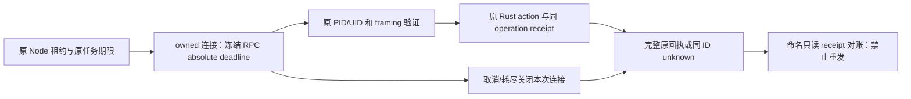

# T-1250 三个 Rust IPC 模块只读核查

仅提供 CONTRACT 输入，不是正式 SPEC PASS、实现验收或运行许可。绑定 SPEC `0c9468d57923af45971f54b3e3500ff82936e74aded1af9363ad37cfc477bcc4`；16 个真实源码/锁文件及原 cfg 用例逐条 SHA 见 `native-readonly-source-binding.json`。本轮只读源码、检查 Rust 版本；没有 cargo build/test、App、浏览器、模型或 PG。当前实际工具链为 Rust 1.98.0。模型身份诚实保留 unknown/inherited。

大白话：把“每次等十秒”改成“每次等两分钟”仍可能被持续发送的一点点数据无限续上。一次请求必须只认最初的截止时间。取消连接可以停止等待，却不能声称已经派发的文件写入或命令被撤销。

## 真实消费者及最小建议

|模块与真实位置|当场源码事实|合同/实现必须守的边界|
|---|---|---|
|`ipc.rs:303–331` `serve_one`|先取消非阻塞模式，read/write 各 10 秒；`read_until` 可能多次 read，`to_writer`/`write_all` 可能多次 write；没有整帧 `Instant` 期限。`MAX_REQUEST=1_400_000`、strict schema、kernel PID/UID 已存在。|受控读帧和写帧正槽至少 120 秒。冻结一次完整私有 IO 观察期限，循环仅使用其剩余值；partial bytes 不刷新。读取不完整/已到期不得进入 `execute`。不新增公开 deadline 字段，不改 request/action/owner/permission。|
|`ipc.rs:392–408,438–444` listener/Drop|单 listener 线程串行执行 `serve_one`；bridge stop 只在 accept 循环读取，Drop stop 后 join。serve 的读写等待没有 stop 参数，当前慢连接可以拖住 join。|把已有 owned bridge stop 沿私有参数传到 framing 等待；取消检查不是新正执行超时。只关闭本连接/本 bridge，不杀 App/陌生进程。已经进入 `execute` 的文件操作不能按断线推断回滚；同 operation prepared/committed journal 是恢复依据。|
|`browser_ipc.rs:61–125`|读 10 秒、写 120 秒；framing 后直接 `runtime.block_on(host.dispatch)`。完整 read/write 无绝对期限；写响应前已有 4,000,000 字节上限。|保写正槽 120 秒并修读；写帧分块/末换行同原冻结期限。不能给每块重新 120 秒。必须把等待与浏览器动作终态分开，超时是 unknown，不是 stop proof。|
|`browser_ipc.rs:187–207,243–254`|16 个连接上限；busy 分支直接 `write_all`，早于 `serve_one` 的 socket 配置；Drop join 所有 worker，再 `host.shutdown()`。|busy/unauthorized/error 回执也是漏扫写 IO 消费者，需同一有界 writer，保 16 连接、所有响应限额。停止桥接必须唤醒 owned IO；不得把连接关闭等同浏览器物理停止或释放 profile。|
|`ipc_windows.rs:372–428`|`finish_io` 每次 Wait 10 秒；超时 CancelIoEx 后 Wait(INFINITE) 回收栈 OVERLAPPED/缓冲；每个 `read_chunk`、partial write 都重新计时。|原栈内存安全必须保：取消后不能只用一个有限 Wait 然后直接返回并释放仍在内核使用的 OVERLAPPED/缓冲。正 IO deadline 与完成回收是两种事实；回收未确认不能签 stopped。将冻结 deadline/stop 沿 read/write/finish 私有参数传递；按剩余值等待、检查 stop 后 CancelIoEx，再真实完成 drain。|
|`ipc_windows.rs:430–496,569–602`|accept 原 100ms stop 轮询；serve 每 8192 字节读块、写回执、成功后的 1 字节 trailing-close 等待各用新 10 秒。Drop 仅 stop+join。|保 accept 100ms 间隔，它不是正执行上限。read frame/write frame/trailing drain 不能各块续期。trailing drain 是资源收尾，不得在业务回执已完成后又按两分钟新正执行去等待客户端；应以独立已声明清理槽/同原剩余截止有界收口。|
|`ipc_windows.rs:334–337`|CreateNamedPipeW 的 default wait 参数也复用 IO_TIMEOUT_MS。|该参数不是完整 RPC 总期限，改常量不能代签 active IO/墙钟闭合；应在声明表单独说明其真实用途。保持私有 pipe、DACL/remote 拒绝和 exact PID。|

上述调整均可落在这三个已列 Rust 模块的私有函数/原 `#[cfg(test)]`，无需扩公开 schema、命令许可或生产 native 注册方式。本次未给 writer 窗口、未改任何 Rust 字节。

## 不应隐藏的取消及执行事实

1. Node native client `send` 当前只有活动 `socket.setTimeout(10_000)`，没有 signal/absolute timer；browser client 已接 signal、活动 timeout125秒，但仍缺总期限。Rust 不能凭空读取 Node 的 AbortSignal 或原任务期限：Node 必须守原 signal/deadline，Rust 只能使用私有冻结接收/IO期限，或原请求内已经存在的可信 admission 期限。禁止为方便给 public strict body 添加执行预算。
2. 浏览器 `BrowserHost::dispatch` 原 `Cleanup/StopProof` 在普通 expires 拒绝前走严格 bound-owner 原路径（`browser.rs:894–943`）；不得用 transport 到期门先反杀它们，也不能把原30秒 recovery admission改长。只读物理 profile 查询没有该 admission，应有有限读取槽。
3. `runtime.block_on(host.dispatch)` 是真实动作消费者，不等于 socket IO。不能仅 drop 这个 future 就声称 profile/lane stopped；原 pending cleanup/inflight/OS 进程与 fresh stop proof 仍决定释放。处理已经派发命令的原 frozen timeoutMs 与 watcher取消保持；不因 IPC120 秒改变 command 进程许可或输入。
4. 原 native file write 和 command_run dispatch 后，连接取消/断开/响应逾时仍保原 operation ID 的 unknown；读取原 file_receipt/command status 是恢复，不重发写或新建 command。正向测试必须保 original owner/CAS/journal/version 等断言。
5. Windows 的取消 drain 使用 INFINITE 是源码中真实存在的安全回收边界。本次 Mac 不可能证明其完成；若实现只能在现栈模型中保 drain，回执应明确“取消已发、完成回收待确认”，不能把 drain 无限等待算有界清理通过。若要迁移成堆对象/独立完成回收，仍在原模块内，但具体生命周期需先交独评，不能用超时后 free 的办法洗绿。

## 当前 Mac 能否不启动主 App 跑真实协议

可以使用现有测试二进制入口，实际可编译及成功仍待执行；本轮没有构建或运行证明。

- **文件/命令 Unix socket**：现有精简 `frontend/src-tauri/src/workbench/Cargo.toml` `[lib] path=mod.rs`，无 Tauri/build.rs；原 `ipc::tests` 直接创建 0700/0600 私有 Unix socket，真实 LOCAL_PEERPID/UID，随机临时 TaskFiles。可在专属 `--target-dir` 运行 `cargo test --manifest-path <owned source>/frontend/src-tauri/src/workbench/Cargo.toml --locked --offline --lib ipc::tests -- --test-threads=1`。这会运行文件/CAS/journal及系统 `/bin/echo`、`/bin/sleep` 的 owned sandbox 协议测试，不启动 App，不使用模型或用户库。13 个原测试中3个 ignore 不会自行执行；2个 probe 本身无 env会空返回，实际授权/拒绝证据在调用它们的两个真实 child 用例，而不是孤立 probe 的 PASS。
- **浏览器 Unix socket**：精简 Cargo 包虽然声明 `workbench-browser` feature，却没有 browser.rs 所需 nomi-browser/nomi-browser-engine/nomifun-browser-platform/url/tokio 依赖。不能给这个包加 `--features workbench-browser` 就宣称已经可运行。现主 `frontend/src-tauri/Cargo.toml` 已有 `[[test]] name=workbench/path=src/workbench/mod.rs` 和这些依赖；`--test workbench browser_ipc::tests` 是原真实入口，不会调用 `lib.rs::run()` 或 App main，但构建会经过主包 build.rs/Tauri 依赖。需要私有 source/target、明确 debug 无配置密钥/不拷auth及资源输入绑定；或另经独评建立 evidence-only 最小 harness 并直接编译原模块/锁定原依赖，不修改生产 Cargo。当前不能冒充精简包已有浏览器依赖。
- **浏览器普通7个 cfg 测试**：1个 ignore 是真实 Node/DB/CfT整链，不能自动解ignore；其余不启动真实Chrome：profile_location 使用 `/missing/cft`，测试私有socket/权限/物理目录/响应上限。`different_process_cannot_call_browser_socket` 才真正执行 unauthorized 子进程；单独 probe 无 env空返回。
- **Windows named pipe**：`ipc_windows.rs` 顶层 `cfg(windows)`，Mac完全不编译或执行该模块。原两例中1个真实 Windows 文件PID测试、1个 opt-in ignored command probe。Mac 的 `command_windows` fail-closed helper测试不代签 Windows pipe/CancelIoEx。跨target `cargo check` 即使可用也只是编译，实际 Windows runner需要另留协议回执。

构建和测试必须另有 owned工具审查；不能借此只读报告启动共享 target 或主 App。纯 Rust确证也不能代签 Node/backend 公共租约→transport→原 Rust journal→named readonly对账全链。

## 原 cfg 测试与需要补的实测族

精确清单/ignore/行号见 JSON。现 ipc13/browser7/Windows2是源码声明数，运行数为0。

在现有原模块 cfg 测试内补：

- 正读/正写真实大于30秒、小于120秒，仍返回同 operation 的合法内容/版本；不要只断言常量变120。
- 整帧 partial-byte trickle 到原绝对截止必须停；有 activity也不续；末换行、partial writes同原期限。可通过 cfg 内窄时钟/期限注入检验耗尽，但不能把短时钟单测代签>30秒真实链。
- 已停止/已到期的未完整帧不得 execute（write/command effect0）；complete frame dispatch 后真实丢回执再 named receipt 同ID恢复，原 journal/后续更高版本不覆盖。
- 真实 owned socket取消/Drop等待唤醒，foreign peer/UID/路径/owner/CAS/limit全部原断言保；文件动作进入同步OS IO后不声称撤销。
- Windows exact read/write/drain期限、立即 CancelIoEx、完成回收之后才释放栈buffer；没有实际Windows runner就明确未执行，不虚构可用性。

现 ignored Rust辅助fixture还有90秒/120秒/180秒外层（ipc.rs:822/861、browser_ipc.rs:436）；Node对应fixture还有ready90秒、child60秒kill、10秒观察、15秒finish（`workbench-native-host.test.ts:145–170`、`workbench-file-recovery.test.ts:285–300`、`workbench-browser-host.test.ts:372–395`）。启用真实慢公共链之前必须在本SPEC已列原测试文件/原cfg内按完整串行重新算有限外层，保更长值、retry0及真实cleanup；不能被它们提前杀掉后只用Rust单测签AC-NATIVE。

建议由后续受审工具分别封存 build/actual--list/每原用例EOF、>30秒公共链、取消/unknown/receipt及PID/清理回执；所有正请求/有限观察至少120秒，Rust libtest本身没有per-test timeout配置，外层需由独立工具覆盖完整实际串行、构建、fixture/hook及资源清理。原 ignored状态保持，到真实前置满足并显式运行该exactfixture时才记其实测。

## 结论

三个 Rust 文件的最小私有改法在当前24路径合同内可表达；**只替换10秒为120秒不够**。需把整帧absolute IO期限、owned stop唤醒、Windows完成回收与unknown对账说清楚，并把busy/error/trailing等真实写等待纳入声明。Mac存在不启动主App的真实测试入口，但当前Rust测试未运行，Windows仍未验。此报告不签正式SPEC/BUILD/全功能/安装包通过。
