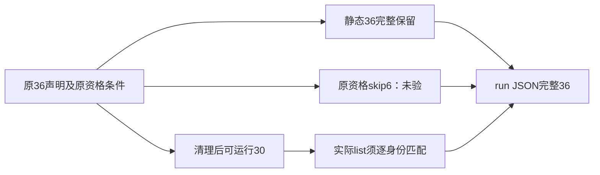

# V8 私有资格库存修复候选

只修执行工具，当前未准入正文。原ccdd/4341字节保留，Gate原parser不动。真实只读解析复现原36声明丢6资格skip；新11纯解析断言通过，不是产品测试。

未知、歧义或runner会重新注入的环境根资格均拒绝，不自行提供原生/App/模型前置。原6资格例不是PASS。所有声明预算和outer完整保，与旧4341不缩；render11无资格变化。

prepare两个组均真实退出0、实际源哈希0漂移；没有Vitest list/body、Workerbuild、服务、App或模型。精确工具/diff/原负路与11parser检查见V8_CANDIDATE_BINDING.json。等待root与独立peer审查，不自行执行。
