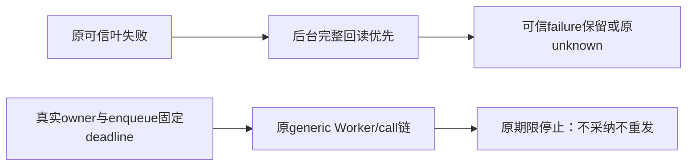

# T1251 叶与 stage1 私有候选独评

结论：PASS_TEST_CANDIDATE_ONLY，仅当前叶3758/de1a与stage1 0d5b可作为受控候选验证；没有执行测试或应用生产。

原catch先真实complete回读，可信GenerationFailure/cause后原普通fallback保留。新增叶端口测试分别核retry_wait/code/delay、waiting_user/failed、真实unknown同对象、原取消、已完整回读优先及同报告ACK恢复，不称HTTP整链。没有global classifier改动。

stage1保原21mode与计数/内容/unknown/partial安全断言；去互等ACK屏障保持真实Pi串行。所有ACK drop/crash/hooks只作用原submission taskId，当前draining逐轮持有且finally完整await。自有HTTP关闭与host.stop独立启动，拒绝均留AggregateError而不跳过socket关闭；此前a1/b9缺口关闭。

有限期限新增例使用真实public账户/组及AI业务owner，再经原persistent enqueue冻结180000ms与原modelInput；通过原generic model dispatcher/lease/identity/call ports，本例旨在真实生成到期与0投影/0新请求，不把owner.executionTaskId为空伪装正式业务成功。必须实际走到HTTP、同call、原deadline与关闭全断言后才能通过；没有SQL改deadline/模型回执。

unknown stage2、partial新断言、5/6HTTP及31/38tokens调整不在本次候选准入。原31/38数字仍原样，后续实际因果分开独评。

逐字源绑定见同名 JSON；运行工具、源窗口、测试EOF另验。审查模型 unknown/inherited。
