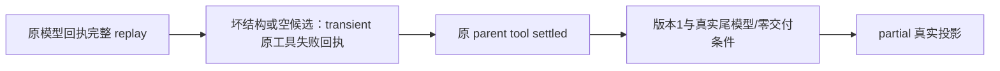

# T1251 真实失败回执文案窄复核

结论：可以把 FR-OUTCOME 的两族 `no_evidence` 文案纠正为真实 `transient`，仅规格澄清通过；没有执行模型、PG、测试或修改生产。

`execution-chat-generation.service.ts:219` 在原完整 replay 已消费全部模型回执后，对坏结构或无可交付 data 产生严格 `status:error`、`error.code:transient`、`retryable:true`、`sideEffect:none`，随后原 parent tool 结算原 JSON 结果；不是通用 no_evidence。`chat-receipt-projection.ts:91` 还要求版本1、最后父模型 stop、没有已交付 proposal/committed、原最后工具失败且 sideEffect:none，才能形成真实 partial。只改终态期待不能覆盖这些条件。

建议文案：可信后台 completionReceipt 与完整工具失败回执；badOutput/diagnosisEmpty 严格绑定实际 transient/retryable/sideEffect:none、完整零候选与真实 projection partial，其他族 no_evidence 原断言保留。

实际两族的完整工具、模型、账本、projection版本及零候选证据仍待 engine 提供；本结论没有批准任何新计数或任意终态集合。写集仍原三路径，生产 service/projection/schema 不改。

逐源 SHA 见同名 JSON；审查者模型标识 unknown/inherited。
