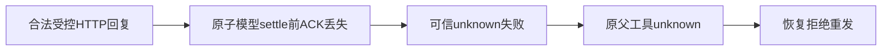

仅本精确候选通过静态审查（PASS_TEST_CANDIDATE_ONLY），没有运行或功能 PASS。

原 res.destroy 可被 Pi 未确认重试合法吸收，无法证明父工具未知。新刺激在同原任务的结算端口写入前丢失回执，沿真实 durable model → 可信失败叶 → durable tool → 恢复器闭合；不从库修改状态。原请求2与用量空值仍须真实 whole 观察，不能把这一预测记成实际红绿。

精确来源与保留断言见同名 JSON。
