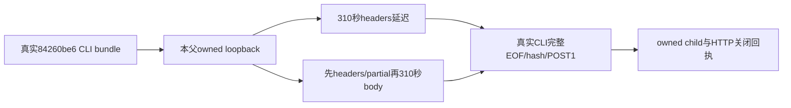

# 构建CLI的慢HTTP工具独评

精确 de048571 / e5d37451 静态通过，限定两个受控协议用例；尚未启动310秒链。本评审只读核实际8文件116PASS、标准types/scanner/build的原raw SHA及真实bundle，不把它们当慢链已绿。

工具直接执行真实bundle和fixed Node，没有替fetch/Response；明确本轮baseURL、合成token和显式group/account，原clientFor不读官方连接。输入、header、requestId、JSON完整meta/data/hash和每例POST1严格核。分阶段延迟事件与真实关闭日志必须实际留存。

完整外层22,560,000毫秒含两child8.4M、两helper2.16M、监听/close各120k、入口prepare/after/margin；不缩原8.28M dispatch观察，不重发。取消禁止开第二例，非零、源漂移或关闭不明都失败。

收据不是公共业务、官方模型、Rust或App验收，也不是最终物理安装包已跑。原两301秒RED保留。此评审未运行CLI/HTTP。
