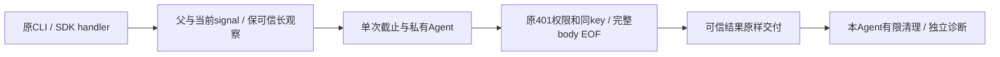

# T1252 实现候选独立审查

当前 cf927b8d 候选没有剩余阻断。这里仅审产品与测试候选的实际字节；不授权运行，也不把协议原300秒红或私有类型检查当作新实现通过。

13个来源及候选逐SHA核对一致，6产品路径没有扩展。原请求作用域、Cookie、token headers、401至多一次重登录、确认与幂等守卫保持；Undici仅注册mcp-server直接固定7.27.2，不改global dispatcher或fetch。

先前具体候选缺口已经关闭：默认正序列保60秒衔接余量；剩余不足完整HTTP槽时不发请求、不缩内层；网络前取消有明确before_request/未派发；SDK percall signal不遮蔽constructor较长观察或父取消。新增真实Client/InMemoryTransport与server handler组合用例保原组账号头、结果编号及POST一次，假钟超过8,100秒后仍等待9,000秒配置；它只验证装配与绝对timer，不代真实网络慢链。

业务使用原Response.json一次完整EOF，原409 spy与全部旧断言保留；auth合法raw/empty仅text EOF，不新增JSON质量门。完整非2xx SyntaxError保实际HTTP status、不给伪receipt；真正stream/取消失败保持命名本地未知。可信成功/错误回执不会被close/destroy或日志异常覆盖。

每dispatch私有Agent、取消隔离、有限清理、不泛化重试与不续后台任务符合合同。所有原测试assert表达式按顺序仍在；具体库存见JSON。两300秒默认传输RED属于原实现事实，新Agent GREEN、新包CLI、原Rust8HTTP与真实公共PNG/PDF长链、标准types和完整Gate仍待执行。模型标识未知，不自报型号。
